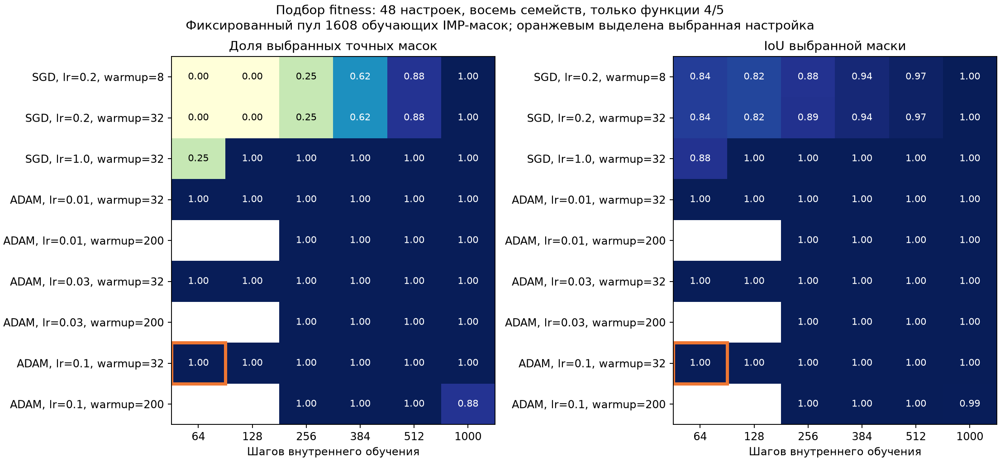

# Перенос разреженных структур на новые функции: итоговый отчёт за 20 октября 2026

**По качеству эксперимент успешен: наш W/G-декодер с эволюционным поиском z
восстанавливает точную маску в 90,3% заданий против 19,4% у IMP, а после
обучения сети с найденной маской получает меньшую ошибку, чем IMP и обычная
MLP без маски, обученная непосредственно на новой задаче.** Средняя избыточная
BCE составляет 0,000775 у evolution, 0,001504 у IMP и 0,002757 у плотной MLP.
Это снижение ошибки примерно в 1,9 и 3,6 раза соответственно.

Успех относится к **переносу известных структур на новые функции**:
правильная маска уже встречалась как решающая структура обучающих задач,
но сама новая функция, её параметры и наблюдения отличаются. У нашего
метода есть предварительное обучение банка и декодера; равенство полных
вычислительных затрат с обучением IMP или MLP с нуля здесь не проверялось.
Доли точных масок относятся к разным единицам: 65/72 выбранных переносимых
масок у evolution и 28/144 отдельных сетей у IMP.

Лучший средний результат среди вариантов с декодером даёт случайный поиск z:
excess BCE 0,000219 и 86,1% точных масок. Это также использует наш обученный
декодер, а не случайные маски из всех возможных структур. Прямой выбор
из обучающего IMP-банка достигает правильной маски всех 24 семейств.
Gumbel остаётся слабее этих вариантов. Поэтому полезность обученного
пространства масок подтверждается, но преимущество специального поиска z
над случайным поиском пока не установлено.

## 1. Датасет: что именно требуется выучить

### 1.1. Вход, функция и структурная маска

Каждый объект — вектор из 48 чисел. Его координаты независимо сэмплируются
из стандартного нормального распределения: обычно они близки к нулю,
но могут принимать и положительные, и отрицательные значения.

$$
x=(x_0,\ldots,x_{47})^{\mathsf T}\sim\mathcal N(0,I_{48}).
$$

Ниже используется нумерация с нуля, как в исходниках и хитмапах. Из 48
координат первые 32 определяют ответ, а последние 16 являются независимыми
шумовыми признаками. Шумовые признаки имеют такое же распределение,
как остальные; это полноценные входные данные, а не нули или копии
информативных координат. Модель должна научиться их не использовать.

Скрытая структура задаётся бинарной матрицей размера 48×8. Строка отвечает
входной координате, столбец — скрытому нейрону. Единица разрешает связь
между ними, ноль её удаляет. Такая матрица называется маской.

$$
M_s\in\{0,1\}^{48\times8},\qquad
(M_s)_{ih}=1\ \Longleftrightarrow\ x_i\text{ поступает в нейрон }h.
$$

Индекс s обозначает **семейство**: набор разных функций с одной и той же
правильной маской. Индекс j ниже обозначает конкретную функцию семейства.
Нужно разделять три понятия: семейство задаёт структуру, функция задаёт
численные параметры учителя, а выборка содержит наблюдения этой функции.
Новые наблюдения одной функции и новая функция с той же маской — разные
виды обобщения; в этом отчёте проверяется второй.

### 1.2. Общая и переменная часть маски

У каждого из восьми скрытых нейронов есть два закреплённых входа,
одинаковых во всех семействах. Дополнительно ему назначаются два входа
из множества 16–31. Эти 16 переменных входов разбиваются на восемь
непересекающихся пар: каждый используется ровно один раз.

$$
\begin{aligned}
h&\in\{0,\ldots,7\},\\
C_h&=\{2h,2h+1\},\\
V_{s,h}&\subset\{16,\ldots,31\},\qquad |V_{s,h}|=2,\\
V_{s,h}\cap V_{s,k}&=\varnothing\quad(h\ne k),\qquad
\bigcup_{h=0}^{7}V_{s,h}=\{16,\ldots,31\},\\
(M_s)_{ih}&=\mathbf1\{i\in C_h\cup V_{s,h}\}.
\end{aligned}
$$

Следовательно, каждый нейрон получает четыре входа, а вся маска содержит
32 связи из 384 возможных. Из них 16 общие для всех семейств; остальные
16 задают различающуюся группировку переменных признаков. Например,
в семействе 0 нейрон 0 использует координаты {0,1,18,30}, а в семействе
22 тот же нейрон — {0,1,22,31}.

| Скрытый нейрон | Общие входы | Переменные входы семейства 0 | Переменные входы семейства 22 |
| --- | --- | --- | --- |
| 0 | 0, 1 | 18, 30 | 22, 31 |
| 1 | 2, 3 | 16, 31 | 17, 26 |
| 2 | 4, 5 | 24, 26 | 16, 20 |
| 3 | 6, 7 | 17, 22 | 19, 23 |
| 4 | 8, 9 | 23, 25 | 21, 28 |
| 5 | 10, 11 | 19, 20 | 18, 24 |
| 6 | 12, 13 | 21, 28 | 25, 27 |
| 7 | 14, 15 | 27, 29 | 29, 30 |

Генератор дополнительно ограничивает совпадения переменных назначений:
попарное пересечение правильных масок разных семейств составляет от 16
до 20 связей из 32. Полная четвёрка входов одного нейрона между семействами
не повторяется. Поэтому простое восстановление общего ядра ещё не решает
задачу: требуется определить и переменную группировку.

$$
\|M_s\|_0=32,\qquad
16\le |\operatorname{supp}(M_s)\cap\operatorname{supp}(M_t)|\le20
\quad(s\ne t).
$$

### 1.3. Как маска превращается в функцию-учителя

Функция-учитель — небольшая нейросеть с восемью ReLU-нейронами и одним
выходом sigmoid. ReLU обнуляет отрицательный аргумент и сохраняет
положительный. Sigmoid переводит произвольное число в интервал от нуля
до единицы.

$$
\operatorname{ReLU}(u)=\max(0,u),\qquad
\sigma(u)=\frac{1}{1+e^{-u}}.
$$

В каждой разрешённой связи независимо выбирается положительный вес.
Вектор весов каждого нейрона нормируется до единичной длины. Пороги
нейронов и знаки выходных коэффициентов тоже выбираются заново для
каждой функции. Точный генератор имеет вид:

$$
\begin{aligned}
\alpha_{sj,ih}&\sim\mathcal U(0.5,1.5),\\
w_{sj,ih}&=\frac{(M_s)_{ih}\alpha_{sj,ih}}
{\sqrt{\sum_{r=0}^{47}(M_s)_{rh}\alpha_{sj,rh}^{,2}}},\\
\tau_{sj,h}&\sim\mathcal U(-0.5,0.5),\\
a_{sj,h}&=\frac{\varepsilon_{sj,h}r_{sj,h}}{\sqrt8},\qquad
r_{sj,h}\sim\mathcal U(0.8,1.2),\quad
\Pr(\varepsilon_{sj,h}=1)=\Pr(\varepsilon_{sj,h}=-1)=\tfrac12,\\
\eta_{sj}(x)&=c_{sj}+\sum_{h=0}^{7}a_{sj,h}
\operatorname{ReLU}\!\left(\sum_{i=0}^{47}w_{sj,ih}x_i-\tau_{sj,h}\right),\\
y_{sj}(x)&=\sigma\!\left(\eta_{sj}(x)\right).
\end{aligned}
$$

Сдвиг c центрирует среднее значение логита, то есть аргумента sigmoid.
Из нормировки весов следует, что сумма входов нейрона до вычитания порога
имеет стандартное нормальное распределение. Поэтому центрирование можно
вычислить аналитически. Здесь φ и Φ — плотность и функция распределения
стандартного нормального закона.

$$
c_{sj}=-\sum_{h=0}^{7}a_{sj,h}
\left[\varphi(\tau_{sj,h})-\tau_{sj,h}\bigl(1-\Phi(\tau_{sj,h})\bigr)\right].
$$

Это делает средний логит равным нулю; точное равенство средней вероятности
одной второй из этого не следует. Внутри семейства маска остаётся общей,
но веса, пороги и выходные коэффициенты различаются. Следовательно,
одна и та же структура действительно решает разные функции.

### 1.4. Какие данные получает алгоритм

Метка объекта — точная мягкая вероятность учителя. Бинарный ответ 0/1
из неё не сэмплируется. Для каждой функции независимо создаются три
набора: support для обновления весов, query для выбора решения и test
для измерения итоговой ошибки на новых объектах.

| Набор | Объектов на функцию | Назначение |
| --- | ---: | --- |
| Support | 2048 | Градиентные обновления параметров MLP |
| Query | 2048 | Выбор z, маски и checkpoint в соответствующем этапе |
| Test | 8192 | Оценка зафиксированного результата |

Первоначально определены 40 структур: 24 обучающие, восемь валидационных
и восемь финальных. Но текущий эксперимент использует **все 24 обучающие
структуры с новыми функциями**, а не новые семейства 24–31. Это принципиально
для интерпретации результата.

| Функции внутри каждого из 24 семейств | Роль |
| --- | --- |
| 0–3 | Исходный банк и обучение W/G VAE: 96 функций |
| 4–5 | Новые адаптационные функции для поиска одной маски семейства |
| 6–7 | Другие новые функции для оценки переноса найденной маски |
| 8–11 | Резерв для будущей отдельной итоговой проверки; пока не использовался |

Всего текущий этап добавляет 96 новых функций: 48 адаптационных и 48
оценочных. Поиск получает только support/query функций 4/5. До доступа
к функциям 6/7 выбранная маска фиксируется с контрольной суммой. На каждой
функции 6/7 её веса учатся с нуля; query этой функции выбирает checkpoint,
а test измеряет качество. Функции 6/7 относятся к валидационному
эксперименту; слово test здесь также обозначает отдельные наблюдения,
но не окончательно отложенные функции 8–11.

## 2. Общая модель и критерии качества

При любой заданной маске обучаемая MLP вычисляет ту же композицию
линейных операций, ReLU и sigmoid, что и учитель. Символ θ объединяет
все численные параметры; маска M определяет только доступные связи
первого слоя.

$$
\begin{aligned}
\widehat y_{\theta,M}(x)&=\sigma\!\left(c+\sum_{h=0}^{7}a_h
\operatorname{ReLU}\!\left(b_h+\sum_{i=0}^{47}M_{ih}W_{ih}x_i\right)\right),\\
\theta&=(W,b,a,c).
\end{aligned}
$$

При полной матрице единиц это обычная MLP 48→8→1: 384 входных веса,
8 скрытых bias, 8 выходных весов и один выходной bias — всего 401 параметр.
При маске из 32 связей остаётся 49 эффективных параметров. Bias и выходной
слой обучаются во всех методах и не обрезаются.


На этой ранее подготовленной схеме входы пронумерованы с 1: блоки 1–16,
17–32 и 33–48 соответствуют блокам 0–15, 16–31 и 32–47 в формулах и хитмапах.
Каждый блок означает 16 независимых входов, подключённых ко всем восьми
нейронам, а не один усреднённый признак.

Обучение минимизирует бинарную кросс-энтропию с мягкими метками и L2-штраф.
Логарифм берётся натуральный. Обозначение M⊙W означает поэлементное
умножение: запрещённые маской веса не влияют на предсказание.

$$
\begin{aligned}
\ell(y,p)&=-y\log p-(1-y)\log(1-p),\\
L_D(\theta,M)&=\frac1{|D|}\sum_{(x,y)\in D}
\ell\!\left(y,\widehat y_{\theta,M}(x)\right),\\
J_D(\theta,M)&=L_D(\theta,M)+\frac\lambda2
\left(\|M\odot W\|_F^2+\|b\|_2^2+\|a\|_2^2+c^2\right),\qquad\lambda=10^{-5}.
\end{aligned}
$$

Поскольку метки мягкие, даже идеальный учитель имеет ненулевую BCE.
Поэтому основной показатель — избыточная ошибка, excess BCE: из BCE
модели вычитается BCE точного ответа учителя с самим собой. Значение,
близкое к нулю, означает точное воспроизведение функции.

$$
\begin{aligned}
H_D&=\frac1{|D|}\sum_{(x,y)\in D}\ell(y,y),\\
\Delta_D(\theta,M)&=L_D(\theta,M)-H_D\\
&=\frac1{|D|}\sum_{(x,y)\in D}
D_{\mathrm{KL}}\!\left(\operatorname{Bern}(y)\,\|\,
\operatorname{Bern}(\widehat y_{\theta,M}(x))\right)\ge0.
\end{aligned}
$$

Структуру оцениваем по IoU: числу правильно совпавших связей, делённому
на число связей в объединении. Порядок скрытых нейронов сам по себе
не меняет функцию сети. Поэтому перед структурным сравнением разрешается
переставить восемь столбцов маски; входные координаты переставлять нельзя.
Перестановка находится Hungarian matching и используется только
в диагностике, а не для выбора кандидата на новой функции.

$$
\operatorname{IoU}(M,M_s)=\max_{\pi\in S_8}
\frac{|\operatorname{supp}(MP_\pi)\cap\operatorname{supp}(M_s)|}
{|\operatorname{supp}(MP_\pi)\cup\operatorname{supp}(M_s)|}.
$$

Точная маска имеет IoU=1. Отдельно считаем IoU переменной части
по строкам 16–31, используя ту же перестановку, что выбрана по полной
маске. Это не позволяет высокому совпадению общего ядра скрыть ошибки
в группировке переменных входов.

## 3. Методы

### 3.1. Обычная MLP без маски

Все 384 связи первого слоя разрешены. Сеть обучается непосредственно
на support каждой новой оценочной функции. Это одна MLP в каждом повторе,
без объединения прогнозов нескольких сетей. Три инициализации служат
отдельными повторами. Предобученный банк и декодер этому методу не нужны.

### 3.2. Аналитическая маска — oracle-контроль

Из генератора берётся правильная структура семейства. Численные веса
учителя модели не выдаются: 49 эффективных параметров учатся с той же
инициализации, на тех же данных и с тем же бюджетом, что у остальных
фиксированных масок. Этот контроль показывает, можно ли решить задачу
при известной структуре. Его результат — excess BCE около 2,6e-8.
Oracle участвует только в диагностике и не включается искусственно
в набор кандидатов поиска.

### 3.3. IMP: итеративное обрезание весов

IMP начинает с обычной плотной MLP. После обучения связи первого слоя
сортируются по модулю обученного веса, и 30% оставшихся связей с наименьшими
модулями удаляются. Затем все параметры возвращаются к исходной
инициализации, оптимизатор создаётся заново и сеть с новой фиксированной
маской обучается снова. Удалённые связи не восстанавливаются.

$$
384\to269\to189\to133\to94\to66\to47\to33\to32.
$$

Каждый раунд получает 2000 шагов и собственный checkpoint по query.
Ни правильная маска, ни требование «четыре связи на нейрон» pruning
не подсказываются. В текущем сравнении IMP выполняется **на самой новой
оценочной функции**, отдельно для каждой инициализации; это сильнее,
чем перенос уже найденной IMP-маски с адаптационной функции.

### 3.4. Предобученный генератор масок W/G

Сначала создаётся банк результатов IMP на исходных функциях 0–3.
В полном банке 13 312 карт; в обучение W/G VAE входят только 9216 train-карт
96 исходных функций 24 семейств. Карта содержит веса первого слоя W,
градиенты support BCE G и фактическую IMP-маску. Это наблюдаемые результаты
обычного обучения; аналитические маски не используются как targets VAE.
AGOP в основном варианте W/G не используется.

У каждой исходной функции собственный NF-энкодер; декодер общий.
NF-слои обрабатывают скрытые столбцы одинаковыми операциями и учитывают
средний контекст других столбцов. Усреднение столбцов делает параметры
posterior инвариантными к их перестановке. При reconstruction дополнительно
сопоставляются столбцы предсказания и IMP-target. Поэтому архитектура
учитывает произвольный порядок скрытых нейронов, но не устраняет
сложность выбора правильного z.

Энкодер выдаёт среднее и диагональную дисперсию нормального распределения
16-мерного латентного вектора. Во время обучения декодер получает выборку
из этого распределения; prior — стандартное нормальное распределение.
Общий декодер — MLP 16→128→128→384 с GELU между слоями.
Номер целевого семейства декодеру не передаётся.

$$
\begin{aligned}
q_{\phi_j}(z\mid W,G)&=\mathcal N\!\left(\mu_j(W,G),
\operatorname{diag}(s_j^2(W,G))\right),\qquad z\in\mathbb R^{16},\\
p(z)&=\mathcal N(0,I_{16}),\\
S_\psi(z)&\in\mathbb R^{48\times8},\qquad
M_\psi(z)=\operatorname{Top32}(S_\psi(z)).
\end{aligned}
$$

Top32 оставляет единицы в 32 координатах с наибольшими оценками и нули
в остальных. Он задаёт только общее число связей: четыре связи в каждом
столбце, общие пары и отсутствие шумовых входов не навязываются.
Обучение VAE сочетает 0,8 weighted BCE, 0,2 hard-MSE и KL-штраф;
вес положительного класса 11, конечный коэффициент KL — 0,005.
Это используемый surrogate objective с сопоставлением столбцов.

Для новых функций отдельного обученного энкодера нет. **При переносе
используем замороженный декодер и выбираем z по данным функций 4/5.**
Таким образом, W/G — обозначение признаков предобучения, а не требование
сначала обучить IMP на каждой новой функции перед поиском z.

### 3.5. Fitness: как оценивается один z

Кандидат z задаёт бинарную маску. Для каждой из двух адаптационных функций
создаётся новая MLP с этой маской и парной инициализацией. Она обучается
на support ограниченное число шагов. Средняя BCE на query двух функций
становится fitness: меньше лучше. Конкретный вес учителя и его маска
в этот расчёт не входят.

$$
\begin{aligned}
\theta_{s,j}^{(T)}(M)&=\operatorname{InnerTrain}_T
\!\left(\theta_{s,j}^{(0)},M,D_{s,j}^{\mathrm{support}}\right),\\
F_s(z)&=\frac12\sum_{j\in\{4,5\}}
L_{D_{s,j}^{\mathrm{query}}}
\!\left(\theta_{s,j}^{(T)}(M_\psi(z)),M_\psi(z)\right).
\end{aligned}
$$

После подбора внутренний оптимизатор — стабилизированный Adam,
64 шага, lr=0,1. Первые 32 шага используется leaky ReLU со slope 0,1,
затем ReLU. Все query-оценки считаются с обычным ReLU. Для всех кандидатов
одной функции инициализация одинакова; порядок скрытых столбцов
канонизируется по самой бинарной маске, без эталона.

### 3.6. Эволюционный поиск z

Используются восемь независимых стартов из нормального prior. В каждом
из 40 шагов для каждого старта создаются пять гауссовских возмущений.
Маска каждого предложения оценивается через fitness; переход принимается
только при снижении query BCE. Радиус возмущения плавно уменьшается
с 0,5 до 0,15. В конце выбирается лучший из восьми результатов.

$$
z'_{r,k}=z_r+\rho_t\epsilon_{r,k},\qquad
\epsilon_{r,k}\sim\mathcal N(0,I_{16}),\quad k=1,\ldots,5.
$$

Градиент по z здесь не требуется: поиск работает непосредственно
с дискретными масками декодера. Вместе с восемью начальными оценками
это 8+40×8×5=1608 candidate-fit, или 3216 отдельных обучений MLP
с учётом двух адаптационных функций.

### 3.7. Gumbel и дифференцируемый поиск z

Жёсткий top-32 не имеет полезного обычного градиента по изменению
состава выбранных связей. Для направления шага используется Gumbel-шум
и непрерывная релаксация top-k. Straight-through конструкция возвращает
в прямом проходе бинарную маску, а в обратном использует производную
релаксированной маски. Градиент проходит через внутреннее обучение MLP.
Декодер при этом остаётся замороженным.

На каждом шаге для каждого старта берутся две стохастические маски,
их градиенты усредняются. Adam по z с lr=0,05 предлагает направление,
после чего проверяются три масштаба шага: 0,5, 1 и 2. Предложение
принимается только по улучшению настоящей fitness жёсткой маски.
Температура уменьшается с 2 до 0,5, амплитуда шума — с 0,5 до 0,1;
норма градиента ограничена 5. Стартов восемь, шагов 40.

$$
8+40\cdot8\cdot(2+3)=1608\text{ candidate-fit}.
$$

Из них 640 относятся к дифференцируемым стохастическим маскам,
968 — к жёстким начальным и проверяемым маскам. Поэтому равенство
candidate-fit не означает одинаковые затраты методов: вторые производные
делают Gumbel дороже обычного scoring.

### 3.8. Контрольные способы выбрать маску

**Случайный поиск z** оценивает 1608 латентных векторов из prior,
включая те же первые восемь, что используются поисковыми методами.
Выбирается кандидат с минимальной fitness. Это проверка, даёт ли
направленная оптимизация пользу относительно широкого независимого
обследования обученного пространства.

**Лучший из восьми начальных z** выбирается по fitness ещё до каких-либо
изменений латентных векторов. Он отделяет пользу оптимизации от пользы
самого выбора удачного старта. **Нулевой z** декодируется один раз
без подбора: это контроль того, что декодер выдаёт около центра prior.

**Выбор из обучающего IMP-банка** работает вообще без декодера. Он оценивает
той же fitness фиксированный пул из 1608 настоящих train-масок: по 67
на каждое из 24 семейств. Пул одинаков для всех новых задач, целевое
семейство ему не указывается. Точная аналитическая маска в него
искусственно не добавляется. Последующая диагностика показала, что
в этом пуле есть точная маска каждого из 24 семейств. Алгоритм находит
её по query BCE новых адаптационных функций, не по совпадению с эталоном.
Таким образом, контроль проверяет выбор уже имеющегося решения, а не
генерацию новой структуры и не оракульный доступ к правильному ответу.
Его 100% означают 24/24 семейства; запись 72/72 в сырых результатах
повторяет тот же контроль для трёх декодеров, хотя декодер здесь не
используется. При подборе гиперпараметров fitness эталон восьми семейств
использовался как валидационная метрика; остальные 16 семейств в подборе
не участвовали. Этот контроль отделяет качество критерия от доступности
структур в пространстве z.

**Частотная маска** — одна фиксированная структура из 32 наиболее частых
связей обучающих IMP-target. Новые функции не участвуют в её построении.
Она проверяет, достаточно ли усреднённого prior без адаптации.

### 3.9. Общее итоговое обучение и честное сравнение

После фиксации маски на каждой из функций 6/7 с нуля обучаются три
отдельные MLP: Adam lr=0,03, 2000 шагов, warmup 200 шагов leaky ReLU,
затем ReLU, выбор checkpoint по query каждые 100 шагов. Инициализация
одинакова у методов: положительные модули случайных входных весов
с масштабом 0,1, bias скрытых нейронов 0,1, нулевые readout и выходной bias.
Дальнейшее обучение весов по знаку не ограничено.

Все методы получают одинаковые данные и парные seeds. Суммарные затраты
различаются: у генератора есть предобучение, у IMP — несколько раундов,
у поиска — много коротких обучений. Мы сравниваем качество в этом
протоколе, а не доказываем одинаковую стоимость методов.

## 4. Подбор параметров и итоговые результаты

Восемь семейств 0, 3, 6, 9, 12, 15, 18, 21 использованы для подбора
внутреннего обучения, только на функциях 4/5. Проверены 48 настроек:
SGD lr=0,2/1,0, Adam lr=0,01/0,03/0,1, допустимые сочетания warmup
8/32/200 и 64/128/256/384/512/1000 шагов. Для экономии разные бюджеты
оценивались в промежуточных точках одной длинной траектории.

Правило выбора: сначала максимум доли точных масок из фиксированного
банка, затем IoU, затем минимум шагов; оставшееся равенство разрешается
по ошибке точных масок. Аналитический эталон используется здесь как
валидационная метрика гиперпараметров; на новых функциях сами кандидаты
по-прежнему выбираются только по query BCE.

Выбраны Adam lr=0,1, 64 шага, warmup=32: точная маска в 8/8 семейств.
Прежние 64 SGD давали 0/8; продление прежнего SGD до 1000 шагов тоже
даёт 8/8. Adam lr=0,01 и 0,03 также дают 8/8 за 64 шага; вариант lr=0,1
выиграл оставшийся критерий точности внутреннего обучения. Это лучшая
настройка проверенной сетки по указанному правилу, а не доказательство
глобально оптимальных параметров.



Полный повтор включает 24 семейства × три декодера с seed 4213/4214/4215,
по две оценочные функции и три повтора MLP. Десять методов дают 4320
строк метрик. Все 72 задания завершены без ошибок. Старые и новые
наблюдения, декодеры, начальные z, случайные пулы и seeds итоговых MLP
совпадают; меняются внутренний оптимизатор, lr и warmup fitness.

| Метод | Excess BCE до подбора | Excess BCE после | IoU после | Точные маски после |
| --- | ---: | ---: | ---: | ---: |
| W/G Gumbel | 0,007778 | 0,005857 | 0,6587 | 16/72 = 22,22% |
| W/G evolution | 0,006531 | 0,000775 | 0,9471 | 65/72 = 90,28% |
| Случайные 1608 z | 0,004653 | 0,000219 | 0,9916 | 62/72 = 86,11% |
| Выбор из IMP-банка | 0,002820 | 2,6e-8 | 1,0000 | 24/24 семейства = 100% |
| Лучшая из восьми начальных масок | 0,010159 | 0,009076 | 0,4991 | 0% |
| Нулевой z | 0,012673 | 0,012673 | 0,3965 | 0% |
| Частотная маска | 0,018177 | 0,018177 | 0,3263 | 0% |
| Одна MLP без маски | 0,002757 | 0,002757 | — | — |
| IMP на новой функции | 0,001504 | 0,001504 | 0,8399 | 28/144 = 19,44% |
| Аналитическая маска | 2,6e-8 | 2,6e-8 | 1,0000 | 100% |


Средние сначала считаются внутри семейства по функциям, повторам MLP
и seed декодера, затем по 24 семействам. Погрешности на графиках — SEM
по семействам. Контроли bank/dense/oracle/IMP повторяются при разных seed
декодера, но не считаются новыми независимыми измерениями. Структурное
сравнение IoU с полной маской dense само по себе малоинформативно:
этот метод не пытается выбрать ровно 32 связи.

На 16 семействах вне подбора эффект сохранился: bank точен в 16/16,
evolution имеет excess BCE 0,000971, random — 0,000258. У dense на этом
подмножестве 0,002794, у IMP — 0,001637. Следовательно, улучшение fitness
не ограничилось восемью калибровочными структурами.

Evolution улучшился по ошибке в 8,43 раза, random — в 21,27 раза.
Evolution чаще даёт точный ответ, но его семь промахов грубее:
средний IoU этих промахов около 0,456. У десяти неточных случайных
результатов средний IoU около 0,9394. Поэтому random имеет меньшую
среднюю BCE, несмотря на меньшую долю точных масок.

## 5. Хитмапы: что именно выдаёт декодер и что находят методы

Для иллюстраций заранее зафиксированы семейства 0 и 22, seed декодера
4213. Эти семейства уже использовались в предшествующих отчётах;
после получения текущих результатов удобные примеры не подбирались.
Все рисунки ниже построены по сохранённым весам и z, без нового обучения
и без повторного поиска.

У всех хитмап 48 строк и восемь столбцов. Строки 0–15 соответствуют
общим входам, 16–31 — переменным, 32–47 — шуму. Жёлтая и красная линии
отделяют эти блоки. Для сопоставимости с аналитической маской скрытые
столбцы каждой картинки оптимально переставлены только при визуализации;
это не изменяет предсказания и не влияет на поиск.

### 5.1. Декодер до и после поиска z

Верхняя строка показывает sigmoid от логитов декодера: непрерывные
оценки связей в диапазоне 0–1. Это визуализация уверенности оценок,
а не утверждение о калиброванных вероятностях. Нижняя строка показывает
бинарную маску после top-32, которая действительно используется MLP.
В первой колонке приведён аналитический эталон, во второй — z=0.
Один и тот же нулевой z даёт одну и ту же исходную маску независимо
от семейства. Разное расположение её столбцов между рисунками возможно
только из-за последующего визуального выравнивания к разным эталонам.

Для каждой пары «до/после» взят **один и тот же старт**: начальный z
того запуска, чей конечный результат выбран алгоритмом, и его конечный z.
Это корректное сравнение одной траектории. Оно отличается от контроля
«лучший из восьми начальных z», где начальный кандидат выбирается отдельно.
Выравнивание столбцов для отображения выполнено независимо для каждого
состояния; IoU всегда учитывает эквивалентность перестановок.


В семействе 0 evolution улучшает IoU выбранной траектории с 0,391 до 1,
полностью восстанавливая переменные связи. Gumbel для своего выбранного
старта улучшает IoU только с 0,333 до 0,362. Это наглядно разделяет
наличие нужной структуры у декодера и способность конкретного поиска
до неё добраться.


В семействе 22 оба выбранных старта имеют IoU около 0,829. Evolution
достигает точной маски, Gumbel — близкой структуры с IoU 0,939.
Таким образом, Gumbel способен улучшать маску, но в этих настройках
часто останавливается раньше точного решения.

### 5.2. Сравнение масок остальных методов

Следующие панели показывают аналитическую маску, полную структуру dense,
одну конкретную IMP-маску функции 6 из повтора 0 и средний IMP шести
отдельных сетей: две оценочные функции × три инициализации. В среднем
IMP цвет означает долю сетей, сохранивших данную связь после выравнивания.
Это только диагностическое изображение: средняя маска не используется
как отдельный предиктор или ансамбль.

Также показаны частотная маска, лучший из восьми исходных z, Gumbel,
evolution, random и прямой выбор из банка. Нулевой z уже показан выше.
Полностью синяя маска dense означает наличие всех связей, а не равенство
всех обученных весов или одинаковую важность входов.


В семействе 22 evolution и банк дают точную структуру. Random получает
IoU 0,939, а показанный отдельный IMP — около 0,684; средний IoU шести
IMP около 0,775. Эти частные примеры поясняют устройство решений,
но вывод о преимуществе делается по сводке всех 24 семейств.

## 6. Что удалось установить и что остаётся открытым

Первоначальная fitness с 64 SGD недообучала внутреннюю MLP: правильная
маска закрывала только 8,17% разрыва от константного прогноза 0,5 до
учителя. После подбора закрывается 99,90%, средний excess BCE правильной
маски внутри fitness составляет 3,66e-5. Лучшая точная маска банка теперь
занимает первое место во всех семействах; Spearman отрицательной fitness
с IoU вырос с 0,326 до 0,688.

Во всех 62 случайных пулах, где встречался точный ответ, он был выбран.
Всего в этих пулах 193 точных кандидата. Средний IoU выбранной маски
совпал с максимальным IoU пула: 0,9916. Ошибка отбора доступного правильного
ответа в этом контроле устранена. Для текущего переноса переобучение
банка или VAE не требуется, чтобы получить сильный результат.

У Gumbel сохраняется проблема внешнего поиска: принимается 4,35%
предложенных обновлений, random лучше по самой fitness в 55/72 случаях.
Градиенты конечны и ненулевые, но их нормы сильно колеблются. Следующий
разбор должен отделить влияние непрерывной релаксации, параметров внешнего
оптимизатора и покрытия пространства восемью стартами. Причина всех
оставшихся промахов этим экспериментом не установлена.

Установленный результат не доказывает перенос на ранее неизвестные
группировки, преимущество Gumbel, превосходство по полной стоимости
или итоговое качество на функциях 8–11. Он подтверждает, что при знакомых
структурах обученный генератор с подходящей fitness позволяет находить
маски, с которыми новые функции решаются лучше текущих IMP и dense
бейзлайнов в заданном протоколе.


Слева показана fitness на адаптационных функциях, справа — текущие
query-ошибки MLP при полном обучении на оценочных функциях. Итоговый
checkpoint выбирается по query, поэтому отдельные колебания текущей
кривой oracle не означают ухудшения выбранного результата. Слева
и справа разные функции, seeds и этапы обучения.

## 7. Технические детали, время и воспроизведение

В технической реализации Adam момент обновляется с beta1=0,9 и beta2=0,999.
Для конечных вторых производных используется знаменатель sqrt(v_hat+eps²)
с eps=1e-6. Это стабилизированный вариант знаменателя Adam; одинаковая
формула используется для обычной оценки и дифференцируемого поиска.
Итоговый Adam для обучения оценочных сетей сохранён прежним.
В 36 заданиях градиент вычислялся с восстановлением промежуточных
активаций; в других 36 коротких траекториях он хранился
целиком, что ускорило выполнение. Это изменение расхода памяти и вычислений,
без изменения математической схемы обновления или настроек обучения.
Обе версии исходников сохранены в соответствующих заданиях, их хеши
перечислены в `comparison.json`.

Подбор занял 173,6 секунды, повторный эксперимент — 317,9 секунды;
это времена диспетчеров без подготовки кода. Использованы все восемь GPU
по четыре процесса на карту, наблюдалась загрузка 93–100%. Пик
зарезервированной памяти PyTorch одного задания повтора — 1,379 GiB,
подбора — 1,469 GiB, без учёта CUDA-контекста и других процессов.
Все обучения выполнялись на CUDA. Новые unit-тесты не создавались
и не запускались; статическая проверка изменённых исходников пройдена.

Для повторения на новом каталоге с теми же данными и контролями:

```bash
python3 -u -m overlapping_groups.launch --phase evaluate \
  --bank tmp/overlapping_groups_20261020/banks/bank_v1 \
  --vae-runs tmp/overlapping_groups_20261020/runs/vae_v1 \
  --runs overlapping_groups/runs/known_mask_tuned_repeat \
  --config overlapping_groups/configs/transfer.json \
  --cache-from tmp/overlapping_groups_20261020/runs/known_mask_v1 \
  --workers-per-device 4 --gpu-memory-gib 8
```

Численные источники: [подбор](assets/2026-10-20/overlapping_groups/fitness_tuning_summary.json),
[зафиксированная настройка](assets/2026-10-20/overlapping_groups/fitness_tuning_seal.json),
[новая сводка](assets/2026-10-20/overlapping_groups/transfer_summary.json),
[парное сравнение](assets/2026-10-20/overlapping_groups/fitness_comparison.json),
[диагностика](assets/2026-10-20/overlapping_groups/selection_audit.json),
[все оценочные сети](assets/2026-10-20/overlapping_groups/results.csv).
[Предыдущий результат](../tmp/overlapping_groups_20261020/KNOWN_MASK_RESULTS_2026-10-20.md) сохранён отдельно.


Хитмапы до/после и сравнения масок воспроизводятся модулем `overlapping_groups.reporting.figures`;
численные значения примеров, номера выбранных стартов и контрольные суммы
сохранены в [report_figures.json](assets/2026-10-20/overlapping_groups/report_figures.json).

Определения семейств и конфигурация генератора сохранены в [dataset_definition.json](assets/2026-10-20/overlapping_groups/dataset_definition.json).

## Приложение A. Предыдущие результаты Pattern, Multimask и AGOP

Ниже сохранены результаты исследований 17–18 октября из прежней версии
этого отчёта: разделение энкодеров и декодеров, теория общих представлений,
начальный код Pattern, cVAE и AGOP. Они относятся к прежним постановкам
и дополняют текущий опыт со скрытыми группировками. Прежний раздел
«следующий эксперимент» заменён выполненной постановкой и результатами выше.

### Постановка и смысл метрик

Генератор учится по картам разреженных MLP предсказывать маску с фиксированным бюджетом 32 связей. Исходная архитектура использует отдельный энкодер для каждой обучающей задачи и общий декодер. При переносе декодер замораживается, а латентный код z выбирается по качеству обучения MLP на исходных задачах соответствующего эпизода. Итоговую оценку проводят на отложенных задачах после фиксации маски. Энкодер в этом поиске непосредственно не используется: его роль состоит в формировании пространства масок при обучении генератора.

В Multimask банк содержит 1536 учителей: 12 исходных задач по 128 MLP, с разбиением 96/16/16 на обучение, валидацию и тест внутри каждой задачи. Поэтому **bank-test измеряет восстановление структуры новых учителей уже известных задач**, а итоговый перенос — качество маски на новых задачах. Высокое значение первой метрики само по себе не гарантирует вторую.

IoU сравнивает сгенерированную маску с ближайшей аналитической структурой, а не с индивидуальной IMP-маской учителя. Для оценки функции используем test BCE и её превышение над аналитическим минимумом, excess BCE; меньшее значение лучше. В Multimask цели мягкие, поэтому эталонная BCE положительна: около 0,54858 для семьи A и 0,54540 для B. Абсолютные BCE разных синтетических постановок напрямую не сопоставляются.

### Один энкодер и несколько декодеров

Обратное разделение параметров заменяет 12 энкодеров и один декодер на один энкодер и 12 декодеров. Такая модель содержит 1,92 млн параметров вместо 10,31 млн, то есть примерно в 5,4 раза меньше. При этом средний bank-test IoU по трём инициализациям снизился с 0,9316 до 0,8979. Полностью общая модель ещё компактнее, около 0,94 млн параметров, но основной протокол дал нестабильный результат: 0,7382 ± 0,3413. Большой разброс связан с неудачным seed и ранней остановкой. В отдельном контроле без ранней остановки эта модель восстановилась до IoU 0,9406, однако этот checkpoint не имеет отдельной итоговой оценки переноса и не заменяет основной результат.


*Рисунок A1. Размер модели и bank-test IoU. Полосы погрешности показывают SD по трём seeds на одном наборе задач. У cVAE известна семья A/B, а ELBO-вариант также использует другую функцию потерь; сравнение не изолирует только эффект числа общих параметров.*

Вмешательства в латентный код показали, что у обратной модели замена posterior-кода на код другой семьи почти не меняет IoU. Следовательно, существенную часть семейной структуры задаёт выбранный приватный декодер. Сам факт наличия общего энкодера не доказывает, что он построил общее пространство с одинаковым смыслом координат для разных задач.

Для новой задачи нет собственного обученного декодера, поэтому возникает дополнительный выбор ветви. В основном протоколе её выбирали по source-validation при нулевом коде, после чего выполняли 80 шагов поиска z. На seed 4213 обратная модель получила IoU 0,8824 для A и 1,0000 для B; исходная архитектура — 0,9394 и 1,0000. Test BCE семьи A также ухудшилась с 0,55952 до 0,56554.

Более широкий выбор среди 12 ветвей и восьми случайных стартов, всего 96 кандидатов, без градиентного поиска достиг точных масок обеих семей на двух из трёх seeds. Это показывает чувствительность результата к выбору декодера, но такой перебор использует больший бюджет, чем восемь стартов одной ветви. Сокращение модели удалось; преимущество общего энкодера для переноса этим опытом не установлено.

### Что объясняет теория общих энкодеров и декодеров

Общий энкодер не обеспечивает идентифицируемость латентных координат. Если он распознаёт задачу по входной карте, то может кодировать разные задачи с разными знаковыми перестановками координат, а соответствующие приватные декодеры могут обращать эти преобразования. Реконструкция и KL к стандартному нормальному prior сохранятся, хотя одинаковая координата z будет иметь разный смысл. Общий декодер уменьшает эту свободу, но оставляет глобальную симметрию и возможность использовать разные области латентного пространства для разных структур. Это контрпример к достаточности одного sharing, а не общая теорема о поведении конкретной сети.

Для нашего NF-энкодера существенно и согласование симметрий. Он инвариантен к перестановке скрытых колонок, тогда как покоординатная маска при такой перестановке меняется. Без канонизации входов и targets либо функции потерь, учитывающей эту симметрию, одинаковое представление должно было бы восстанавливать разные упорядоченные маски. Канонизация банка по функциональным центроидам учителей устраняет эту несогласованность; аналитическая эталонная маска для неё не используется.

Наконец, способность менять непрерывные scores не равна способности менять структуру. Пока изменение scores не меняет порядок на границе 32-й и 33-й связи, операция top-32 возвращает ту же маску. Поэтому ненулевой Jacobian декодера, положительный KL и снижение reconstruction loss совместимы с большим плато одинаковых структур. Чтобы подтвердить полезность латентного пространства, нужны измерения разнообразия масок и улучшения после поиска, а не только характеристики VAE-loss.

Условие в cVAE создаёт ещё один путь к хорошему результату: известная семья может почти полностью определять нужную структуру. В этом случае декодер способен использовать условие вместо z. Поэтому сравнения дополнялись нулевым кодом, сменой условия, случайными кодами и частотной маской семьи. Эти рассуждения объясняют наблюдения, но не дают общей гарантии сходимости или переноса.

### Почему Pattern почти оптимален до поиска

Первое уточнение относится к обозначению начальной точки: сохранённый z₀ — случайный вектор из prior, а не буквальный ноль. При z = 0 обученный декодер выдаёт IoU 0,9394. Среди 4096 сэмплов стандартного нормального prior точными оказались 96,92% масок, а средний IoU составил 0,9981. Поэтому восемь точных стартов подряд вполне ожидаемы: при независимом сэмплировании вероятность такого события около 78%.


*Рисунок A2. Слева показано действие выравнивания скрытых колонок. Справа — доля точных масок при разных масштабах prior. Значение σ = 1 соответствует стандартному prior; z = 0 проверен отдельно как одна детерминированная маска.*

Гипотеза о том, что оптимум возникает только из-за диагностического выравнивания, не подтвердилась. Для выходов обученного декодера raw и aligned IoU совпадают. Выравнивание правильно распознаёт переставленные колонки эталона, однако случайная 32-связная маска после него достигает лишь среднего IoU 0,4087; перестановку входных строк оно тоже не исправляет.

Более содержательный механизм обнаружился в обучающих targets. Top-32 частот связей среди 9000 канонизированных train-масок уже точно совпадает с теплицевой поддержкой. Для частот до канонизации aligned IoU составляет только 0,4222. Все задачи Pattern используют одну аналитическую поддержку, поэтому устойчивый общий prior может давать точную структуру без индивидуального кодирования учителя.

Это согласуется с простым расчётом. Если частота связи в обучающих масках равна f, то постоянный прогноз, минимизирующий weighted BCE с положительным весом w, имеет вид

$$
p^* = \frac{wf}{1-f+wf}.
$$

Он монотонен по частоте, поэтому top-32 постоянного прогноза совпадает с top-32 частот. На этом банке такого решения достаточно для точной общей поддержки. При этом сам обученный декодер не является буквально постоянным: его Jacobian ненулевой, а один последний bias не восстанавливает структуру. Наблюдения согласуются с устойчивым ранжированием связей на большой области prior. Полного переобучения VAE без канонизации не было, поэтому исключительную причинную роль канонизации мы не устанавливаем.

Pattern подтвердил восстановление общей поддержки. Однако выбранный ранее шаг 0 не показал улучшения от поиска z: точный ответ уже находился в начальном распределении.

### Условный VAE на Multimask

cVAE использует общие энкодер и декодер, получающие известную семью A/B. Условие не содержит индекс одного из четырёх вариантов маски или отложенные метки, но является дополнительной информацией по сравнению с полностью общей безусловной моделью. Prior остаётся стандартным нормальным.

Проверены две функции потерь. Surrogate сохраняет прежнюю комбинацию weighted BCE, hard-MSE и beta-KL. ELBO-вариант использует обычную Bernoulli BCE и KL с согласованной нормировкой, без hard-MSE, pos-weight и KL warmup. Он достиг bank-test IoU 0,9431 ± 0,0091; surrogate — 0,9290 ± 0,0157. Это устойчивее основного результата безусловной общей модели, однако разницу ELBO-варианта нельзя целиком приписать conditioning: одновременно изменилась функция обучения.

После полного Gumbel-поиска на seed 4213 оба cVAE получили тот же итоговый IoU, что и исходная модель: 0,9394 для A и 1,0000 для B. Таким образом, улучшение восстановления банка не превратилось в улучшение итогового переноса.


*Рисунок A3. Итоговый перенос для seed 4213. Слева — структура, справа — превышение аналитической BCE. Для исходной модели переиспользован baseline от 13 октября; полный поиск для новых архитектур выполнен в серии 17 октября. Это по одному полному переносу на модель, а не три независимых повтора.*

| Модель | IoU A | IoU B | Test BCE A | Test BCE B |
| --- | ---: | ---: | ---: | ---: |
| 12E / 1D | 0,9394 | 1,0000 | 0,55952 | 0,54540 |
| 1E / 12D | 0,8824 | 1,0000 | 0,56554 | 0,54540 |
| 1E / 1D | 0,9394 | 1,0000 | 0,55964 | 0,54540 |
| cVAE surrogate | 0,9394 | 1,0000 | 0,55964 | 0,54540 |
| cVAE ELBO | 0,9394 | 1,0000 | 0,55952 | 0,54540 |

Контроли показывают, почему точный ответ B следует трактовать осторожно. У ELBO-модели он получается уже при нулевом коде; простая частотная маска семьи B тоже даёт IoU 1 и BCE 0,54540. Для A частотный контроль слабее, IoU 0,7778. Смена условия может резко ухудшить результат: для ELBO-модели IoU при неверной семье падает до нуля. Значит, условие действительно используется, но точная маска B сама по себе не доказывает пользу z.

Отдельная задача — покрытие всех четырёх равноценных вариантов. Среди 512 prior-сэмплов на каждую пару seed/семья обнаруживали максимум один точный вариант, часто ни одного. Например, ELBO-модель на seed 4213 даёт точную маску B в 50,4% сэмплов, но все эти точные ответы относятся к одному варианту из четырёх. Высокая частота точного ответа и разнообразие допустимых структур здесь расходятся.


*Рисунок A4. Слева — процент точных ответов, справа — число разных точных вариантов из четырёх. В каждом случае использовано 512 prior-сэмплов. Отсутствие варианта в этой выборке не доказывает нулевую вероятность его генерации, но полного покрытия в проведённой проверке нет.*

### AGOP и выбор метода поиска

Последующий опыт проверил, даёт ли дополнительная информация о входных производных учителя более полезное пространство масок. Полный AGOP — второй момент градиентов логита MLP по входам — подавался в отдельную MLP-ветку вместе с NF-представлением весов и градиентов BCE. Два контроля той же архитектуры получали функциональную карту F или нули. Все три модели имели одинаковые 11 325 088 параметров и использовали один банк и одинаковую подготовку targets.

Для каждой ветки проверены Gumbel и evolution на трёх seeds 4213/4214/4215. В обоих поисках использовались восемь стартов и 80 шагов. Итоговые средние по четырём отложенным задачам и трём инициализациям приведены ниже.

| Ветка | Gumbel IoU | Evolution IoU | Gumbel BCE | Evolution BCE |
| --- | ---: | ---: | ---: | ---: |
| Полный AGOP | 0,9507 | 0,9798 | 0,55438 | 0,55084 |
| Функциональная карта F | 0,9406 | 0,9697 | 0,55622 | 0,55271 |
| Нулевая ветка | 0,9501 | 0,9697 | 0,55530 | 0,55253 |


*Рисунок A5. Слева — средние IoU и SD по трём seeds. Справа — парная разность между AGOP и нулевой веткой. Выигрыш среднего сосредоточен в seed 4213; на двух остальных seeds преимущество по IoU не воспроизводится.*

При Gumbel AGOP выигрывает у обоих контролей на seed 4213, проигрывает им на 4214 и совпадает по IoU на 4215. При evolution он выигрывает только на 4213, а на остальных двух seeds все ветки совпадают по IoU. Поэтому лучший средний результат AGOP не является свидетельством устойчивого преимущества на всех инициализациях. На Pattern преимущество также не обнаружено.

Эволюционный поиск улучшил IoU относительно Gumbel в четырёх из девяти checkpoints и сравнялся в остальных пяти. В этой серии выбор способа поиска оказался существенным практическим фактором. Однако равное число внешних шагов не означает равный вычислительный бюджет: методы используют разное число предложений и вычислений. Справочная медиана времени составила 8,6 минуты для Gumbel и 1,7 минуты для evolution, но оценки выполнялись параллельно на MPS и измерялись разными способами. Эти времена не дают контролируемого сравнения скорости.

### Источники и данные рисунков

Подробные протоколы и ограничения сохранены в отчётах об [общем энкодере](../tmp/research_20261017/reports/01_shared_encoder_many_decoders.md), [теории](../tmp/research_20261017/reports/02_theory.md), [Pattern](../tmp/research_20261017/reports/03_pattern_initial_z.md), [cVAE](../tmp/research_20261017/reports/04_multimask_cvae.md) и [AGOP](../tmp/research_20261017/reports/05_agop.md). Численный источник — [снимок результатов](../tmp/research_20261017/reports/RESULTS.md); дальнейший протокол — [согласованный план](../tmp/research_20261017/NEXT_EXPERIMENT.md).

Все пять рисунков построены по сохранённым таблицам. Их [численные данные и хеши источников](assets/2026-10-20/chart_data.json) и [генератор](assets/2026-10-20/build_figures.py) находятся рядом с PNG и SVG. В сравнениях архитектур полный поиск показан только для подтверждённого протоколом seed 4213; три seeds относятся к обучению и prior-контролям. В отдельной серии AGOP оба метода полного поиска проверены на всех трёх seeds одного фиксированного benchmark. Покрытие четырёх мод и перенос на независимые наборы структур остаются открытыми вопросами.


Рабочий код после очистки находится в [пакете overlapping_groups](../overlapping_groups/README.md),
по структуре аналогичном `pattern`. Сбор новых банков и обучение энкодеров
используют только W/G; ветки функциональных проб и AGOP удалены из этого
эксперимента. Приведённые выше результаты получены до рефакторинга:
сохранённые банки, декодеры и протоколы запусков не изменялись.
