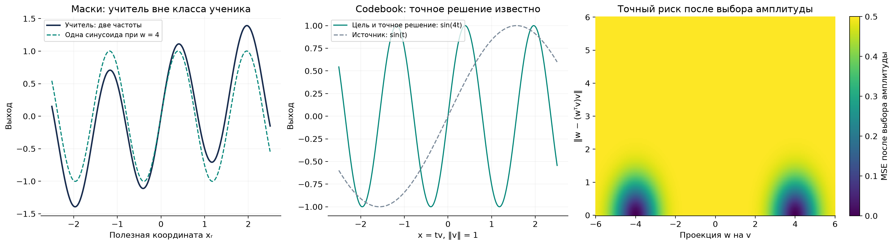
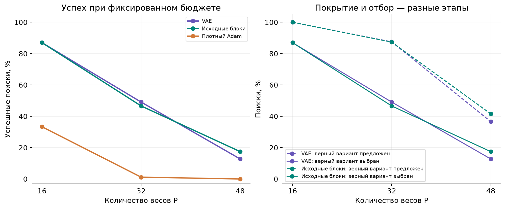
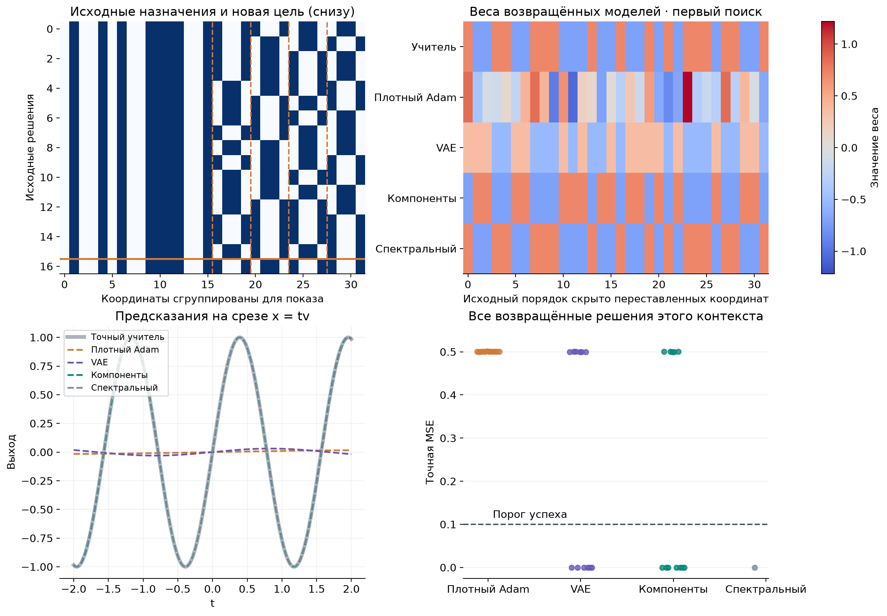
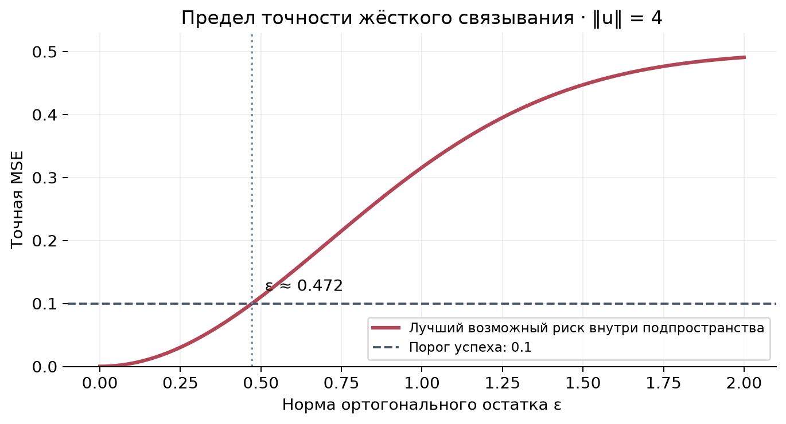
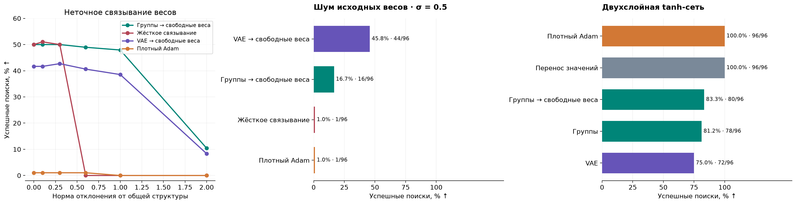

# Перенос структуры решения между задачами

Итоговый отчёт · 26 октября 2026. Текст отредактирован 27 октября.

## 1. Синусоидальные маски: помогает ли выбор нужных связей

### Какую задачу мы решаем

Мы хотим проверить простую идею: если по уже решённым задачам понять,
какие связи сети обычно полезны, поможет ли это обучить сеть на новой задаче?
Для этого сначала используем небольшой пример, в котором известна функция,
порождающая ответы. Эту функцию будем называть **учителем**, а обучаемую
модель — **учеником**.

На вход подаются независимые числа из стандартного нормального распределения.
У задачи два выхода. Каждый выход учителя зависит только от одного входа
и складывается из медленной и быстрой синусоиды. Ученик для каждого выхода
использует одну синусоиду:

$$
\begin{aligned}
x&\sim\mathcal N(0,I_d),\\
y_j(x)&=\alpha_j\sin(\ell_jx_{r_j})+\sin(h_jx_{r_j}),\\
f_j(x)&=\gamma_j\sin(w_j^\top x),\qquad j\in\{1,2\}.
\end{aligned}
$$

Здесь d — число входов, r — номер полезного входа, ℓ и h — низкая
и высокая частоты, α — вклад низкой частоты. Вектор w и амплитуда γ
обучаются. Частоты и коэффициент учителя выбираются в диапазонах:

$$
\ell_j\in[0.65,0.75],\qquad
h_j\in[3.8,4.2],\qquad
\alpha_j\in[0.35,0.45].
$$

При восьми входах первый выход зависит от одного из входов 0–3,
второй — от одного из входов 4–7. **Правильная маска** оставляет только
эти две связи, а остальные веса фиксирует на нуле. Из всех 120 способов
оставить две связи только 16 учитывают это разделение входов между выходами.

Мы различаем **исходные задачи**, на решениях которых учится генератор масок,
и **новые задачи**, на которых проверяется перенос. В исходных задачах
встречаются восемь сочетаний полезных входов. Ещё четыре сочетания используются
для настройки и четыре — для итоговой проверки. Каждый отдельный полезный
вход уже встречался при обучении; новым является их сочетание.

### Что делают сравниваемые методы

Сначала собрали банк решений: обучили сети с 262 144 случайными масками
и получили 279 решений, прошедших порог качества. По их маскам обучили
вариационный автоэнкодер — **VAE**. После обучения он предлагает маски
для новых задач.

Вариант **VAE с раздельным обучением частей** учится восстанавливать каждый
выход, даже когда часть скрытого кода, относящаяся к другому выходу,
заменена шумом. Так мы стараемся научить его отдельно представлять две части
маски и затем сочетать их по-новому. Обычный VAE обучается без такой замены.

Есть и более простой способ: для каждого выхода независимо выбрать связь
по частоте, с которой она встречалась в исходных решениях. Он позволяет
проверить, даёт ли сложность VAE дополнительную пользу.

На каждой новой задаче структурный метод предлагает 32 маски и обучает
веса для каждой. По ошибке на отдельной выборке выбирает одну маску,
затем ещё 32 раза обучает её веса с новых случайных начальных значений.
Возвращает лучший результат из обеих стадий. Плотные SGD и Adam вместо
выбора масок обучают все веса с 64 разных стартов.

Каждое обучение длится 1024 шага по 64 примера. Таким образом, на один
поиск у всех методов приходится 4 194 304 предъявления обучающих примеров.
В этой серии 32 пробных обучения по маскам используют четыре повторяющихся
начальных вектора; заключительные 32 старта независимы. Настройки плотных
оптимизаторов выбраны на отдельных задачах.

Кандидаты сравниваются на выборке из 4096 примеров, которая не участвует
в обновлении весов. Итоговую ошибку в синусоидальных задачах мы можем
вычислить точно по известному распределению входов. Обучение считается
успешным, если эта средняя квадратичная ошибка (**MSE**) меньше 0,1.
Для двух выходов ошибки усредняются:

$$
R=\frac12\sum_{j=1}^{2}\mathbb E[(f_j(x)-y_j(x))^2].
$$

Общая запись метода и бюджета также приведена в
[предыдущем отчёте](FINAL_REPORT_2026-10-20.md).

### Как выглядит хорошее решение

Даже с правильной маской ученик не может в точности повторить учителя:
у учителя две частоты, у ученика одна. Однако он может хорошо приблизить
основную высокочастотную часть.

*Слева показан такой пример: синяя линия — ответ учителя, зелёная —
одна синусоида с частотой 4 и наилучшей для этой частоты амплитудой.
В центре — следующая задача, в которой точное решение уже существует.
Справа цветом показана точная MSE одночастотной задачи: тёмные области
соответствуют хорошим весам. Это вычисление по формуле, а не результаты
дополнительного обучения.*

Точная оценка ошибки опирается на формулу среднего произведения двух
синусоид при нормальных входах:

$$
K(a,b)=\mathbb E[\sin(a^\top x)\sin(b^\top x)]
=\frac12\left(e^{-\|a-b\|^2/2}-e^{-\|a+b\|^2/2}\right).
$$

Она позволяет оценить любую найденную модель по всему распределению входов,
а не только по конечной проверочной выборке.

Формула ошибки и лучшей амплитуды

Для одного выхода обозначим через eᵣ вектор, выделяющий полезный вход.
Тогда:

$$
\begin{aligned}
A(w)&=K(w,w),\\
B(w)&=\alpha K(w,\ell e_r)+K(w,he_r),\\
C&=\alpha^2K(\ell e_r,\ell e_r)+K(he_r,he_r)
+2\alpha K(\ell e_r,he_r),\\
R(\gamma,w)&=\gamma^2A(w)-2\gamma B(w)+C,\\
\gamma_{\mathrm{opt}}(w)&=B(w)/A(w)\quad\text{при }A(w)>0.
\end{aligned}
$$

Лучшая амплитуда здесь найдена при фиксированном векторе весов.
Это не решает задачу поиска самого вектора и не доказывает глобальной
оптимальности численно найденной модели.

### Результаты

Основное сравнение содержит 384 поиска на метод: три случайных
инициализации обучения VAE, восемь сочетаний функции и семейства
и по 16 поисков для каждого такого случая. Использована исправленная
версия результатов matched_v2.

<!-- table:masks -->

| Метод | Успех | Средняя точная MSE ↓ |
| --- | --- | --- |
| Правильная маска задана заранее | 383/384 (99.7%) | 0.0541 |
| Перебор 16 допустимых масок | 311/384 (81.0%) | 0.1002 |
| Случайная маска с учётом двух выходов | 269/384 (70.1%) | 0.1282 |
| VAE с раздельным обучением частей | 259/384 (67.4%) | 0.1347 |
| Выбор частей по исходным частотам | 251/384 (65.4%) | 0.1398 |
| Плотный Adam | 103/384 (26.8%) | 0.2251 |
| Две случайные связи из всех 16 | 49/384 (12.8%) | 0.2722 |
| Обычный VAE | 29/384 (7.6%) | 0.2855 |
| Плотный SGD с моментом | 16/384 (4.2%) | 0.2976 |
| Плотный SGD | 6/384 (1.6%) | 0.3269 |
| Выбор готовой исходной маски | 0/384 (0.0%) | 0.3045 |

<!-- /table:masks -->

**Выбор структуры заметно помогает, но VAE не оказался лучшим генератором.**
Он дал 67,4% успеха против 26,8% у Adam. При этом простой перебор
16 допустимых масок дал 81,0%, а выбор частей по исходным частотам — 65,4%.
Если пространство масок маленькое, его выгодно перебирать.

Разница VAE и простого частотного метода — 2,1 процентного пункта.
Описательный 95%-интервал для этой разницы составляет [−2,9; 7,3]:
эти данные не позволяют уверенно выделить преимущество VAE.
Для разницы VAE и Adam интервал равен [27,1; 52,6].
Интервалы получены повторным выбором восьми групп «функция × семейство»;
они относятся к этому исходному банку.

Затем мы заново собрали три банка решений и повторили сравнение:

<!-- table:replication -->

| Метод | Успех | Средняя MSE | Банки 751 / 752 / 753, % |
| --- | --- | --- | --- |
| Перебор 16 допустимых масок | 317/384 (82.6%) | 0.0917 | 82.8 / 84.4 / 80.5 |
| Случайная маска с учётом двух выходов | 265/384 (69.0%) | 0.1261 | 66.4 / 71.9 / 68.8 |
| VAE с раздельным обучением частей | 247/384 (64.3%) | 0.1375 | 65.6 / 66.4 / 60.9 |
| Выбор частей по исходным частотам | 256/384 (66.7%) | 0.1316 | 71.9 / 71.1 / 57.0 |
| Плотный Adam | 139/384 (36.2%) | 0.1994 | 32.0 / 40.6 / 35.9 |
| Выбор готовой исходной маски | 0/384 (0.0%) | 0.2993 | 0.0 / 0.0 / 0.0 |

<!-- /table:replication -->

Направление результата сохранилось: структурные методы лучше Adam,
а простой генератор сопоставим с VAE.

### Что меняется при увеличении числа входов

К исходным входам добавили независимые шумовые координаты:

<!-- table:mask_scaling -->

| Размерность | VAE | Выбор по частотам | Adam | SGD |
| --- | --- | --- | --- | --- |
| 8 | 67.2% | 68.8% | 27.1% | 1.6% |
| 16 | 61.5% | 66.1% | 13.5% | 0.0% |
| 32 | 60.9% | 71.4% | 0.0% | 0.0% |
| 64 | 65.6% | 71.4% | 0.0% | 0.0% |

<!-- /table:mask_scaling -->

У VAE и частотного метода полезные входы остаются теми же, а маска
заранее запрещает новые шумовые связи. Плотные оптимизаторы должны обучать
увеличившийся вектор весов. Этот опыт показывает пользу исключения
**заранее известных** лишних входов. Поиск неизвестных полезных входов
в большей размерности здесь не проверялся.

В более раннем опыте распределение стартов было другим: VAE с раздельными
частями дал 592/1536 успехов, настроенный SGD — 44/1536, простой частотный
метод — 579/1536. Эти результаты приведены отдельно от основной таблицы.
Все 592 успешные модели сохранили успех после снятия маски и ещё
1024 шагов плотного SGD. Значит, хорошее решение доступно и полной сети,
а маска помогает до него добраться. Дополнительные шаги не входят
в основное сравнение бюджетов.

## 2. Общие значения весов: что переносить на новую задачу

### Постановка и точное решение

В предыдущем опыте мы выбирали, какие веса оставить ненулевыми.
Теперь проверяем другое ограничение: **какие веса должны быть равны**.

Учитель использует все входы, но каждый его вес принимает одно из двух
значений. Например, структура может требовать равенства первого и третьего
весов, а также второго и четвёртого. На новой задаче эта группировка
сохраняет смысл, хотя сами два значения могут измениться.

Такое представление называют **codebook**: есть небольшой набор общих
значений и указание, какое значение использовать в каждой координате.
Для наших задач:

$$
\begin{aligned}
P&=8J,\qquad J\in\{2,4,6\},\\
x&\sim\mathcal N(0,I_P),\\
y(x)&=\sin((w^*)^\top x),\\
w_p^*&=\frac{\omega}{\sqrt P}(2i_p^*-1),
\qquad i_p^*\in\{0,1\}.
\end{aligned}
$$

P — число весов, J — число блоков, ω — частота учителя.
Бит i указывает, к какой из двух групп относится координата.

Ученик задаёт свой вектор весов через матрицу группировки U и два
обучаемых значения c:

$$
w=Uc,\qquad f(x)=\gamma\sin(w^\top x).
$$

В каждой строке U ровно одна единица: она выбирает первое или второе
значение из c. При правильной группировке известно точное решение:

$$
c^*=\begin{pmatrix}-\omega/\sqrt P\\+\omega/\sqrt P\end{pmatrix},
\qquad \gamma^*=1,\qquad R(1,U^*c^*)=0.
$$

То есть задача решается без ошибки двумя общими значениями.
Плотная модель тоже может воспроизвести этот вектор, но ей нужно найти
все его координаты отдельно.

### Как устроены исходные и новые задачи

Вектор группировки разбит на блоки по восемь координат. Каждый блок имеет
один из двух вариантов: 11110000 или 11001100. В исходных задачах число
блоков второго типа чётно, в новых — нечётно. Отдельные варианты блоков
уже известны, а их полные сочетания — новые.

Есть и численное различие: частоты исходных задач лежат между 0,8 и 1,2,
а новых — между 3,8 и 4,2. Так мы проверяем, можно ли перенести группировку
при существенной смене нужных значений весов.

Исходные задачи решены плотным SGD: четыре старта по 2048 шагов.
В банк принимали решения с измеренной MSE < 0,005. Веса каждого решения
разделяли на две группы по близости значений. С учётом симметрии синусоиды
перед этим согласовывали знак весов и выходной амплитуды.

Генератор обучался на полученных группировках. Правильные ответы учителя
использовали только для последующей проверки: во всех девяти банках
группировки удалось извлечь точно. В этом опыте границы блоков известны
и VAE, и простому методу, собирающему новые векторы из исходных блоков.

### Результаты

На новую задачу отведён прежний бюджет: 32 пробных обучения и 32 новых
обучения выбранной структуры. На метод приходится 192 поиска при 16 весах
и по 768 при 32 и 48 весах.

<!-- table:codebook -->

| Метод | 16 весов | 32 веса | 48 весов |
| --- | --- | --- | --- |
| VAE, новые значения | 87.0% | 49.1% | 12.8% |
| Исходные блоки, новые значения | 87.0% | 46.6% | 17.4% |
| Независимые биты | 3.1% | 0.1% | 0.0% |
| Выбор готового исходного разбиения | 0.0% | 0.0% | 0.0% |
| Блоки, начальные значения от исходных задач | 0.0% | 0.0% | 0.0% |
| Блоки, исходные значения без обучения | 0.0% | 0.0% | 0.0% |
| Блоки без нормировки инициализации | 65.6% | 19.1% | 4.8% |
| Блоки с суммированием градиентов | 84.4% | 41.1% | 13.3% |
| Правильные назначения, новые значения | 100.0% | 100.0% | 100.0% |
| Верное разбиение, исходные значения | 0.0% | 0.0% | 0.0% |
| Плотный SGD | 10.4% | 0.0% | 0.0% |
| Плотный Adam | 33.3% | 1.2% | 0.0% |
| Перенос всего вектора исходных весов | 0.0% | 0.0% | 0.0% |
| Только две ненулевые связи | 0.0% | 0.0% | 0.0% |

<!-- /table:codebook -->

**Перенос группировки и перенос численных значений дали разные результаты.**
Если правильная группировка задана заранее, новые случайные значения
позволяют решить все задачи. Старт со старых значений не дал ни одного
успеха. В этих опытах низкая частота исходной задачи оказывается плохой
начальной точкой для поиска новой высокой частоты.

При 32 весах VAE дал 49,1% успеха, сборка из исходных блоков — 46,6%,
Adam — 1,2%. Группировка помогает, а специальное преимущество VAE
над простой сборкой здесь невелико.

Два дополнительных сравнения показывают важность самого обучения весов.
Если не нормировать начальные общие значения с учётом размеров групп,
успех простого метода падает с 46,6% до 19,1%. Если вместо среднего
градиента группы использовать сумму, он падает до 41,1%.
Поэтому в основном варианте начальная норма контролируется,
а градиенты внутри группы усредняются.

### Почему результат ухудшается при 48 весах

<!-- table:coverage -->

| Метод | Весов | Верное разбиение встретилось | Верное разбиение выбрано | Успех |
| --- | --- | --- | --- | --- |
| VAE, новые значения | 16 | 100.0% | 87.0% | 87.0% |
| VAE, новые значения | 32 | 87.5% | 49.1% | 49.1% |
| VAE, новые значения | 48 | 36.6% | 12.8% | 12.8% |
| Исходные блоки, новые значения | 16 | 100.0% | 87.0% | 87.0% |
| Исходные блоки, новые значения | 32 | 87.4% | 46.6% | 46.6% |
| Исходные блоки, новые значения | 48 | 41.5% | 17.4% | 17.4% |

<!-- /table:coverage -->

Здесь «встретилось» означает, что среди первых 32 кандидатов было верное
разбиение. «Выбрано» — что его обучение оказалось лучшим на проверочной
выборке и именно это разбиение пошло на повторные старты.

Эти события различаются. При 32 весах VAE почти в 88% поисков предлагает
верное разбиение, но выбирает его лишь примерно в 49%: пробное обучение
правильной структуры тоже может не удаться. При 48 весах верный вариант
уже редко попадает в набор предложений. Число сочетаний растёт как
два в степени J, а число проб остаётся равным 32.

*Каждая панель относится к своей задаче. Сравнивать методы следует
внутри одной панели. В подписях указаны доля успеха и число успешных поисков.*

## 3. Можно ли восстановить группы, если их границы неизвестны

### Как мы скрываем и восстанавливаем структуру

В предыдущем опыте границы блоков были заданы. Теперь меняем порядок
всех координат неизвестной перестановкой. Эта перестановка одинакова
для исходных и новых задач одного банка. Алгоритм получает только
группировки, извлечённые из обученных исходных весов.

Простой способ найти зависимости — посмотреть, как каждая координата
меняла свою группу от одной исходной задачи к другой. Если две координаты
почти всегда меняются вместе или противоположным образом, объединяем их.
Затем независимо выбираем наблюдавшийся вариант для каждой найденной группы.

Формально для координаты r её профиль — последовательность назначений
в m исходных решениях:

$$
p_r=(i_r^{(1)},\ldots,i_r^{(m)}).
$$

Координаты связываются, если их профили совпадают либо противоположны
не менее чем в 95% решений. Группы получаются объединением связанных
координат; постоянные координаты образуют отдельную группу.

VAE получает тот же полный вектор назначений, но сам учится описывать
его распределение. Для сравнения также проверяем случайные назначения,
готовые исходные разбиения и метод, которому правильные границы блоков
даны заранее. Адаптивный поиск CEM постепенно повышает вероятность частей
лучших кандидатов: четыре раунда по восемь обучений, обновление
по двум лучшим результатам каждого раунда.

### Результаты

Здесь все 32 пробные инициализации независимы. На метод приходится
144/288/288 поисков при 16/32/48 весах. Поэтому эта серия отличается
от предыдущей не только скрытыми границами, но и начальными значениями.

<!-- table:hidden -->

| Метод | 16 весов | 32 веса | 48 весов |
| --- | --- | --- | --- |
| VAE без заданных групп | 0.0% | 38.5% | 15.3% |
| Восстановленные группы | 0.0% | 52.8% | 17.0% |
| Границы блоков заданы заранее | 93.8% | 54.9% | 18.4% |
| Неверные границы | 0.0% | 0.7% | 0.0% |
| Независимый выбор группы каждой координаты | 7.6% | 0.0% | 0.0% |
| Выбор готового исходного разбиения | 0.0% | 0.0% | 0.0% |
| Равномерные назначения | 0.0% | 0.0% | 0.0% |
| Перебор сочетаний восстановленных групп | 0.0% | 55.6% | 13.2% |
| Адаптивный поиск по группам (CEM) | 0.0% | 44.8% | 17.7% |
| Адаптивный поиск по координатам | 3.5% | 0.0% | 0.0% |
| Правильное разбиение задано заранее | 100.0% | 100.0% | 100.0% |
| Плотный SGD | 8.3% | 0.0% | 0.0% |
| Плотный Adam | 38.2% | 1.0% | 0.0% |

<!-- /table:hidden -->

При 32 весах восстановленные группы дают 52,8% успеха, почти столько же,
сколько известные границы — 54,9%. VAE даёт 38,5%, Adam — 1,0%.
Значит, полезную группировку можно узнать из решений других задач.

При двух блоках простой метод не работает. Причина видна уже по данным:
в исходных задачах встречаются только сочетания 00 и 11, а новые задачи
требуют 01 и 10. Два блока всегда менялись одновременно, поэтому по таким
примерам нельзя понять, что их следует выбирать независимо.
Знание границ снимает эту неоднозначность.

### Можно ли решить эту задачу без градиентного обучения

Для одного синуса можно использовать его известную форму.
После выбора знакового направления v перебираем 64 частоты от 0,125 до 8.
Для каждой частоты лучшая амплитуда на обучающей выборке находится напрямую:

$$
\widehat\gamma(\omega,v)=
\frac{\sum_n y_n\sin(\omega v^\top x_n)}
     {\sum_n\sin^2(\omega v^\top x_n)}.
$$

Здесь сумма берётся по обучающим примерам. Частоту выбираем по ошибке
на них, а разбиение — по отдельной выборке. В таблице этот способ назван
«подбор частоты». Он использует знание формы задачи, но не истинную частоту.

<!-- table:spectral -->

| Метод | 16 весов | 32 веса | 48 весов |
| --- | --- | --- | --- |
| Подбор частоты по восстановленным группам | 0/12 (0.0%) | 24/24 (100.0%) | 24/24 (100.0%) |
| Подбор частоты по случайным разбиениям | 0/12 (0.0%) | 0/24 (0.0%) | 0/24 (0.0%) |
| Оценка направления по данным + подбор частоты | 0/12 (0.0%) | 0/24 (0.0%) | 0/24 (0.0%) |

<!-- /table:spectral -->

Подбор частоты по восстановленным группам решает все 24 случая
при 32 и 48 весах. Это сильнее проверенного градиентного обучения.
Следовательно, найденная структура полезна, а дальнейший способ подбора
численных значений можно улучшать.

Один такой результат относится к одному сочетанию банка, функции
и целевого разбиения. Градиентные методы запускаются на нём 12 раз.
Кроме того, 4 194 304 вычисления предсказаний у перебора частоты
и столько же обучающих примеров с вычислением градиентов — разные
вычислительные затраты. Равенство времени или числа операций не измерялось.

### От чего зависит возможность переноса

<!-- table:hidden_controls -->

| Метод | 8 источников, 32 веса | 8 источников, 48 весов | Новый порядок входов у цели, 48 весов |
| --- | --- | --- | --- |
| VAE без заданных групп | 79/288 (27.4%) | 5/288 (1.7%) | 0/288 (0.0%) |
| Восстановленные группы | 149/288 (51.7%) | 35/288 (12.2%) | 0/288 (0.0%) |
| Перебор сочетаний восстановленных групп | 160/288 (55.6%) | 27/288 (9.4%) | 0/288 (0.0%) |
| Правильное разбиение задано заранее | 288/288 (100.0%) | 288/288 (100.0%) | 288/288 (100.0%) |
| Плотный Adam | 3/288 (1.0%) | 0/288 (0.0%) | 0/288 (0.0%) |
| Подбор частоты по восстановленным группам | 24/24 (100.0%) | 18/24 (75.0%) | 0/24 (0.0%) |

<!-- /table:hidden_controls -->

В первых двух столбцах для восстановления групп оставлены только
восемь исходных решений. При 48 весах в одном банке две разные группы
ошибочно объединяются; подбор частоты решает уже 18 из 24 случаев.

В последнем столбце только для новой задачи заново переставлены входы.
Связь между расположением исходных и новых весов исчезает.
Переносимые разбиения перестают помогать, хотя задача по-прежнему решается,
если заранее дать правильное разбиение.

### Пример найденных весов и предсказаний

Рассмотрим один фиксированный пример с 32 весами: банк 9101, функция 911,
вариант разбиения 0. Он выбран по этим номерам, без отбора по успеху метода.
Для каждого метода показан первый сохранённый поиск.

*Сверху слева показаны исходные разбиения и новая цель в последней строке.
Для наглядности координаты собраны по найденным группам.
Сверху справа — веса, которые методы действительно вернули.
Снизу слева — предсказания вдоль направления учителя; снизу справа —
точная MSE всех 12 поисков на этом примере. Подбор частоты даёт один результат.*

<!-- table:example -->

| Метод | MSE первого поиска | Средняя MSE всех запусков на этом примере | Амплитуда первого решения |
| --- | --- | --- | --- |
| Плотный SGD | 0.500124 | 0.500854 | 0.0158084 |
| Плотный Adam | 0.500146 | 0.500343 | 0.0171323 |
| VAE без заданных групп | 0.499763 | 0.24998 | -0.0307258 |
| Восстановленные группы | 0 | 0.208393 | -1 |
| Перебор сочетаний восстановленных групп | 0 | 0.125032 | -1 |
| Подбор частоты по восстановленным группам | 0.000104725 | 0.000104725 | 0.999942 |
| Правильное разбиение задано заранее | 0 | 0 | -1 |

<!-- /table:example -->

Частота учителя здесь примерно 4,01447. В первом поиске восстановленные
группы и перебор их сочетаний привели к точному решению. VAE и Adam дали
почти нулевые предсказания с ошибкой около 0,5. При других стартах
исход меняется, что видно на правом нижнем графике.

Отрицательная амплитуда сама по себе не означает ошибку: одновременная
смена знаков входных весов и амплитуды оставляет синусоидальный ответ тем же.

## 4. Что делать, если найденная группировка верна лишь приблизительно

### Почему одинаковые веса иногда мешают

В новой задаче веса одной группы могут оказаться близкими, но не равными.
Если требовать их точного равенства до конца обучения, часть функции
воспроизвести невозможно.

Запишем истинный вектор как сумму части u, которую можно выразить
в выбранной группировке, и недостающей части r:

$$
w^*=u+r,\qquad u=P_Sw^*,\qquad r=(I-P_S)w^*.
$$

Здесь S — пространство допустимых связанных весов, а Pₛ — проекция
на него. Величина ε — длина недостающей части. Для нормальных входов
можно точно найти лучшую ошибку при сохранении этого ограничения:

$$
\begin{aligned}
a&=\|u\|^2,\qquad b=\|r\|^2=\varepsilon^2,\\
\mathbb E[y\mid P_Sx]&=e^{-b/2}\sin(u^\top x),\\
R_S^*&=\frac12\left[1-e^{-2(a+b)}-e^{-b}(1-e^{-2a})\right].
\end{aligned}
$$

Вторая строка — лучший ответ, который можно получить, зная лишь входы
в допустимом подпространстве. Третья — его ошибка.

При длине u около 4 формула почти совпадает с более простой:

$$
R_S^*\approx\frac{1-e^{-\varepsilon^2}}2.
$$

При ε=0,6 даже лучшее такое решение имеет MSE около 0,151 — уже выше
нашего порога 0,1. Дополнительные шаги внутри тех же ограничений
не могут это исправить.

### Сначала связанные веса, затем свободные

Мы проверили простой выход: первые 768 шагов обучать связанные веса,
а последние 256 — разрешить каждому весу меняться отдельно.
На графиках этот переход называется release, в таблицах — «затем свободные веса».
Весь бюджет остаётся равным 1024 шагам на обучение.

<!-- table:residual -->

| Норма остатка | Группы, веса связаны | Группы, затем свободные веса | VAE, затем свободные веса | Adam |
| --- | --- | --- | --- | --- |
| 0 | 48/96 (50.0%) | 48/96 (50.0%) | 40/96 (41.7%) | 1/96 (1.0%) |
| 0.1 | 49/96 (51.0%) | 48/96 (50.0%) | 40/96 (41.7%) | 1/96 (1.0%) |
| 0.3 | 48/96 (50.0%) | 48/96 (50.0%) | 41/96 (42.7%) | 1/96 (1.0%) |
| 0.6 | 0/96 (0.0%) | 47/96 (49.0%) | 39/96 (40.6%) | 1/96 (1.0%) |
| 1 | 0/96 (0.0%) | 46/96 (47.9%) | 37/96 (38.5%) | 0/96 (0.0%) |
| 2 | 0/96 (0.0%) | 10/96 (10.4%) | 8/96 (8.3%) | 0/96 (0.0%) |

<!-- /table:residual -->

В каждом условии 96 поисков: три банка, по четыре сочетания функции
и разбиения, по восемь поисков на сочетание. При ε=1 снятие ограничений
после обучения в восстановленных группах даёт 46/96 успехов.
Без снятия ограничений и у Adam — 0/96.

При ε=2 выигрыш резко уменьшается: 10/96 у найденных групп.
Даже правильная базовая группировка с последующим снятием ограничений
даёт лишь 58/96. Ограничение уже снято, но оставшегося времени обучения
может не хватить для исправления большой ошибки.

### Насколько качественными должны быть исходные решения

В следующем опыте портим исходные веса нормальным шумом и заново
восстанавливаем группы. Параметр σ задаёт силу шума относительно
покоординатного стандартного отклонения исходных весов.

Отдельно проверяем действительно недообученные исходные сети:
после 8, 32 и 128 шагов. В этих опытах сохраняются все исходные задачи,
включая плохо решённые.

<!-- table:source_quality -->

| Состояние источников | Группы, веса связаны | Группы, затем свободные веса | VAE, затем свободные веса | Adam |
| --- | --- | --- | --- | --- |
| Исходный чистый банк | 48/96 (50.0%) | 48/96 (50.0%) | 40/96 (41.7%) | 1/96 (1.0%) |
| Исходные задачи: 128 шагов | 48/96 (50.0%) | 48/96 (50.0%) | 40/96 (41.7%) | 1/96 (1.0%) |
| Исходные задачи: 32 шага | 48/96 (50.0%) | 48/96 (50.0%) | 40/96 (41.7%) | 1/96 (1.0%) |
| Исходные задачи: 8 шагов | 0/96 (0.0%) | 0/96 (0.0%) | 4/96 (4.2%) | 1/96 (1.0%) |
| Шум σ=0,25 | 48/96 (50.0%) | 48/96 (50.0%) | 40/96 (41.7%) | 1/96 (1.0%) |
| Шум σ=0,5 | 1/96 (1.0%) | 16/96 (16.7%) | 44/96 (45.8%) | 1/96 (1.0%) |
| Шум σ=1 | 0/96 (0.0%) | 0/96 (0.0%) | 4/96 (4.2%) | 1/96 (1.0%) |
| Шум σ=0,5; остаток 0,3 | 1/96 (1.0%) | 17/96 (17.7%) | 41/96 (42.7%) | 1/96 (1.0%) |

<!-- /table:source_quality -->

После 32 шагов исходные веса ещё неточны, но группировки уже восстановлены
правильно; итог совпадает с хорошим банком. После восьми шагов ошибочны
14,5–18,2% назначений, и перенос почти перестаёт работать.

При шуме σ=0,5 ошибочно меняется всего 1,6–3,5% назначений. Тем не менее
простое правило группировки разбивает единые группы на множество частей.
Вместо 16 сочетаний становится от 4096 до 131 072. Среди первых 32 предложений
правильное разбиение встречается в 9/96 поисков простого метода
и 55/96 поисков VAE. После снятия ограничений они дают 16/96 и 44/96 успехов.

**В этом режиме VAE устойчивее выбранного простого метода восстановления.**
При ещё большем шуме оба метода почти теряют способность решать задачи.

*Слева меняется отклонение новых весов от точных равенств, в центре —
шум исходных решений. Справа показан следующий опыт с tanh-сетью.
Группы — это восстановленные зависимости между весами;
«освобождение» означает продолжение обучения без требования их равенства.*

## 5. Двухслойная tanh-сеть: сохраняется ли преимущество

### Задача

Переходим от одной синусоиды к сети с четырьмя скрытыми нейронами:

$$
f_\theta(x)=
\frac1{\sqrt H}\sum_{h=1}^{H}
a_h\tanh(w_h^\top x+b_h)+b_0,
\qquad H=4,\quad x\in\mathbb R^{32}.
$$

Здесь w — входные веса нейрона, b — его сдвиг, a — выходной вес.
У учителя и плотного ученика одинаковая архитектура со 137 параметрами.

Входные веса всех четырёх нейронов используют одну группировку координат,
но два общих значения у каждого нейрона свои. С правильной группировкой
остаётся 17 свободных чисел: восемь входных значений, четыре сдвига,
четыре выходных веса и общий выходной сдвиг. Такую цель можно представить точно.

Каждый из трёх банков содержит 16 простых задач. Их решает плотный Adam:
четыре старта по 4096 шагов. По близости столбцов обученной входной матрицы
восстанавливается группировка координат. Этот способ учитывает,
что одинаковую функцию можно представить разным порядком скрытых нейронов.
Все 48 исходных группировок восстановлены правильно.

Новые задачи используют другие сочетания частей и новые численные
параметры. Масштаб общих входных весов, с учётом размера групп,
возрастает с 0,8 до 2,5. Среднее и масштаб выхода определяются
на отдельной выборке из 8192 примеров.

SGD, Adam и обучение связанных весов настроены на отдельных проверочных
задачах. Для настройки связанных весов разрешено использовать правильную
проверочную группировку; её настройки затем одинаковы у всех структурных
методов. Итоговые задачи в настройке не участвуют.

### Результаты

На метод приходится 96 поисков с прежним бюджетом 32+32.
Успех — MSE меньше 0,01 после нормировки выхода, на отдельной
выборке из 16 384 примеров.

<!-- table:twolayer -->

| Метод | Успех | Средняя MSE после нормировки | Диапазон успеха по банкам, % |
| --- | --- | --- | --- |
| Плотный Adam | 96/96 (100.0%) | 0.000478 | 100.0–100.0 |
| Перенос численных параметров + Adam | 96/96 (100.0%) | 0.000508 | 100.0–100.0 |
| Правильная группировка | 96/96 (100.0%) | 0.001680 | 100.0–100.0 |
| Группы, затем свободные веса | 80/96 (83.3%) | 0.007639 | 75.0–90.6 |
| Восстановленные группы | 78/96 (81.2%) | 0.056909 | 78.1–84.4 |
| VAE | 72/96 (75.0%) | 0.089878 | 71.9–78.1 |
| Плотный SGD | 72/96 (75.0%) | 0.010321 | 75.0–75.0 |
| Выбор готового исходного разбиения | 0/96 (0.0%) | 0.306869 | 0.0–0.0 |
| Равномерная группировка | 0/96 (0.0%) | 0.488044 | 0.0–0.0 |

<!-- /table:twolayer -->

**Здесь лучше работает обычный Adam: 96/96 успехов.**
Старт с численных параметров исходных сетей тоже даёт 96/96.
VAE получает 72/96, восстановленные группы — 78/96,
группы с последующим снятием ограничений — 80/96.

Исходную структуру удалось узнать правильно, но её внешний поиск
не дал преимущества: плотная задача уже хорошо решается Adam.
В этом случае выбор структуры добавляет этап, на котором можно ошибиться.

## 6. Как объяснить полученные результаты

### Нужно и предложить хорошую структуру, и обучить её

Обозначим через q шанс предложить полезную структуру, а через β —
шанс успешно обучить её за заданное время. Если попытки независимы,
после N полных попыток вероятность получить хотя бы одно хорошее решение
не меньше:

$$
\Pr(\text{есть хорошее решение})\geq1-(1-q\beta)^N.
$$

Эта формула объясняет две причины неудачи. Генератор может редко предлагать
нужную структуру. Или структура встречается часто, но обучение её весов
не успевает найти хорошее решение. Есть и третий этап — отбор:
хороший кандидат должен быть выбран по проверочной ошибке.

Более точная запись для двух этапов поиска

Для структуры s обозначим вероятность успеха обучения за T шагов
через bₜ(s). Средний успех одной попытки с генератором Q:

$$
p_Q=\mathbb E_{s\sim Q}b_T(s).
$$

Пусть ρₖ — вероятность выбрать хорошую структуру среди K проб,
βₜ — нижняя оценка успеха нового обучения этой структуры,
δₛₑₗ — вероятность потерять хорошие решения при финальном отборе.
При оговорённой в статье условной независимости новых стартов:

$$
\Pr(R(\widehat w)\leq\varepsilon)\geq
\left[\rho_K\bigl(1-(1-\beta_T)^R\bigr)-\delta_{\mathrm{sel}}\right]_+.
$$

R в степени обозначает число повторных обучений, а запись R(w) —
ошибку модели. Нижняя граница обрезается снизу нулём.
В экспериментах кандидаты используют общие обучающие примеры
и общую выборку для отбора. Поэтому формулу нельзя применять,
автоматически считая все наблюдавшиеся попытки независимыми.

### Почему лишние координаты мешают синусоидальной модели

Для точной одночастотной цели известен вектор весов, дающий нулевую ошибку:

$$
y=\sin(\omega v^\top x),\qquad \|v\|=1,\qquad
f(x)=\gamma\sin(w^\top x).
$$

Решение — вес ωv и амплитуда 1. Любой другой вес можно разложить
на часть вдоль нужного направления и перпендикулярную часть:

$$
w=tv+u,\qquad u^\top v=0.
$$

Ненужная часть u мешает ученику согласовать колебания с учителем.
Их среднее произведение содержит множитель:

$$
e^{-\|u\|^2/2}.
$$

Если длина u велика, полезный сигнал в ошибке и её градиенте становится
очень слабым. При одинаковом случайном масштабе каждого начального веса
добавление координат увеличивает длину этой ненужной части.
Правильная маска или группировка сразу исключает многие такие направления.

Теорема в статье задаёт условия, при которых плотный градиентный спуск
за отведённое число шагов почти не уходит от неудачного старта.
Для правильно выбранного подпространства ограниченной размерности
остаётся положительный шанс начать достаточно близко к хорошему решению.

Точная формула риска и условие теоремы

Для нормальных входов:

$$
\begin{aligned}
R(\gamma,w)&=A(w)\gamma^2-2B(w)\gamma+C_\omega,\\
A(w)&=\tfrac12(1-e^{-2\|w\|^2}),\\
C_\omega&=\tfrac12(1-e^{-2\omega^2}),\\
B(w)&=\tfrac12e^{-\|u\|^2/2}
\left[e^{-(t-\omega)^2/2}-e^{-(t+\omega)^2/2}\right].
\end{aligned}
$$

Пусть начальная амплитуда по модулю не больше 2, шаг η положителен
и не больше 1. Обозначим:

$$
\begin{aligned}
s&=\|u_0\|-1\geq1,\qquad M=\|w_0\|+1,\\
G(s,M)&=8Me^{-2s^2}+4(1+M)e^{-s^2/2}.
\end{aligned}
$$

Тогда:

$$
\eta TG(s,M)\leq1
\quad\Longrightarrow\quad
\|w_t-w_0\|\leq1,\qquad
R(\gamma_t,w_t)\geq C_\omega-3e^{-s^2},
\quad 0\leq t\leq T.
$$

То есть на этом конечном промежутке веса остаются рядом со стартом,
а ошибка остаётся большой. Теорема сама по себе не утверждает,
куда обучение сойдётся при неограниченном времени.

Отдельная численная проверка использовала точный градиент средней ошибки,
частоту 4, по 8192 случайных старта и 4096 шагов:

<!-- table:population -->

| Размерность | Постоянный масштаб старта | Масштаб уменьшается с размерностью | Точная маска |
| --- | --- | --- | --- |
| 2 | 3574/8192 (43.63%) | 2697/8192 (32.92%) | 4852/8192 (59.23%) |
| 8 | 109/8192 (1.33%) | 109/8192 (1.33%) | 4814/8192 (58.76%) |
| 16 | 0/8192 (0.00%) | 4/8192 (0.05%) | 4819/8192 (58.83%) |
| 32 | 0/8192 (0.00%) | 0/8192 (0.00%) | 4781/8192 (58.36%) |
| 64 | 0/8192 (0.00%) | 0/8192 (0.00%) | 4802/8192 (58.62%) |
| 128 | 0/8192 (0.00%) | 0/8192 (0.00%) | 4821/8192 (58.85%) |

<!-- /table:population -->

В первом варианте плотного старта масштаб каждого веса постоянен,
во втором уменьшается с числом входов. В таблице считаются **отдельные
обучения**, а не поиски из 64 стартов.

Эта проверка подтверждает трудность выбранной задачи. Условия теоремы
относятся к конкретному градиентному спуску и инициализации.
Для её расширения на случайные минибатчи нужны дополнительные ограничения;
достаточные условия не проверены для нашего обучения пакетами по 64 примера без ограничения амплитуды. Поэтому наблюдавшийся проигрыш Adam обоснован экспериментами,
а не этой теоремой.

### Почему важны разнообразные исходные решения

Если два блока в исходных задачах всегда меняются вместе,
невозможно понять, независимы ли они. Если они меняются достаточно
разнообразно, совпадения профилей позволяют восстановить группы.

Оценка ошибки восстановления в идеализированной модели

Предполагается, что назначения извлечены точно, исходные строки независимы,
а меняющиеся координаты определяются J сбалансированными,
попарно независимыми бинарными факторами с возможной заменой 0 на 1 и 1 на 0.
По m исходным решениям группы восстанавливаются с вероятностью ошибки
не выше:

$$
\delta_m\leq\min\{1,J(J+1)2^{-m}\}.
$$

После верного восстановления равномерная сборка предлагает каждое полное
сочетание с вероятностью два в степени минус J. Даже идеальное
восстановление групп поэтому не устраняет рост числа сочетаний.
Оценка не гарантирует точность извлечения назначений из плохо обученных весов.

## 7. Что дали ранние проверки архитектуры

До этих опытов проверяли разные способы кодировать маски.
Подробности находятся в [предыдущем отчёте](FINAL_REPORT_2026-10-20.md)
и [сводке ранних экспериментов](../archive/history/experiments/multitask_2026-10-17/reports/SUMMARY.md).

| Проверка | Результат | Что мы узнали |
| --- | --- | --- |
| Один общий кодировщик вместо нескольких | Размер модели уменьшился с 10,31 до 1,92 млн параметров, перенос не улучшился | Более компактная модель сама по себе не даёт лучших масок |
| VAE с указанием семейства задачи | После поиска IoU 0,9394 / 1,0000, как у основных методов сравнения | Знание семейства помогает генерации, но не обеспечивает всех нужных вариантов |
| Начальный код на задаче Pattern | 96,92% случайных масок уже точны | Хороший ответ часто получен ещё до поиска; его нельзя считать улучшением от оптимизации |
| Дополнительные признаки AGOP, три случайных старта обучения | IoU 0,9798 против 0,9697 у исходного представления | Прибавка возникла в одном из трёх стартов; устойчивого выигрыша нет |

Кодировщик преобразует исходное решение в скрытое представление,
декодер строит по нему маску. IoU измеряет совпадение связей найденной
и правильной масок. AGOP обозначает отдельное представление задачи,
построенное по градиентам; здесь приведён результат его сравнения
с исходным представлением.

Полный поиск при сравнении числа кодировщиков выполнен для одного
случайного старта обучения генератора; три старта относятся к обучению
и проверкам исходно предлагаемых масок. Поиск с AGOP проверен на всех трёх.
Эти ранние результаты относятся к своим задачам и не добавляются
к числу наблюдений новых опытов.

## 8. Итог и границы выводов

**Главный результат — на новую задачу может переноситься группировка весов,
даже когда перенос самих численных значений не помогает.**
На выбранных синусоидальных задачах это повышает долю успешных обучений
при одинаковом числе предъявлений обучающих примеров.

Полезные группы удаётся восстановить из решений других задач.
Если равенства весов верны лишь приблизительно, помогает сначала
обучать связанные веса, а затем разрешить им меняться независимо.
Для этого случая получена и точная формула минимальной ошибки,
пока равенства сохраняются.

Сложность генератора не всегда оправданна. Простые частоты, сборка
исходных блоков и перебор часто сопоставимы с VAE или лучше него.
На двухслойной tanh-сети сильнее оказался плотный Adam.
Следовательно, результат зависит от того, насколько полезно ограничение
именно для данной задачи и насколько трудно его найти.

Стоимость предварительной работы тоже существенна.
Первый банк масок стоил 4096 бюджетов одного поиска на новой задаче.
Для codebook обучение одного банка при 2/4/6 блоках стоило соответственно
0,5/2/8 таких бюджетов; один банк tanh-задач — четыре.
Обучение генератора и настройка добавляются сверху.
Поэтому мы установили выигрыш по качеству при заданном бюджете
**после подготовки банка**, а общую экономию вычислений с нуля пока не показали.

Наконец, это синтетические задачи и небольшое число исходных банков.
Повторные поиски на одной задаче показывают влияние случайного старта,
но не заменяют проверку на большом числе независимых задач.
Результаты разных постановок приводятся отдельно; просмотренные задачи
нельзя повторно считать неизвестной итоговой проверкой.

## Данные и воспроизводимость

Полные доказательства приведены в [статье](../paper_vae_solver/main.pdf)
и её [математическом разделе](../paper_vae_solver/latex/method_theory.tex).
Подробные протоколы и результаты:
[маски](../paper_vae_solver/results/RESULTS.md),
[общие значения весов](../paper_vae_solver/results/CODEBOOK_RESULTS.md),
[скрытые группы](../paper_vae_solver/results/HIDDEN_STRUCTURE_RESULTS.md),
[неточность структуры и tanh](../paper_vae_solver/results/ROBUSTNESS_TWOLAYER_RESULTS.md),
[ReLU](FINAL_REPORT_2026-10-20.md),
[первая синусоидальная серия](../archive/history/experiments/sine_mask_vae/results/v1/REPORT.md).

Таблицы взяты из сохранённых результатов. Аналитические рисунки рассчитаны
по приведённым формулам; пример предсказаний использует реально сохранённые
веса. Они и описание выбора примера находятся в
[solution_example.json](assets/2026-10-26/solution_example.json).
[Контрольные суммы исходных данных](assets/2026-10-26/sources.json)
позволяют проверить, какие версии файлов использованы.

Перестроение таблиц и рисунков из корня репозитория:

    python mds/assets/2026-10-26/build_tables.py
    python mds/assets/2026-10-26/build_figures.py

Нужны Python, NumPy и Matplotlib. Полные результаты запусков и реализации
сохранены в [архиве](../paper_vae_solver/reproducibility/README.md).
Новые обучения для редактирования отчёта не проводились.
