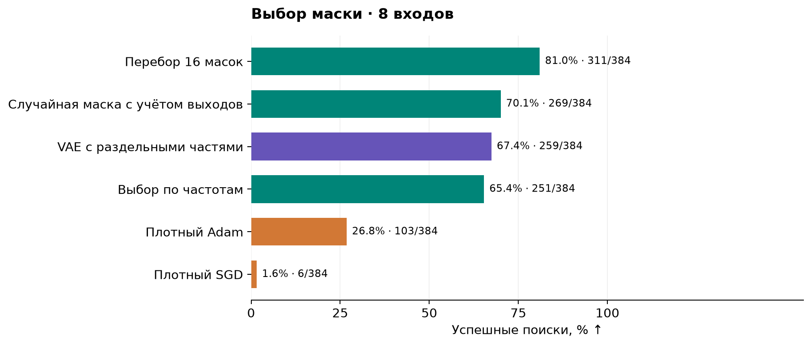
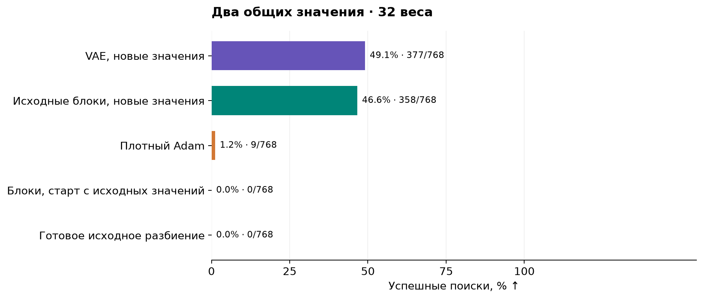
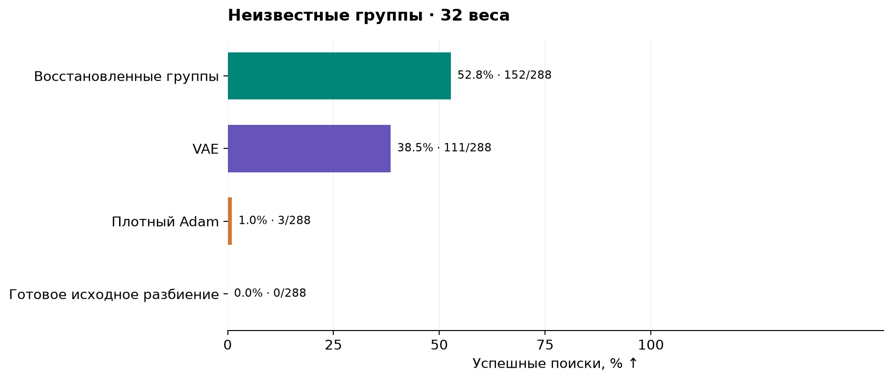
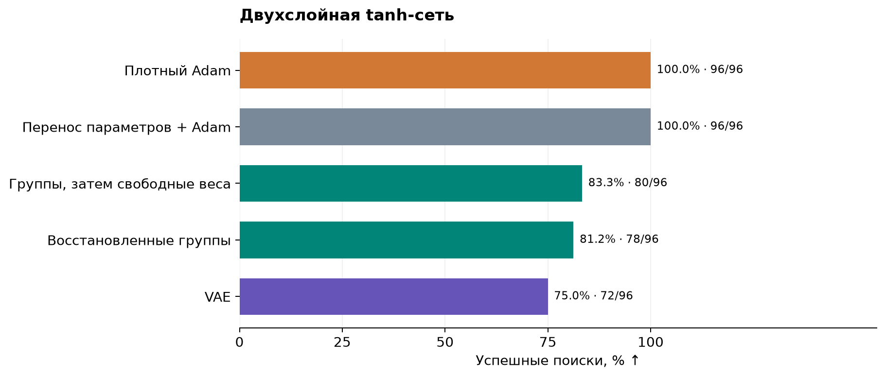

# Перенос структуры решения между задачами

Итоговый отчёт · 26 октября 2026. Редакция от 27 октября.

## 1. Синусоидальные маски

### Задача

Проверяем, помогает ли выбор нужных связей обучить модель на новой задаче.
Функцию, которая задаёт правильные ответы, называем учителем,
а обучаемую модель — учеником.

На входе восемь независимых стандартных нормальных чисел. Учитель выдаёт
два ответа: каждый зависит от одного входа и содержит две синусоиды.
Ученик приближает каждый ответ одной синусоидой:

$$
\begin{aligned}
x&\sim\mathcal N(0,I_8),\\
y_j(x)&=\alpha_j\sin(\ell_jx_{r_j})+\sin(h_jx_{r_j}),\\
f_j(x)&=\gamma_j\sin(w_j^\top x),\qquad
w_j\in\mathbb R^8,\quad j\in\{1,2\}.
\end{aligned}
$$

Первый ответ использует один из первых четырёх входов, второй — один
из последних четырёх. Номера входов, частоты и амплитуды учителя:

$$
\begin{aligned}
r_1&\in\{0,1,2,3\},\qquad r_2\in\{4,5,6,7\},\\
\ell_j&\in[0.65,0.75],\qquad h_j\in[3.8,4.2],
\qquad\alpha_j\in[0.35,0.45].
\end{aligned}
$$

У ученика 16 входных весов. Маска оставляет два из них, остальные обнуляет.
Всего таких масок 120. Если оставить по одной связи для каждого ответа
с учётом указанного разделения входов, получаем 16 вариантов.
Обучаются оставшиеся веса и две выходные амплитуды.

Минимизируем среднюю квадратичную ошибку (MSE) двух выходов:

$$
R=\frac12\sum_{j=1}^{2}\mathbb E[(f_j(x)-y_j(x))^2].
$$

### Аналитическое решение и пример

Точное совпадение невозможно: одна синусоида не воспроизводит сумму двух
разных синусоид. Однако для заданных весов можно точно найти лучшую
амплитуду и ошибку. При нормальных входах среднее произведение синусоид равно:

$$
K(a,b)=\mathbb E[\sin(a^\top x)\sin(b^\top x)]
=\frac12\left(e^{-\|a-b\|^2/2}-e^{-\|a+b\|^2/2}\right).
$$

Единичный вектор полезного входа и лучшая амплитуда одного выхода:

$$
\begin{aligned}
e_r&=(0,\ldots,0,1,0,\ldots,0),
\quad\text{единица стоит на месте }r,\\
\gamma_{\mathrm{opt}}(w)&=
\frac{\alpha K(w,\ell e_r)+K(w,he_r)}{K(w,w)},\qquad w\ne0.
\end{aligned}
$$

Например, пусть ответ учителя и приближение имеют вид:

$$
y(x)=0.4\sin(0.7x_0)+\sin(4x_0),\qquad
w=4e_0,\qquad \gamma=\gamma_{\mathrm{opt}}(4e_0)\approx1.002.
$$

Ученик воспроизводит быструю синусоиду, а медленная остаётся в ошибке:
MSE составляет примерно 0,050. Это пример хорошего приближения;
глобальный минимум по всем весам здесь аналитически не найден.

### Данные и методы

Сначала собрали банк: 262 144 обучения на 16 исходных задачах.
В каждом обучении выбиралась одна из 120 масок и новые начальные веса.
Отобрали 279 решений с MSE ниже 0,1; они содержат восемь разных масок.
Восемь других масок разделили между настройкой и итоговой проверкой.
Каждый полезный вход уже встречался в исходных задачах, а сочетания входов
в итоговой проверке были новыми.

**VAE** — вариационный автоэнкодер, обученный предлагать маски по этому банку.
Проверили обычный VAE и вариант с раздельным обучением частей: при
восстановлении одного выхода часть скрытого кода другого заменяли шумом.
Такой вариант должен независимо представлять части маски.

**Выбор по частотам** независимо выбирает связь для каждого выхода
с вероятностью, равной её частоте в банке. **Готовая исходная маска**
берётся из банка целиком.

**Случайный выбор** проверили в двух вариантах: из всех 120 масок
и из 16 масок с учётом двух выходов. **Перебор** проверяет эти 16 масок
по два раза. **Правильная маска** задана заранее: это проверка того,
насколько хорошо можно обучить веса при известной структуре.

**Плотные SGD, SGD с моментом и Adam** обучают все 16 весов
без выбора маски. Их настройки выбраны на отдельных задачах.

У структурных методов сначала обучаются 32 кандидата. По MSE на
4096 отдельных примерах выбирается маска, после чего её веса обучаются
ещё 32 раза с новых стартов. Возвращается лучшая модель из всех 64.
У плотных методов — 64 старта. Каждое обучение занимает 1024 шага
по 64 примера; бюджет одного поиска одинаков:

$$
B=64\cdot1024\cdot64=4\,194\,304
\quad\text{предъявления обучающих примеров}.
$$

В первых 32 структурных обучениях используются четыре повторяющихся
начальных вектора; заключительные старты независимы.
При заранее известной маске все 64 старта отданы ей.
Успех означает точную MSE ниже 0,1 по всему распределению входов,
с усреднением по двум выходам. Ниже 384 поиска на метод.

### Результаты

<!-- table:masks -->

| Метод | Успех | Средняя точная MSE ↓ |
| --- | --- | --- |
| Правильная маска задана заранее | 383/384 (99.7%) | 0.0541 |
| Перебор 16 допустимых масок | 311/384 (81.0%) | 0.1002 |
| Случайная маска с учётом двух выходов | 269/384 (70.1%) | 0.1282 |
| VAE с раздельным обучением частей | 259/384 (67.4%) | 0.1347 |
| Выбор частей по исходным частотам | 251/384 (65.4%) | 0.1398 |
| Плотный Adam | 103/384 (26.8%) | 0.2251 |
| Две случайные связи из всех 16 | 49/384 (12.8%) | 0.2722 |
| Обычный VAE | 29/384 (7.6%) | 0.2855 |
| Плотный SGD с моментом | 16/384 (4.2%) | 0.2976 |
| Плотный SGD | 6/384 (1.6%) | 0.3269 |
| Выбор готовой исходной маски | 0/384 (0.0%) | 0.3045 |

<!-- /table:masks -->

Перебор оказался лучшим способом выбирать маску: 81,0% успеха.
VAE с раздельными частями дал 67,4%, выбор по частотам — 65,4%,
Adam — 26,8%. Разница между VAE и частотным методом мала и неустойчива
при повторении на других банках. Выбор структуры здесь помогает,
но преимущество VAE перед простыми методами не показано.

Правильная маска даёт 99,7%: при её поиске можно потратить бюджет
на неверные варианты. Полный перебор доступен, поскольку допустимых масок
всего 16.

## 2. Два общих значения весов

### Задача

Теперь все входы полезны, но веса учителя принимают только два значения.
Проверяем, можно ли перенести с исходных задач распределение весов
по двум группам, а сами значения обучить заново.

Обозначения для этой задачи:

$$
\begin{aligned}
P&\in\{16,32,48\} &&\text{— число входов и весов},\\
J&=P/8\in\{2,4,6\} &&\text{— число блоков по восемь координат},\\
\omega&>0 &&\text{— частота учителя}.
\end{aligned}
$$

Учитель и ученик задаются формулами:

$$
\begin{aligned}
x&\sim\mathcal N(0,I_P),&
y(x)&=\sin((w^*)^\top x),\\
w_p^*&=\frac{\omega}{\sqrt P}(2i_p^*-1),&
i_p^*&\in\{0,1\},\quad p=1,\ldots,P,\\
w_p&=c_{i_p},&
f(x)&=\gamma\sin(w^\top x).
\end{aligned}
$$

Двоичный индекс каждого веса выбирает одно из двух общих чисел.
Эту пару чисел называют **codebook**. Для заданных индексов ученик
обучает только два числа и выходную амплитуду, а плотная модель —
все входные веса независимо. Здесь и далее для одного выхода
минимизируется MSE:

$$
R=\mathbb E[(f(x)-y(x))^2].
$$

### Аналитическое решение и пример

Если индексы найдены правильно, точное решение известно:

$$
i=i^*,\qquad
c_0=-\frac{\omega}{\sqrt P},\qquad
c_1=+\frac{\omega}{\sqrt P},\qquad
\gamma=1,\qquad R=0.
$$

Например, при 16 весах и частоте 4 общие значения равны минус единице
и плюс единице. Для двух блоков 11110000 и 11001100 получаем:

$$
w^*=(1,1,1,1,-1,-1,-1,-1,\;1,1,-1,-1,1,1,-1,-1).
$$

При таких весах ученик совпадает с учителем для любого входа.
Деление на корень из размерности сохраняет длину вектора весов равной
частоте учителя.

### Данные и методы

В каждом блоке разрешены только два варианта индексов:
11110000 и 11001100. В исходных задачах число блоков второго типа
чётно, в новых — нечётно. Частота меняется с диапазона 0,8–1,2
на 3,8–4,2. Поэтому новая задача требует нового сочетания знакомых частей
и других численных весов.

Пространство назначений небольшое:

| Входных весов | Блоков | Полных векторов индексов | Из них новые |
| --- | --- | --- | --- |
| 16 | 2 | 4 | 2 |
| 32 | 4 | 16 | 8 |
| 48 | 6 | 64 | 32 |

Для каждой размерности собрали три независимых банка. В одном банке
было 4, 16 или 64 исходных задачи — по две функции на исходное назначение.
Каждую решали плотным SGD с четырёх стартов по 2048 шагов.
Принимали решения с MSE ниже 0,005; веса разделяли на две группы
по близости значений. Во всех девяти банках назначения восстановлены точно.

**VAE** учится предлагать новые назначения по восстановленным блокам.
**Сборка исходных блоков** независимо выбирает для каждого места один
из наблюдавшихся восьмибитных блоков. Границы блоков известны обоим методам.

**Независимые биты** выбирают группу каждой координаты отдельно.
**Готовое исходное разбиение** переносит весь вектор индексов из банка.
Проверили также перенос всего вектора численных весов и сохранение
только двух ненулевых связей.

Для выбранных блоков сравнили **новые случайные значения**,
**старт с исходных значений** и **исходные значения без обучения**.
В основном варианте начальная норма весов контролируется, а градиенты
внутри группы усредняются. Две отдельные проверки убирают нормировку
старта или заменяют средний градиент суммой.
**Правильные назначения** и **плотные SGD/Adam** служат теми же
проверками, что в первом опыте.

Поиск и порог успеха прежние: 32 кандидата и 32 повторных обучения,
MSE ниже 0,1. Кандидаты могут повторяться.
На метод приходится 192 поиска при 16 весах и по 768 при 32 и 48.

### Результаты

<!-- table:codebook -->

| Метод | 16 весов | 32 веса | 48 весов |
| --- | --- | --- | --- |
| VAE, новые значения | 87.0% | 49.1% | 12.8% |
| Исходные блоки, новые значения | 87.0% | 46.6% | 17.4% |
| Независимые биты | 3.1% | 0.1% | 0.0% |
| Выбор готового исходного разбиения | 0.0% | 0.0% | 0.0% |
| Блоки, начальные значения от исходных задач | 0.0% | 0.0% | 0.0% |
| Блоки, исходные значения без обучения | 0.0% | 0.0% | 0.0% |
| Блоки без нормировки инициализации | 65.6% | 19.1% | 4.8% |
| Блоки с суммированием градиентов | 84.4% | 41.1% | 13.3% |
| Правильные назначения, новые значения | 100.0% | 100.0% | 100.0% |
| Верное разбиение, исходные значения | 0.0% | 0.0% | 0.0% |
| Плотный SGD | 10.4% | 0.0% | 0.0% |
| Плотный Adam | 33.3% | 1.2% | 0.0% |
| Перенос всего вектора исходных весов | 0.0% | 0.0% | 0.0% |
| Только две ненулевые связи | 0.0% | 0.0% | 0.0% |

<!-- /table:codebook -->

При 32 весах VAE даёт 49,1% успеха, сборка блоков — 46,6%,
Adam — 1,2%. При правильных назначениях обучение новых значений
успешно во всех случаях. Перенос старых значений не дал успехов
даже с правильными назначениями.

Результат подтверждает пользу переноса группировки. Преимущество VAE
перед перебором здесь не установлено: допустимы всего 4, 16 или 64
назначения, а полного перебора в этой серии не было.

## 3. Восстановление неизвестных групп

### Задача и аналитическое решение

В предыдущем опыте границы блоков были известны. Теперь перемешиваем
координаты одной неизвестной перестановкой, общей для исходных и новых задач:

$$
y(x)=\sin((\Pi w^*)^\top x),
\qquad \Pi=\text{матрица перестановки координат}.
$$

Нужно восстановить зависимости между координатами по исходным решениям,
затем подобрать их новое сочетание. Точное решение остаётся прежним:
правильные назначения после перестановки, два значения учителя
и амплитуда 1 дают нулевую ошибку.

### Пример решения

В сохранённом примере с 32 весами частота учителя примерно 4,01447.
Два его значения и найденное решение:

$$
\begin{aligned}
c_0^*&\approx-0.709665,& c_1^*&\approx+0.709665,\\
w_{\mathrm{found}}&\approx-\Pi w^*,&
\gamma_{\mathrm{found}}&\approx-1.
\end{aligned}
$$

Смена знаков весов и амплитуды сохраняет функцию, поэтому найденное
решение совпадает с учителем. На этом первом сохранённом поиске метод
восстановленных групп имеет MSE, равную нулю с точностью вычислений;
Adam и VAE дают ошибку около 0,5.

*Сверху — исходные назначения, новая цель и найденные веса.
Снизу — предсказания вдоль направления учителя и MSE повторных поисков.
Пример зафиксирован по номерам банка и задачи, без отбора по результату;
он показывает отдельный поиск, а не среднее качество метода.*

### Данные и методы

Использовали три банка на размерность: по 4, 16 или 64 исходных решения
при 16, 32 или 48 весах. Это банки предыдущего опыта с перемешанными
координатами. Назначения извлекали из обученных весов.

**Восстановленные группы:** для каждой координаты записываем её назначения
во всех исходных решениях. Координаты объединяем, если они совпадают
либо противоположны не менее чем в 95% решений. Затем независимо
комбинируем наблюдавшиеся варианты найденных групп.

**VAE** обучается на полных векторах назначений без указания границ.
**Известные границы** используют исходные блоки до перемешивания;
**неверные границы** проверяют случайное разбиение.

**Перебор сочетаний** последовательно проверяет варианты восстановленных
групп в пределах 32 проб. **CEM** — адаптивный случайный поиск:
четыре раунда по восемь кандидатов; после каждого раунда вероятности
выбора обновляются по двум лучшим. Его проверили для групп и отдельных
координат. Остальные проверки — независимые биты, равномерные назначения,
готовое исходное разбиение, правильное разбиение и плотные оптимизаторы.

Бюджет прежний, но теперь все 32 пробных старта независимы.
При 16, 32 и 48 весах выполнены соответственно 144, 288 и 288 поисков
на метод.

### Результаты

<!-- table:hidden -->

| Метод | 16 весов | 32 веса | 48 весов |
| --- | --- | --- | --- |
| VAE без заданных групп | 0.0% | 38.5% | 15.3% |
| Восстановленные группы | 0.0% | 52.8% | 17.0% |
| Границы блоков заданы заранее | 93.8% | 54.9% | 18.4% |
| Неверные границы | 0.0% | 0.7% | 0.0% |
| Независимый выбор группы каждой координаты | 7.6% | 0.0% | 0.0% |
| Выбор готового исходного разбиения | 0.0% | 0.0% | 0.0% |
| Равномерные назначения | 0.0% | 0.0% | 0.0% |
| Перебор сочетаний восстановленных групп | 0.0% | 55.6% | 13.2% |
| Адаптивный поиск по группам (CEM) | 0.0% | 44.8% | 17.7% |
| Адаптивный поиск по координатам | 3.5% | 0.0% | 0.0% |
| Правильное разбиение задано заранее | 100.0% | 100.0% | 100.0% |
| Плотный SGD | 8.3% | 0.0% | 0.0% |
| Плотный Adam | 38.2% | 1.0% | 0.0% |

<!-- /table:hidden -->

При 32 весах восстановленные группы дают 52,8% успеха,
известные границы — 54,9%, VAE — 38,5%, Adam — 1,0%.
Значит, полезные зависимости можно извлечь из исходных решений.

При 16 весах восстановление не работает: в исходных данных два блока
всегда меняются вместе. По таким примерам нельзя узнать, что на новой
задаче их разрешено сочетать независимо.

Отдельно проверили **подбор частоты**. Для каждого сочетания найденных
групп перебрали 64 частоты от 0,125 до 8, а амплитуду нашли методом
наименьших квадратов. Этот метод использует известную форму одного синуса:

Для сравнения частоту подбирали также по случайным назначениям
и по направлению, оценённому через среднее произведение входа на ответ.

<!-- table:spectral -->

| Метод | 16 весов | 32 веса | 48 весов |
| --- | --- | --- | --- |
| Подбор частоты по восстановленным группам | 0/12 (0.0%) | 24/24 (100.0%) | 24/24 (100.0%) |
| Подбор частоты по случайным разбиениям | 0/12 (0.0%) | 0/24 (0.0%) | 0/24 (0.0%) |
| Оценка направления по данным + подбор частоты | 0/12 (0.0%) | 0/24 (0.0%) | 0/24 (0.0%) |

<!-- /table:spectral -->

Он решил все 24 проверенных случая при 32 и 48 весах.
Это более сильный результат для данной постановки, чем градиентный поиск.
Но перебор частоты и обучение с градиентами имеют разные затраты;
равенство времени работы здесь не измерялось.

## 4. Приблизительные равенства весов

### Задача

Теперь веса новой задачи лишь приблизительно подчиняются найденной
группировке. Разделим вектор учителя на допустимую часть
и перпендикулярный ей остаток:

$$
y(x)=\sin((u+r)^\top x),\qquad
u\in S,\quad r\perp S,\quad \varepsilon=\|r\|.
$$

Здесь пространство допустимых весов задаётся равенством весов внутри
выбранных групп. Пока ученик сохраняет эти равенства, остаток
он воспроизвести не может.

### Аналитическое решение и пример

При нормальных входах лучший ответ, использующий только допустимую
часть входа, и его точная ошибка:

$$
\begin{aligned}
a&=\|u\|^2,\qquad b=\|r\|^2,\\
f_{\mathrm{best}}(x)&=e^{-b/2}\sin(u^\top x),\\
R_{\min}&=\frac12\left[1-e^{-2(a+b)}-e^{-b}(1-e^{-2a})\right].
\end{aligned}
$$

Например, при длине допустимой части 4 и норме остатка 0,6
минимальная MSE примерно 0,151. Это выше порога успеха 0,1:
продолжать обучение с теми же равенствами недостаточно.

### Данные и методы

Взяли задачи с 32 весами и добавили остаток разной нормы.
В каждом условии — 96 поисков на метод по трём исходным банкам.
**Жёсткое связывание** сохраняет равенства все 1024 шага.
Вариант **«затем свободные веса»** обучает связанные веса 768 шагов,
а последние 256 позволяет всем весам меняться независимо.
Группировку предлагает простой метод восстановления или VAE.
Плотный Adam обучается без этих ограничений.

### Результаты

<!-- table:residual -->

| Норма остатка | Группы, веса связаны | Группы, затем свободные веса | VAE, затем свободные веса | Adam |
| --- | --- | --- | --- | --- |
| 0 | 48/96 (50.0%) | 48/96 (50.0%) | 40/96 (41.7%) | 1/96 (1.0%) |
| 0.1 | 49/96 (51.0%) | 48/96 (50.0%) | 40/96 (41.7%) | 1/96 (1.0%) |
| 0.3 | 48/96 (50.0%) | 48/96 (50.0%) | 41/96 (42.7%) | 1/96 (1.0%) |
| 0.6 | 0/96 (0.0%) | 47/96 (49.0%) | 39/96 (40.6%) | 1/96 (1.0%) |
| 1 | 0/96 (0.0%) | 46/96 (47.9%) | 37/96 (38.5%) | 0/96 (0.0%) |
| 2 | 0/96 (0.0%) | 10/96 (10.4%) | 8/96 (8.3%) | 0/96 (0.0%) |

<!-- /table:residual -->

При норме остатка 1 жёсткие равенства дают 0/96 успехов.
Их снятие после обучения в восстановленных группах даёт 46/96;
Adam — 0/96. При большом остатке 2 успех снижается до 10/96.
Группировка полезна как начальное ограничение, но её нужно вовремя снимать.

Качество исходных решений тоже влияет на перенос.
При умеренном шуме исходных весов VAE с последующим снятием ограничений
дал 44/96 успехов, простое восстановление групп — 16/96.
Подробная проверка шума и недообученных источников приведена в приложении.

## 5. Двухслойная tanh-сеть

### Задача

Проверяем перенос группировки на другой модели. Учитель и ученик —
сети с четырьмя скрытыми нейронами и 32 входами:

$$
\begin{aligned}
x&\sim\mathcal N(0,I_{32}),\qquad H=4,\\
f_\theta(x)&=\frac1{\sqrt H}\sum_{h=1}^{H}
a_h\tanh(w_h^\top x+b_h)+b_0,\\
y(x)&=f_{\theta^*}(x).
\end{aligned}
$$

У каждого нейрона есть входные веса, сдвиг и выходной коэффициент.
Входные веса используют общую группировку координат, но два численных
значения у каждого нейрона свои. При заданной группировке остаётся
17 обучаемых чисел вместо 137 у плотной сети.

### Аналитическое решение и пример

Точное решение существует: параметры ученика можно взять равными
параметрам учителя. Однако способ найти их напрямую по данным
аналитически не получен.

Например, при группах «первые 16 входов» и «последние 16 входов»
сумма на входе каждого скрытого нейрона записывается через два числа:

$$
w_h^\top x=
c_{h,0}\sum_{p=1}^{16}x_p+
c_{h,1}\sum_{p=17}^{32}x_p.
$$

Вместо 32 входных весов нейрон обучает два общих значения.
Это иллюстрация параметризации; в опыте использовались сочетания
блоков из предыдущих задач.

### Данные и методы

Собрали три банка по 16 простых задач. Каждую решали плотным Adam:
четыре старта по 4096 шагов. По близости столбцов обученных входных
матриц восстановили все 48 группировок правильно.
В новых задачах сочетания частей меняются, а масштаб входных весов
возрастает с 0,8 до 2,5.

**Восстановленные группы, VAE, готовое разбиение, случайная группировка
и правильная группировка** задают ограничения, как в предыдущих опытах.
Проверили обучение внутри групп и последующее снятие равенств.
**Плотные SGD/Adam** обучают всю сеть; **перенос параметров + Adam**
начинает с численных параметров исходной сети.

На метод выполнено 96 поисков с бюджетом 32+32.
Выход нормирован по отдельным 8192 примерам.
Успех — нормированная MSE ниже 0,01 на 16 384 новых примерах.
Настройки оптимизаторов выбраны на отдельных задачах.

### Результаты

<!-- table:twolayer -->

| Метод | Успех | Средняя MSE после нормировки | Диапазон успеха по банкам, % |
| --- | --- | --- | --- |
| Плотный Adam | 96/96 (100.0%) | 0.000478 | 100.0–100.0 |
| Перенос численных параметров + Adam | 96/96 (100.0%) | 0.000508 | 100.0–100.0 |
| Правильная группировка | 96/96 (100.0%) | 0.001680 | 100.0–100.0 |
| Группы, затем свободные веса | 80/96 (83.3%) | 0.007639 | 75.0–90.6 |
| Восстановленные группы | 78/96 (81.2%) | 0.056909 | 78.1–84.4 |
| VAE | 72/96 (75.0%) | 0.089878 | 71.9–78.1 |
| Плотный SGD | 72/96 (75.0%) | 0.010321 | 75.0–75.0 |
| Выбор готового исходного разбиения | 0/96 (0.0%) | 0.306869 | 0.0–0.0 |
| Равномерная группировка | 0/96 (0.0%) | 0.488044 | 0.0–0.0 |

<!-- /table:twolayer -->

Adam решил все 96 случаев, VAE — 72, восстановленные группы — 78,
группы с последующим снятием равенств — 80.
В этой постановке перенос структуры не улучшил обучение:
плотная модель уже хорошо решается обычным Adam.

## Что установлено

На синусоидальных задачах выбор связей и связывание весов повышают
вероятность успешного обучения при заданном бюджете. Переносить полезно
группировку; старые численные значения могут не подходить новой задаче.
Для неточных равенств помогает сначала обучать связанные веса,
затем разрешать им меняться независимо.

Специального преимущества VAE перед простыми способами поиска
в целом не показано. Пространства допустимых структур в основных опытах
малы; перебор масок оказался сильнее VAE, а подбор частоты с найденными
группами решил все проверенные одночастотные задачи при 32 и 48 весах.
На tanh-сети лучше работал плотный Adam.

Сравнение бюджетов относится к поиску на новой задаче.
Предварительное получение банка оплачивается отдельно:
для масок это 4096 таких бюджетов, для общих значений весов —
0,5/2/8 при 2/4/6 блоках, для tanh — четыре.
Общая экономия вычислений с учётом подготовки банка не установлена.

## Материалы

[Дополнительные проверки и теория](FINAL_REPORT_2026-10-26_APPENDIX.md):
повторение на других банках, увеличение размерности, покрытие назначений,
шум источников и условия теоретических оценок.
Ранние опыты с ReLU и архитектурой описаны в
[отчёте от 20 октября](FINAL_REPORT_2026-10-20.md).

Исходные результаты:
[маски](../paper_vae_solver/results/RESULTS.md),
[общие значения весов](../paper_vae_solver/results/CODEBOOK_RESULTS.md),
[скрытые группы](../paper_vae_solver/results/HIDDEN_STRUCTURE_RESULTS.md),
[неточные равенства и tanh](../paper_vae_solver/results/ROBUSTNESS_TWOLAYER_RESULTS.md).
Все таблицы и графики построены по сохранённым данным; новых обучений
для этого отчёта не проводилось.
