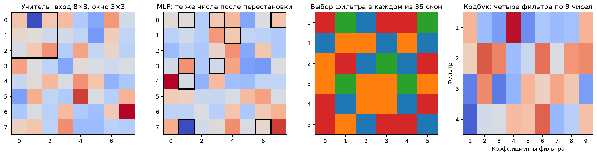
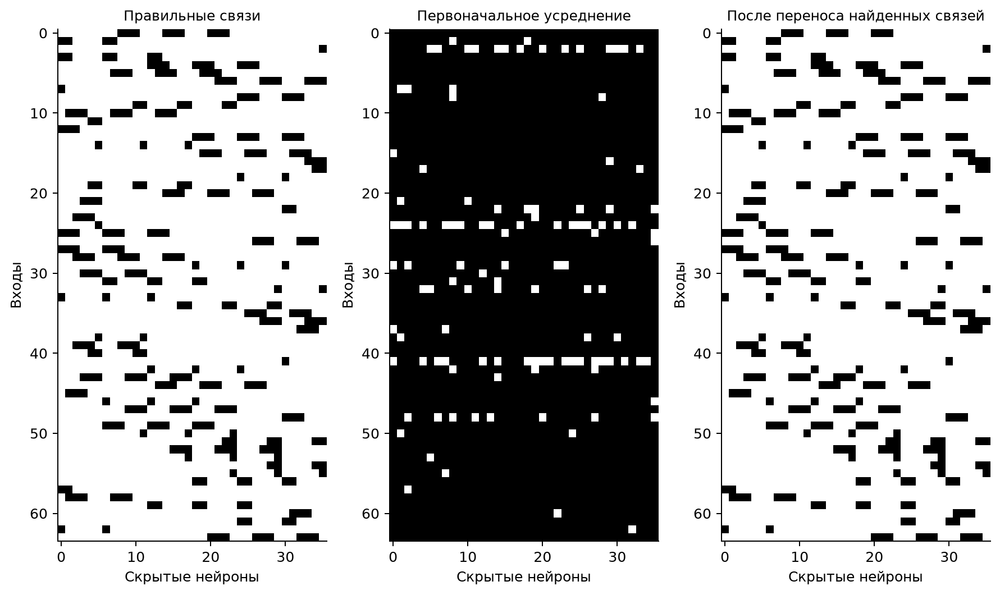
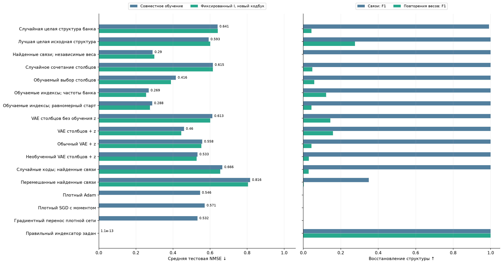
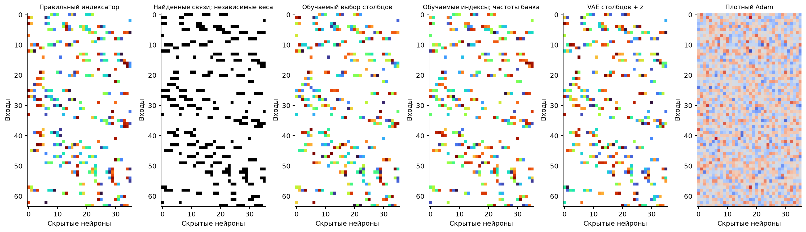

# Скрытая свёртка: извлечение связей и новых индексаторов

28 октября 2026 года. Продолжение [проверки устойчивости извлечения](MLP_ROBUSTNESS_2026-10-28.md).

**Из исходных данных удалось извлечь правильные связи и перенести их на новые функции. Полный индексатор с правильными повторениями весов на новых сочетаниях пока не восстановлен.** Лучший генератор без VAE дал NMSE 0,269 против 0,546 у Adam. Однако перенос одних связей уже даёт 0,290: большая часть выигрыша связана с найденной локальностью.

## Задача и эталонное решение

Вход — 64 независимых стандартных нормальных числа. Учитель располагает их в массиве 8×8 и рассматривает все 36 окон 3×3. В каждом окне выбирается один из четырёх фильтров. У всех задач одна неизвестная перестановка входных координат; выбор фильтров и их численные коэффициенты меняются между задачами.

Обозначим через Tₕ(s) номер входа на позиции s окна h после этой перестановки, а через qₕ — выбранный фильтр. Тогда:

$$
\begin{aligned}
x&\sim\mathcal N(0,I_{64}),\qquad h=1,\ldots,36,\quad s=1,\ldots,9,\quad q_h\in\{1,2,3,4\},\\
y(x)&=\frac16\sum_{h=1}^{36}\operatorname{ReLU}\!\left(\sum_{s=1}^{9} C_{9(q_h-1)+s}\,x_{T_h(s)}\right).
\end{aligned}
$$

Ученик — обычная MLP **64 → 36 ReLU → 1**. У неё 2304 возможные связи. Индексатор задаёт, какое число кодбука стоит на каждой связи; код 0 означает отсутствие связи, его значение фиксировано и равно нулю. Остальные 36 чисел обучаются. Эталонный индексатор известен по построению:

$$
\begin{aligned}
I^*_{ih}&=\begin{cases}
9(q_h-1)+s,&i=T_h(s),\\
0,&i\notin\{T_h(1),\ldots,T_h(9)\},
\end{cases}\\
W_{ih}&=C_{I^*_{ih}},\qquad C_0=0.
\end{aligned}
$$

В нём **324 активные связи** используют 36 общих чисел. Истинные I и C представляют чистую функцию без ошибки; контроль с правильным I заново обучает C по тем же данным. Это эталонное представление, а не аналитический алгоритм восстановления учителя из конечной выборки.

Пример из первой итоговой функции: две связи в разных окнах используют один коэффициент:

$$
I_{8,1}=I_{46,4}=28,\qquad C_{28}=-0.9107.
$$

Метод получает размеры сети, бюджет из 36 чисел и фиксированный нулевой код. Размер окна, число фильтров, перестановка входов, число активных связей и истинный индексатор ему не сообщаются. Смещения у всех моделей нулевые, выходные веса фиксированы и равны 1/6.

Слева — нормальные числа в расположении учителя и одно окно; затем — те же числа на входе MLP, где девять входов окна разбросаны. Четыре цвета в третьем рисунке обозначают четыре фильтра. Справа показаны их численные коэффициенты. Это синтетическая задача, а не реальные изображения.

## Откуда берётся обучающий банк

Путь извлечения: **исходные пары вход–ответ → обученные сети → приближённые индексаторы**. Учительские индексаторы на этом пути не используются. VAE — один из последующих генераторов; извлечение и генерация разделены.

Взяли 32 исходные функции. Каждая имеет 16 384 обучающих и 2048 проверочных примера. Обучили по четыре обычные плотные сети, 8192 шага Adam: два старта без штрафа и два со слабым L1-штрафом. Числа исходного кодбука — перестановки 36 разнесённых значений от −1 до 1 с небольшой случайной добавкой; эти значения оптимизатору не сообщаются. В новых функциях числа кодбука выбираются непрерывно из того же диапазона.

Скалярный k-means оценивает повторения обученных весов. Чтобы отделить фоновые веса от активных, проверяются семь способов обработки нуля, включая несколько порогов относительно медианы величин весов. Для каждого кандидата переобучаются только числа кодбука; вариант выбирается по исходной проверочной ошибке. Размер правильной маски при этом не задаётся.

Первоначальное усреднение сохраняло 2189 из 2304 связей. Поэтому дополнительно взяли связи из **самого точного исходного решения по проверочной ошибке**. В нём оказалось 324 связи; последующая диагностика подтвердила их правильность. Затем сопоставили столбцы остальных сетей по доле энергии их весов внутри этих найденных связей, повторно обучили исходные сети на них и снова извлекли индексаторы. Ни геометрия входов, ни число фильтров для этого не нужны.

Оставили по два лучших решения каждой исходной функции: 64 индексатора. На 48 структурах из 24 функций обучаются генераторы, 16 структур из восьми других функций используются для выбора состояний VAE. «Лучшие» здесь означает относительный отбор по исходной проверочной ошибке; это не гарантия правильной структуры. После дополнительного обучения средняя ошибка исходных сетей даже выросла с 0,0084 до 0,0257. Связи стали согласованнее, но банк повторений остался неточным:

| Что восстановлено в исходных решениях | Первоначальный банк | После переноса найденных связей |
| :-- | --: | --: |
| Связи, средний F1 | 0.388 | 0.994 |
| Повторения весов, средний F1 | 0.067 | 0.192 |
| Полностью восстановленный индексатор | 1/32 | 2/32 |

После извлечения точны только **2 из 32** лучших исходных индексаторов. Общая маска связей в итоговом банке восстановлена полностью. Числа таблицы относятся к самим исходным индексаторам и считаются после согласования эквивалентных перестановок.

## Как генерируем индексаторы

Для генераторов столбцов, отдельных индексов и VAE найденная общая маска связей фиксируется заранее. Они выбирают коды на этих связях. Поэтому F1 связей, равный единице, относится к предварительному извлечению; он не означает, что каждый генератор самостоятельно обнаружил окна.

| Метод | Что делает на новой задаче |
| :-- | :-- |
| Обучаемый выбор столбцов | Собирает для каждого нейрона варианты его столбца из исходного банка; обучает выбор между ними и 36 чисел кодбука. VAE не используется. |
| Обучаемые отдельные индексы | На каждой найденной связи обучает категориальный выбор одного из 36 кодов. Начальные вероятности получены из частот банка; отдельный контроль начинает с равномерных вероятностей. |
| VAE столбцов / обычный VAE | Обучаются восстанавливать только исходные индексаторы. На новой задаче декодер заморожен; обучается кодбук и, при необходимости, z. У столбцов отдельные z, у обычного VAE один общий. NF в опыте не используется. |
| Целая исходная структура | Переносит случайный или лучший по исходной ошибке индексатор; переобучает числа. |
| Только найденные связи | Сохраняет извлечённые связи, но обучает на них 324 независимых веса. Повторений весов здесь нет. |
| Случайные контроли | Независимо выбирают столбцы или коды, используют необученный VAE либо перемешивают найденные связи. |
| Плотные методы | Adam и SGD с моментом обучают 2304 веса с нуля. Градиентный перенос дообучает исходную плотную сеть без ограничений связей. |

У VAE столбцов обучаются 288 переменных z, у обычного — 64. У выбора столбцов — 1728 логитов, у отдельных индексов — 11 664. Поэтому **36 чисел кодбука — не всё число оптимизируемых переменных**. Независимые вероятности и разделение VAE по столбцам являются явными предположениями о генераторе, а не результатом обнаружения четырёх фильтров.

## Новые задачи и отдельная проверка структуры

Первый пилот использовался для разработки извлечения. Для итоговой оценки после изменения выравнивания и добавления генераторов без VAE созданы **восемь свежих функций** с новыми сочетаниями, коэффициентами и примерами. Каждая отличается от ближайшего исходного обучающего сочетания как минимум в **16–20 окнах из 36**, даже после переименования фильтров.

Формальное пространство выбора фильтров содержит 4³⁶ сочетаний. Это не доказательство сложности для любого алгоритма: контроль с независимым выбором столбцов специально использует возможность покомпонентного поиска.

На функцию: **256 примеров для градиентного обучения, 512 для выбора состояния и старта, 4096 только для итоговой ошибки**. Все методы имеют четыре старта по 2048 шага. Численные шаги выбраны на двух отдельных калибровочных функциях. Бюджет по стартам, шагам и предъявлениям обучающих примеров совпадает; FLOPs, число переменных и затраты исходного сбора не уравнены.

Проверяем две части индексатора. F1 связей оценивает найденные соединения. F1 повторений оценивает пары активных соединений, использующих одно число: учитывает и ошибочные объединения, и пропущенные повторения. Перестановки скрытых нейронов и номеров кодов учитываются только при диагностике. Для плотных сетей дискретный индексатор не придумываем.

Дополнительно фиксируем каждый выбранный индексатор и **заново обучаем только кодбук с четырёх других стартов**. Так проверяем, объясняется ли ошибка самой структурой или неудачным совместным обучением чисел и индексов.

## Результаты

NMSE — MSE, делённая на дисперсию обучающих ответов. Состояния и старты выбираются по проверочной ошибке; затем усредняется итоговая ошибка восьми функций.

| Метод | NMSE ↓ | Новый кодбук при фиксированном I ↓ | F1 повторений ↑ |
| :-- | --: | --: | --: |
| Случайная целая структура банка | 0.641 | 0.642 | 0.044 |
| Лучшая целая исходная структура | 0.593 | 0.601 | 0.276 |
| Найденные связи; независимые веса | 0.290 | 0.299 | 0.000 |
| Случайное сочетание столбцов | 0.615 | 0.615 | 0.048 |
| Обучаемый выбор столбцов | 0.416 | 0.389 | 0.059 |
| Обучаемые индексы; частоты банка | 0.269 | 0.255 | 0.122 |
| Обучаемые индексы; равномерный старт | 0.288 | 0.276 | 0.044 |
| VAE столбцов без обучения z | 0.613 | 0.601 | 0.144 |
| VAE столбцов + z | 0.460 | 0.445 | 0.158 |
| Обычный VAE + z | 0.558 | 0.553 | 0.043 |
| Необученный VAE столбцов + z | 0.533 | 0.528 | 0.029 |
| Случайные коды; найденные связи | 0.666 | 0.655 | 0.028 |
| Перемешанные найденные связи | 0.816 | 0.805 | 0.003 |
| Плотный Adam | 0.546 | — | — |
| Плотный SGD с моментом | 0.571 | — | — |
| Градиентный перенос плотной сети | 0.532 | — | — |
| Правильный индексатор задан | 1.10e-13 | 1.09e-13 | 1.000 |

**Полезные связи извлечены из данных.** Они совпали с эталоном; обучение 324 независимых весов на этих связях дало NMSE 0,290 против 0,546 у Adam и 0,571 у SGD. Перемешивание связей ухудшает результат до 0,816.

**Генератор без VAE оказался лучше проверенных VAE по ошибке функции.** Отдельные обучаемые индексы дали 0,269, VAE столбцов — 0,460. Но равномерная инициализация индексов на тех же связях уже даёт 0,288. Дополнительный выигрыш от частот банка невелик; значительная часть переноса относится к связям.

**Правильные новые повторения весов пока не восстановлены.** У лучших отдельных индексов F1 повторений всего 0,122, у VAE столбцов — 0,158. Ни один обучаемый генератор не получил точный индексатор хотя бы одной из восьми функций. Их выбранные индексаторы отличаются от исходного банка, но новизна сама по себе не означает правильность. Копирование лучшего исходного индексатора сохраняет F1 повторений 0,276, однако плохо решает новую функцию: NMSE 0,593.

После фиксации индексов и нового обучения кодбука ошибка лучшего генератора остаётся 0,255. При правильном индексаторе она около 10⁻¹³. В этом контроле новые старты чисел кодбука не устранили разрыв.

Белый цвет — отсутствие связи; одинаковый цвет в индексаторах — одно общее число кодбука. У контроля с независимыми весами показаны только связи, у Adam — действительные численные веса. Номера кодов и столбцы согласованы с эталоном только после обучения. [Все методы и эталон для первой новой функции](assets/2026-10-28/hidden_convolution/all_indexators.png).

В этом опыте удалось перенести **локальность**, извлечённую из исходных решений. Заявлять восстановление полного нового индексатора или преимущество конкретного нейросетевого генератора оснований нет. Одно из ограничений — слабый банк повторений: исходные численные решения неплохо приближают функции, но большинство их индексаторов ошибочны. Опыт показывает эту границу всего конвейера, а не только VAE. Исходные задачи имеют больше данных, чем новые; общий вывод о невозможности решения плотным градиентным методом из этого не следует.

## Материалы

[Код и воспроизведение](../experiments/hidden_convolution_v1/README.md), [полная численная сводка](assets/2026-10-28/hidden_convolution/summary.json), [CSV](assets/2026-10-28/hidden_convolution/metrics.csv). [Первоначальный пилот](assets/2026-10-28/hidden_convolution/initial_pilot_comparison.png) и [его результаты](assets/2026-10-28/hidden_convolution/initial_pilot_summary.json) отделены от свежей итоговой оценки.

Сохранены исходные сети, отобранные индексаторы, параметры генераторов, все старты, лучшие кодбуки и структурные переменные, независимые переобучения и кривые. Итоговый запуск — `experiments/hidden_convolution_v1/runs/pilot_v4/`; предшествующие варианты описаны в README. Хеши замороженных банков, приоров и настроек проверены, свежие итоговые данные совпали с заранее сохранённым манифестом. Тесты не создавались и не запускались; выполнены эксперименты, проверка стиля, ссылок и просмотр рисунков.
