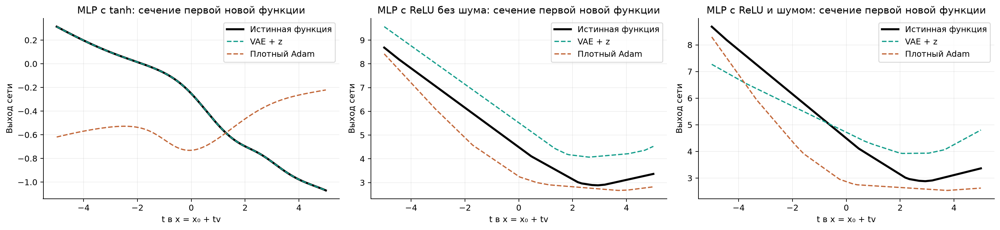
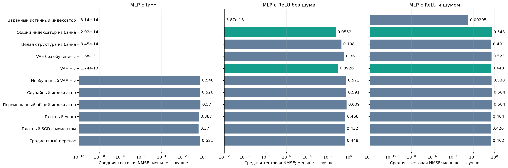
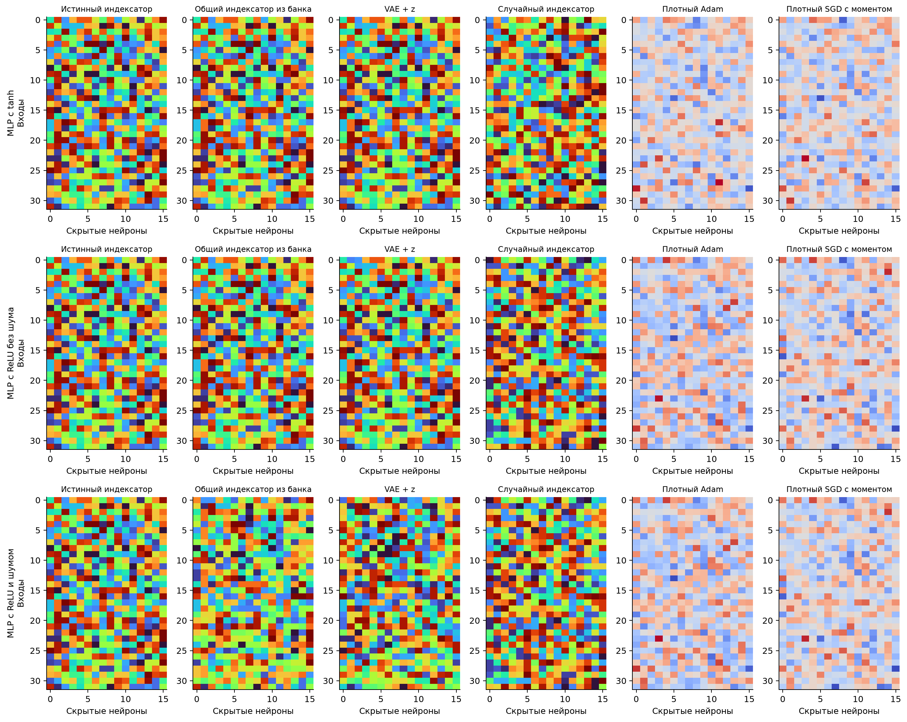

# Устойчивость извлечения структуры: tanh и шумные ответы

28 октября 2026 года. Продолжение [проверки извлечения только из структур](STRUCTURE_ONLY_2026-10-28.md).

**На MLP с tanh перенос структуры снова решил все восемь новых функций. На ReLU с шумными ответами преимущество над SGD исчезло.** Добавленный парный контроль без шума показывает, что нынешний извлекатель чувствителен к небольшим ошибкам исходных весов. Это дополнительные проверки прежнего семейства MLP, а не новые реальные датасеты.

## Задача и точное представление

На входе 32 независимых стандартных нормальных числа. У сети 16 скрытых нейронов и один выход. Матрица из 512 весов использует 32 общих числа; индексатор указывает, какое число стоит на каждой связи:

$$
\begin{aligned}
x&\sim\mathcal N(0,I_{32}),\qquad I^*\in\{1,\ldots,32\}^{32\times16},\\
W^{(t)}_{ih}&=C^{(t)}_{I^*_{ih}},\qquad i=1,\ldots,32,\quad h=1,\ldots,16,\\
y_t(x)&=\frac14\sum_{h=1}^{16}\phi\!\left(\sum_{i=1}^{32}W^{(t)}_{ih}x_i\right).
\end{aligned}
$$

Проверили три условия: tanh без шума, ReLU без шума и ReLU с шумом в обучающих ответах. Во всех условиях числа кодбука исходных и новых функций независимо выбираются из равномерного распределения от −1 до 1. Прежняя равномерная сетка исходных значений здесь не используется. Смещения нулевые, выходные веса фиксированы и равны 1/4 у всех методов.

В шумном условии к обучающему ответу добавляется независимый нормальный шум. Его стандартное отклонение равно 10% стандартного отклонения чистых обучающих ответов соответствующей функции. Проверочные и итоговые ответы чистые у всех методов. Сравниваем восстановление самой функции, без добавления ошибки шума к итоговой метрике.

Точное представление известно по построению: истинный индексатор и истинные 32 числа дают чистую функцию без ошибки. Контроль с заданным истинным индексатором обучает эти числа по тем же примерам. Остальным структурным методам истинный индексатор не сообщается. Это эталонное представление, а не аналитический способ восстановить учителя по конечной выборке.

В первой новой задаче с tanh связи с координатами (вход, нейрон) (1, 1), (3, 2), (8, 9) используют одно число кодбука: C с индексом 12, равное 0.9899. Оно встречается в 16 местах матрицы. На другой функции расположение этих мест сохраняется, а само число меняется.

Показана первая новая функция каждого условия вдоль прямой в 32-мерном пространстве входов. Чёрная линия — истинная функция, пунктирные — решения VAE+z и Adam. Это иллюстрация; численные результаты ниже рассчитаны на полной итоговой выборке.

## Что собрали и какие методы проверили

В каждом условии обучили 24 обычные плотные сети: шесть исходных функций, по четыре старта. На функцию — 8192 обучающих и 2048 проверочных примера; обучение длится 8192 шага. Сохранили по две лучшие сети каждой функции, без требования почти нулевой ошибки.

Из весов каждой сети извлекли приближённый индексатор скалярным k-means с 32 центрами. Скрытые столбцы согласовали по рисунку равенств весов, затем согласовали номера кодов; оба сопоставления — венгерским алгоритмом. Входные примеры, их корреляции и истинная структура в извлечение не поступают. Число кодов 32 задано как бюджет модели. Декодер не ограничивает число использований каждого кода.

VAE получает только согласованные индексаторы. На шести структурах он учится, на шести других выбирается его состояние. После этого его веса заморожены. Значения кодбука на новых функциях обучаются заново; в варианте VAE+z дополнительно обучается 16-мерный z. NF в этой серии не используется.

| Метод | Действие на новой функции |
| :-- | :-- |
| Общий индексатор | Голосование шести исходных обучающих структур; затем обучение 32 чисел. |
| Целая структура из банка | Случайный выбор одного из шести исходных индексаторов; обучение чисел заново. |
| VAE без обучения z / VAE+z | Декодирование случайного z; во втором варианте z дополнительно меняется по ошибке задачи. |
| Необученный VAE+z | Та же процедура со случайным замороженным декодером. |
| Случайный / перемешанный индексатор | Случайное назначение кодов либо перемешивание мест общего индексатора с сохранением числа использований кодов. |
| Плотный Adam / SGD с моментом | Обучение всех 512 весов с нуля; момент SGD равен 0,9. |
| Градиентный перенос | Дообучение всех 512 весов одной из исходных сетей. |
| Заданный истинный индексатор | Диагностический контроль: обучение 32 чисел при известной правильной структуре. |

Для каждого условия взяли восемь новых функций, по четыре старта и 2048 шага. **128 примеров используются для градиентного обучения, ещё 1024 — для выбора состояния и старта, 8192 — только для итоговой оценки.** Поэтому 128 — не весь бюджет размеченных данных. Шаги обучения выбраны на двух отдельных калибровочных функциях. Число стартов, шагов и предъявлений обучающих примеров на новой функции одинаковое; затраты исходного сбора и FLOPs не уравнены.

Парный ReLU-контроль без шума добавлен после того, как в шумном исходном банке обнаружилось слабое восстановление структуры. Истинный индексатор, чистые входы и кодбуки в двух ReLU-условиях совпадают; различается шум обучающих ответов. Исходные и новые функции имеют разные значения кодбука.

## Восстановление структуры

| Условие | NMSE лучшей исходной сети, среднее по 6 функциям | Совпадения общего индексатора с эталоном |
| :-- | --: | --: |
| tanh | 3.43e-14 | 512/512 |
| ReLU без шума | 0.0023 | 499/512 |
| ReLU с шумом | 0.0026 | 255/512 |

Здесь общий индексатор получен голосованием шести структур, использованных для обучения VAE. Сравнение с эталоном выполняется после заморозки, с согласованием столбцов и номеров кодов. Диагностика исходного сборщика отдельно использует все 12 отобранных структур, поэтому её числа отличаются: 512, 504 и 283 соответственно.

На ReLU исходные функции аппроксимированы достаточно хорошо в обоих условиях. Но без шума общий индексатор почти правильный, а с шумом согласование и квантование весов дают значительно более слабую структуру. Низкая ошибка исходной сети сама по себе не обеспечивает точного восстановления повторений весов.

## Решение новых функций

Ниже средняя тестовая NMSE: MSE, делённая на дисперсию обучающих ответов. Для каждой функции состояние и старт выбраны только по проверочной ошибке; затем ошибки восьми функций усреднены. В шумном условии нормировка использует дисперсию зашумлённых обучающих ответов.

| Метод | tanh | ReLU без шума | ReLU с шумом |
| :-- | --: | --: | --: |
| Заданный истинный индексатор | 3.14e-14 | 3.87e-13 | 0.0029 |
| Общий индексатор из банка | 2.92e-14 | 0.0552 | 0.5431 |
| Целая структура из банка | 3.45e-14 | 0.1977 | 0.4907 |
| VAE без обучения z | 1.60e-13 | 0.3614 | 0.5235 |
| VAE + z | 1.74e-13 | 0.0926 | 0.4479 |
| Необученный VAE + z | 0.5462 | 0.5720 | 0.5384 |
| Случайный индексатор | 0.5257 | 0.5912 | 0.5841 |
| Перемешанный общий индексатор | 0.5697 | 0.6093 | 0.5840 |
| Плотный Adam | 0.3866 | 0.4684 | 0.4638 |
| Плотный SGD с моментом | 0.3699 | 0.4323 | 0.4257 |
| Градиентный перенос | 0.5214 | 0.4483 | 0.4622 |

Шкала логарифмическая. Ошибки меньше 10⁻¹² находятся у левой границы графика; подписи показывают фактические значения.

**Tanh:** VAE+z и прямой перенос структуры решают все восемь функций практически точно. Обучение z увеличило число успешных стартов с 13 до 23 из 32 при пороге NMSE < 0,001, но после выбора старта обе версии VAE успешны на 8/8 функциях. Это повторное подтверждение переноса общей схемы, а не необходимости VAE или z.

**ReLU без шума:** VAE+z дал NMSE 0,093 против 0,432 у SGD. Прямое голосование структур ещё лучше — 0,055. Полной точности у общего индексатора нет: совпадают 499 из 512 назначений. VAE+z достиг порога 0,001 на двух из восьми выбранных решений.

**ReLU с шумом:** VAE+z дал 0,448, SGD — 0,426. Убедительного преимущества структурного метода здесь нет. При правильном индексаторе ошибка всего 0,003: сама параметризация по-прежнему полезна, но нынешний конвейер её не восстанавливает достаточно хорошо. Отдельно улучшать извлечение, согласование и обучение приора нужно на исходных задачах, без настройки по этим итоговым функциям.

В первых четырёх столбцах одинаковый цвет означает использование одного числа кодбука. У Adam и SGD показаны действительные численные веса: красный и синий обозначают их знак, а не номер кода. Структуры согласованы с эталоном только для диагностики после обучения. Полные рисунки всех 11 методов и эталона: [tanh](assets/2026-10-28/mlp_robustness/indexators_tanh_continuous_v1.png), [ReLU без шума](assets/2026-10-28/mlp_robustness/indexators_clean_relu_continuous_v1.png), [ReLU с шумом](assets/2026-10-28/mlp_robustness/indexators_noisy_relu_continuous_v1.png).

## Что показал этот опыт

Перенос структуры работает также с tanh и непрерывными случайными исходными кодбуками. На ReLU без шума он сохраняет преимущество при неполном восстановлении индексатора. При шуме проявилась граница нынешнего способа извлечения: качественных численных решений недостаточно, если их квантование и согласование искажают общую схему.

Индексатор одинаков для всех функций каждого условия. Перенос целой исходной структуры остаётся сильным контролем; новых сочетаний отсутствовавших в банке частей здесь не проверяли. Новые функции имеют значительно меньше обучающих примеров, чем исходные. Поэтому опыт не доказывает, что плотный градиентный метод не найдёт эти функции при достаточном количестве данных. Это пилот на восьми новых функциях каждого условия, без заявления о статистически подтверждённом общем преимуществе.

## Материалы

[Код и команды воспроизведения](../experiments/shared_codebook_mlp_v1/README.md#continuous-source-values-activation-and-observation-noise), [численная сводка](assets/2026-10-28/mlp_robustness/summary.json), [таблица CSV](assets/2026-10-28/mlp_robustness/metrics.csv). Исходные банки, VAE, данные, все старты и лучшие кодбуки/z сохранены в `experiments/shared_codebook_mlp_v1/runs/*continuous_v1/`.

Хеши замороженных банков структур, приоров и настроек проверены перед построением результатов; они не изменились при итоговом решении. Тесты не создавались и не запускались. Выполнены сами эксперименты, проверка стиля кода и просмотр рисунков.
