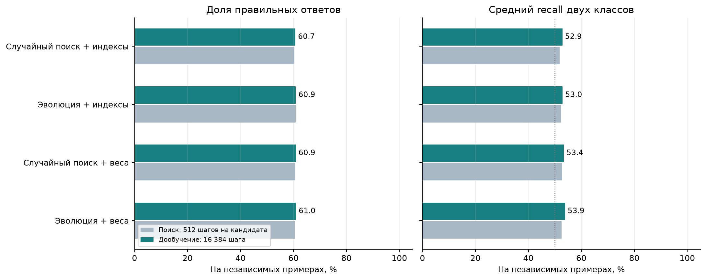
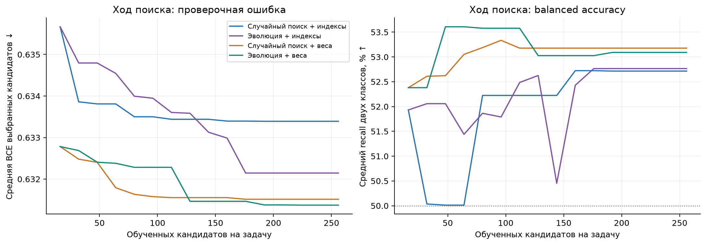
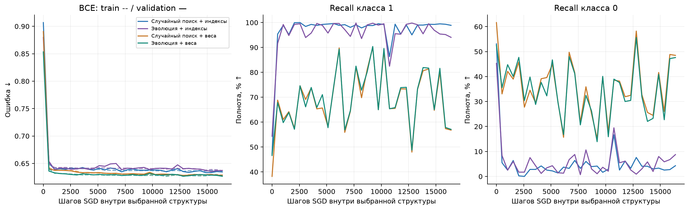
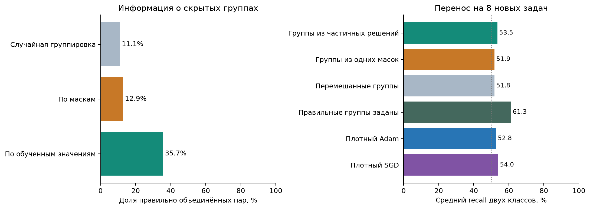
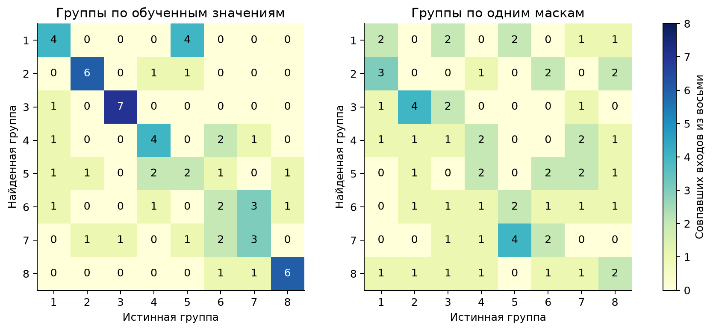
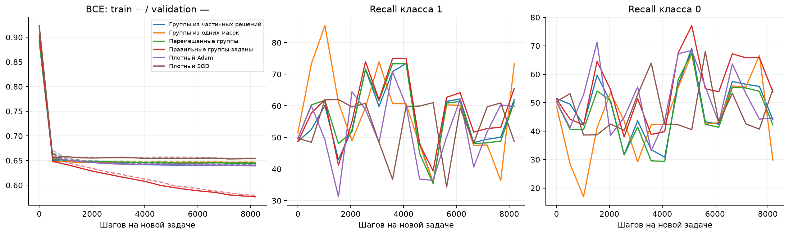

# Поиск структур MLP: случайный выбор и эволюция

28 октября 2026. Сбор полных и частичных решений, извлечение структуры и проверка переноса.

Частичные решения содержат информацию о скрытых связях. В этом пилоте извлечённая группировка не дала убедительного преимущества над плотным обучением на новых задачах.

## Задача и её точное решение

На вход поступают 64 независимых равновероятных бита. Ответ вычисляет скрытая
схема: 16 блоков первого уровня, четыре второго и один выходной. Каждый блок
получает четыре входа и вычисляет XOR либо порог «не менее двух/трёх единиц».
У задач общая скрытая группировка координат, но разные связи и операции.
Ученику дают только вход и конечный ответ всей схемы.

При известной схеме решение записывается точно через ReLU. Обозначим через
ReLU положительную часть числа, а через s — сумму четырёх входящих битов:

$$
\begin{aligned}
\operatorname{XOR}_4(s) &= \operatorname{ReLU}(s)
-2\operatorname{ReLU}(s-1)+2\operatorname{ReLU}(s-2)
-2\operatorname{ReLU}(s-3),\\
T_2(s) &= \operatorname{ReLU}(s-1)-\operatorname{ReLU}(s-2),\\
T_3(s) &= \operatorname{ReLU}(s-2)-\operatorname{ReLU}(s-3).
\end{aligned}
$$

На целых s от 0 до 4 эти формулы дают нужные нули и единицы. Следовательно,
все задачи точно представимы ReLU-MLP 64–64–16–4–1. Ученики имеют именно эти
размеры и обучаемые смещения. Это доказывает существование точного решения
для свободных численных весов; произвольный фиксированный codebook
не обязан содержать значения для такого решения.

Например, для четырёх битов (1, 0, 1, 0) сумма равна двум:
XOR возвращает 0, порог двух единиц возвращает 1, а порог трёх — 0.

Например, в первой задаче два первых блока берут координаты **38, 8, 14, 31; 64, 38, 14, 31**.
Их ответы затем участвуют в операции следующего уровня. Эти координаты и
промежуточные ответы используются только генератором данных, а не поиском.

## Что выбираем и что обучаем

Кандидат задаёт маски связей и codebook каждого слоя: девять общих чисел
для весов и ещё девять для смещений. Codebook строится из целых значений
от −4 до 4 с выбранным масштабом; маски и масштабы меняются между кандидатами.
Число разрешённых входов нейрона выбирается из нескольких плотностей,
включая полный слой. Первый кандидат каждой задачи — плотная сеть.
Правильную группировку входов поиску не сообщаем.

**Обучение индексов.** Для каждого разрешённого веса обучается вещественное
вспомогательное число. Индекс выбирает ближайший элемент фиксированного
codebook; в прямом проходе используется именно это дискретное значение.
В обратном проходе применяем приближение: производную выбора заменяем
единицей. Это straight-through SGD, а не точный градиент дискретного индекса.
Числа самого codebook остаются фиксированными. Смещения обучаются аналогично.

Для одного слоя это можно записать так:

$$
W_{ij}=M_{ij}c_{I_{ij}},
\qquad I_{ij}=\arg\min_{k\in\{1,\ldots,9\}}|u_{ij}-c_k|.
$$

Здесь M — предложенная маска связей, c — девять фиксированных чисел,
u — обучаемые вспомогательные числа, I — полученные дискретные индексы.

**Обучение весов.** При той же фиксированной маске обычный SGD обучает
свободные численные веса и смещения. Индексов общего codebook в этом варианте нет.

**Случайный поиск** независимо предлагает новые маски и масштабы.
**Эволюция** выбирает четыре лучших кандидата по проверочной BCE,
скрещивает их связи на уровне нейронов, меняет часть связей и масштабы.
В каждой популяции из 16 есть четыре новых случайных кандидата. Численные
веса и вспомогательные числа индексов для каждого кандидата обучаются заново:
наследуется структура. Отбор не использует правильные связи учителя.

## Данные и бюджет

Взяты те же четыре полные задачи, которые уже просмотрены при предыдущей
проверке плотных SGD/Adam. Это исходные задачи для разработки способа сбора
банка, **не независимые новые задачи переноса**. Части по отдельности не обучались.

Каждый метод проверил 256 кандидатов на задачу: 16 популяций по 16,
по 512 шагов SGD и 128 новых примеров на шаг. Это 16,777,216 предъявлений
обучающих примеров на задачу и метод. Сравниваются три шага обучения,
используется SGD с моментом 0.9. Начальная популяция, данные и случайные
старты согласованы между вариантами. Число предъявлений одинаково;
стоимость квантования означает, что это не равенство FLOPs.

Кандидат и чекпойнт выбираются по BCE на отдельных 4096 примерах.
Все четыре поиска завершились до оценки на 16 384 независимых примерах.
Успех требует accuracy ≥97% и recall каждого класса ≥95%.

После просмотра хода поиска добавлен диагностический этап: для выбранной
структуры каждой задачи по шесть новых стартов, по 16 384 шага. Это ещё
12,582,912 предъявлений на задачу и метод. Настройки для всех методов
одинаковы; итог оценивается на новой независимой выборке. Этот этап проверяет
недостаток времени внутреннего обучения, но не заменяет длинную оценку всех
ранее отброшенных структур.

## Результаты

| Поиск структуры и внутреннее обучение | После поиска: accuracy | После дообучения: accuracy | После дообучения: средний recall двух классов | Решено |
| :-- | --: | --: | --: | --: |
| Случайный поиск + индексы | 60.4% | 60.7% | 52.9% | 0/4 |
| Эволюция + индексы | 60.9% | 60.9% | 53.0% | 0/4 |
| Случайный поиск + веса | 60.7% | 60.9% | 53.4% | 0/4 |
| Эволюция + веса | 60.6% | 61.0% | 53.9% | 0/4 |

Accuracy — доля правильных ответов. Средний recall двух классов
(balanced accuracy) не позволяет выдать постоянное предсказание частого
класса за решение: у такого предсказания показатель равен 50%.

Детали после длинного обучения выбранных структур:

| Задача | Случайный + индексы | Эволюция + индексы | Случайный + веса | Эволюция + веса | Частый класс |
| :-- | --: | --: | --: | --: | --: |
| 1 | 50.0% | 50.0% | 50.0% | 50.0% | 50.0% |
| 2 | 74.9% | 75.3% | 76.1% | 76.4% | 72.2% |
| 3 | 68.0% | 68.0% | 68.0% | 68.0% | 68.0% |
| 4 | 50.1% | 50.3% | 49.6% | 49.6% | 50.3% |

Этапы поиска и дообучения оценены на разных независимых выборках.
Столбец «Частый класс» — доля более частого класса в той же итоговой выборке;
это ориентир для оценки accuracy, а не отдельный алгоритм поиска.

На графике поиска показано среднее по четырём задачам для текущего кандидата,
выбранного по минимальной проверочной BCE. Это проверочные, а не итоговые метрики.

Кривые усреднены по всем шести стартам каждой задачи, а не только по лучшим.
Пунктир показывает среднюю обучающую BCE между отметками; сплошные линии —
ошибку и recall на проверочной выборке текущих параметров.

## Можно ли извлечь структуру без точных решений

По уточнению пользователя сняли требование точного решения. Рассмотрели
все 96 моделей длинного этапа и взвесили их по улучшению проверочной BCE
относительно постоянного прогноза частоты класса. Оставлен запас 0.005,
чтобы не придавать вес совсем малым улучшениям. Итоговая оценочная выборка
для этого отбора не использовалась.

Положительный вес получили **21 модели из 96**, все — на исходной
задаче 2. Таким образом, банк содержит разные
частичные решения фактически одной функции, а не многих разнообразных задач.
Это существенное ограничение текущего опыта.

По совместному участию входов в обученных нейронах восстановили восемь групп
по восемь координат и пары групп следующего уровня. Число и размеры групп
заданы постановкой; их состав извлекается из моделей. Сравнили с извлечением
из одних масок, без численных значений весов.

**Среди пар, объединённых по обученным значениям, 35.7% действительно
принадлежат одной скрытой группе.** У случайной группировки ожидается
11.1%; по одним маскам получилось 12.9%. Ни одна из восьми
групп не восстановлена полностью. Это частичная информация о структуре,
а не готовое точное решение.

Группировка заморожена до генерации новых задач. Проверили две отдельные
задачи для выбора шага обучения и **восемь новых полных задач той же семьи**.
Для каждого представления настройка выбиралась только на двух первых задачах.
На новой задаче — четыре старта по 8192 шага, batch 128; все численные веса
обучаются заново. Правильная группировка дана только отдельному oracle-контролю.
Перемешанная группировка сохраняет размеры и число связей.

| Представление новой задачи | Средняя BCE ↓ | Accuracy | Средний recall двух классов |
| :-- | --: | --: | --: |
| Группы из частичных решений | 0.6381 | 58.4% | 53.5% |
| Группы из одних масок | 0.6441 | 58.1% | 51.9% |
| Перемешанные группы | 0.6428 | 58.0% | 51.8% |
| Правильные группы заданы | 0.5514 | 62.9% | 61.3% |
| Плотный Adam | 0.6383 | 58.4% | 52.8% |
| Плотный SGD | 0.6436 | 57.8% | 54.0% |

Извлечение из обученных значений немного лучше перемешанной группировки,
но BCE практически совпадает с плотным Adam. Плотный SGD имеет немного
больший средний recall классов. По восьми задачам нельзя уверенно утверждать
преимущество извлечённой структуры. Разности ошибок и предварительные
парные bootstrap-интервалы сохранены рядом с таблицей.

**Итог: точность исходных решений не является обязательным условием
извлечения структуры.** Здесь информация нашлась, но её пока недостаточно
для убедительного выигрыша на новых задачах. Логичное продолжение — банк
частичных решений разных полных функций, чтобы общий рисунок связей
восстанавливался по нескольким независимым исходным задачам.

## Что можно заключить

Частичные решения содержат информацию о скрытых связях. В этом пилоте извлечённая группировка не дала убедительного преимущества над плотным обучением на новых задачах.

Пилот проверяет конкретные маски, codebook и операторы эволюции при указанном
бюджете. Он не доказывает невозможность эволюционного решения или отсутствие
полезной структуры. По одному запуску на четырёх исходных задачах также
нельзя уверенно ранжировать небольшие различия между методами.

Для продолжения важнее разнообразие исходных функций: сейчас информативные
частичные решения относятся к одной задаче. Следует отдельно оценивать
восстановление общей структуры и улучшение качества новых задач; порог
точности 97% не является условием допуска модели к извлечению структуры.

## Воспроизведение

Код и протоколы: [experiments/mlp_logic_v1](../experiments/mlp_logic_v1/).
Исходные результаты поиска: [search_v1](../experiments/mlp_logic_v1/results/search_v1/summary.json),
длинного обучения: [refit_v1](../experiments/mlp_logic_v1/results/refit_v1/summary.json).
Сохранены все структуры, качества кандидатов, loss/recall, выбранные модели,
дискретные индексы лучших вариантов и SHA256 замороженных исходников.
Лучшие неуспешные кандидаты не называются успешным банком.
Уточнение с частичными решениями и переносом:
[weak_bank_v1](../experiments/mlp_logic_v1/results/weak_bank_v1/summary.json).
Кривые предыдущего этапа:
[калибровка плотных методов](assets/2026-10-28/mlp_structure_search/calibration_training.png).
