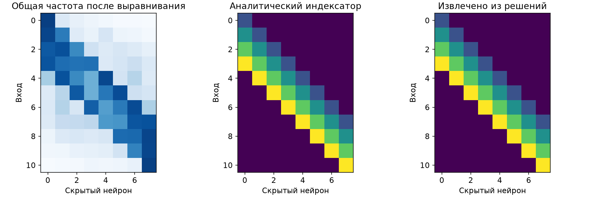
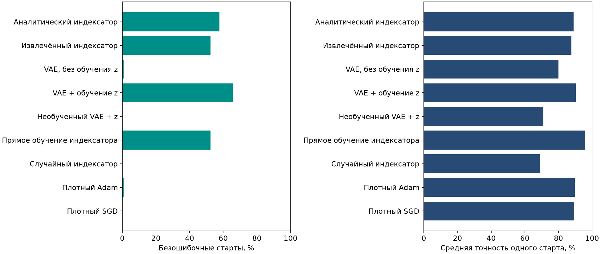
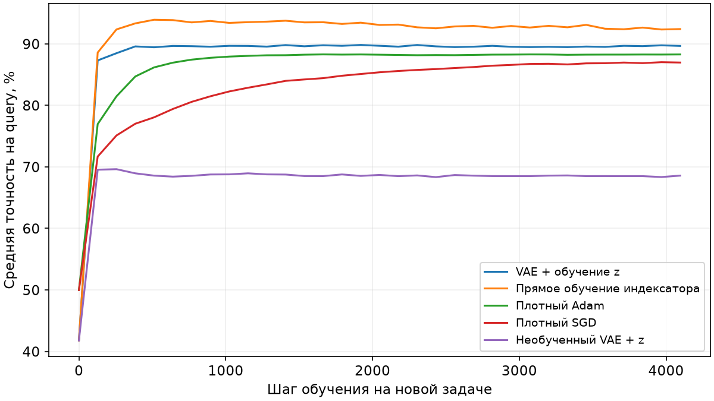
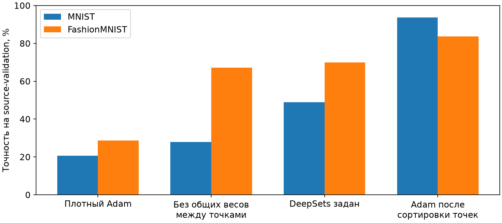
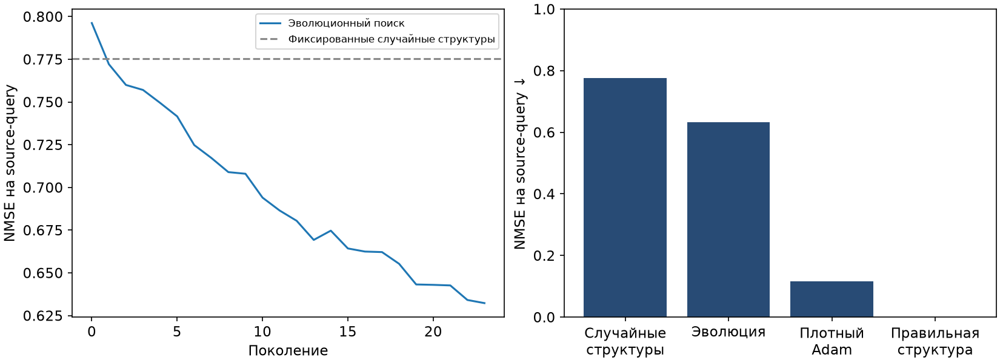

# Pattern: извлечение индексатора и перенос через NF+VAE

28 октября 2026 года. Завершённый эксперимент на исходном Pattern; это первый этап общей проверки трёх примеров.

## Задача и точное решение

На вход подаётся строка из 11 бит. Нужно определить, встречается ли в ней заданный шаблон из четырёх бит. Например, строка `11001011100` содержит шаблон `0010`. Всего возможны 2048 входов. В исходных задачах использовали 12 шаблонов, а для проверки переноса оставили четыре новых: `0010`, `0100`, `1011`, `1101`.

Переведём биты входа и шаблона в значения −1 и +1. Один скрытый нейрон проверяет одно из восьми положений шаблона:

$$
\begin{aligned}
x&\in\{-1,+1\}^{11},\qquad p\in\{-1,+1\}^{4},\\
h_j(x)&=\operatorname{ReLU}\!\left(\sum_{r=1}^{4}p_r x_{j+r-1}-3\right),\qquad j=1,\ldots,8,\\
y(x)&=\mathbf{1}\!\left\{\sum_{j=1}^{8}h_j(x)>0\right\}.
\end{aligned}
$$

При полном совпадении сумма четырёх произведений равна 4, поэтому отклик нейрона равен 1. Одно несовпадение уменьшает сумму до 2, и отклик становится нулевым. Это точное решение задачи. Для шаблона `0010` четыре коэффициента фильтра равны −1, −1, +1, −1.

## Что переносим

Численные значения весов хранятся в кодбуке, а индексатор указывает, какое значение поставить на каждую связь:

$$
\begin{aligned}
W_{ij}&=C_{I_{ij}},\
I&\in\{0,1,2,3,4\}^{11\times8},\
C_0&=0,\
f(x)&=a\sum_{j=1}^{8}\operatorname{ReLU}\!\left(\sum_{i=1}^{11}W_{ij}x_i+b\right)+c.
\end{aligned}
$$

На новой задаче обучаются четыре значения кодбука и три общих числа: скрытое смещение, выходной коэффициент и выходное смещение. Всего семь численных параметров. В варианте NF+VAE дополнительно обучается латентный вектор из 16 чисел; параметры самого VAE заморожены. Независимые веса связей здесь не обучаются. Плотная сеть имеет 105 свободных параметров.

## Банк, выравнивание и VAE

На 12 исходных задачах собрали 6144 обычные сети: по 512 случайных инициализаций на шаблон. Каждую обучали Adam и постепенно прореживали до 32 связей, после прореживания возвращая численные параметры к исходной инициализации. Было шесть стадий по 1024 шага. Этот сбор — отдельные предварительные затраты, они не входят в бюджет решения новой задачи.

В рабочем банке оставили лучшую четверть решений **для каждой задачи отдельно**, по BCE на исходной проверочной выборке. Почти идеальная точность не требуется: даже неполное решение может содержать полезную структуру. Исключаются решения с BCE выше 0,5. Банк содержит 1536 решений: 1152 для обучения VAE, 192 для выбора его состояния и 192 в резерве. Начальные состояния сетей между этими частями не пересекаются. У обучающей части средняя исходная точность — 94.84%, минимальная — 82.42%.

Перед обучением VAE обязательно выровняли скрытые столбцы. Венгерский алгоритм сопоставляет столбцы каждой маски общей опорной маске. Опорную маску уточняли по исходным обучающим решениям; среди начальных вариантов выбирали тот, с которым решения лучше согласуются. Аналитическая маска при этом не использовалась.

После выравнивания сравнили, как веса каждой связи меняются между исходными задачами. Связи с похожими профилями объединяются в группы общих значений. Здесь заранее заданы размеры модели: восемь скрытых нейронов, четыре связи на нейрон при извлечении общей маски и четыре группы по восемь связей. Расположение связей и состав групп алгоритму не сообщаются. Извлечены все 32 правильные связи и все 32 правильные принадлежности к группам с точностью до переименования четырёх значений кодбука.

NF получает веса сети, градиент ошибки и функциональный отклик её связей. Для исходных задач используются отдельные NF-энкодеры и один общий категориальный декодер VAE. Он восстанавливает **отобранные выровненные маски** и группы общих весов. Состояние VAE выбирается по ошибке восстановления на отложенных сетях исходных задач. Аналитический индексатор используется только для итогового сравнения и контрольного метода.

## Сравниваемые методы

**Извлечённый индексатор** сразу использует найденную общую структуру и обучает кодбук. **VAE без обучения z** декодирует случайный латентный вектор и обучает только численные параметры. **VAE + z** одновременно обучает кодбук и латентный вектор, меняющий дискретный индексатор через замороженный декодер. Для дискретных назначений применяется straight-through оценка градиента.

**Прямое обучение индексатора** начинает с того же обученного декодера, но затем меняет все категориальные оценки связей независимо. Поэтому этот вариант тоже использует перенос; это проверка необходимости латентного ограничения. **Необученный VAE + z** проверяет роль предварительного обучения. Ещё два контроля — случайный индексатор и заранее заданный аналитический индексатор. Плотные Adam и SGD обучают обычную сеть без кодбука.

На каждом новом шаблоне у каждого метода 32 старта по 4096 шагов на одних и тех же 768 обучающих входах. Шаг и лучший старт выбираются по 256 другим входам. Итоговый test содержит 512 входов. Настройки численного обучения выбраны на исходных шаблонах. Дополнительно проверяется точность на **всех 2048 входах**; это полная проверка конечной задачи, а не отдельная независимая выборка. Показатели из разных стартов относятся к четырём задачам, а не к 128 независимым задачам.

## Результаты

«Безошибочный старт» означает ноль ошибок на всех 2048 входах. Последние два столбца относятся к одной модели на задачу, выбранной по query среди 32 стартов.

| Метод | Безошибочные старты | Средняя точность старта, все входы | Выбранные модели, все входы | Выбранные модели, test |
| :-- | --: | --: | --: | --: |
| Аналитический индексатор | 74/128 | 88.90% | 100.00% | 100.00% |
| Извлечённый индексатор | 67/128 | 87.75% | 100.00% | 100.00% |
| VAE, без обучения z | 1/128 | 79.94% | 95.42% | 95.12% |
| VAE + обучение z | 84/128 | 90.20% | 100.00% | 100.00% |
| Необученный VAE + z | 0/128 | 71.07% | 72.20% | 72.66% |
| Прямое обучение индексатора | 67/128 | 95.52% | 100.00% | 100.00% |
| Случайный индексатор | 0/128 | 68.90% | 71.74% | 72.31% |
| Плотный Adam | 1/128 | 89.67% | 98.71% | 97.85% |
| Плотный SGD | 0/128 | 89.36% | 97.67% | 96.34% |

Общая структура извлечена правильно: с фиксированным извлечённым индексатором решены все четыре новые задачи без ошибок. **VAE с обучаемым z тоже решил все четыре задачи**, а в отдельных стартах дал 84/128 безошибочных решений против 1/128 у плотного Adam и 0/128 у плотного SGD. Без обучения z у VAE только один безошибочный старт. У необученного декодера их нет: предварительно выученная структура существенна.

При этом VAE не лучший по каждому показателю. Прямое обучение индексатора даёт более высокую среднюю точность старта, хотя точных решений у него меньше. В отдельных запусках VAE ошибается существенно. Поэтому вывод здесь — преимущество по частоте нахождения **полного решения**, а не превосходство по любой метрике.

Pattern подтверждает работу связки «банк → выравнивание → общая структура → новый кодбук» и перенос через замороженный VAE. Однако его истинный индексатор одинаков для всех шаблонов. Этот эксперимент ещё не доказывает, что VAE умеет составлять принципиально новые сложные индексаторы, и не заменяет проверку на более крупной задаче.

## Два известных датасета: только предварительная проверка постановки

Для MNIST и Fashion-MNIST проверили DeepSets на неупорядоченных множествах точек. Изображение уменьшается до 14×14; каждая из 196 точек содержит строку, столбец и яркость. Метки классов остаются исходными. Во время обучения порядок точек случайно меняется. Использованы 6000 исходных обучающих изображений и 2000 других исходных изображений для проверки, два старта по 2048 шагов. Официальный test ещё не использовался.

| Метод | MNIST | Fashion-MNIST |
| :-- | --: | --: |
| Плотный Adam, случайный порядок точек | 20,68% | 28,75% |
| Отдельная MLP для каждой позиции, без общих весов | 27,95% | 67,20% |
| DeepSets с заданными общими весами | 48,98% | 69,93% |
| Плотный Adam после восстановления порядка точек | 93,80% | 83,73% |

Здесь DeepSets задан вручную, поэтому таблица **не является результатом поиска структуры нашим методом**. Восстановление порядка делает обычный Adam сильным. На Fashion-MNIST преимущество общих весов над отдельными MLP пока небольшое. Эти проверки помогают выбрать содержательную постановку; два примера извлечения структуры на известных датасетах ещё не завершены.

## Более сложный синтетический вариант

Следующая постановка — скрытая перестановка 64 входов, восемь групп по восемь входов и четыре общих ReLU-фильтра. Каждый фильтр имеет восемь коэффициентов: в кодбуке 32 различных обучаемых значения вместо четырёх. Плотная матрица имеет размер 64×32 и 256 полезных связей. Порядок входов и группы заранее алгоритму не сообщаются.

$$
\begin{aligned}
h_{gk}(x)&=\operatorname{ReLU}\!\left(\sum_{r=1}^{8}C_{kr}x_{\pi(8g+r)}+b_k\right),\\
y(x)&=\frac{1}{\sqrt{32}}\sum_{g=0}^{7}\sum_{k=1}^{4}a_k h_{gk}(x),\qquad x\sim\mathcal{N}(0,I_{64}).
\end{aligned}
$$

Здесь перестановка входов общая между задачами, а численные значения кодбука, смещений и выходных коэффициентов меняются. Точное решение задано учителем. Даже число разбиений входов на восемь неупорядоченных групп примерно равно 4,5×10⁴⁷; полный перебор непригоден.

Проведён первый сбор на четырёх исходных задачах: 64 кандидата, 24 поколения; структуры меняли перестановками входов, а их кодбуки обучали Adam. Получены 1536 состояний кандидатов, из них 1351 различная структура. Безошибочность для попадания в этот предварительный банк не требовалась. Ошибка NMSE — MSE, делённая на дисперсию целевого выхода.

| Исходный контроль | NMSE ↓ |
| :-- | --: |
| Фиксированные случайные структуры | 0,7753 |
| Эволюционный поиск структур | 0,6323 |
| Плотный Adam | 0,1171 |
| Правильная структура, новый кодбук | около 5×10⁻¹⁴ |

Изменение структур помогает относительно фиксированных случайных вариантов, но пока проигрывает плотному Adam. При правильной структуре численное обучение легко решает задачу. Значит, текущая трудность — найти индексатор. Это проверки исходных задач; перенос через NF+VAE на новых задачах этой модификации ещё не проверен. Сравнение на новых задачах потребует общего бюджета и дополнительных контролей.

Отдельный контроль по вторым моментам исходных наблюдений восстановил группы и соответствие всех 64 входов. Он использует гауссовское распределение входов и не перебирает полные индексаторы. Это самостоятельный способ предложить структуру из данных, а не результат извлечения из банка через NF+VAE; смешивать эти выводы нельзя.

## Воспроизводимость

Код: `pattern/codebook/`. Основной протокол: `pattern/codebook/protocol_v4.json`. Итоговые массивы и сохранённые модели: `pattern/runs/codebook_20261028_v4/`. Полный исходный сбор: `pattern/runs/codebook_20261028_v2/raw_collection/`. Предшествующие варианты сохранены для проверки влияния отбора, выравнивания и исправления категориальных целей. Неизменённые плотные базовые методы переиспользуются; происхождение записано в `reused_results.json`.

Машинные таблицы: [comparison.csv](assets/2026-10-28/pattern_codebook/comparison.csv), [pointset_feasibility.json](assets/2026-10-28/pattern_codebook/pointset_feasibility.json). Результаты предварительных проверок изображений и веса моделей находятся в `experiments/structure_search_v2/runs/`.

Источники постановок: [Deep Sets](https://arxiv.org/abs/1703.06114), [Torchvision datasets](https://docs.pytorch.org/vision/main/datasets.html), [официальный Fashion-MNIST](https://github.com/zalandoresearch/fashion-mnist). Использование DeepSets на изображениях как множествах точек — наша проверочная постановка; это не стандартное сравнение архитектур на исходной растровой задаче.
