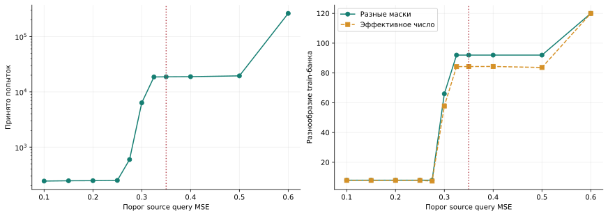
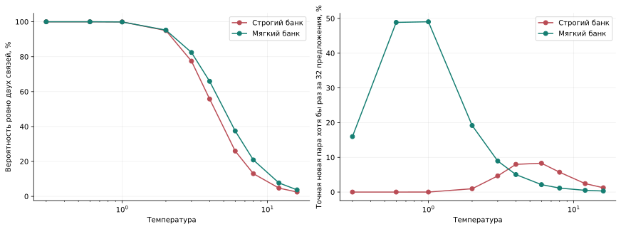
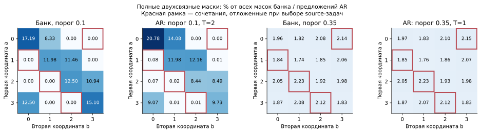
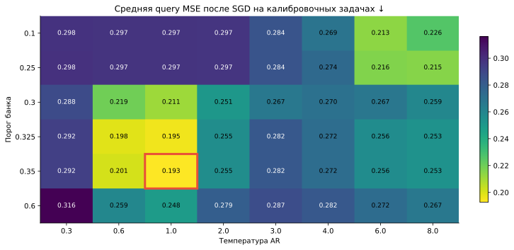
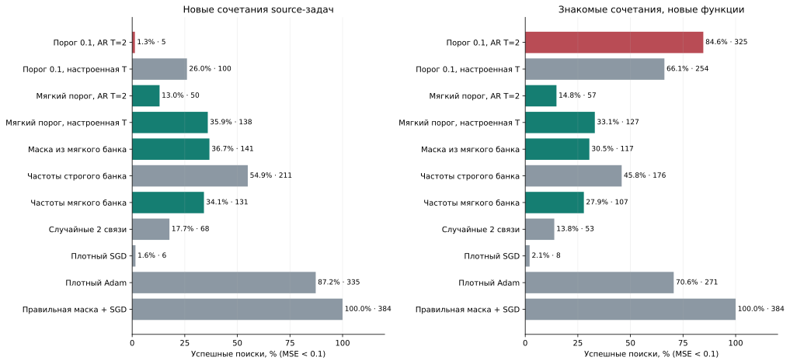

# Почему AR не находил новые маски: порог банка и температура

Диагностика от 3 ноября 2026, продолжение
[итогового отчёта](../final_mds/FINAL_REPORT_2026-11-03.md).
[Протокол](../experiments/sine_ar_current_v1/diagnosis_protocol.json) и
[код](../experiments/sine_ar_current_v1/diagnose.py) сохранены отдельно
от опубликованного опыта. Здесь проверяется предложение пользователя
ослабить порог отбора случайных исходных решений.

Ослабление фильтра помогло новым сочетаниям: успех AR вырос с 1.30%
до 35.94%, причём одно расширение температурной сетки дало 26.04%.
Однако знакомые сочетания стали решаться хуже: 84.64% → 33.07%.
Перенос маски из мягкого банка даёт практически тот же результат,
что и AR. Поэтому это исправление покрытия банка, а не подтверждение
преимущества сложного генератора.

## 1. Какие маски действительно попадали в обучение

В этом sine-опыте IMP не используется. Для каждой из 16 исходных функций
независимо выбирались две связи из 16 возможных, после чего численные
веса обучались SGD. Все 262144 случайные попытки вместе покрывают
120 возможных двухсвязных масок; частота каждой лежит между 2085 и 2285.
Отбор использует эмпирическую query MSE, без правильной маски учителя.

Случайный поток кандидатов и банк после фильтрации имеют разное
разнообразие. При строгом пороге 0.1 остаются 244 решения, из них
192 обучающих и 52 валидационных. В обеих частях представлены только
восемь разных масок. Увеличение числа случайных попыток на тех же
исходных задачах в первую очередь добавит копии этих масок.

| Порог source MSE | Принято попыток | Разных train-масок | Отложенных полных пар уже в train-банке |
| ---: | ---: | ---: | ---: |
| 0.10 | 244 | 8 | 0 из 4 |
| 0.25 | 251 | 8 | 0 из 4 |
| 0.30 | 6339 | 66 | 3 из 4 |
| 0.325 | 18597 | 92 | 4 из 4 |
| 0.35 | 18705 | 92 | 4 из 4 |
| 0.60 | 262144 | 120 | 4 из 4 |

Источник: [аудит всех сохранённых попыток](../experiments/sine_ar_current_v1/results/diagnosis_20261103/bank_audit.json).
Порог 0.60 принимает вообще все исходные попытки и служит контролем
потери отбора по качеству.

## 2. Что выучил исходный AR

Исходные задачи специально используют только пары координат, для которых
разность номеров по модулю четыре равна нулю или единице. Две другие
группы полных сочетаний оставлены для калибровки и оценки. При двух
активных связях и строгом отборе хорошие полные решения сохраняют именно
восемь исходных сочетаний. Все отдельные нужные координаты встречаются,
но их совместные появления сильно зависят друг от друга.

Авторегрессионная модель обучается максимизировать вероятность целых
масок:

$$
Q_\phi(M)=\prod_{p=1}^{16}Q_\phi(M_p\mid M_{<p}),
\qquad
\mathcal L(\phi)
=-\frac{1}{N}\sum_{i=1}^{N}\log Q_\phi(M^{(i)}).
$$

Эта цель поощряет воспроизведение наблюдавшихся зависимостей.
Энтропия эмпирического train-банка равна 0.128724 нат на токен;
обученная модель практически достигает этого значения. Валидация по
другим карточкам тех же восьми масок проверяет воспроизведение банка,
но не способность создавать новые сочетания. При T=1 на исходные восемь
масок приходится 99.943% вероятности модели.

Обычный и кешированный сэмплеры дали одинаковые 36864 маски при
совпадающих случайных состояниях. Вероятности вычислены также полным
перебором всех 65536 бинарных масок; распределения нормированы.
[Диагностика сэмплера](../experiments/sine_ar_current_v1/results/diagnosis_20261103/sampler_diagnostics.json).

## 3. Температура применялась, но её сетка была узкой

В опубликованном запуске logits действительно делились на температуру;
выбранная T=2 доходила до генерации. Это верхняя граница прежней сетки
0.3, 0.6, 1, 2. Поэтому отдельно проверены T=3, 4, 6, 8,
а для анализа вероятностей — ещё 12 и 16.

Для исходного строгого банка, в среднем по трём генераторам:

| Температура | Ровно две связи | Вероятность полной отложенной пары | Хотя бы одна точная нужная маска за 32 предложения |
| ---: | ---: | ---: | ---: |
| 1 | 99.94% | 0.0005% | 0.0043% |
| 2 | 94.98% | 0.1207% | 0.96% |
| 4 | 55.76% | 1.0675% | 7.98% |
| 6 | 25.97% | 1.1058% | 8.31% |
| 8 | 13.00% | 0.7424% | 5.71% |

Третий столбец суммирует вероятность четырёх отложенных полных пар;
последний усредняет вероятность попадания в конкретную пару задачи.
Это точный расчёт распределения, а не оценка по небольшому сэмплу.
Более широкая маска тоже может успешно обучиться, поэтому последняя
колонка не является верхней границей успеха SGD.

## 4. Что добавляет мягкий фильтр

Повтор одной исходной задачи восстановил прежние query-ошибки в точности.
Из 1202 решений, впервые принимаемых между порогами 0.1 и 0.325,
все 1202 имеют population MSE ниже 0.1 на одном выходе и выше 0.4
на другом. Например, ошибки двух выходов одного решения равны
0.0413 и 0.5587, а эмпирическая средняя query MSE — 0.2957.

Таким образом, новый банк допускает частичные решения. В численном
обучении одной функции они ещё плохи, но содержат полезные связи.
Старые численные веса не переносятся: AR получает только маску,
а следующий SGD обучает новые значения.

Это проверено численно для одной source-задачи, а не для всех 16.
Дополнительные 16384 обучения использованы только для диагностики
и не добавлялись в банк. [Исходные измерения по выходам](../experiments/sine_ar_current_v1/results/diagnosis_20261103/partial_solution_audit.json).

Ослабление фильтра меняет смысл проверки новизны: при пороге 0.325
все четыре ранее отложенные полные маски уже присутствуют среди
принятых частичных source-решений. Они остаются новыми сочетаниями
относительно **набора исходных задач**, но уже знакомы относительно
**масок нового банка**. Улучшение решателя само по себе ещё не доказывает
генерацию отсутствующих в новом банке структур; поэтому добавлен replay.

## 5. Протокол сравнения

Проверены банки с порогами 0.1, 0.25, 0.3, 0.325, 0.35 и 0.6.
Сохранены архитектура MADE, три seed, 3000 шагов Adam и выбор checkpoint
по source validation NLL. Повторяющиеся маски агрегированы с их исходными
частотами: это та же полная likelihood-цель, а не равномерная балансировка.
При пороге 0.1 использованы опубликованные checkpoints без переобучения.

Порог и температура выбираются по средней эмпирической query MSE
после SGD на прежних калибровочных функциях. Итоговая проверка использует
новые функции 12031/12032, генерируемые после сохранения выбора.
На метод и условие приходится 384 поиска, по 64 обучения на поиск:
1024 шага, batch 64, те же настройки SGD и query-отбор. Для структурных
методов сохраняются 32 разведочных попытки и 32 свежих обучения выбранной
маски. Финальный критерий успеха **не ослабляется**: population MSE < 0.1.

В каждом условии это восемь или 16 задач с повторными поисками и тремя
генераторами одного банка. Структурное разбиение уже исследовано;
даже с новыми численными функциями это диагностическое продолжение,
а не независимое подтверждение общей гипотезы. Настройки плотных SGD/Adam
сохранены из прежней калибровки.

Дополнительная цена разработки учитывается отдельно: 15 переобученных
генераторов, 270336 новых калибровочных обучений и диагностический повтор
одной source-задачи. Новый банк отбирается из уже сохранённых попыток;
заново собирать весь исходный поток не пришлось.

## 6. Результаты на новых численных функциях

По калибровке выбраны **порог 0.35 и T=1**. Для строгого банка лучший
вариант расширенной сетки — **T=6**. Порог 0.325 при T=1 почти совпадает
по калибровочной ошибке: 0.1952 против 0.1926; нет основания считать
именно 0.35 универсальным оптимумом.

В таблице доля успешных поисков и число успехов из 384. Обе колонки
используют новые функции; «знакомые» и «новые» относятся к сочетаниям
координат исходных задач. Здесь новый набор функций и случайных стартов,
поэтому сравнивать методы нужно внутри этой таблицы, а не смешивать
их числа с первоначальным запуском.

| Метод | Новые сочетания | Знакомые сочетания |
| --- | ---: | ---: |
| AR, строгий порог 0.1, T=2 | 1.30% · 5 | 84.64% · 325 |
| AR, строгий порог 0.1, T=6 | 26.04% · 100 | 66.15% · 254 |
| AR, мягкий порог 0.35, прежняя T=2 | 13.02% · 50 | 14.84% · 57 |
| **AR, мягкий порог 0.35, T=1** | **35.94% · 138** | **33.07% · 127** |
| Replay из мягкого банка | 36.72% · 141 | 30.47% · 117 |
| Независимые частоты строгого банка | 54.95% · 211 | 45.83% · 176 |
| Независимые частоты мягкого банка | 34.11% · 131 | 27.86% · 107 |
| Равномерные случайные две связи | 17.71% · 68 | 13.80% · 53 |
| Плотный SGD | 1.56% · 6 | 2.08% · 8 |
| Плотный Adam | 87.24% · 335 | 70.57% · 271 |
| Правильная маска + SGD | 100% · 384 | 100% · 384 |

[Машиночитаемая сводка](../experiments/sine_ar_current_v1/results/diagnosis_20261103/summary.json)
и [CSV](../experiments/sine_ar_current_v1/results/diagnosis_20261103/comparison.csv).
Доверительные интервалы ниже получены парным bootstrap по задачам,
условно на одном исходном банке и трёх обучениях генератора.

На новых сочетаниях мягкий AR выигрывает у исходного на 34.64 п.п.
(95% интервал 32.29–37.24), а у строгого AR с T=6 — на 9.90 п.п.
(3.65–14.58). Разность с replay составляет −0.78 п.п.
(−6.51–4.69): преимущества генератора над простым переносом не видно.
Все 138 успешных решений мягкого AR выбрали маску, уже находящуюся
в мягком train-банке. В этом сравнении новых относительно банка масок
для успеха не потребовалось.

На знакомых сочетаниях мягкий AR теряет 51.56 п.п. относительно исходного
(интервал потери 47.14–55.99). Вероятность исходных восьми полных масок
снижается с 94.73% у строгого AR с T=2 до 15.02% у мягкого с T=1.
Расширение банка перераспределило ограниченный бюджет предложений.

Обе гипотезы пользователя оказались существенными: прежняя сетка
температур была слишком узкой, а строгий фильтр удалял разнообразие
частичных решений. Для новых сочетаний помогает и увеличение температуры,
и ослабление отбора. Для следующего опыта разумно проверять баланс
полных и частичных решений в банке, учитывая потерю на знакомых сочетаниях.
Такая балансировка здесь ещё не проверялась. Превосходства над Adam,
частотным контролем или replay новый опыт не устанавливает.

## 7. Ошибка сохранения калибровки

В прежнем `save_fit` выражение `Path.with_suffix(".npz")` обрезало часть
имени после точки в дробной температуре. Например, температуры 0.3 и 0.6
и разные seeds перезаписывали `ar_t0.npz`. Исправление добавляет расширение
к полному имени. JSON-оценки, выбор температуры в памяти и целевые файлы
без дробной температуры в имени не затронуты этим дефектом.
Старые результаты не перезаписывались; калибровочные NPZ прежнего запуска
нельзя считать полным журналом всех настроек.
