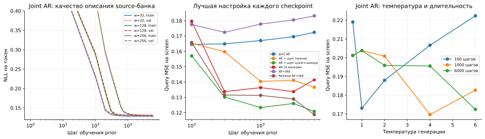
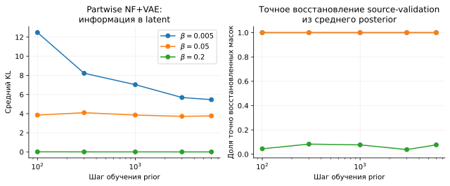
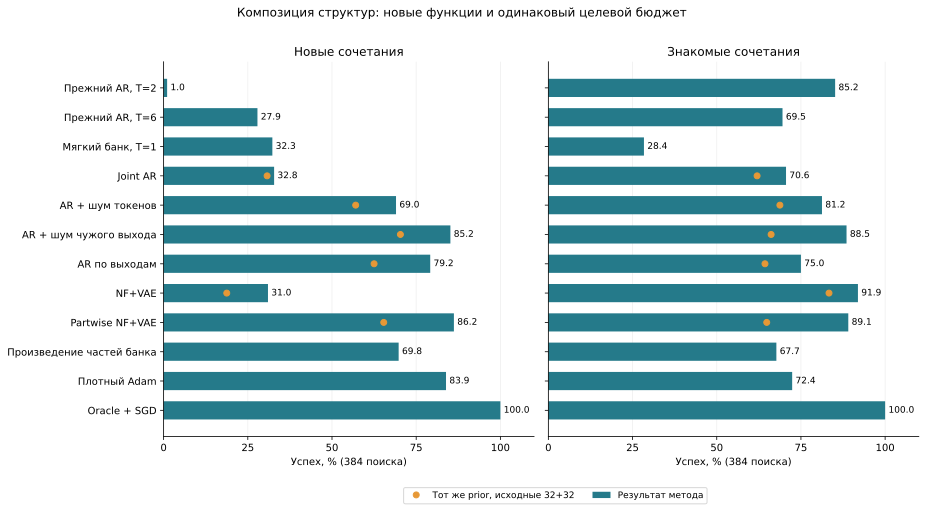
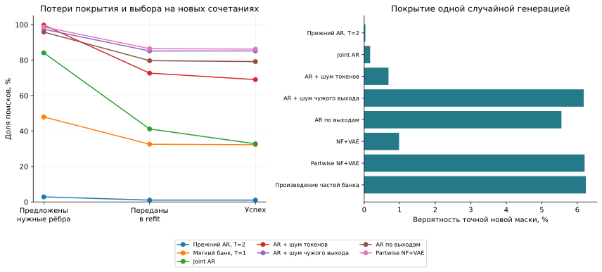

# Синусы: что потерял AR и что даёт шум

Дата: 3 ноября 2026. Продолжение
[проверки фильтра и температуры](SINE_AR_FILTER_DIAGNOSIS_2026-11-03.md).
[Код и протокол](../experiments/sine_ar_repair_v1/README.md),
[данные запуска](../experiments/sine_ar_repair_v1/results/run_20261103/).

**Перенос AR восстановлен:** на одном строгом банке случайных масок зашумление чужого выхода и калибровка решателя дают **85.16%** успеха на новых сочетаниях и **88.54%** на знакомых. Partwise NF+VAE на том же банке даёт **86.20% / 89.06%**. Главный потерянный механизм — обучение композиции частей; одной температуры или большего числа шагов недостаточно.

## Почему сравнение с прежним NF+VAE требовало повторения

В положительном архивном опыте NF означало **Neural Functional**:
encoder получал нормированные веса и градиенты исходного решения.
Генератор имел VAE с 16-мерным latent. Существенная деталь — обучение
**по частям**: для восстановления первого выхода вторую половину latent
заменяли независимым нормальным шумом, и наоборот. Так decoder учился
восстанавливать каждый выход без надёжной информации о другом выходе.

В сохранённом историческом matched_v2 при одинаковом банке и бюджете
обычный NF+VAE дал **29/384 (7.55%)**, partwise NF+VAE — **259/384 (67.45%)**,
простое произведение частей банка — **251/384 (65.36%)**. Поэтому прежний
результат нельзя приписать самому факту использования VAE. Там уже был
явный механизм композиции, который отсутствует у joint AR.
[Архивная сводка](../archive/history/paper_vae_solver/results/summary.json).

Поздний AR проверялся на другом банке и других численных функциях;
изменились и настройки плотного Adam. Прямое сравнение старых процентов
с новыми смешивало эти изменения. Полный старый пакет checkpoint-ов
не восстановлен: ниже сравниваются архивная архитектура NF/VAE и AR
**на одном текущем банке**, а не заявляется точное повторение matched_v2.
Архивный encoder имеет отдельные параметры для исходных задач; decoder
общий и при генерации оставляет две связи с наибольшими scores.
Mask-only контроль убирает численные веса и градиенты, сохраняя этот
encoder и задачу восстановления. Поэтому он изолирует пользу численных
признаков, но не делает архитектуры NF/VAE и MADE одинаковыми.

## Что меняем в текущем методе

Строгий банк получен случайным выбором двух связей из 16 и обучением SGD,
без IMP и без знания координат учителя. Из 262144 исходных попыток
query-фильтр 0.1 оставил 244 карточки: 192 train, 52 validation,
восемь различных train-масок. Этот банк одинаков для всех новых priors.
В мягком банке отложенные полные маски уже присутствовали; здесь новые
композиции проверяются относительно исходного строгого банка.

Обычный AR оценивает совместное распределение всех 16 битов. Если банк
содержит только определённые пары частей, максимум likelihood поощряет
воспроизведение именно этих пар. Хорошая NLL на validation-карточках
с теми же восемью масками не означает покрытия новых сочетаний.

Сравниваются три изменения AR:

1. **Шум токенов:** каждый входной бит с вероятностью 0.1, 0.3 или 0.6
   заменяется независимым сэмплом из своего эмпирического маргинала.
2. **Шум чужого выхода:** при предсказании столбца другого выхода
   подставляется столбец независимой source-карточки с вероятностью
   0.25, 0.5 или 1. Цель остаётся настоящей маской исходной карточки.
3. **AR по выходам:** две отдельные авторегрессии учат распределения
   столбцов и генерируют их независимо.

Для второго варианта при вероятности замены 1 objective имеет вид:

$$
\mathcal L(\theta)=
-\mathbb E_{M,\widetilde M\,\stackrel{\mathrm{iid}}{\sim}\widehat P}
\sum_{j=1}^{2}\sum_{r=1}^{8}
\log p_\theta\!\left(M_{rj}\mid
M_{<r,j},\widetilde M_{\mathrm{foreign},<r,j}\right).
$$

Чужой контекст независим от целевого столбца, поэтому его корреляции
не помогают в среднем. В явном варианте по выходам распределение сразу
факторизовано:

$$
p_\theta(M)=p_{\theta_1}(M_{:,1})\,p_{\theta_2}(M_{:,2}).
$$

Разбиение на выходы известно из архитектуры. Координаты учителя,
правильные целевые маски и population MSE не участвуют в обучении
или выборе. Это осмысленный bias композиции, но не доказательство
автоматического обнаружения произвольных модулей сети.

Для шумных AR проверяется как обычная генерация, так и та же порча
контекста при генерации. Температура делит logits и проверяется отдельно.
В NF/VAE шум при генерации задаётся масштабом нормального latent,
а не температурой категориального распределения.

## Как исключаем ошибку настройки

Проверены 26 конфигураций с тремя seed и пятью checkpoint-ами
100/300/1000/3000/6000. У joint AR меняются ширина 32/128/256,
learning rate 0.0003/0.001/0.003, weight decay 0/0.01/0.1;
у NF/VAE — вес KL 0.005/0.05/0.2. Добавлены равные веса source-задач
и VAE, получающий только маски без численных весов/градиентов.

Source-validation используется для диагностики. Настройки выбираются
по query MSE полного поиска на отдельных численных функциях:
сначала screen, затем подтверждение двух лучших вариантов каждой семьи
на другой calibration-выборке. Новые целевые функции создаются после
сохранения всех выбранных настроек. Таким образом, более ранний
checkpoint может оказаться полезнее даже при худшей source-NLL.

Также проверяются шаг и масштаб инициализации SGD, 512/1024/2048 шагов,
независимые старты, два старта на предложенную маску и refit четырёх
различных кандидатов вместо одного. На поиск всегда расходуется
**65536 обновлений отдельных моделей × batch 64**; увеличение длины
обучения компенсируется числом попыток. Каждый выбранный prior
оценивается и с исходной схемой 32+32, и с настроенным решателем.
Плотные SGD и Adam получают собственную калибровку.

В прежнем мягком AR точная маска предлагалась в 189 из 384 поисков,
но попадала в refit только в 138; все эти 138 refit дали успех.
Поэтому отдельно измеряются покрытие предложениями и потери выбора,
а не только итоговая доля успехов.

## Что показала диагностика обучения

Строгий банк имеет энтропию **0.128724 nat на токен**. Обычный AR
ширины 128 к 6000 шагам достигает train-NLL около **0.12873**,
validation-NLL около **0.1312**. Существенной нехватки мощности или
недообучения на наблюдаемых масках нет. Энтропия независимых выходов
равна **0.172559 nat на токен**: более высокая source-NLL модели,
разрешающей композицию, здесь ожидаема. В самом банке взаимная
информация двух выходных масок составляет **0.70136 nat**.

У базового AR, lr=0.001 и T=1, увеличение обучения со 100 до 6000 шагов
снижает familiar query MSE на screen с **0.1284 до 0.1070**, но повышает
ошибку новых calibration-сочетаний с **0.2178 до 0.3006**. Критерий
source-validation не обнаруживает эту потерю переноса. Нужен выбор
checkpoint по решению отдельных calibration-задач, а не только NLL.

Слева — train/validation NLL трёх размеров joint AR, средняя по seed.
В центре для каждого checkpoint показана лучшая screen-настройка семьи,
поэтому это диагностическая кривая подбора, не независимая оценка.
Справа — отдельное влияние температуры у базового AR.

У partwise NF+VAE сильный KL-штраф **β=0.2** вызывает коллапс:
к 6000 шагам средний KL около **0.0003**, дисперсия posterior около 1,
число активных latent-компонент по порогу Var(μ)>0.01 равно нулю.
Точное восстановление из среднего posterior — **8.33% train / 7.69% val**.
При β=0.005 и 0.05 восстановление в обоих split — **100%**, KL остаётся
ненулевым. Эти проценты описывают reconstruction исходных карточек,
а не способность генерировать новые структуры из prior.

Оба графика используют все три seed. Вариант β=0.2 теряет информацию
уже к первому сохранённому checkpoint; просто продлить его обучение
не исправляет проблему.

Дополнительная проверка encoder показала shortcut: при обнулении **всех**
входных признаков семь неколлапсировавших конфигураций VAE сохраняют
**100% validation-reconstruction** к 6000 шагам, на каждом из трёх seed.
Все строгие карточки одной source-задачи имеют одну маску; отдельные
параметры encoder могут запомнить её по задаче. Поэтому хорошая
reconstruction здесь не доказывает пользу численных NF-признаков.
Эта проверка выполнена после обучения и не использовалась для подбора.

## Результат на новых функциях

Ниже — новая серия функций 14031/14032, одинаковых для всех методов;
числа из предыдущей проверки порога сюда не подставляются. В каждом
условии 384 поиска. Основной AR выбран по confirmation-query заранее:
это `cross_noise`, а не победитель, выбранный после просмотра target.

| Генератор | Исходный решатель: новые, % | Исходный: знакомые, % | Настроенный: новые, % | Настроенный: знакомые, % |
|---|---:|---:|---:|---:|
| Joint AR | 30.73 | 61.98 | 32.81 | 70.57 |
| AR + шум токенов | 57.03 | 68.75 | 69.01 | 81.25 |
| **AR + шум чужого выхода** | 70.31 | 66.15 | 85.16 | 88.54 |
| AR по выходам | 62.50 | 64.32 | 79.17 | 75.00 |
| NF+VAE | 18.75 | 83.33 | 30.99 | 91.93 |
| Partwise NF+VAE | 65.36 | 64.84 | 86.20 | 89.06 |
| VAE только масок | 11.20 | 84.64 | 13.28 | 93.75 |
| Partwise VAE масок | 67.45 | 64.32 | 82.55 | 84.38 |

Исходный решатель — 32 предложения с четырьмя повторяемыми векторами
инициализации и 32 свежих refit выбранной маски, по 1024 шага.
У всех выбранных новых семей калибровка предпочла 512 шагов и 128 fit.
Для основного AR это **64 предложения с независимыми стартами + 64 refit**
одной query-выбранной маски, lr=0.05, масштаб инициализации 2.
Остальные режимы различаются повторением стартов; полный выбор сохранён
в `selection_frozen.json`. Топ-4 не был выбран ни для одной семьи.

| Контроль | Новые сочетания: успех, % | Знакомые: успех, % |
|---|---:|---:|
| Прежний строгий AR, T=2 | 1.04 | 85.16 |
| Прежний строгий AR, T=6 | 27.86 | 69.53 |
| Прежний мягкий AR, T=1 | 32.29 | 28.39 |
| Мягкий AR + настройка отбора | 30.73 | 27.60 |
| Смесь joint / по выходам | 76.30 | 80.99 |
| Независимые биты строгого банка | 49.74 | 43.75 |
| Произведение выходных столбцов банка | 69.79 | 67.71 |
| Выбор целой строгой маски | 0.00 | 87.24 |
| Случайные 2 из 16 | 15.89 | 15.89 |
| Плотный SGD | 3.12 | 2.60 |
| Плотный Adam | 83.85 | 72.40 |
| Oracle + SGD | 100.00 | 100.00 |

Простые генераторы, старые priors и плотные методы сохраняют исходный
бюджет 64 × 1024; у смеси — 128 × 512. Плотные оптимизаторы независимо
перекалиброваны: SGD lr=0.2 / scale=1.25, Adam lr=0.1 / scale=0.7.
Во всех строках одинаково число предъявленных обучающих примеров.
Контроль «мягкий AR + отбор» меняет только распределение попыток;
полной повторной настройки этого генератора в новой серии нет.

Оранжевая точка — тот же выбранный prior с исходным решателем.
Она отделяет изменение генератора от распределения численного бюджета.
Полная таблица всех 28 режимов, MSE, результатов по seed и интервалов
сохранена в [comparison.csv](assets/2026-11-03/sine_ar_repair/comparison.csv).

Основной AR получает **327/384** успехов на новых сочетаниях и **340/384**
на знакомых. Все **327** успешных новых масок отсутствуют в его строгом
train-банке. По отдельным seed успех на новых сочетаниях —
**86.72%, 84.38%, 84.38%**. Population MSE в среднем **0.08754 / 0.07751**.

Сравнение с Adam на новых сочетаниях: **+1.30 п.п.**, описательный 95%
bootstrap по четырём координатным парам **[−11.46; 20.57] п.п.**.
Это не подтверждает превосходства над Adam. На знакомых сочетаниях
разность **+16.15 п.п. [5.99; 25.52]**, условно на одном банке.

**Польза именно обученного AR относительно простого произведения частей
не установлена:** при одном исходном решателе результаты **70.31% и
69.79%**. Нельзя приписывать генератору дополнительный выигрыш от перехода
на 128 коротких fit. Простое произведение не проходило новую полную
настройку решателя. Обнаруженный механизм — композиция и эффективное
расходование попыток, а не исключительное преимущество нейрогенератора.

## Что исправлено и что ещё теряется

В основном варианте оставлены width=128, AdamW lr=0.001, weight decay=0;
выбраны **1000 шагов**, равный суммарный вес source-задач и полная замена
чужого столбца при обучении. При генерации **T=1**, дополнительного
зашумления контекста нет. Все целевые численные коэффициенты новые.

Для проверки именно шума есть сравнение при одинаковых width=128,
lr=0.001, 1000 шагах и T=1: novel calibration-query MSE обычного AR
**0.3006**, AR с полной заменой чужого выхода **0.1191**; добавление
равных весов source-задач даёт **0.1136**. Это контролируемая абляция
на screen-функциях, а не ещё одна независимая target-оценка.

В диагностике генерации на 98304 сэмплах средняя вероятность точной
новой пары выросла с **0.0336%** у прежнего AR с T=2 до **6.1801%**.
У partwise NF+VAE она **6.2063%**, у произведения частей **6.2408%**.
Шумный AR сохраняет по одной связи на выход в **99.72%** сэмплов;
**49.34%** массы приходится на новые сочетания известных частей.
Это почти то же распределение, которое даёт простой product-контроль.

Слева проверяется наличие обеих нужных связей, включая более широкие
маски. Справа — средняя вероятность точной маски новой пары при одном
сэмпле, оценённая отдельно после замораживания настроек. Это разные
метрики; более широкая маска тоже иногда успешно обучается.

У основного AR точная маска предложена в **374/384** поисках, передана
в refit в **326/384**, итоговых успехов **327/384**. Ещё один успех
использует более широкую маску. Значит, оставшиеся потери в основном
связаны с тем, какую предложенную структуру получает дальнейший бюджет.
Перенос refit на четыре маски в проверенной калибровке не улучшил выбор;
это ограничение нельзя считать уже решённым.

| Семья | Width AR | LR / weight decay | Шум или β | Шаги prior | T / std latent |
|---|---:|---|---|---:|---:|
| Joint AR | 256 | 0.001 / 0 | p=0.0 | 300 | 6.0 |
| AR + шум токенов | 128 | 0.001 / 0.0 | p=0.6 | 6000 | 2.0 |
| **AR + шум чужого выхода** | 128 | 0.001 / 0.0 | p=1.0 | 1000 | 1.0 |
| AR по выходам | 64 | 0.003 / 0.0 | p=0.0 | 300 | 0.6 |
| NF+VAE | — | 0.001 / 0.01 | β=0.005 | 300 | 1.0 |
| Partwise NF+VAE | — | 0.001 / 0.01 | β=0.005 | 6000 | 2.0 |
| VAE только масок | — | 0.001 / 0.01 | β=0.05 | 1000 | 1.0 |
| Partwise VAE масок | — | 0.001 / 0.01 | β=0.05 | 3000 | 2.0 |

Все выбранные AR генерируют без дополнительной порчи контекста.
У VAE столбец масштаба означает std нормального latent, не logit-temperature.
Encoder NF/VAE содержит 353040 параметров вместе с decoder; отличие
информации и архитектуры от MADE описано выше. Полные настройки и все
калибровочные кандидаты сохранены, включая неудачные варианты.

## Цена и артефакты

Исходный банк переиспользован: его сбор стоил 262144 fit, то есть 4096
целевых бюджетов. Новая проверка обучила **78 priors** (468000 суммарных
шагов оптимизатора), выполнила **745 screen-настроек** и **116704
калибровочных поиска** в эквиваленте целевого бюджета: 71520 screen,
39936 подтверждение/настройка семей, 3456 смесь и мягкий prior,
1792 настройка плотных методов. Целевая оценка — **21504 поиска**.
Query-вычисления и послезапусковая диагностика идут дополнительно;
это счёт предъявленных примеров, а не равенство FLOPs или времени.

- [Протокол, запуск и выбранные checkpoints](../experiments/sine_ar_repair_v1/README.md).
- [Замороженные настройки](../experiments/sine_ar_repair_v1/results/run_20261103/selection_frozen.json), [правило выбора основного AR](../experiments/sine_ar_repair_v1/results/run_20261103/report_protocol.json).
- [Сводка](../experiments/sine_ar_repair_v1/results/run_20261103/summary.json), [парные сравнения](assets/2026-11-03/sine_ar_repair/paired_differences.csv).
- [Генерация и состав масок](assets/2026-11-03/sine_ar_repair/generation_diagnostics.csv), [диагностика latent](../experiments/sine_ar_repair_v1/results/run_20261103/latent_diagnostics.json).
- [Хеши исходного банка и восстановленных признаков](../experiments/sine_ar_repair_v1/results/run_20261103/provenance.json).

## Граница вывода

Успех означает аналитическую **population MSE < 0.1**, а не доказанный
глобальный минимум. Решатель не может точно представить двухчастотного
учителя; хорошее решение всё равно имеет ненулевую ошибку. Во всех
целевых попытках численные веса и амплитуды обучаются заново.

Это диагностика на ранее исследованном структурном разбиении с новыми
численными функциями и одним source-банком. Для новых сочетаний есть
четыре координатные пары, каждая с двумя функциями. Интервалы bootstrap
строятся по парам; 384 поиска не являются 384 независимыми задачами.
Стоимость обучения и калибровки priors учитывается отдельно от целевого
бюджета. Расширение поиска гиперпараметров само по себе не является
бесплатным преимуществом метода.
