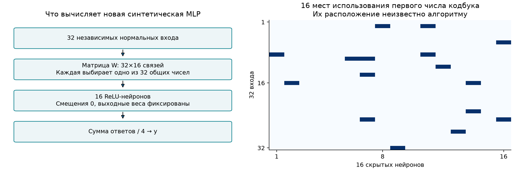
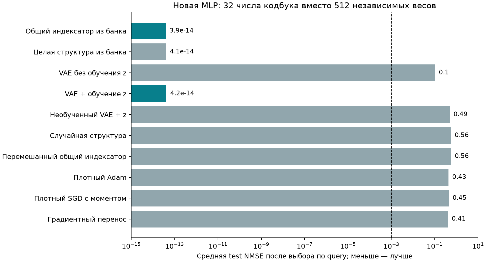
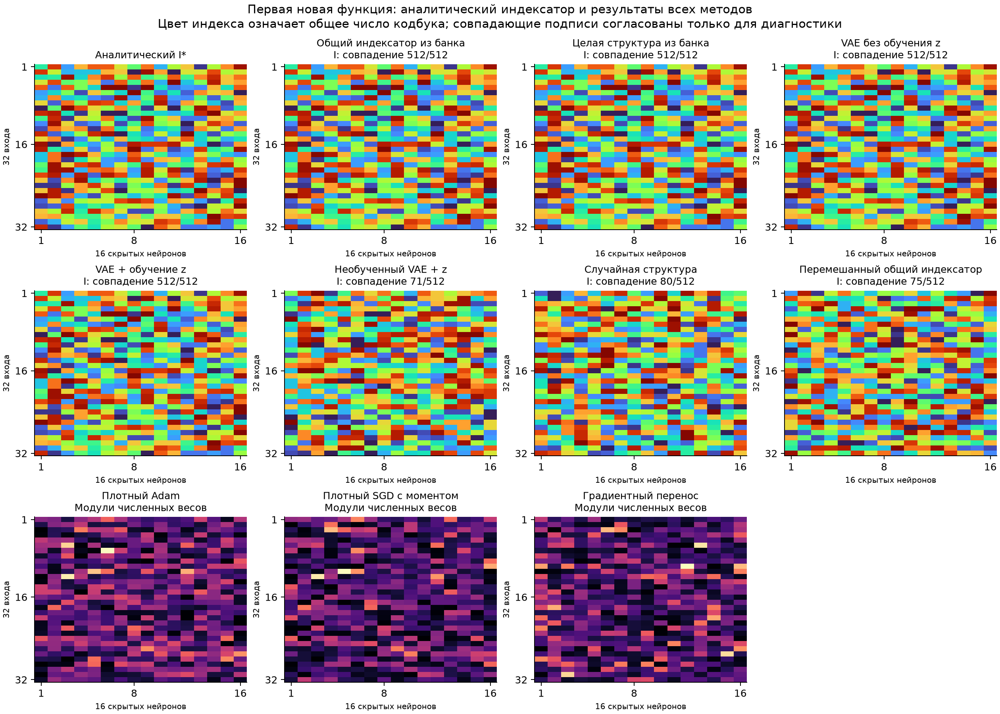
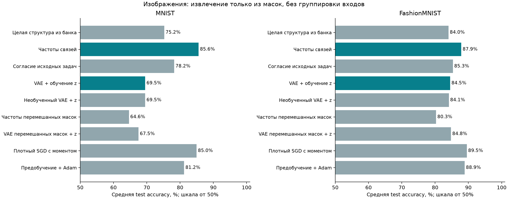
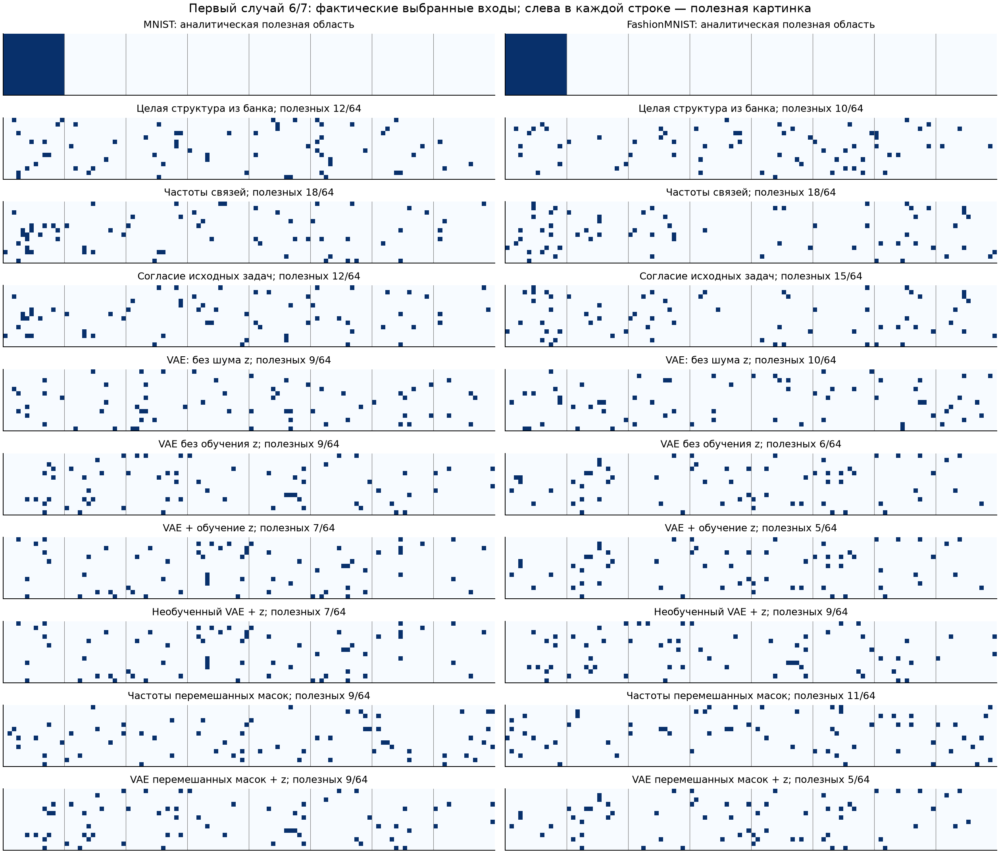

# Извлечение общей структуры из обученных моделей

28 октября 2026 года. Продолжение [предыдущего отчёта](STRUCTURE_TRANSFER_2026-10-28.md).

**В новой синтетической MLP удалось восстановить все 512 назначений весов к элементам кодбука, используя только обученные исходные сети.** После переноса VAE с обучаемым z решил восемь новых задач практически точно. Корреляции входов, аналитический решатель и заранее заданные группы входов здесь не использовались.

Отдельно повторили прежние опыты с изображениями, убрав корреляционную группировку. Там результат заметно слабее: общая информация в масках есть, но VAE не восстановил полезную область. Эти две проверки следует рассматривать отдельно.

## 1. MLP с произвольными повторениями весов

### Задача, индексатор и точное решение

На вход подаются 32 независимых стандартных нормальных числа. Сеть содержит 16 скрытых ReLU-нейронов и один выход. Её матрица имеет 512 связей, но использует только 32 общих обучаемых числа:

$$
\begin{aligned}
x&\sim\mathcal N(0,I_{32}),\qquad I^*\in\{1,\ldots,32\}^{32\times16},\\
W^{(t)}_{ih}&=C^{(t)}_{I^*_{ih}},\\
y_t(x)&=\frac14\sum_{h=1}^{16}\operatorname{ReLU}\!\left(\sum_{i=1}^{32}W^{(t)}_{ih}x_i\right).
\end{aligned}
$$

Индексатор I общий для задач; численные значения C меняются. У всех сравниваемых моделей смещения равны нулю, а выходные веса фиксированы и равны 1/4. Поэтому у плотной модели обучаются **512 весов**, у модели с заданным индексатором — **32 числа кодбука**. Размеры сети и бюджет кодбука известны методу; расположение повторений неизвестно.

Генератор случайно размещает каждое число кодбука в 16 местах матрицы. Эти места могут относиться к разным входам и разным нейронам. **Ни блоков входов, ни локальных фильтров здесь нет.** При декодировании VAE ограничение «каждый индекс встречается 16 раз» не навязывается.

На правой части рисунка показаны 16 связей, использующих первое число кодбука. Учитель знает это размещение; обучаемый метод получает только решения исходных задач.

Точное решение новой задачи — её 32 числа C и общий индексатор I. Например, первые две строки и шесть столбцов истинного индексатора в этом опыте:

$$
\begin{aligned}
I^*_{\mathrm{example}}&=\begin{pmatrix}
12&28&7&22&26&26\\
28&18&8&9&9&22
\end{pmatrix}.
\end{aligned}
$$

Пятая и шестая связи первой строки используют одно число C с индексом 26. Четвёртая связь первой строки и шестая связь второй используют число с индексом 22. Эти числа заново обучаются для каждой функции. Полная аналитическая матрица показана ниже рядом с найденными.

Формальное пространство назначений имеет 32⁵¹² вариантов, включая эквивалентные переименования. Полного перебора не было. При этом некоторые исходные решения уже содержат правильную схему, поэтому отдельно сравниваем извлечение общего индексатора с переносом одной готовой исходной структуры.

### Что собрали и как извлекли структуру

Сначала обучили **обычные плотные сети** на шести исходных функциях: четыре старта по 8192 шага. Каждая функция использует 8192 обучающих и 2048 проверочных примера. Числа исходного кодбука — случайные перестановки 32 равномерно расположенных значений от −1 до 1; сами значения обучаемым сетям не сообщались.

Получили 24 обученные матрицы весов. В каждой матрице обычным скалярным k-means с 32 центрами оценили, какие веса могут использовать одно число кодбука. Затем согласовали скрытые нейроны по рисунку равенств весов внутри столбцов, а номера элементов кодбука — по совпадению мест их использования. В обоих случаях применяли венгерский алгоритм.

**На этом этапе использовались обученные веса и качество исходных решений. Входные примеры, их корреляции и истинный индексатор для извлечения не использовались.** Бюджет 32 центров соответствует размеру кодбука модели. Специального алгоритма для группировки входов нет.

Оставили две лучшие модели каждой исходной функции: банк из 12 приближённых индексаторов. Это структуры, оценённые по весам исходных сетей; отдельного отбора по ошибке квантованных сетей не проводили. Исходные численные решения тоже не все точны: лучшие модели пяти функций дали практически нулевую ошибку, оставшейся — NMSE около 0,00363.

Первый индексатор каждой пары использовали для обучения VAE, второй — для выбора его чекпойнта. Номера скрытых нейронов и кодов согласованы по исходному решению, без обращения к учителю. Прямой общий индексатор получили голосованием шести обучающих структур по каждой позиции. После заморозки сравнение с учителем подтвердило **512 совпадений из 512**, с точностью до перестановки нейронов и переименования кодов.

VAE получает **только дискретные индексаторы**, имеет скрытый код z размерности 16 и категориальный декодер для 512 позиций. Численные веса сетей, входы и ответы функций в обучение VAE не поступают. При обучении z добавляются 16 переменных; все веса декодера остаются заморожены. Это VAE структур, а не использовавшийся ранее NF-кодировщик весов и функциональных признаков.

### Методы и новые задачи

| Метод | Что делает на новой задаче |
| :-- | :-- |
| Общий индексатор из банка | Фиксирует найденную общую схему и обучает 32 числа. |
| Целая структура из банка | Берёт одну из шести исходных обучающих структур; числа обучает заново. |
| VAE без обучения z | Декодирует случайный z, фиксирует индексатор, обучает числа кодбука. |
| VAE + z | Замораживает VAE, обучает кодбук; во второй половине обучения раз в 16 шагов дополнительно меняет z через приближённый градиент дискретного выбора. |
| Необученный VAE + z | Та же процедура со случайным декодером. |
| Случайный индексатор | Случайно назначает каждой связи одно из 32 чисел. |
| Перемешанный общий индексатор | Сохраняет число использований каждого кода, но случайно меняет их места. |
| Плотные Adam / SGD | Обучают все 512 весов с нуля. SGD использует момент 0,9. |
| Градиентный перенос | Начинает с исходной плотной сети и дообучает все 512 весов. |

Шаги численного обучения выбраны на двух дополнительных калибровочных функциях до итоговой оценки. Структурные методы используют один общий настроенный шаг для кодбука; плотные варианты настроены отдельно.

Проверены **восемь новых функций**. Их 32 числа кодбука выбирались непрерывно и независимо из диапазона от −1 до 1. На функцию: **128 обучающих, 1024 проверочных и 8192 итоговых примера**, восемь стартов по 4096 шагов. Каждый шаг использует все 128 обучающих примеров. Случайные входы общие для функций, а кодбуки различаются. Чекпойнт и старт выбираются по проверочной ошибке.

NMSE — MSE, делённая на дисперсию обучающих ответов. Порог успеха — test NMSE меньше 0,001. В столбце средней ошибки сначала выбирается один старт по проверочной выборке, затем результат усредняется по восьми функциям.

| Метод | Средняя итоговая NMSE ↓ | Успешные старты из 64 | Решённые выбранные задачи из 8 |
| :-- | --: | --: | --: |
| Общий индексатор из банка | 3,92·10⁻¹⁴ | 64 | 8 |
| Целая структура из банка | 4,07·10⁻¹⁴ | 52 | 8 |
| **VAE + обучение z** | **4,20·10⁻¹⁴** | **47** | **8** |
| VAE без обучения z | 0,1042 | 12 | 4 |
| Необученный VAE + z | 0,4939 | 0 | 0 |
| Случайный индексатор | 0,5601 | 0 | 0 |
| Перемешанный общий индексатор | 0,5631 | 0 | 0 |
| Плотный Adam | 0,4328 | 0 | 0 |
| Плотный SGD с моментом | 0,4462 | 0 | 0 |
| Градиентный перенос | 0,4089 | 0 | 0 |

После выбора по проверочной выборке VAE+z вернул правильный индексатор **во всех восьми задачах: 512 из 512 позиций**. Среди всех стартов правильный индексатор получился в 45 случаях; порог ошибки прошли 47. Это разные критерии: небольшое отличие структуры иногда ещё допускает малую ошибку.

У VAE без обучения z точный индексатор получился в 11 стартах, порог ошибки прошли 12. Следовательно, в этом опыте оптимизация z дала заметную пользу. Однако прямое использование общей структуры надёжнее: 64 успешных старта. Перенос целой исходной структуры также решает все задачи после выбора старта, поэтому необходимость именно VAE не доказана.

### Аналитический индексатор и то, что нашли методы

Это первая новая функция. В каждом методе показан старт, выбранный по проверочной ошибке. Одинаковый цвет означает использование одного числа кодбука. Для визуального сравнения нейроны и подписи кодов согласованы с эталоном **после обучения**, только при построении рисунка. У плотных методов показаны модули фактических численных весов; дискретный индексатор им не приписывался.

В этом примере правильный индексатор нашли общий структурный метод, перенос целой структуры и оба обученных варианта VAE. Случайные варианты дают другую схему, хотя число обучаемых значений у них тоже равно 32. Поэтому результат объясняется правильными повторениями весов, а не одним уменьшением числа параметров.

**Граница вывода:** здесь показан перенос общей схемы весов при малом числе примеров новой задачи. Исходные плотные сети обучались на 8192 примерах, новые — на 128. Это не доказательство, что градиентный спуск не способен решить те же функции при достаточном количестве данных. Схема повторений общая для всех задач; создание нового сочетания нескольких извлечённых структур не проверялось.

## 2. Контроль на изображениях без корреляционной группировки

Взяли прежние MNIST и Fashion-MNIST с одной полезной картинкой и семью помехами. Использовали **первый исходный банк**, собранный до выделения корреляционных групп. В нём 1664 относительно хороших частичных решения на датасет. Для обучения VAE — 832 маски, для выбора чекпойнта — 416; ещё 416 сохранены как резерв.

Извлекатель получает только номера выбранных входов, идентификатор исходной задачи и принадлежность ветви поиска. **Никаких изображений, весов сетей, градиентов, функциональных оценок, координат полезной картинки или числа групп.** Качество уже использовалось при отборе исходного банка; при дальнейшем извлечении маски имеют одинаковый вес. Семейство моделей по-прежнему выбирает 64 входа — это заданный бюджет разреженности.

Проверили перенос целой маски, частоты связей, согласие частот между исходными задачами и VAE масок. У отрицательного контроля номера входов независимо перемешаны в каждой исходной маске: число связей сохраняется, общий рисунок координат разрушается. Перемешанные маски не называются хорошими решениями первоначальных задач.

Частота входа — доля исходных масок, где он включён. Для варианта согласия сначала считаем частоты отдельно по исходным задачам, затем усредняем их логарифмы с добавкой K/d. Здесь K=64, d=1568. Выбираем 64 входа с наибольшей оценкой. Эти операции используют только исходные структуры.

У VAE проверили два значения силы регуляризации, 0,5 и 10; выбор делался по восстановлению исходных масок из других ветвей поиска. Более сильная регуляризация не помогла. Лучшим чекпойнтом на MNIST оказался начальный, на Fashion-MNIST — после первой эпохи. Поэтому в этих опытах нет свидетельства успешного обучения VAE общему полезному рисунку масок.

Настройки численного обучения выбраны на исходных классах. Итоговая оценка — те же 48 случаев на датасет, четыре старта по 1024 шага; плотные контроли перенесены из прежнего запуска после проверки совпадения данных. **Это парная повторная проверка, а не новый слепой тест.** Условия и рисунки самих задач приведены в [основном отчёте](STRUCTURE_TRANSFER_2026-10-28.md).

| Метод без группировки входов | MNIST, accuracy ↑ | Fashion-MNIST, accuracy ↑ |
| :-- | --: | --: |
| Целая маска из банка | 75,24% | 84,03% |
| Частоты связей | **85,58%** | **87,87%** |
| Согласие исходных задач | 78,22% | 85,35% |
| VAE: декодирование без шума z | 67,52% | 84,83% |
| VAE без обучения z | 68,23% | 77,79% |
| VAE + z | 69,51% | 84,51% |
| Необученный VAE + z | 69,51% | 84,13% |
| Частоты перемешанных масок | 64,63% | 80,27% |
| VAE перемешанных масок + z | 67,51% | 84,76% |
| Плотный Adam | 79,32% | 86,73% |
| Плотный SGD с моментом | 84,98% | 89,53% |
| Градиентное предобучение + Adam | 81,20% | 88,88% |

Частоты лучше переноса целой случайной исходной маски и отрицательного контроля. Значит, общий полезный сигнал в исходных структурах есть. Но они почти равны SGD на MNIST и уступают ему на Fashion-MNIST. Сильный прежний результат 94,73% и 97,06% без предварительного выделения полезной группы не воспроизвёлся.

Показана первая задача 6/7 каждого датасета. Пиксели возвращены в исходный порядок только для диагностики; полезная картинка находится слева. Маска по частотам содержит всего **18 полезных входов из 64** на обоих датасетах. Это частичная информация, а не восстановление всей полезной области. У обученного VAE большинство выбранных входов тоже лежит в помехах.

## Что показала новая серия

**На новой MLP правильную общую структуру удалось получить из обученных моделей и перенести на новые функции.** VAE+z использовал только индексаторы исходных сетей и решил все восемь новых задач после выбора старта по проверочной выборке. Специальная группировка входных данных для этого не требовалась. Прямой перенос найденной структуры и некоторых исходных индексаторов также успешен.

На изображениях чистый вариант оказался слабее прежнего конвейера. Это ограничивает прежнее обобщение: сильный выигрыш там относится к извлечению структуры вместе с предварительной группировкой данных, а не к одному VAE исходных масок.

## Воспроизведение

Код новой MLP: [shared_codebook_mlp_v1](../experiments/shared_codebook_mlp_v1/README.md), итоговый запуск `runs/v2`; `v1` — предварительный сбор с 4096 шагами, восстановивший 511 из 512 назначений. Код контроля изображений: [structure_only_v1](../experiments/structure_only_v1/README.md).

[Общие результаты и аудит](../experiments/structure_only_v1/runs/summary.json), [CSV](../experiments/structure_only_v1/runs/metrics.csv), [матрицы показанных индексаторов](../experiments/structure_only_v1/runs/indexator_examples.npz). Сохранены все итоговые состояния, численные кодбуки, индексаторы, лучшие z, выбранные шаги и кривые. Хеши банков, приоров и настроек зафиксированы до итоговой оценки и при построении отчёта остались неизменными.

Бюджеты на новую задачу уравнены по стартам, шагам и предъявлениям примеров. Затраты сбора исходных сетей, обучения VAE и FLOPs между методами не уравнивались. Тесты не создавались и не запускались; выполнены генерация результатов, проверка файлов и визуальный просмотр рисунков.
