# Перенос структуры между задачами: три проверки

28 октября 2026 года. **Извлечённая структура помогла во всех трёх проверках.** На синтетической MLP она позволила почти точно восстановить новые функции. На MNIST и Fashion-MNIST с отвлекающими входами точность выросла примерно с 85% до 95% и с 90% до 97%. При этом простые способы использования найденной структуры оказались сопоставимы с NF+VAE. Эти опыты подтверждают пользу переноса структуры, но не преимущество VAE над другими способами её представления.

## 1. Что именно переносим

Мы разделяем решение на **индексатор** — расположение и повторение весов — и **кодбук** — их численные значения:

$$
W_{ij}=C_{I_{ij}},\qquad C_0=0.
$$

Индекс 0 выключает связь. Если две связи имеют один ненулевой индекс, они используют одно обучаемое число. Сначала на исходных задачах ищем полезные индексаторы. На новой задаче переносим их структуру, а числа кодбука обучаем заново. В варианте NF+VAE декодер заморожен; вместе с кодбуком можно обучать только его входной вектор z размерности 16.

Для синтетики ненулевые числа действительно многократно повторяются. В опытах с изображениями проверяем более простой частный случай: индексатор выбирает входы, а каждая оставленная связь получает собственное число. Поэтому на изображениях речь идёт о переносе **масок**, а не о доказанном преимуществе квантования весов.

Начальная проверка на обычном Pattern вынесена в [отдельный отчёт](PATTERN_CODEBOOK_2026-10-28.md). Там NF+VAE с обучаемым z дал 84 безошибочных старта из 128 против 1 у Adam и 0 у SGD. Далее рассматриваются более крупные пространства структур.

## 2. Синтетическая MLP со скрытыми группами входов

### Задача и точное решение

Вход — 64 независимых стандартных нормальных числа. Неизвестная перестановка делит их на восемь групп по восемь координат. К каждой группе применяются четыре общих ReLU-фильтра. Сеть-учитель вычисляет:

$$
\begin{aligned}
x&\sim\mathcal N(0,I_{64}),\qquad g=0,\ldots,7,\quad k=1,\ldots,4,\\
h_{gk}(x)&=\operatorname{ReLU}\!\left(\sum_{r=1}^{8}C_{kr}x_{\pi(8g+r)}+b_k\right),\\
y(x)&=\frac1{\sqrt{32}}\sum_{g=0}^{7}\sum_{k=1}^{4}a_kh_{gk}(x).
\end{aligned}
$$

Здесь перестановка π общая для всех задач. **Новая задача — новые 32 числа кодбука, четыре смещения и четыре выходных коэффициента.** Модули весов выбираются от 0,75 до 1,75 со случайными знаками, смещения — от −3 до −2, выходные коэффициенты — от 0,7 до 1,3. Ученику доступны только вход и полный ответ; отдельные фильтры ему не показываются.

Точное решение — эта же сеть с правильной перестановкой и числами учителя. У неё 32 скрытых нейрона и 256 ненулевых связей первого слоя. После задания индексатора обучаются 41 число: 32 веса, четыре смещения, четыре выходных коэффициента и общий свободный член. У плотной сети 64–32–1 — **2113 численных параметров**.

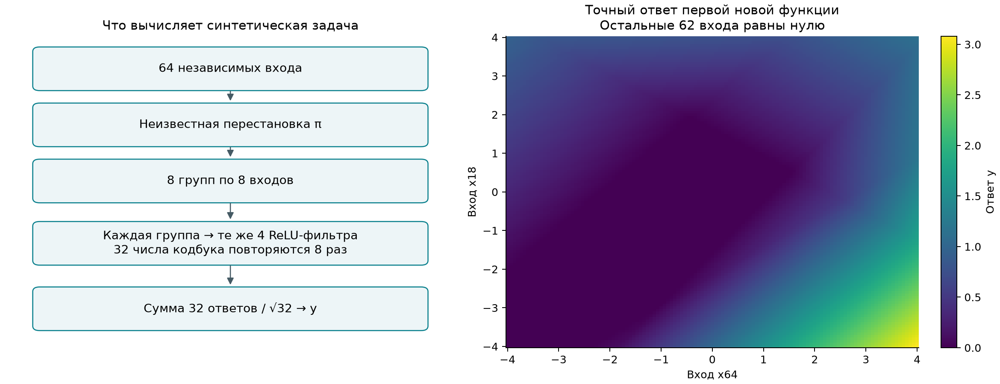

Слева показана схема учителя. Справа — точный ответ первой новой функции при изменении двух входов; остальные 62 равны нулю. Это сечение заданной функции, без обучения модели.

Аналитический индексатор — матрица 64×32. Для группы с номером g, позиции r внутри неё и фильтра k:

$$
\begin{aligned}
I^*_{\pi(8g+r),\,4g+k}&=8(k-1)+r,
&g&=0,\ldots,7,\quad r=1,\ldots,8,\quad k=1,\ldots,4.
\end{aligned}
$$

Все остальные элементы равны нулю. Одно ненулевое число индекса означает одно общее значение кодбука. Если расположить строки и столбцы по истинным группам, каждый из восьми диагональных блоков имеет вид:

$$
\begin{aligned}
I_{\mathrm{block}}&=\begin{pmatrix}
1&9&17&25\\
2&10&18&26\\
\vdots&\vdots&\vdots&\vdots\\
8&16&24&32
\end{pmatrix}.
\end{aligned}
$$

Например, первая истинная группа в сохранённом опыте содержит входы **64, 18, 1, 4, 31, 63, 38, 14**, именно в таком порядке. Коэффициент C с индексом 1 связывает вход 64 с первым фильтром этой группы и соответствующие первые входы семи других групп с тем же фильтром. Всего у него восемь применений.

Уже различных разбиений 64 входов на восемь неупорядоченных восьмёрок:

$$
\frac{64!}{(8!)^8\,8!}\approx4{,}5\cdot10^{47}.
$$

Порядок координат внутри групп добавляет варианты. Полного перебора здесь не было.

### Как нашли структуру и собрали банк

Обычный эволюционный поиск улучшил исходную NMSE с 0,796 до 0,632, но проиграл плотному Adam. Поэтому проверили второй способ: извлечение зависимостей непосредственно из исходных данных.

Для нормального входа полезна матрица второго момента:

$$
\begin{aligned}
M&=\mathbb E\!\left[y(x)(xx^\top-I)\right],\\
B&=\frac1{\sqrt{32}}\sum_{k=1}^{4}
 a_k\frac{\varphi(b_k/\|C_k\|)}{\|C_k\|}C_kC_k^\top.
\end{aligned}
$$

Функция φ — плотность стандартного нормального распределения; строка кодбука обозначена C с номером фильтра. В правильном порядке координат матрица M состоит из восьми одинаковых диагональных блоков B: между разными группами её элементы равны нулю. Поэтому по четырём исходным функциям можно сначала восстановить группы, затем согласовать координаты внутри них. На конечных данных использовали оценки моментов, спектральную группировку и сопоставление координат. Истинная перестановка в поиск не передавалась. После заморозки результата диагностическая проверка подтвердила все 64 позиции с точностью до общего переименования групп и внутренних координат.

**Это самостоятельный аналитический способ поиска, а не открытие VAE из банка.** Он предложил основу для направленного сбора: проверили 128 близких перестановок на четырёх полных исходных задачах, по два старта и 1536 шагов. Оставили лучшие 32 перестановки — 256 обученных моделей. Для VAE их разделили по перестановкам: 192 модели для обучения, по 32 для выбора чекпойнта и контроля. NF-кодировщики получают веса, градиенты и функциональные признаки моделей; общий VAE учится восстанавливать перестановку.

### Результаты на новых функциях

Проверены восемь новых функций с той же скрытой перестановкой. На функцию: 8192 обучающих, 2048 проверочных и 8192 независимых итоговых входа; восемь стартов по 6144 шага, batch 128. Чекпойнт и старт выбираются по проверочной ошибке. Шаги плотных оптимизаторов выбраны на исходных задачах. Градиентный перенос начинает с обученных исходных плотных сетей и затем меняет все их веса.

NMSE — MSE, делённая на дисперсию обучающих ответов. В таблице итоговая NMSE усреднена по восьми моделям, выбранным по проверочной выборке. Успешным считается старт с test NMSE меньше 0,01.

| Метод | Средняя итоговая NMSE ↓ | Успешные старты из 64 | Успешные выбранные задачи из 8 |
| :-- | --: | --: | --: |
| Извлечённый индексатор, без VAE | 4,98·10⁻¹² | 64 | 8 |
| NF+VAE, без обучения z | 4,98·10⁻¹² | 64 | 8 |
| NF+VAE + обучение z | 4,67·10⁻¹² | 64 | 8 |
| Плотный Adam | 0,0756 | 8 | 1 |
| Плотный SGD с моментом | 0,0439 | 8 | 1 |
| Градиентный перенос исходных сетей | 0,0465 | 7 | 2 |
| Необученный VAE + z | 0,7355 | 0 | 0 |
| Случайная перестановка | 0,7739 | 0 | 0 |

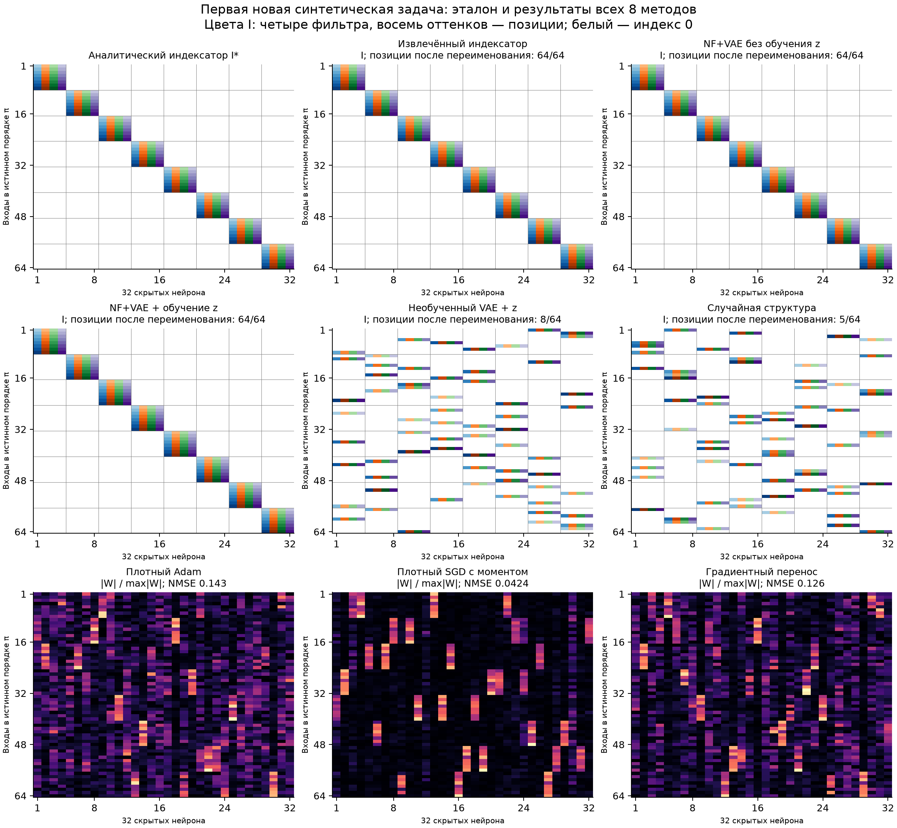

Здесь показаны **аналитический индексатор и реальные результаты всех восьми методов на первой новой функции**. В каждом методе взят старт с минимальной проверочной ошибкой. Белый цвет означает выключенную связь; четыре цвета и восемь оттенков обозначают 32 индекса кодбука. Для сравнения одинаковые группы и позиции переименованы после обучения; истинные индексы использованы только при построении этой иллюстрации.

Извлечённый индексатор, NF+VAE без обучения z и NF+VAE+z восстановили все 64 позиции с точностью до такого переименования. Их первая группа совпала с приведённой выше. У необученного VAE совпали 8 из 64 позиций, у случайной структуры — 5. Это показатели одного фиксированного примера, а не среднее серии.

В нижнем ряду показаны модули **сохранённых численных весов** плотных сетей, нормированные на максимум каждой матрицы. Отдельного дискретного индексатора они не выдают; веса не пороговали и не превращали искусственно в маску. Строки упорядочены одинаково с эталоном, нейроны плотных сетей оставлены в сохранённом порядке.

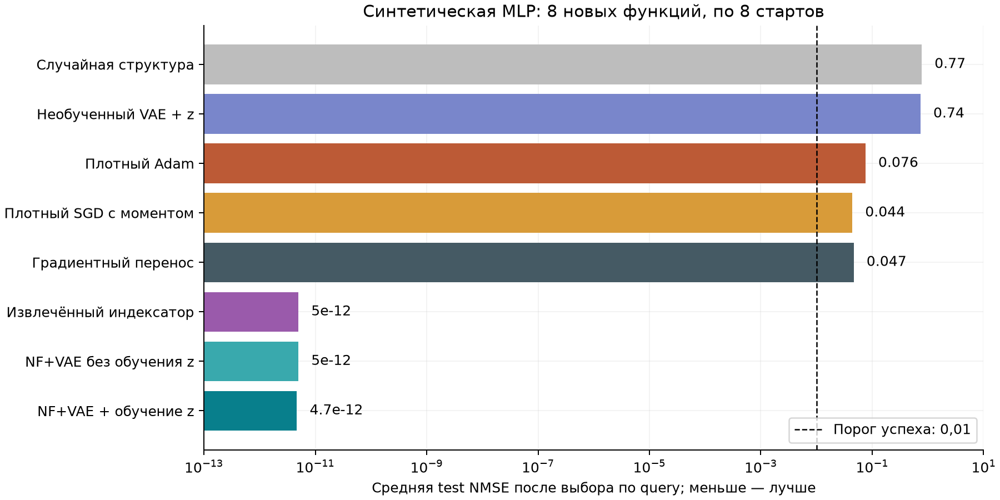

Передача правильной структуры почти устраняет ошибку при том же бюджете обучения новой задачи. Все 64 структурных старта прошли порог 0,01; это не означает, что каждый стал численно точным. Средняя NMSE всех стартов NF+VAE+z — 0,000048, тогда как восемь выбранных моделей достигли практически нулевой ошибки.

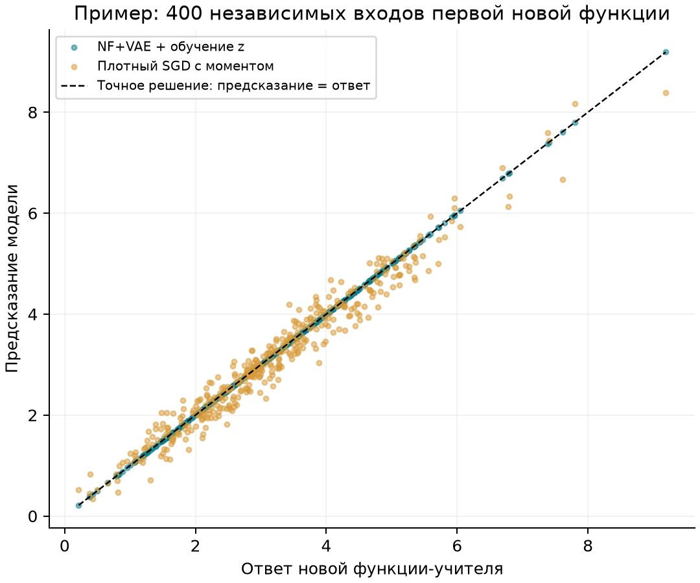

На примере одной новой функции точки структурной модели лежат на линии точного ответа. Плотный SGD сохраняет заметные отклонения. **VAE здесь сохраняет найденную общую перестановку, но прямое её использование даёт тот же результат.** Дополнительная оптимизация z не понадобилась.

## 3. MNIST и Fashion-MNIST: полезное изображение среди отвлекающих

### Постановка задачи

Каждое изображение уменьшаем с 28×28 до 14×14 усреднением соседних пикселей. В один пример складываем восемь изображений: одно полезное и семь отвлекающих. Затем общей неизвестной перестановкой перемешиваем все **1568 координат**. Метка зависит только от полезного изображения:

$$
x=P_\pi\begin{bmatrix}u^{(0)}\\u^{(1)}\\\vdots\\u^{(7)}\end{bmatrix}
\in\mathbb R^{1568},\qquad
u^{(q)}\in[0,1]^{196},\qquad
 y=\mathbf1\{\operatorname{class}(u^{(0)})=c_1\}.
$$

Задача бинарная: различить два выбранных класса. Например, в MNIST нужно отличить цифру 6 от 9 на полезной картинке; семь других картинок независимо содержат те же цифры и не определяют ответ. В каждом блоке одинаковое число изображений обоих классов, без повторов внутри блока. Состав полезных координат и их порядок модели не сообщаются.

Для сбора структуры используются 13 пар классов из 0–5. Ещё две пары тех же классов служат для настройки методов. Новые задачи — все шесть пар классов 6–9: у MNIST это цифры, у Fashion-MNIST — рубашка, кроссовок, сумка и ботинок. Перестановка сохраняется, а распознаваемые классы меняются.

**Это модификации известных датасетов с отвлекающими входами, а не стандартная десятиклассовая классификация MNIST/Fashion-MNIST.** Они проверяют, помогает ли перенести общие полезные входы при небольшом числе новых размеченных примеров.

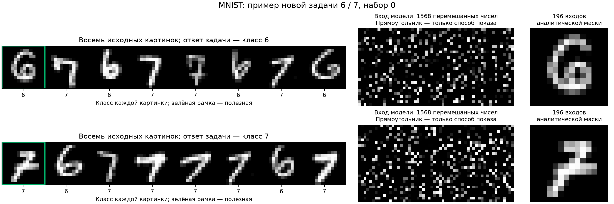

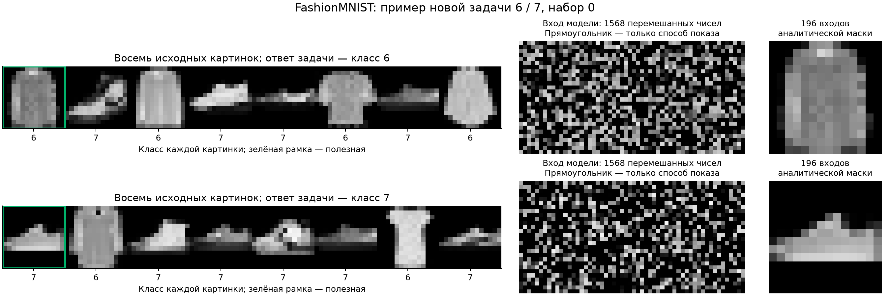

На рисунках — два обучающих примера первой новой задачи **6 против 7** каждого датасета. Слева видны восемь исходных картинок, полезная обведена зелёным. В центре — фактический перемешанный вход модели, условно разложенный в прямоугольник. Справа — полезная картинка после отбора аналитической маской и возврата исходного порядка. Исходный порядок и зелёная рамка нужны для объяснения; обучаемые методы их не получают. Для Fashion-MNIST классы 6 и 7 — рубашка и кроссовок.

### Как выглядит решение

Если полезные 196 координат известны, можно отбросить семь помех и обучать классификатор одного изображения. Это аналитически правильный выбор входов. Точного аналитического классификатора реальных изображений у нас нет; вариант с известными полезными координатами дан отдельно как контроль.

Искомая компактная модель выбирает 64 различные координаты и использует MLP с 16 скрытыми ReLU-нейронами:

$$
\begin{aligned}
s&=(s_1,\ldots,s_{64}),\qquad s_j\in\{1,\ldots,1568\},\\
f(x)&=\sigma\!\left(\sum_{h=1}^{16}a_h
 \operatorname{ReLU}\!\left(\sum_{j=1}^{64}C_{jh}x_{s_j}+b_h\right)+c\right).
\end{aligned}
$$

Здесь σ — сигмоида, выход — вероятность второго класса. Индексатор s определяет входы; кодбук содержит 64×16 чисел. Вместе со смещениями и выходом это **1057 обучаемых чисел**, у плотной MLP той же скрытой ширины — **25 121**. Например, найденная маска выбирает пиксели полезной цифры, а новый кодбук учится отличать 6 от 9; веса классификатора исходных цифр не копируются.

Аналитическая маска полезного изображения задаётся известной генератору перестановкой. Если наблюдаемая координата i соответствует исходной координате π(i), то множество полезных входов:

$$
S^*=\{i:\pi(i)\le196\},\qquad |S^*|=196.
$$

Для любого выбранного списка входов — аналитического списка из 196 или найденного списка из 64 — индексатор записывается одинаково:

$$
\begin{aligned}
I_{s_j,h}&=16(j-1)+h,\qquad j=1,\ldots,m,\quad h=1,\ldots,16,\\
I_{i,h}&=0\quad\text{при }i\notin\{s_1,\ldots,s_m\}.
\end{aligned}
$$

Здесь m — число выбранных входов. У каждой оставленной связи собственный ненулевой индекс; общий индекс 0 выключает остальные. Аналитическая маска сохраняет всё полезное изображение. Единственной аналитически оптимальной маски **ровно из 64 пикселей** для реальных изображений мы не знаем, поэтому сравниваем найденные маски с полезной областью из 196 координат, а не требуем совпадения с произвольным набором из 64.

### От частичных решений к общим входам

Сначала случайно выбирали маски по 64 входа, обучали численные веса, отбирали лучшие маски и меняли в них по четыре входа. На каждом датасете собрано **6656 состояний сетей**: 13 задач × 32 кандидата × 16 поколений. Один этап — 256 шагов на 48 примерах; веса наследуются, поэтому это не 6656 независимых обучений с нуля.

Оставили лучшие 25% по проверочной BCE отдельно для каждой задачи и ветви сбора: **1664 частичных решения**. Средняя их проверочная точность — 87,73% на MNIST и 91,17% на Fashion-MNIST. Почти идеальная точность не требовалась.

Полезность входа оценивали по тому, насколько ухудшается решение после замены этого входа его средним значением:

$$
\Delta_i=L_{\mathrm{query}}(f\text{ с }x_i\leftarrow\overline{x_i})
-L_{\mathrm{query}}(f).
$$

Положительные оценки объединяли по исходным моделям. Дополнительно по корреляциям входов восстановили восемь групп зависимых координат; число групп задано постановкой, их состав неизвестен. Выбрали группу с наибольшей суммарной полезностью. **Таким образом, группировку дают исходные входы, а нужную группу выбирают по частичным решениям.** Этот этап группирует координаты, а не исходные задачи и не скрытые нейроны. Заранее заданы восемь групп и выбор одной полезной группы; принадлежность координат группам находится по данным.

На MNIST получилось 165 координат, из них 158 действительно относятся к полезному изображению. На Fashion-MNIST — 195 из 195. Эта проверка использует известный генератор только после фиксации найденных групп.

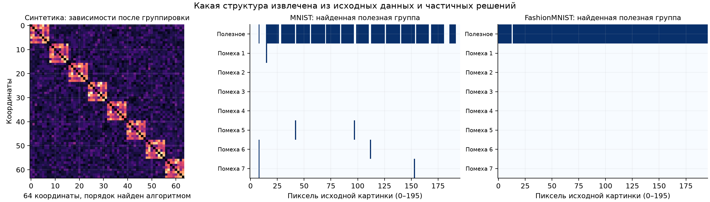

Слева видны восемь найденных групп синтетической задачи. Справа найденные входы возвращены в исходный порядок **только для иллюстрации**: почти все лежат в строке полезного изображения. Алгоритм этого порядка не получал.

Затем внутри найденной группы провели ещё четыре поколения поиска: 1664 состояния, из которых оставили **416 хороших моделей**. Их средняя точность — 96,77% и 95,74%. По их маскам обучили VAE; разделение 208/104/104 сделано по независимым ветвям эволюции. В этой модели все скрытые столбцы имеют одну маску входов, а NF-признаки инвариантны к их перестановке. Поэтому неоднозначность порядка столбцов устранена самим представлением; в обычном Pattern столбцы явно выравнивались.

В исходном рабочем банке VAE были 265 уникальных масок MNIST и 276 Fashion-MNIST, в обучающей его части — 132 и 138. Это мало относительно пространства возможных выборов:

$$
\binom{165}{64}\approx4{,}53\cdot10^{46},\qquad
\binom{195}{64}\approx2{,}41\cdot10^{52}.
$$

Все 192 маски, использованные NF+VAE+z на новых задачах каждого датасета, различны и отсутствуют в исходном хорошем банке. **Большое число комбинаций само по себе не доказывает необходимости сложного поиска:** после выделения полезной группы даже случайный выбор её части уже работает хорошо.

### Какие методы сравниваем

| Метод | Что переносится и как решается новая задача |
| :-- | :-- |
| Плотные Adam / SGD с моментом 0,9 | Все входы, все веса обучаются с нуля. |
| Градиентное предобучение | Плотная сеть учится на тех же исходных наблюдениях с шестью исходными классами; затем дообучаем все веса или только новый выход. |
| NF+VAE | По весам, градиентам и функциональным признакам исходных решений учится восстанавливать хорошие маски. Замороженный декодер предлагает 64 входа; кодбук обучается заново. |
| NF+VAE + z | Та же модель; после 512 шагов дополнительно меняем z раз в 16 шагов через приближённый градиент дискретного выбора. |
| Необученный VAE + z | Проверяет, достаточно ли случайного декодера с оптимизацией его входа. |
| Прямое обучение индексов | Начинает с предложения обученного VAE, затем меняет оценки всех входов напрямую; это тоже метод с переносом. |
| Частоты / полезность связей | Выбирает 64 входа по частоте в хорошем банке или по их функциональной полезности. |
| Связь входа с меткой | Простой контроль без банка: выбирает 64 входа по нормированной ковариации с исходными метками. |
| Найденная группа целиком / её случайные 64 входа | Проверяет прямую пользу извлечённой структуры без VAE. |
| Случайная маска / правильные входы | Нижний контроль и контроль с известной структурой. |

При предложении маски VAE использовали шум Gumbel и выбор 64 наибольших оценок без повторений. Шум фиксирован внутри старта; z может изменяться. Проверены также маски без этого шума и четыре разных шага обучения вместо четырёх одинаково настроенных стартов плотных методов. Все эти варианты включены в [полную таблицу CSV](../experiments/structure_search_v2/runs/study_metrics.csv).

### Результаты

На каждую из шести новых пар классов взяли восемь наборов данных: всего **48 случаев на датасет**. В каждом — 16 обучающих и 64 проверочных изображения на класс. У всех методов четыре старта по 1024 полных шага на 32 обучающих примерах. Чекпойнт и старт выбираются только по проверочной BCE. Шаг обучения и регуляризация настроены на исходных классах.

Итоговая оценка — по 512 изображениям каждого класса из официальной test-части, с новыми отвлекающими изображениями. В таблице усреднена точность моделей, выбранных по проверочной выборке. Примеры обучения и проверки не пересекаются ни в полезном, ни в отвлекающих блоках.

| Метод | MNIST, точность ↑ | Fashion-MNIST, точность ↑ |
| :-- | --: | --: |
| NF+VAE + обучение z | **94,73%** | **97,06%** |
| NF+VAE без обучения z | 94,58% | 97,05% |
| Прямое обучение индексов с началом от VAE | 94,60% | 96,98% |
| Частоты связей в хорошем банке | 94,93% | 96,91% |
| Полезность связей в хорошем банке | 95,44% | 96,85% |
| Связь входов с исходной меткой, без банка | 95,43% | 96,92% |
| Случайные 64 входа найденной группы | 94,42% | 97,20% |
| Вся найденная группа | 95,78% | 97,14% |
| Правильные 196 входов заданы | 95,94% | 97,26% |
| Плотный Adam | 79,32% | 86,73% |
| Плотный SGD с моментом | 84,98% | 89,53% |
| Градиентное предобучение + Adam | 81,20% | 88,88% |
| Градиентное предобучение, обучается только выход | 81,64% | 88,68% |
| Необученный VAE + z | 69,06% | 77,72% |
| Случайные 64 входа из всех 1568 | 65,24% | 79,40% |

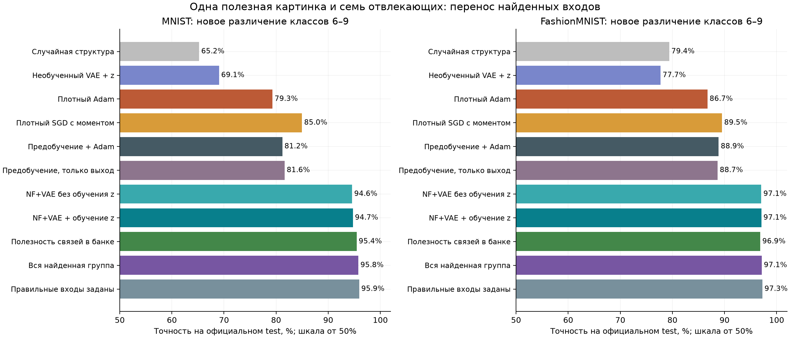

NF+VAE+z опередил SGD с моментом на **9,75 и 7,53 процентного пункта**. Градиентное предобучение на тех же исходных данных этот разрыв не закрыл. Четыре разных шага обучения дали SGD 84,71% и 89,29%, Adam — 78,42% и 86,66%; существенного улучшения нет.

При этом случайные 64 входа найденной группы почти столь же хороши, как VAE, а вся группа на MNIST немного лучше. Контроль по связи входа с меткой тоже близок к лучшим результатам. **Основную пользу приносит выделение общих полезных входов; сложная генеративная модель для этих двух задач не обязательна.** Разница NF+VAE с обучением z и без него мала: 0,15 и 0,01 процентного пункта.

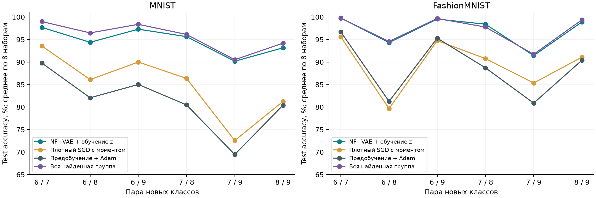

График разбивает результат по шести новым парам, а не только по общему среднему. Повторные наборы используют одни классы и частично одни test-изображения; это не 48 независимых семейств задач. Небольшие различия между структурными вариантами не следует считать доказанным превосходством одного из них.

### Какие индексаторы получились на одном примере

Ниже показана первая новая задача каждого датасета: **6 против 7, набор 0**. Пример один и тот же для всех методов, а старт каждого метода выбран по проверочной BCE. Пиксели возвращены в исходный порядок только для диагностики: первый квадрат — полезная картинка, остальные семь — помехи. В первой строке дана аналитическая маска всех 196 полезных входов.

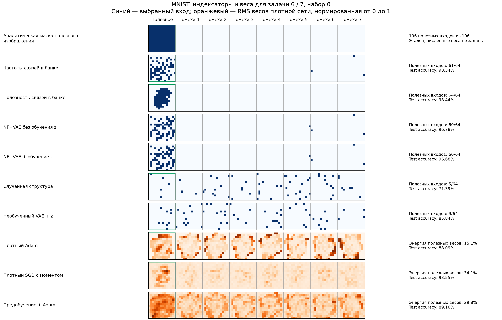

На MNIST NF+VAE+z выбрал 60 полезных входов из 64, отбор по частотам — 61, по функциональной полезности — 64. Случайная маска выбрала 5, необученный VAE+z — 9. На рисунке видно и расположение пропущенных пикселей, и связи с отвлекающими изображениями.

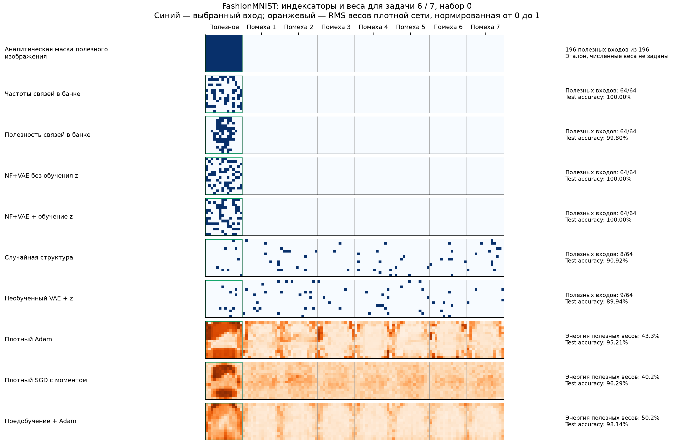

На Fashion-MNIST у NF+VAE+z все 64 выбранных входа относятся к полезному изображению. У случайной маски таких входов 8 из 64, у необученного VAE+z — 9.

Синим показан именно дискретный выбор входов. У плотных методов отдельной маски нет: оранжевым показана средняя квадратическая величина весов, выходящих из каждого входа, нормированная на максимум карты. Это изображение весов, а не оценка функциональной важности. Все **20 методов каждого датасета**, включая остальные контроли, показаны в [приложении с индексаторами](STRUCTURE_TRANSFER_INDEXATORS_2026-10-28.md), вместе с таблицей этого примера и полными списками найденных входов.

## 4. Что удалось показать и где граница результата

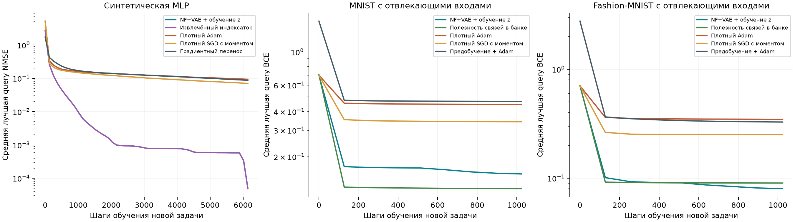

На графиках — средняя лучшая проверочная ошибка по всем стартам. Итоговые таблицы используют отдельные test-данные. **Полезную общую структуру удалось перенести на новые функции и новые классы без перебора всего пространства индексаторов.** Неполные исходные решения оказались достаточны для поиска полезных входов на изображениях.

Но эти опыты не показывают, что NF+VAE самостоятельно открыл сложную композиционную структуру. В синтетике основной поиск сделал метод моментов. На изображениях помогли корреляционные группы и полезность входов исходных сетей; простой отбор по исходным меткам тоже силён. VAE успешно хранит найденное семейство масок, однако самостоятельная добавочная ценность VAE и обучения z пока невелика. Скрытая перестановка во всех новых задачах остаётся прежней: перенос на новое расположение входов здесь не проверялся.

Сравнение относится к указанным MLP и бюджету. Число шагов и предъявлений на новой задаче одинаковое, FLOPs и объём предварительного поиска — разные. Только два этапа сбора банка на изображениях требуют 8320 эпизодов по 256 шагов на датасет; этот расход нельзя скрывать в сравнении со стартом плотной сети с нуля. Предобучение плотного контроля проверено по девяти настройкам и использует те же 3952 исходных наблюдения с метками. Расходы полного жизненного цикла методов не уравнивались.

До финальной серии были отрицательные проверки. На обычных изображениях простой отбор 64 пикселей не превзошёл плотное обучение. В пилоте с переставляемыми точками заданный вручную DeepSets улучшал результат относительно MLP без инвариантности, но восстановление порядка точек делало обычный Adam сильнее. Этот пилот не считается извлечением структуры. Ранний генератор отвлекающих изображений допускал повторы; его заменили сбалансированным выбором без повторов **до открытия итогового test**, результаты старого генератора в таблицы не входят.

Следующий содержательный шаг — проверка семьи, где на новой задаче нужно сочетать несколько извлечённых частей, а прямое использование одной общей маски или простой отбор входов уже недостаточны. Текущие результаты дают убедительные примеры пользы переноса структуры, но ещё не доказывают необходимость именно NF+VAE для такого переноса.

## Данные и воспроизведение

[Код и порядок запуска](../experiments/structure_search_v2/README.md), [все численные результаты и аудит](../experiments/structure_search_v2/runs/study_summary.json), [таблица CSV](../experiments/structure_search_v2/runs/study_metrics.csv). Синтетический перенос: `scrambled_transfer_v1`. Итоговые изображения: `distractor_MNIST_v5` и `distractor_FashionMNIST_v5`; исходные частичные банки — v3, их функциональный анализ и найденные группы — v4. Версии v1–v2 — только исходные пилоты.

Сохранены маски, кодбуки, лучшие z, выбранные шаги, метрики всех стартов, кривые обучения, разбиения, исходники запусков и замороженные хеши моделей/настроек до итоговой оценки. Примеры аналитических и найденных индексаторов воспроизводятся скриптом `study_structure_examples.py`; их численные представления и выбранные старты сохранены в `runs/structure_examples.json` и `runs/structure_examples.npz`. Хеши не изменились в ходе оценки, пересечения обучающих и проверочных изображений отсутствуют. Исходные датасеты скачиваются отдельно; их контрольные суммы сохранены в `dataset_manifest.json`.
