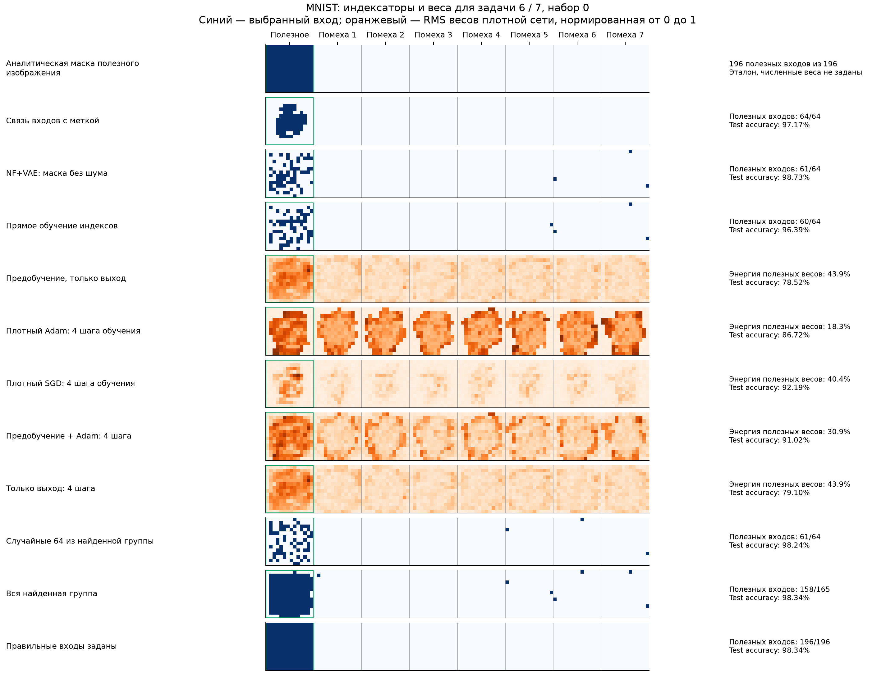
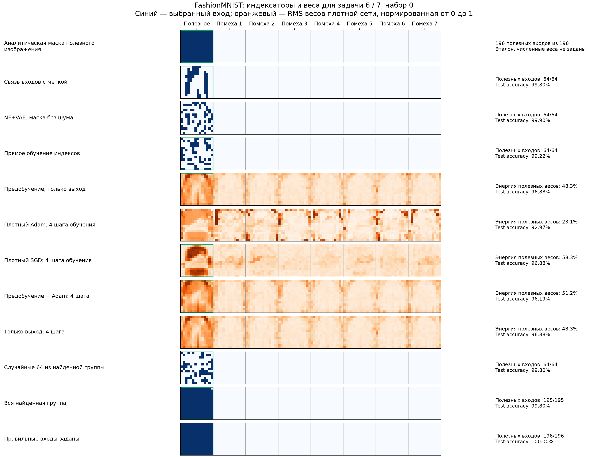

# Индексаторы всех методов: примеры к отчёту от 28 октября 2026

[Основной отчёт](STRUCTURE_TRANSFER_2026-10-28.md). Здесь собраны реальные структуры всех методов на одной заранее фиксированной новой задаче каждой серии. Нового обучения для этих рисунков не проводили.

Для синтетики взята первая новая функция; для изображений — первая пара 6/7 и набор 0. В каждом методе старт выбирается по проверочной ошибке, как в основном эксперименте. Итоговая test-метрика не участвовала в выборе примера или старта. Это отдельные примеры; средние по всем задачам приведены в основном отчёте.

## Синтетическая MLP: аналитический индексатор и все восемь методов


Матрица индексатора имеет 64 строки и 32 столбца. Белый цвет — индекс 0; одинаковые цвет и оттенок — одно общее число кодбука. Эталон задаёт восемь повторяющихся блоков 8×4. Чтобы сравнить структуры, найденные группы сопоставлены истинным по наибольшему пересечению, затем одним общим переименованием согласованы восемь позиций внутри групп. Истинная структура используется только для этой диагностики после завершения обучения.

У плотных Adam, SGD и градиентного переноса нет дискретного индексатора. Для них показан модуль фактически обученного первого слоя, нормированный на максимум своей матрицы. Столбцы не переставлены, веса не обнулены порогом. Поэтому цветные индексы и яркости весов — разные представления.

| Метод | Первая группа входов после согласования подписей | Совпавшие позиции из 64 | Test NMSE первой задачи ↓ |
| :-- | :-- | --: | --: |
| Аналитический индексатор | 64, 18, 1, 4, 31, 63, 38, 14 | 64 | 0 при точных числах учителя |
| Извлечённый индексатор | 64, 18, 1, 4, 31, 63, 38, 14 | 64 | 5.626e-14 |
| NF+VAE без обучения z | 64, 18, 1, 4, 31, 63, 38, 14 | 64 | 5.626e-14 |
| NF+VAE + обучение z | 64, 18, 1, 4, 31, 63, 38, 14 | 64 | 5.417e-14 |
| Необученный VAE + z | 16, 8, 14, 17, 30, 22, 60, 6 | 8 | 0.7569 |
| Случайная структура | 54, 32, 34, 14, 31, 63, 23, 29 | 5 | 0.809 |
| Плотный Adam | Плотные численные веса | — | 0.1427 |
| Плотный SGD с моментом | Плотные численные веса | — | 0.04238 |
| Градиентный перенос | Плотные численные веса | — | 0.1264 |

Номера входов здесь начинаются с 1. Порядок восьми входов существенен для общей нумерации кодбука; порядок самих групп не меняет функцию. Полные восемь групп каждого метода, исходные перестановки и выбранные старты сохранены в [structure_examples.json](../experiments/structure_search_v2/runs/structure_examples.json).

## Изображения: как читать рисунки

Каждая строка показывает все 1568 координат в виде восьми картинок 14×14. Исходный порядок восстановлен только для объяснения. Зелёной рамкой выделена полезная картинка, известная генератору. Синим показаны выбранные входы; белым — выключенные. У всех 16 скрытых нейронов одна и та же маска входов, поэтому достаточно показать её один раз.

Аналитическая маска сохраняет все 196 координат полезной картинки. Это эталон полезной области, а не аналитическое решение распознавания реальных изображений. Компактные методы выбирают 64 входа; совпадение с эталоном измеряется числом выбранных координат внутри этой области. У строки «Правильные входы заданы» маска дана методу заранее, а численные веса обучены.

Для плотных сетей показана RMS весов первого слоя по 16 скрытым нейронам, нормированная на максимум карты. Справа указана доля суммы квадратов этих весов, относящаяся к полезным координатам. Это описание численных весов, а не функциональная важность входов; оно зависит в том числе от масштабов нейронов.

## MNIST: все 20 методов




## Fashion-MNIST: все 20 методов




## Численные результаты показанного примера

В столбцах «Структура» у масок указано число полезных входов среди выбранных. У плотных сетей указана доля энергии весов полезных входов; эти два показателя нельзя напрямую сравнивать. Точность относится к первой задаче 6/7, а не ко всему датасету.

| Метод | MNIST: структура | MNIST: test accuracy | Fashion-MNIST: структура | Fashion-MNIST: test accuracy |
| :-- | :-- | --: | :-- | --: |
| Частоты связей в банке | 61/64 входов | 98.34% | 64/64 входов | 100.00% |
| Полезность связей в банке | 64/64 входов | 98.44% | 64/64 входов | 99.80% |
| Связь входов с меткой | 64/64 входов | 97.17% | 64/64 входов | 99.80% |
| NF+VAE без обучения z | 60/64 входов | 96.78% | 64/64 входов | 100.00% |
| NF+VAE: маска без шума | 61/64 входов | 98.73% | 64/64 входов | 99.90% |
| NF+VAE + обучение z | 60/64 входов | 96.68% | 64/64 входов | 100.00% |
| Необученный VAE + z | 9/64 входов | 85.84% | 9/64 входов | 89.94% |
| Прямое обучение индексов | 60/64 входов | 96.39% | 64/64 входов | 99.22% |
| Случайная структура | 5/64 входов | 71.39% | 8/64 входов | 90.92% |
| Плотный Adam | 15.1% энергии весов | 88.09% | 43.3% энергии весов | 95.21% |
| Плотный SGD с моментом | 34.1% энергии весов | 93.55% | 40.2% энергии весов | 96.29% |
| Предобучение + Adam | 29.8% энергии весов | 89.16% | 50.2% энергии весов | 98.14% |
| Предобучение, только выход | 43.9% энергии весов | 78.52% | 48.3% энергии весов | 96.88% |
| Плотный Adam: 4 шага обучения | 18.3% энергии весов | 86.72% | 23.1% энергии весов | 92.97% |
| Плотный SGD: 4 шага обучения | 40.4% энергии весов | 92.19% | 58.3% энергии весов | 96.88% |
| Предобучение + Adam: 4 шага | 30.9% энергии весов | 91.02% | 51.2% энергии весов | 96.19% |
| Только выход: 4 шага | 43.9% энергии весов | 79.10% | 48.3% энергии весов | 96.88% |
| Случайные 64 из найденной группы | 61/64 входов | 98.24% | 64/64 входов | 99.80% |
| Вся найденная группа | 158/165 входов | 98.34% | 195/195 входов | 99.80% |
| Правильные входы заданы | 196/196 входов | 98.34% | 196/196 входов | 100.00% |

Полные списки входов и выбранные состояния всех методов: [structure_examples.json](../experiments/structure_search_v2/runs/structure_examples.json). Аналитические маски, матрицы индексаторов, исходные перестановки и карты весов: [structure_examples.npz](../experiments/structure_search_v2/runs/structure_examples.npz). Исходные численные веса каждого показанного состояния находятся в соответствующем NPZ метода в каталогах итоговых запусков.

Рисунки воспроизводятся командой:

```bash
MPLCONFIGDIR=/tmp/induction-mpl python experiments/structure_search_v2/study_structure_examples.py
```
