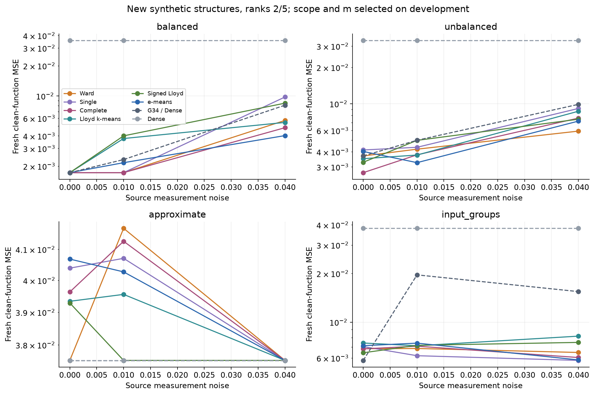
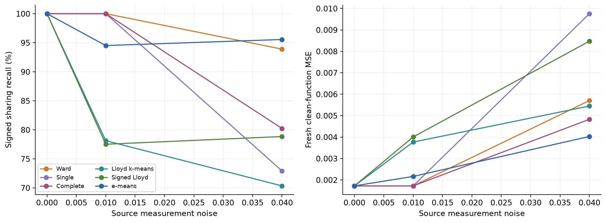
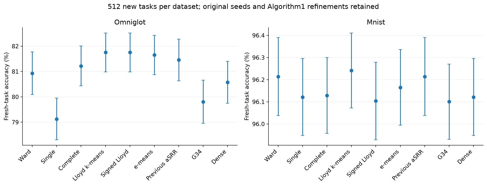
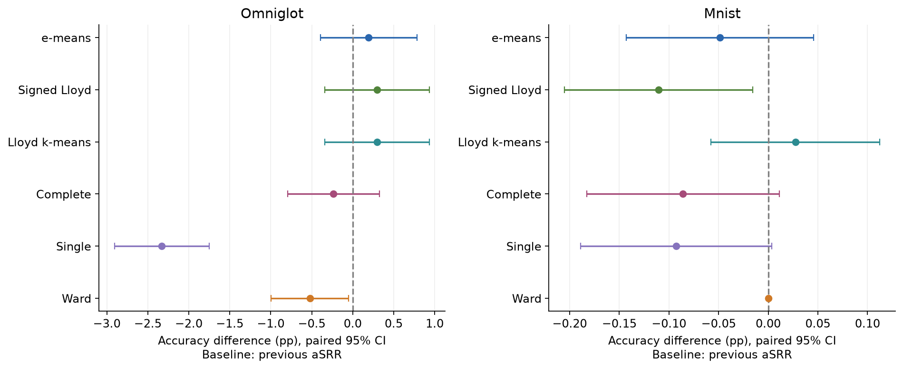
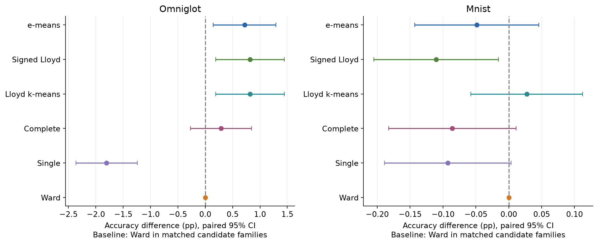
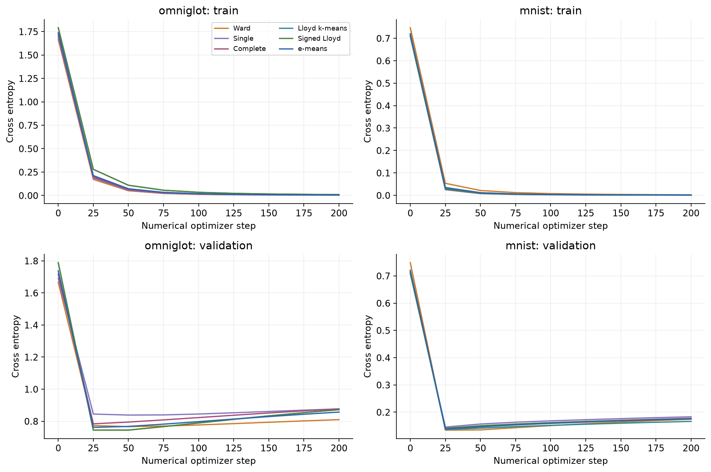
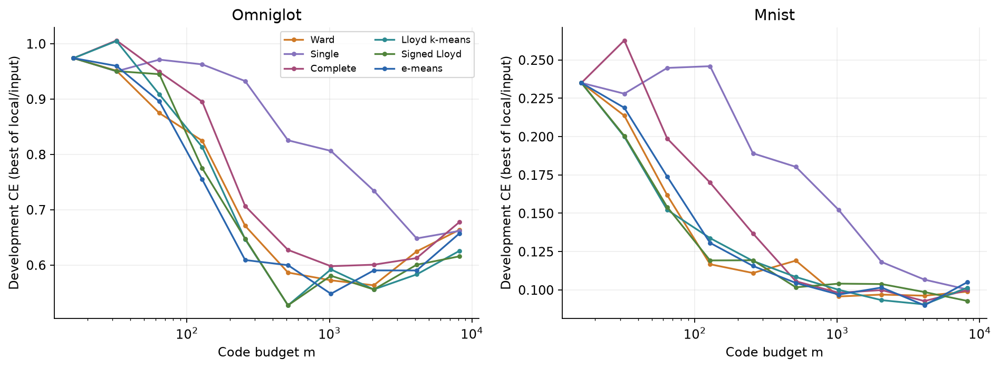
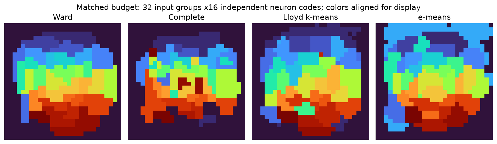

# Кластеризаторы внутри aSRR

15 ноября 2026. Сначала новая синтетика, затем новые реальные эпизоды. Рукопись не менялась.

## Результат проверки

Убедительного выигрыша по accuracy над прежним aSRR/Ward не установлено ни у одного нового кластеризатора. Обычный k-means получил на Omniglot 81.75% с m512 против 81.45% у прежнего локального aSRR с m2048; парная разность +0.30 ± 0.64 п.п. Для MNIST соответствующий k-means дал 96.24% с m4096 против 96.21% у aSRR с m1024; +0.03 ± 0.08 п.п. Это отдельные заранее зафиксированные процедуры, не победитель, выбранный по test.

В новом сравнении с одинаковыми семействами кандидатов и правилом подбора m, где локальным нейронам выделяется m/H групп, k-means и e-means превосходят соответствующий Ward по Omniglot accuracy: +0.82 ± 0.63 и +0.72 ± 0.57 п.п. соответственно (отдельные парные 95% интервалы, без поправки на множественные сравнения). Их CE с этим Ward не различается убедительно. Сам matched Ward уступил прежнему адаптивному Ward, поэтому положительный результат против него нельзя выдавать за улучшение нашего прежнего полного aSRR. На MNIST выигрыша относительно Ward нет.

E-means дал 81.65%/96.17%, с m1024/4096. Его преимущество на шумной сбалансированной синтетике не превратилось в подтверждённое улучшение относительно прежнего полного aSRR на реальных данных. Расширенный выбор по development CE предпочёл e-means на MNIST, хотя его новая accuracy оказалась немного ниже прежнего Ward; интервал включает ноль. One-SE выбор complete_m1024 на MNIST снизил accuracy относительно Ward на −0.14 ± 0.09 п.п. при сопоставимой CE. Автоматическое расширение банка не гарантирует лучший перенос.

Все двенадцать A1-уточнений новых методов имели development CE хуже исходного выбранного кандидата; в test-политиках остались исходные индексаторы. Эти результаты не доказывают бесполезность A1 в других постановках.

## Выбранная до test общая процедура

omniglot: полный банк по development CE выбрал lloyd_input_m512 (m=512); на новой когорте accuracy 81.75%, CE 0.63225. Это заранее выбранная процедура, а не лучший test-результат среди кластеризаторов.
mnist: полный банк по development CE выбрал emeans_input_m4096 (m=4096); на новой когорте accuracy 96.17%, CE 0.12984. Это заранее выбранная процедура, а не лучший test-результат среди кластеризаторов.

| Парное сравнение общей процедуры | Omniglot, п.п. (95% CI) | MNIST, п.п. (95% CI) |
|---|---:|---:|
| Full bank − Previous aSRR | +0.30 ± 0.64 | -0.05 ± 0.09 |
| Full bank − G34 | +1.95 ± 0.69 | +0.06 ± 0.08 |
| Full bank − Dense | +1.18 ± 0.64 | +0.04 ± 0.08 |

## Синтетика: шум 0.04

32 новых независимых структуры, ранги 2/5, три парных уровня шума. Каждая строка ниже — восемь структур сценария. Общий бюджет и численный fitter; выбор семейства и m только на отдельных development-функциях.

| Сценарий | Метод | Fresh MSE | Signed recall, % | Среднее m |
|---|---|---:|---:|---:|
| balanced | Ward | 0.00570 | 93.89 | 8.0 |
| balanced | Single | 0.00976 | 72.92 | 22.0 |
| balanced | Complete | 0.00483 | 80.23 | 13.0 |
| balanced | Lloyd k-means | 0.00545 | 70.34 | 15.0 |
| balanced | Signed Lloyd | 0.00847 | 78.84 | 13.0 |
| balanced | e-means | 0.00403 | 95.55 | 8.0 |
| balanced | Adaptive-local Ward | 0.01365 | 15.53 | 36.0 |
| balanced | G34 / Dense | 0.00809 | 49.91 | 21.0 |
| balanced | Dense | 0.03561 | 0.00 | 96.0 |
| unbalanced | Ward | 0.00593 | 82.76 | 11.0 |
| unbalanced | Single | 0.00914 | 70.44 | 22.0 |
| unbalanced | Complete | 0.00760 | 64.54 | 16.0 |
| unbalanced | Lloyd k-means | 0.00867 | 59.87 | 15.0 |
| unbalanced | Signed Lloyd | 0.00745 | 55.58 | 15.0 |
| unbalanced | e-means | 0.00718 | 78.62 | 9.0 |
| unbalanced | Adaptive-local Ward | 0.01300 | 22.81 | 35.0 |
| unbalanced | G34 / Dense | 0.00988 | 39.06 | 25.0 |
| unbalanced | Dense | 0.03333 | 0.00 | 96.0 |
| approximate | Ward | 0.03753 | 0.00 | 96.0 |
| approximate | Single | 0.03753 | 0.00 | 96.0 |
| approximate | Complete | 0.03753 | 0.00 | 96.0 |
| approximate | Lloyd k-means | 0.03753 | 0.00 | 96.0 |
| approximate | Signed Lloyd | 0.03753 | 0.00 | 96.0 |
| approximate | e-means | 0.03753 | 0.00 | 96.0 |
| approximate | Adaptive-local Ward | 0.03753 | 0.00 | 96.0 |
| approximate | G34 / Dense | 0.03753 | 0.00 | 96.0 |
| approximate | Dense | 0.03753 | 0.00 | 96.0 |
| input_groups | Ward | 0.00649 | 97.48 | 23.0 |
| input_groups | Single | 0.00580 | 100.00 | 24.0 |
| input_groups | Complete | 0.00604 | 98.96 | 24.0 |
| input_groups | Lloyd k-means | 0.00819 | 88.98 | 26.0 |
| input_groups | Signed Lloyd | 0.00749 | 90.71 | 26.0 |
| input_groups | e-means | 0.00584 | 99.05 | 24.0 |
| input_groups | Adaptive-local Ward | 0.00810 | 90.36 | 25.0 |
| input_groups | G34 / Dense | 0.01545 | 53.21 | 47.0 |
| input_groups | Dense | 0.03805 | 0.00 | 96.0 |

Для сбалансированного случая при шуме 0.04 e-means имеет меньшую среднюю MSE, но парная разность с Ward равна −0.00167 ± 0.00229 (95% t-интервал, восемь структур). Убедительного превосходства над Ward по этой небольшой серии не установлено. При сильной индивидуальной деформации Dense имеет лучшую среднюю MSE; при шуме 0.04 его выбрали все методы, а на меньшем шуме часть селекторов ошибочно предпочла sharing.

## Реальные задачи: 512 новых эпизодов каждого датасета

Профили, m и правила выбора новых методов зафиксированы до генерации этой когорты. Дополнительно до любого test-fit и открытия ответов явно добавлен compressed G34 контроль, выбранный только по прежнему development банку; исходная G34/Dense процедура выбрала Dense на Omniglot. Этот дополнительный контроль и исходная заморозка сохранены отдельно. Для каждого нового метода сохраняются исходные семена и одинаковое A1-уточнение лучшего compressed-кандидата. Ниже выбор по development CE; raw-результаты без A1 и paired one-SE находятся отдельно в JSON/CSV.

| Датасет | Метод | Выбранный I | m | Accuracy, % (95% CI) | CE |
|---|---|---|---:|---:|---:|
| omniglot | Ward | ward_local_m2048 | 2048 | 80.93 ± 0.84 | 0.63003 |
| omniglot | Single | single_local_m4096 | 4096 | 79.12 ± 0.82 | 0.68073 |
| omniglot | Complete | complete_input_m1024 | 1024 | 81.22 ± 0.79 | 0.64738 |
| omniglot | Lloyd k-means | lloyd_input_m512 | 512 | 81.75 ± 0.77 | 0.63225 |
| omniglot | Signed Lloyd | signed_input_m512 | 512 | 81.75 ± 0.77 | 0.63223 |
| omniglot | e-means | emeans_input_m1024 | 1024 | 81.65 ± 0.78 | 0.63079 |
| omniglot | Previous aSRR | asrr_local_m2048 | 2048 | 81.45 ± 0.82 | 0.63818 |
| omniglot | G34 / Dense | dense24 | 12544 | 80.57 ± 0.83 | 0.65556 |
| omniglot | Dense | dense24 | 12544 | 80.57 ± 0.83 | 0.65556 |
| omniglot | Full bank, min CE | lloyd_input_m512 | 512 | 81.75 ± 0.77 | 0.63225 |
| omniglot | Full bank, one-SE | lloyd_input_m512 | 512 | 81.75 ± 0.77 | 0.63225 |
| omniglot | Dense, 6 starts | dense | 12544 | 80.39 ± 0.81 | 0.65388 |
| omniglot | G34 | g34_refined_m4096 | 4096 | 79.80 ± 0.85 | 0.65615 |
| mnist | Ward | ward_input_m1024 | 1024 | 96.21 ± 0.18 | 0.12942 |
| mnist | Single | dense24 | 12544 | 96.12 ± 0.17 | 0.13601 |
| mnist | Complete | complete_input_m4096 | 4096 | 96.13 ± 0.17 | 0.13215 |
| mnist | Lloyd k-means | lloyd_local_m4096 | 4096 | 96.24 ± 0.17 | 0.12558 |
| mnist | Signed Lloyd | signed_local_m8192 | 8192 | 96.10 ± 0.18 | 0.13203 |
| mnist | e-means | emeans_input_m4096 | 4096 | 96.17 ± 0.17 | 0.12984 |
| mnist | Previous aSRR | asrr_input_m1024 | 1024 | 96.21 ± 0.18 | 0.12942 |
| mnist | G34 / Dense | a1_g34_refined_m8192 | 8192 | 96.10 ± 0.17 | 0.13249 |
| mnist | Dense | dense24 | 12544 | 96.12 ± 0.17 | 0.13601 |
| mnist | Full bank, min CE | emeans_input_m4096 | 4096 | 96.17 ± 0.17 | 0.12984 |
| mnist | Full bank, one-SE | complete_input_m1024 | 1024 | 96.07 ± 0.17 | 0.12789 |
| mnist | Dense, 6 starts | dense | 12544 | 96.05 ± 0.17 | 0.13267 |
| mnist | G34 | a1_g34_refined_m8192 | 8192 | 96.10 ± 0.17 | 0.13249 |

### Что изменил алгоритм 1 на development

Выбор ниже выполнен до test. В колонке исходного варианта допускается общий Dense endpoint; A1 применён к лучшему compressed seed каждого метода. Test-таблицы raw и final также сохранены в CSV.

| Датасет | Метод | Исходный CE | CE после A1 | Выбранный вариант |
|---|---|---:|---:|---|
| omniglot | Ward | 0.56326 | 0.67285 | Исходный |
| omniglot | Single | 0.64797 | 0.65417 | Исходный |
| omniglot | Complete | 0.59782 | 0.75752 | Исходный |
| omniglot | Lloyd k-means | 0.52705 | 0.76542 | Исходный |
| omniglot | Signed Lloyd | 0.52705 | 0.76542 | Исходный |
| omniglot | e-means | 0.54792 | 0.76696 | Исходный |
| mnist | Ward | 0.09568 | 0.10584 | Исходный |
| mnist | Single | 0.09857 | 0.10311 | Исходный |
| mnist | Complete | 0.09267 | 0.10048 | Исходный |
| mnist | Lloyd k-means | 0.09049 | 0.10321 | Исходный |
| mnist | Signed Lloyd | 0.09276 | 0.09432 | Исходный |
| mnist | e-means | 0.08990 | 0.10415 | Исходный |

Кривые усредняются по задачам и всем шести численным стартам. Финальные предсказания в таблицах используют старт и checkpoint, выбранные по H; их CE не равна среднему всех стартов на кривой.

В карте групп одинаковый цвет означает общий код внутри нейрона. Метки других методов переставлены для наибольшего совпадения с Ward только при отображении; обученные индексаторы не менялись. Все четыре карты используют m512:32общие группы входов,16независимых кодов на группу. Координаты пикселей использованы для визуализации, а не при построении групп.

## Постановка и ограничения

Все локальные методы в новом сравнении получают m/H кодов на нейрон. Previous aSRR сохраняет прежний полный банк, в том числе адаптивное распределение Ward; поэтому это более сильный практический контроль, а не чистая абляция одного linkage. На реальных задачах новые методы проверены в local/input-семействах — победителях прежней серии. На синтетике также проверены global и общие fixed synchronized профили.

E-means — неизменённый авторский код Faiss v1.16.0, native PyTorch FP32 на V100. Для него проверены auto/5, quality/5, quality/25 проходов, по четыре общих случайных начала; выбирается минимальная source SSE. Lloyd и signed Lloyd имеют25шагов и те же четыре начала. У e-means сохранены last-epoch labels; постобработка пустых групп общая для centroid-методов и обеспечивает точный бюджет m. Это сравнение качества, не равного compute. Рецепты, источник, repairs и source histories сохранены.

Источник e-means: [Bessa et al., 2026](https://arxiv.org/pdf/2611.09501v1), [Faiss v1.16.0](https://github.com/facebookresearch/faiss/tree/v1.16.0/contrib/e_means). Параметры взяты из этого релиза: авторский base.py отмечает отличия начальной массы и коэффициентов scaling laws от PDF v1. Это применение к нашим профилям, не воспроизведение embedding-датасетов или H100 speedup из статьи.

Omniglot784–16–5:5way,10train+5H+5query на класс. MNIST784–16–2:100train+50H+100query на класс; source0–4/development5–6/test7–9. Source16/10задач, по4согласованные реплики, development48/24эпизода. Adam200, LR.003/.01/.03,6стартов, Dense24с дополнительным H-выбором четырёх пулов. G34 — прежний практический расширенный банк, не новый exhaustive native search на каждом m.

Реальные CI условны фиксированным source/development данным и классам. Изображения могут повторяться между эпизодами. Подбор по development CE и one-SE не является гарантией меньшего test-риска. Истинного реального I не знаем. Новые software tests не создавались и не запускались.

Код: experiments/srr_cluster_v1. Теория: paper/theory/ASRR_CLUSTERING_2026-11-15.md. Полный протокол, seed/hash registration, frozen predictions, source diagnostics и CSV находятся в artifacts/srr_clustering_2026-11-15; raw — artifacts/local/srr_clustering_2026-11-15.

## Фактическая стоимость построения банка

Время внутри source-конструктора для двух семейств и всей сетки m, в секундах. Прогоны выполнялись при общей нагрузке GPU; это не изолированный speed-бенчмарк. Ward переиспользует дерево для разных m, centroid-методы обучаются отдельно для каждого m. E-means здесь включает три рецепта по четыре начала, Lloyd — четыре начала; число проходов также различается.

| Метод | Omniglot, с | MNIST, с |
|---|---:|---:|
| Ward | 9.95 | 9.14 |
| Single | 53.46 | 50.76 |
| Complete | 11.88 | 10.84 |
| Lloyd k-means | 65.66 | 68.33 |
| Signed Lloyd | 72.36 | 75.26 |
| e-means | 1208.21 | 1168.36 |
