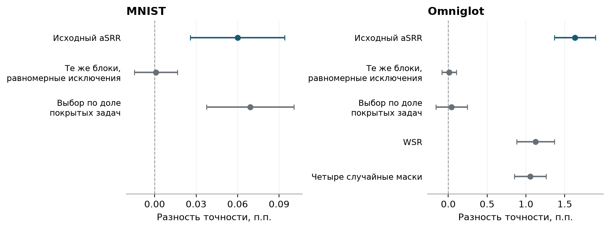

# aSRR при нескольких решениях каждой исходной задачи

По одной хорошо обученной Dense-сети от каждой задачи можно пропустить общую группу даже при точном выравнивании нейронов. Пусть в первой задаче одинаково хорошо работают индексаторы A и B, во второй — A и C. Выбор B и C уничтожает свидетельство в пользу A. При этом выбор по отдельности самых частых связей способен склеить равенства, которые ни одна сеть одновременно не выполняет. Ниже задачу восстановления формулируем так, чтобы отличать оба случая. Численные параметры заново обучаются в каждой задаче.

Для дальнейших модификаций принимаем такой порядок работы. Сначала формулируем механизм ошибки, строим контрпример и выводим предсказание, которое можно опровергнуть. Затем фиксируем синтетическую проверку этого предсказания. До измерения переноса выбираем метод по исходным данным и замораживаем его.

## Что именно восстанавливаем

Полный индексатор задаёт знак и номер свободного кода для каждой позиции первого слоя. Можно также разрешить фиксированный ноль. Множество его следствий обозначим через R. Его элементы — равенства двух весов с заданным относительным знаком и фиксированные нули. Переименование кодов и смена знака одного кода сохраняют эти следствия. Позиции нейронов должны быть сопоставлены: одна допустимая перестановка действует сразу на все связи данного решения. Если соответствие неоднозначно, его варианты можно включить в банк. Равенство считается следствием архитектуры, когда оно выполняется при всех значениях её кодов. Случайные численные совпадения в одном fit игнорируем. У ReLU положительное масштабирование нейрона можно компенсировать в голове. При связях между разными нейронами это иногда даёт ту же функцию с другими группами. Общая инициализация фиксирует начальные номера столбцов, но сама по себе не разрешает эту неоднозначность.

Пусть в исходной задаче t каждый кандидат из банка бюджета m обучен на одних примерах, а его ошибка измерена на других. Близкие по ошибке кандидаты образуют множество решений задачи. Частичная структура C задаёт только те равенства, которые мы хотим перенести.

$$
\begin{aligned}
V_t &= \{I\in B_t:L_t(I)\leq \min_{J\in B_t}L_t(J)+\epsilon\},\\
\mathcal C_\rho &=
\left\{C:\sum_{t=1}^T
 \mathbf 1\!\left[\exists I\in V_t:\ C\subseteq R(I)\right]
 \geq \lceil\rho T\rceil\right\},\\
\mathcal F_\rho &= \mathrm{Max}_{\subseteq}\,\mathcal C_\rho .
\end{aligned}
$$

Возвращаем все максимальные по включению элементы. Для каждого принятого набора связей должна существовать **одна** модель на задачу, выполняющая все связи этого набора. Между задачами модели могут различаться. Если нужен факт, необходимый при *любом* хорошем решении, ответ другой:

$$
N=\bigcap_{t=1}^{T}\ \bigcap_{I\in V_t} R(I).
$$

Например, пусть первая задача допускает наборы связей {a,b} либо {c}, вторая — {a,d} либо {e}. Единственная максимальная общая структура равна {a}, хотя необходимая часть пуста. Если обе задачи допускают либо {a}, либо {b}, максимальных ответов два. Объединение {a,b} недопустимо. Два генератора могут обозначать a и b как «истинную» связь в противоположном порядке при одинаковом законе наблюдений. Тогда никакая статистика этих наблюдений не различит генераторы с вероятностью выше 1/2 при равных априорных весах.

Бюджет m относится ко всем проверяемым **полным** моделям. Разрешение остальных координат как независимых кодов меняет класс моделей. Это отдельная возможность для переноса, если увеличение бюджета допустимо. При фиксированном бюджете выбираем одно полное продолжение на отдельных валидационных эпизодах и замораживаем его до знакомства с целевыми задачами.

## Две причины провала и проверяемые предсказания

**Контрпример для нынешнего aSRR.** Два входа, один скрытый нейрон, один код, три задачи. У первых двух задач второй вход всегда нулевой. Знак второго веса в них не наблюдаем. Пусть обученные Dense-веса первых двух задач пропорциональны (1,−1), а третьей, с полноранговыми входами, — (1,1). И в линейной модели, и для одного ReLU можно получить нулевую ошибку каждым из этих Dense-решений. Правильное равенство двух весов совместимо со всеми тремя задачами. После обычной нормировки два координатных профиля имеют вид

$$
z_1=(1,1,1)/\sqrt2,\qquad z_2=(-1,-1,1)/\sqrt2,\qquad
\langle z_1,z_2\rangle=-1/2.
$$

При бюджете в один код глобальный aSRR обязан поместить оба веса в группу. Его шаг назначения знаков выберет противоположные знаки при любом из двух начальных профилей. Этот ответ уже не сможет представить функцию третьей задачи. В нашей процедуре первая и вторая задачи принимают оба знака, третья принимает только равенство. Их пересечение даёт правильный знак. В точной линейной реализации ошибка прежнего индексатора после МНК на третьей задаче равна 0,5, у нового она равна нулю во всех трёх задачах. Здесь единственный скрытый нейрон, поэтому ошибку aSRR невозможно объяснить перестановкой нейронов. [Фактические знаки и ошибки обоих решений](../../artifacts/asrr_compatible_2026-11-19/single_neuron_counterexample.json).

**1. Различимость ложной связи.** Зафиксируем словарь структур и популяционные множества решений. Пусть истинной для этого определения считается структура, совместимая с почти каждой задачей. Для ложного набора B обозначим через p вероятность получить задачу, в которой ни одно допустимое решение не содержит B. При независимом выборе T исходных задач вероятность ошибочно сохранить B равна

$$
\Pr(B\in\mathcal C_1)=(1-p)^T .
$$

Для полного восстановления достаточно исключить все минимальные по включению ложные наборы. Обозначим их множество через D. Всякий ложный набор содержит элемент D, а каждая истинная структура сохраняется почти наверное. Поэтому вероятность ошибиться во всём семействе ограничена сверху суммой вероятностей для элементов D:

$$
\Pr(\widehat{\mathcal F}_1\ne\mathcal F^\star)
\leq \sum_{B\in D}(1-p_B)^T .
$$

Это утверждение о разнообразии **задач** при известных множествах решений. Дополнительные запуски Dense на одном распределении могут помочь обнаружить второе решение этой задачи. Они не увеличивают вероятность появления задачи, которая различает два функционально эквивалентных объяснения. При неполном покрытии действует аналогичный аргумент для частот. Если популяционная доля совместимых задач отстоит от порога на γ у всех максимальных истинных и всех минимальных ложных наборов и число таких наборов равно d, вероятность ошибки не выше

$$
2d\exp(-2T\gamma^2).
$$

Здесь используются независимые задачи и фиксированные до их наблюдения банк и словарь. Ошибка численной оценки множества решений — отдельный источник неопределённости. Вариант, подобранный на тех же задачах, требует новой выборки задач для такой проверки.

**2. Цена ошибочного продолжения.** Пусть E содержит все допустимые полные продолжения частичной структуры, а r — превышение ошибки над лучшим решением задачи. Имеем

$$
\max_t\min_{I\in E}r_t(I)\ \leq\ \min_{I\in E}\max_t r_t(I).
$$

Например, для двух задач и двух продолжений со строками ошибок (0,1) и (1,0) левая часть равна нулю, правая — единице. Значит, даже полное покрытие частичной структуры не гарантирует столь же хорошего фиксированного индексатора.

Цену одного неверного равенства можно вычислить точно в линейной модели. Пусть входы стандартные гауссовские размерности d, дисперсия шума равна σ², число обучающих примеров n больше d+1, а индексатор задаёт подпространство S размерности k. Обозначим через b длину проекции истинных весов на ортогональное дополнение S. Для обычного МНК без регуляризации средняя квадратичная ошибка предсказания незашумлённого сигнала на новом входе равна

$$
\begin{aligned}
R(S)&=b^2+(\sigma^2+b^2)\frac{k}{n-k-1},\\
R(S)<R(\mathbb R^d)&\quad\Longleftrightarrow\quad
b^2<\frac{\sigma^2(d-k)}{n-d-1}.
\end{aligned}
$$

В гауссовской модели пропущенная компонента независима от регрессоров в S и даёт дополнительный шум дисперсии b². Средний след обратной матрицы Грама для k регрессоров равен k/(n−k−1). Остаётся прибавить квадрат смещения и сравнить с полным МНК. Первое равенство также получается из теоремы 1 Belkin, Hsu и Xu после поворота в базис подпространства и вычитания неснижаемого шума. Даже маленькая ошибка в навязанной связи может оказаться дороже одного сэкономленного кода. Это обосновывает выбор фиксированного продолжения по ошибке после переобучения. Для нелинейной сети численное значение порога надо оценивать отдельно. [Belkin, Hsu и Xu, теорема 1](https://arxiv.org/pdf/1903.07571).

Для прямой проверки этих двух выводов отдельно зафиксировали параметры, семена и ожидаемые численные результаты до запуска дополнительной синтетики. [Предсказания и протокол](../../experiments/srr_approx_v1/compatible_diagnostics_plan.json).

## Как получить и проверить кандидатов

Исходные запуски Dense, группы Ward, поочерёдная оптимизация кодов и сопоставлений из G34, а также локальные перестановки и смены знаков могут давать разные предложения. Для моделей на непрерывных входах мы проверили следующий предварительный отбор. Для каждого полного кандидата сравниваем его с несколькими запусками Dense на обучающих входах той же задачи. Здесь S задаёт декодирование весов из кодов, а U содержит подбираемые коды. В опыте с группировкой входов это матричное произведение.

$$
\begin{aligned}
d_{tI} &= \min_{r,U}
       \|X_tW_{tr}-X_tS_IU\|_F^2/(n_t H),\\
q_{tI} &= \exp\!\left[-\mathrm{rank}_t(d_{tI})/\lceil\sqrt M\rceil\right],\\
q_{tI}(C) &= q_{tI}\,\mathbf 1[C\subseteq R(I)],\qquad
a_C=\left(\min_t\max_I q_{tI}(C)\right)^2,\\
F(B)&=\sum_C a_C\sum_t\max_{I\in B}q_{tI}(C).
\end{aligned}
$$

Ранги начинаются с нуля, M — число первоначальных предложений. По C суммируем в выбранном словаре частичных структур, максимум пустого банка полагаем нулём. На очередном шаге берём кандидат с наибольшим приростом F. Один и тот же кандидат может покрыть несколько задач и несколько наборов связей. Масштаб рангов и квадрат веса — конкретные параметры проверенного варианта.

Прямой жадный отбор требует порядка KMT операций на один частичный набор. Полный словарь в большом слое непрактичен. В скалярной синтетике словарь содержал 331 набор, в опытах с изображениями — 81 частичное назначение четырёх блоков, на Pattern пересечение выполнялось непосредственно над знаковыми матрицами. На изображениях проверены все 16 полных блочных назначений. Результат на этом словаре не устанавливает расположение всех истинных групп пикселей.

**Свойство отбора.** Чем больше уже выбранный максимум в одном слагаемом F, тем меньше прибавит заданный кандидат. Сумма с неотрицательными весами монотонна и субмодулярна. При бюджете K хотя бы одно приращение от кандидата оптимального банка не меньше текущего разрыва, делённого на K. Итерация даёт

$$
F(B_{\mathrm{greedy}})\ \geq\
\big[1-(1-1/K)^K\big]\max_{|B|\leq K}F(B).
$$

Это оценка для предварительного критерия. Для восстановления частичной структуры в банке всё ещё нужно сохранить хотя бы по одному совместимому решению каждой нужной задачи и правильно оценить порог её ошибки. Бывает, что почти оптимальный численный fit есть в каждой задаче, но для одной связи все совместимые с ней решения отвергнуты при отборе. [Nemhauser, Wolsey и Fisher, 1978](https://doi.org/10.1007/BF01588971).

### Псевдоалгоритм

Входы — предложения с бюджетом m, исходные обучающие и проверочные примеры, допустимая ошибка и доля задач. Ниже все задачи используют общий банк. Fit обучает коды, смещения и выходные веса. Строка 1 нужна при ограниченном числе численных переобучений. Для переноса с фиксированным бюджетом используются строки 6–7.

$$
\begin{aligned}
1.\quad &B_0=\varnothing,\quad
 B_{k+1}=B_k\cup\{\arg\max_{I\notin B_k} [F(B_k\cup\{I\})-F(B_k)]\};\\
2.\quad &\hat\theta_{tI}=\mathrm{Fit}(I,D_t^{\rm fit}),\quad
 L_t(I)=\ell(I,\hat\theta_{tI};D_t^{\rm val}),\qquad I\in B_K;\\
3.\quad &G_{tI}=\mathbf1[L_t(I)-\min_J L_t(J)\leq\epsilon],\quad
 A_{IC}=\mathbf1[C\subseteq R(I)];\\
4.\quad &Z_{tC}=\max_I G_{tI} A_{IC};\\
5.\quad &\mathcal F_\rho=\mathrm{Max}_{\subseteq}
 \{C:\textstyle\sum_t Z_{tC}\geq\lceil\rho T\rceil\};\\
6.\quad &E=\{I\in B_K:\exists C\in\mathcal F_\rho,\ C\subseteq R(I)\},\\
 &\hat I\in\arg\min_{I\in E}\ \frac1{|D|}\sum_{u\in D}
     \ell_u^{\rm query}\!\left(I,\mathrm{Fit}(I,D_u^{\rm support})\right);\\
7.\quad &\mathrm{return}\quad \mathcal F_\rho,\quad
  \hat I,\quad \theta_{\rm new}=\mathrm{Fit}(\hat I,D_{\rm new}^{\rm support}).
\end{aligned}
$$

При строгом покрытии можно обойти перечисление частичных наборов. Начинаем с максимальных элементов первой задачи. После каждой следующей задачи пересекаем каждый текущий элемент с каждым допустимым решением и убираем дубли и строгие подмножества:

$$
\begin{aligned}
F_1 &= \mathrm{Max}_{\subseteq}\{R(I): I\in V_1\},\\
F_{t+1}&=\mathrm{Max}_{\subseteq}
 \{C\cap R(I): C\in F_t,\ I\in V_{t+1}\}.
\end{aligned}
$$

**Почему это точно.** Все подмножества совместимого набора тоже совместимы. Пересечение двух таких семейств состоит из всех подмножеств попарных пересечений их максимальных элементов. Индукция даёт результат для всех задач. Для знаковых индексаторов пересечение вычисляется по паре меток каждой позиции в двух моделях. Связываем две позиции, когда их пары одинаковы с точностью до одного общего знака, а пару нулей объявляем фиксированным нулём. Эта операция не зависит от нумерации и ориентации кодов в двух моделях. Число несравнимых ответов в худшем случае экспоненциально. Для изображений словарь ограничили четырьмя двоичными выборами по блокам и всеми их частичными комбинациями.

**Что гарантируют отложенные примеры.** Условимся на замороженных предложениях и уже обученных численных параметрах. Для независимых внутри каждой задачи проверочных примеров, потери в диапазоне от 0 до 1, не менее n примеров на задачу и M обученных моделей суммарно по всем задачам неравенство Хёффдинга и объединение событий дают с вероятностью не меньше 1−δ

$$
\begin{aligned}
r&=\sqrt{\log(2M/\delta)/(2n)},&
\max_{t,I}|\widehat L_t(I)-L^{\rm pop}_t(I)|&\leq r,\\
\mathcal C^{\rm pop}_{\rho,\epsilon-2r}
 &\subseteq\widehat{\mathcal C}_{\rho,\epsilon}
 \subseteq\mathcal C^{\rm pop}_{\rho,\epsilon+2r}.
\end{aligned}
$$

Вычитание лучшей ошибки задачи удваивает границу. Минимум по продолжениям и порог по числу задач сохраняют включения. Для точного восстановления максимальных элементов нужен зазор вокруг допуска. При малом числе запросов в эпизоде эта оценка может быть широкой. Гарантия условна на банке и качестве уже обученных моделей. Относительный допуск допускает и плохо предсказывающий банк, если плохи все его кандидаты. Для переноса нужна проверка абсолютного качества. В приложении к статье результат естественно следует после подраздела о дополнительной информации от разных задач: там задачи дают обязательные связи и запреты, здесь каждая задача может дать несколько взаимоисключающих вариантов. [Действующий раздел теории](../sections/theory.tex).

Сохранение всех гипотез, совместимых с наблюдениями, восходит к version spaces Митчелла. Множества почти оптимальных моделей изучались как Rashomon sets. Здесь для каждой задачи такие гипотезы — полные знаковые индексаторы, а между задачами пересекаются семейства их частичных следствий. Численные коды задач могут различаться. [Mitchell](https://ijcai.org/proceedings/1977/68) · [Fisher, Rudin и Dominici](https://jmlr.org/papers/v20/18-760.html).

Принцип сопоставления разных сред родственен invariant prediction. Задачи оценки общих и частных признаков изучались также в многозадачной регрессии. Здесь проверяем существование совместимого полного решения при заданном бюджете, без каузальной интерпретации. [Peters, Bühlmann и Meinshausen](https://arxiv.org/abs/1501.01332) · [Jalali и соавт.](https://proceedings.neurips.cc/paper/2010/hash/00e26af6ac3b1c1c49d7c3d79c60d000-Abstract.html).

## Контролируемое восстановление

### Проверка двух предсказаний о механизме

В первой проверке даны два решения с одним свободным кодом каждое — равенство или противоположность двух весов. Истинный знак разыгрывается заново в каждом семействе. С вероятностью p очередная задача показывает оба входных направления. В остальных задачах второй вход всегда нулевой, и обе гипотезы функционально совпадают. После МНК по 48 обучающим примерам с шумом и проверки на 128 новых примерах получились следующие частоты сохранения ложного знака при восьми задачах.

| Вероятность различающей задачи | Предсказанная вероятность | Наблюдаемая, из 1024 семейств |
|---:|---:|---:|
| 0 | 100% | 100% (1024) |
| 0,05 | 66,34% | 66,31% (679) |
| 0,20 | 16,78% | 17,58% (180) |
| 0,50 | 0,39% | 0,49% (5) |

При двух, восьми и шестнадцати задачах в каждом семействе можно проверить событие непосредственно. Во всех четырёх режимах оценщик сохранял ложный знак ровно тогда, когда среди увиденных задач не было различающей. Истинный знак сохранился во всех случаях. В более сложной линейной синтетике ниже доля точных восстановлений одной необязательной общей связи росла с 3/32 до 25/32 и 32/32 при увеличении числа исходных задач с двух до четырёх и восьми.

Во второй проверке одна связь уменьшает число кодов с шести до пяти, имеется 16 обучающих примеров, стандартное отклонение шума 0,2. Формула предсказывает, что связь полезна до расстояния от истинных весов до подпространства, равного 1/15. На 8192 независимых обучающих выборках для каждого фиксированного расстояния оценивали парный выигрыш в MSE относительно Dense. Чистую ошибку на новых входах вычисляли точно по весам уже обученной модели.

| Расстояние до подпространства | Предсказанный выигрыш | Наблюдаемый выигрыш [95% ДИ] |
|---:|---:|---:|
| 0 | +0,00667 | +0,00681 [+0,00647 … +0,00716] |
| 0,04 | +0,00427 | +0,00450 [+0,00414 … +0,00486] |
| 0,12 | −0,01493 | −0,01454 [−0,01501 … −0,01408] |

Эта проверка была спланирована после основных опытов как самостоятельная проверка двух формул. Знак эффекта, ожидаемые величины и настройки были записаны до генерации её данных. [План](../../experiments/srr_approx_v1/compatible_diagnostics_plan.json) · [Все результаты](../../artifacts/asrr_compatible_2026-11-19/mechanism_diagnostics.json).

### Непрерывные задачи с несколькими представлениями

Восемь задач в семействе, шесть входов, три пары со свободными относительными знаками. Всего 120 полных индексаторов и 331 частичный набор, включая пустой. Для каждой задачи выбираем две группы весов, реализуемые разными индексаторами. Берём гауссовские входы из подпространства, ортогонального разностям соответствующих столбцов. На этом распределении обе сети дают одну и ту же функцию. В дополнительном режиме оставляем 2,5% масштаба по подавленным направлениям, тогда равенство становится приближённым. Номера связанных входов и знаки меняются между семействами.

В линейном опыте и опыте с двумя наблюдаемыми выходами ReLU использовали 32 семейства на сценарий, по 192/256 обучающих/проверочных примеров на задачу и допуск 0,001 по ограниченной квадратичной потере. В таблице число семейств, в которых **весь список** максимальных ответов совпал с соответствующим эталоном при точном совпадении функций на исходном подпространстве.

| Что заложено в генератор | Линейный, заложенное | Линейный, все точные представления | Наблюдаемые ReLU, заложенное | Наблюдаемые ReLU, все точные представления |
|---|---:|---:|---:|---:|
| Единственный общий полный индексатор | 32 | 32 | 30 | 30 |
| Одна общая связь, которую можно обойти в каждой задаче | 32 | 32 | 24 | 24 |
| Одна связь в обоих заложенных решениях каждой задачи | 29 | 30 | 0 | 25 |
| Два общих полных индексатора | 19 | 32 | 0 | 32 |
| Две по отдельности общие, попарно несовместимые связи | 31 | 31 | 29 | 29 |

Перебор всех 120 кандидатов показывает, почему выбор эталона существенен. В четвёртом сценарии с наблюдаемыми ReLU во всех 32 семействах допустимы дополнительные точные представления. Все 32 ответа метода совпадают с наблюдаемым семейством. Выбрать исключительно два задуманных генератором решения здесь невозможно. Для линейного случая также вычислили популяционную ограниченную ошибку именно тех весов, которые подогнаны по шумным обучающим примерам. При том же допуске наборы максимальных решений, найденные по 256 проверочным примерам, совпали с этим эталоном во всех 320 комбинациях сценария, семейства и уровня возмущения. Это другая проверка, чем равенство классов точно реализуемых функций. [Результаты](../../artifacts/asrr_compatible_2026-11-19/synthetic/linear_results.json) · [Проверка популяционного риска](../../artifacts/asrr_compatible_2026-11-19/synthetic/linear_population_audit.json).

При единственном общем полном линейном индексаторе совместимость и минимизация средней ошибки по тому же банку дали 32/32, голосование за лучшую модель каждой задачи — 30/32, подбор индексатора по расстоянию до Dense в том же банке — 2/32, обычный глобальный Ward — 0/32. В сценарии несовместимых связей объединение по отдельности поддержанных равенств нарушило заложенную совместимость во всех 32 семействах. В первом из них ответом являются два одноэлементных варианта:

$$
\mathcal F_1=\big\{\{w_3=w_6\},\ \{w_4=-w_5\}\big\}.
$$

Практическую цену лишних связей измерили на отдельных полноранговых целевых задачах. В сценарии одной необязательной общей связи генерировали веса, сохраняющие только эту связь, и давали по 16 примеров для обучения. Средняя линейная MSE равна 0,0013 для восстановленной связи с пятью свободными кодами, 0,2588 для случайной связи того же бюджета, 0,0017 для Dense с шестью кодами и 0,5246 для полного трёхкодового индексатора с лучшей средней исходной ошибкой. Усреднение по 48 целевым задачам в каждом из 32 семейств. Для двух наблюдаемых ReLU на том же сценарии ошибка найденного частичного решения составила 0,0355, Dense — 0,0192, эталонной связи — 0,0099. Ошибка восстановления может перевесить выигрыш от ограничения числа кодов. [Результаты ReLU](../../artifacts/asrr_compatible_2026-11-19/synthetic/relu_results.json).

### Скрытые нейроны, наблюдается только скалярный ответ

Эта проверка ближе к исходному методу. Две ReLU имеют неизвестные веса, смещения и ненулевые выходные коэффициенты. Наблюдаем только их взвешенную сумму с шумом, стандартное отклонение 0,035. Для оценки эталона используем проектор P на подпространство входов и истинные столбцы учителя. При двух различных непараллельных плоскостях излома с ненулевыми скачками градиента эквивалентность в классе сетей с двумя нейронами эквивалентна условию

$$
P w_h \in \operatorname{col}(P S_I),\qquad h\in\{1,2\}.
$$

Действительно, скачок градиента на открытом участке каждой плоскости определяет направление её нормали с точностью до множителя. Сеть с двумя нейронами должна воспроизвести оба излома. Для обратного направления достаточно подобрать коды, дающие исходные проекции, и взять исходные смещения и голову. Эталон видит веса учителя только при оценке уже построенного ответа. Оценщик обучает Dense по скалярным ответам и получает кандидатов из всех знаковых паросочетаний шести входов. Для каждого численного переобучения используются четыре проекции обученных Dense-сетей и два случайных старта, по 384 шага Adam, 256 обучающих и 256 свежих проверочных примеров на исходную задачу.

После пилота с 12 семействами на сценарий сравнили методы на 16 новых семенах. Один и тот же список семян использован в пяти сценариях. Числа — точные совпадения со **всем** семейством, вычисленным по изломам. Поочерёдный отбор берёт лучшие ещё не выбранные кандидаты из ранжированных списков исходных задач. Локальный поиск меняет пары или знаки, посещает до 48 кандидатов в каждой задаче и объединяет по шесть лучших. Его итоговый банк имеет переменный размер.

| Сценарий | Покрытие, 48 | Поочерёдно, 48 | Случайно, 48 | Локальный | Все 120 |
|---|---:|---:|---:|---:|---:|
| Единственный полный | 15 | 15 | 5 | 15 | 15 |
| Необязательная общая связь | 15 | 14 | 1 | 8 | 15 |
| Связь в обоих заложенных решениях | 14 | 13 | 0 | 8 | 14 |
| Два общих полных | 14 | 14 | 0 | 3 | 14 |
| Две взаимоисключающие связи | 15 | 14 | 0 | 3 | 14 |
| **Всего из 80** | **73** | **70** | **6** | **37** | **72** |

Отбор по покрытию сохранил для каждого истинного максимального ответа хотя бы одно точное продолжение в каждой задаче во всех 80 семействах. Численное обучение и проверка с ненулевым допуском дали семь ошибок восстановления. По этой же причине полный численный перебор иногда принимает лишний приближённый вариант. Разница 73 против 70 мала. Основной выигрыш в этой постановке даёт сохранение набора совместимых решений с осмысленным предварительным отбором. Для сравнения методов эксперимент фактически переобучил все 120 кандидатов, поэтому 48 — бюджет сравниваемой процедуры, а ускорение по настенным часам здесь не измерялось. [Протокол](../../artifacts/asrr_compatible_2026-11-19/scalar_confirmation/plan.json) · [Реализация скалярного эксперимента](../../experiments/srr_approx_v1/compatible_scalar.py).

### Бинарный Pattern

Из трёх архивных ансамблей Dense и поиска по подмножествам исходных задач построили 14 различных предложений с четырьмя кодами, в том числе ранее найденный по меткам кандидат. В каждом случае заново обучали численные параметры по 768 примерам и измеряли Brier на 384 отложенных входах. При допуске 0,01 у каждой из 12 задач оказалось от одного до шести допустимых полных решений. Их совместное семейство содержит единственное максимальное решение. Оно совпало с эталоном на **88/88** позициях с точностью до общей перестановки скрытых нейронов, имён и знаков кодов. Восстановлены 32 активные связи и 56 фиксированных нулей. Эталон открывался после фиксации результата. Этот опыт проверяет выбор среди предложений, а происхождение правильного предложения разобрано в отдельном исследовании. [Индексатор](../../artifacts/asrr_compatible_2026-11-19/pattern/frozen.npz) · [Результаты](../../artifacts/asrr_compatible_2026-11-19/pattern/results.json) · [Поиск групп и знаков по исходным ответам](ASRR_GROUP_RECOVERY_AND_ANCHOR_2026-11-19.md).

## Перенос при фиксированном бюджете

У MNIST 16 скрытых нейронов и 2048 кодов, у Omniglot 64 и 4096. Позиции скрытого слоя делим на четыре блока одинаковой ширины. В каждом блоке можно взять исходное разбиение aSRR (0) или оставить один общий код и раздать оставшийся бюджет независимым весам (1). При раздаче сначала уравниваем покрытие входов. Среди одинаково покрытых входов предпочтение получают позиции с большим отклонением от центра группы исходного aSRR. В равномерном контроле убираем только это предпочтение, сохраняя блоки, число кодов и генератор случайных чисел. Все 16 комбинаций расходуют одинаковый бюджет. Для Omniglot нулевая комбинация точно воспроизводит исходный aSRR с четырьмя разбиениями. Во всех сравнениях в пределах этапа эпизоды и численные старты одинаковы.

- **MNIST.** Два класса, 16 примеров на класс, по 100 запросов на класс. На валидации пара 5/6, на целевых эпизодах пары из цифр 7/8/9. По 16 численных стартов и 50 шагов Adam.
- **Omniglot.** Пять классов, по 10 примеров на класс для обучения кодов, пять для выбора численного решения и пять запросов. Валидационные и целевые классы взяты из разных разделов. По 24 старта, до 500 шагов Adam, усредняем вероятности четырёх выбранных сетей.

**Первоначальный вариант.** При допуске 0,01 по половине многоклассовой ошибки Brier и минимальном покрытии 90% выбрали продолжение, приемлемое для наибольшего числа валидационных задач. На 768 новых целевых эпизодах на датасет прирост к aSRR составил +0,067 п.п. для MNIST и +1,479 п.п. для Omniglot. В Omniglot максимальными оказались два варианта — второй блок равен 1 либо четвёртый блок равен 1. Ни одно полное продолжение не было приемлемо для 90% исходных задач. Выбранное 1011 покрыло 37,0%. При требовании покрытия 100% остался только пустой набор. По средней валидационной ошибке тот же банк выбрал 0111 и получил на целевых эпизодах ещё на 0,271 п.п. больше, 95% ДИ от −0,087 до +0,629. [Выбор на исходных задачах](../../artifacts/asrr_compatible_2026-11-19/omniglot10_selection.json) · [Парные сравнения, включая WSR и четыре случайные маски](../../artifacts/asrr_compatible_2026-11-19/omniglot10_results.json).

**Проверка воспроизводимости первоначального правила.** На 192 новых валидационных эпизодах независимо выбрали продолжение для каждого из трёх новых случайных предложений и проверили на 1536 свежих целевых эпизодах. Эта процедура дала −0,020 п.п. относительно aSRR на MNIST (97,5% ДИ от −0,064 до +0,024) и +1,646 п.п. на Omniglot (от +1,397 до +1,895). При сохранении конкретных старых индексаторов эффекты воспроизвелись, +0,043 и +1,581 п.п. соответственно. На новых банках отбор по средней валидационной ошибке опередил отбор по доле задач на 0,046 п.п. на MNIST и на 0,148 п.п. на Omniglot. Для второго различия 95% ДИ включает ноль. Именно после этого результата ввели отдельный этап выбора для переноса. [MNIST](../../artifacts/asrr_compatible_2026-11-19/replication/mnist16_results.json) · [Omniglot](../../artifacts/asrr_compatible_2026-11-19/replication/omniglot10_results.json).

**Двухэтапный вариант.** По 192 эпизодам открытия оценили совместимость правил выбора блоков, усреднив Brier по трём маскам в каждом эпизоде. При заданном покрытии остались 11 из 16 полных продолжений на MNIST и 14 на Omniglot. На Omniglot максимальные частичные ответы — по отдельности выбор 1 во втором, третьем или четвёртом блоке. Эти выводы относятся к правилу распределения кодов в блоке. Точные позиции независимых весов меняются между реализациями маски.

На **других 384 валидационных эпизодах** выбрали продолжение с лучшей средней точностью по трём маскам, при равенстве учитывали Brier. Для целевой оценки заранее зафиксировали ещё три новые реализации маски и 1536 новых эпизодов на датасет. Отдельно оценили выбор среди всех 16 правил без структурного фильтра, равномерные исключения в тех же блоках, прежний выбор по доле покрытых задач и архивные маски Omniglot. На каждом целевом эпизоде усредняются точности трёх независимо зафиксированных индексаторов. Это оценка среднего по трём реализациям, без ансамблирования их предсказаний. Интервалы парные по эпизодам, условны на этих трёх масках и имеющихся пулах классов и изображений. Для двух основных сравнений с aSRR приведены 97,5% интервалы с поправкой Бонферрони, для вторичных — 95%. [Зафиксированный протокол MNIST](../../artifacts/asrr_compatible_2026-11-19/completion/mnist16_plan.json) · [Протокол Omniglot](../../artifacts/asrr_compatible_2026-11-19/completion/omniglot10_plan.json).

| Точность на финальных эпизодах | MNIST | Omniglot |
|---|---:|---:|
| Исходный aSRR | 93,363% | 84,401% |
| Двухэтапный выбор | **93,423%** | **86,031%** |
| Средняя валидационная точность по всем 16 правилам | 93,423% | 86,031% |
| Те же блоки, равномерные исключения | 93,422% | 86,021% |
| Выбор только по доле приемлемых задач | 93,354% | 85,989% |
| WSR, зафиксированный вариант | — | 84,909% |
| Четыре архивные равномерные маски, среднее | — | 84,977% |

На MNIST получили **+0,060 п.п.** к исходному aSRR, 97,5% ДИ от +0,026 до +0,094. Для трёх предзаданных реализаций по отдельности приросты +0,057, +0,049 и +0,074 п.п. На Omniglot получили **+1,630 п.п.**, 97,5% ДИ от +1,365 до +1,896. Приросты по реализациям +1,531, +1,760 и +1,599 п.п. Преимущество над WSR составило +1,122 п.п. (95% ДИ от +0,879 до +1,365), над средним четырёх архивных масок +1,055 п.п. (от +0,850 до +1,259). [Результаты MNIST](../../artifacts/asrr_compatible_2026-11-19/completion/mnist16_results.json) · [Результаты Omniglot](../../artifacts/asrr_compatible_2026-11-19/completion/omniglot10_results.json).

В обоих случаях обычный выбор из всех 16 правил по той же валидационной точности выбрал **ровно тот же индексатор** для каждого семени (1000 для MNIST, 0111 для Omniglot). Внутри выбранных блоков взвешивание по остаткам Dense дало относительно равномерных исключений +0,001 п.п. на MNIST (95% ДИ от −0,015 до +0,016) и +0,010 п.п. на Omniglot (от −0,085 до +0,105). Банк с блочными продолжениями содержит лучшие для переноса модели. На этих данных структурный фильтр не дал дополнительной точности, а весовая информация Dense не дала различимого преимущества при размещении независимых весов. Произвольная равномерная маска всего слоя и равномерное распределение внутри уже выбранных блоков — существенно разные контроли.



Для статьи обоснованы два утверждения. Первое — при неоднозначности исходных решений можно восстановить всё наблюдаемое семейство совместимых знаковых связей в заданном банке, включая альтернативы, которые прежний aSRR теряет даже при одном нейроне. Для этого нужны хорошие продолжения в банке и задачи, различающие ложные связи. Второе — включение частичного сохранения групп и независимых весов в банк даёт лучшие фиксированные модели на изученных протоколах переноса. Эксперимент с равномерными исключениями и отбор без фильтра ограничивают объяснение этого второго результата. [Все фиксированные индексаторы](../../artifacts/asrr_compatible_2026-11-19/fixed_indices.npz) · [Сводка](../../artifacts/asrr_compatible_2026-11-19/summary.json).

## Реализация

Для восстановления непосредственно из знаковых индексаторов функция `common_frontier` принимает список допустимых моделей каждой задачи. Для заранее заданного словаря `RelationBank.infer` принимает матрицу отложенных потерь «задача × индексатор» и возвращает максимальные частичные ответы, необходимые связи и фактическое покрытие. Предварительный отбор по ограниченному числу переобучений реализован в `witness_cover`. [Инференс и отбор](../../experiments/srr_approx_v1/compatible.py) · [Выбор фиксированного индексатора](../../experiments/srr_approx_v1/compatible_completion.py).

Из корня репозитория можно воспроизвести проверку выведенных формул и подтверждающий скалярный эксперимент. Для последнего требуются CUDA и архив результатов или доступные устройства для обучения.

```bash
python -m experiments.srr_approx_v1.compatible_diagnostics
python -m experiments.srr_approx_v1.compatible_scalar --confirmation --gpus 0 1 2 3 4 5 6 7
```
