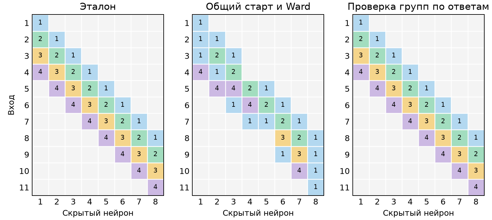

# Восстановление групп Pattern и общий старт aSRR

На бинарном Pattern удалось восстановить все 88 позиций первого слоя. Для этого потребовались два источника информации. Обученные Dense-нейроны предложили возможные наборы входов. Ответы исходных задач позволили выбрать наборы и оценить относительные знаки. На MNIST и Omniglot отдельно проверили предложение инициализировать исходные сети первым слоем одной якорной задачи.

## Какой индексатор восстановился

После одной общей перестановки скрытых нейронов, переименования кодов и выбора знака каждого кода результат имеет вид

$$
\widehat I_{ih} =
\begin{cases}
 i-h+1 & 0\le i-h<4,\\
 0 & \text{иначе}.
\end{cases}
$$

Числа от 1 до 4 обозначают четыре свободных кода задачи. Совпали все 32 активные связи и 56 фиксированных нулей. Эталон использовали при оценке уже построенных индексаторов. Оценщик перебирает перестановки и смены знаков кодов и находит лучшее сопоставление нейронов. Порядок входов при оценке фиксирован.

## Что изменили в поиске

В G34 выравнивание использовало гипотезу об индексаторе. Для каждой задачи подставляли её собственные коды, декодировали столбцы и сопоставляли их с обученными столбцами той же задачи. Архивный алгоритм 1 затем обновлял численные параметры и общие назначения по всем задачам. В нынешнем aSRR усреднение сопоставленных Dense-столбцов предшествует построению кандидатов. Если компонент в каком-то запуске плохо выучен, обязательное взаимно однозначное сопоставление всё равно отдаёт ему столбец. [G34 в коде](../../experiments/sharing_structure_research_v1/blind_joint_bank.py) · [Архивный алгоритм 1](https://github.com/Demoren1/InductionBiasResearch/blob/ea72ea967f5ba0957b72bd1ff588b857fceb606a/paper/sections/method.tex) · [Нынешний метод](../sections/method.tex).

1. В каждом отдельном Dense-столбце сортируем входы по модулю веса. Каждый префикс даёт кандидат на набор входов одного скрытого нейрона. Пул объединяет задачи, запуски и нейроны. В бинарном оценщике максимальная ширина ограничена объёмом данных так, чтобы на состояние в среднем приходилось хотя бы восемь примеров. В Pattern при 768 примерах перебираются ширины от 1 до 6.
2. Для каждого набора входов и каждой исходной задачи оцениваем, какое состояние входов лучше всего объясняет остаток после уже выбранных нейронов. На бинарных признаках индикатор одного состояния точно реализуется одним ReLU. Если расстояние Хэмминга между наблюдаемым состоянием и кандидатом равно нулю, нейрон выдаёт единицу.

$$
 \phi_{S,b}(x)=\max\{0,1-d_{\mathrm H}(x_S,b)\}.
$$

3. Пусть ячейка с состоянием кандидата содержит заданное число примеров. Сглаженная доля положительных ответов и средний текущий прогноз в этой ячейке определяют прирост. На каждом шаге добавляем один общий набор входов. Состояние и выходной вес для каждой задачи выбираются отдельно. Логистические выходы и смещения переоцениваются после каждого добавления.

$$
\widehat S =
\arg\max_{S\ \mathrm{ещё\ не\ выбран}}
\sum_t \max_b n_{Sb}
D_{\mathrm{KL}}\bigl(\mathrm{Bern}(p_{tSb})\,\|\,\mathrm{Bern}(q_{tSb})\bigr).
$$

4. По выбранным состояниям получаем знаки входящих весов во всех задачах. Только для активных позиций кластеризуем эти знаковые профили обычным знаковым Ward из aSRR. Остальные позиции получают фиксированный ноль. Размер слоя и бюджет кодов заданы, как в исходной постановке. Число активных связей, ширина и расположение окон в поиск не входят. [Реализация и абляции](../../experiments/srr_approx_v1/group_pattern.py).

## Где возникают ошибки

Проверили 12 исходных бинарных задач. В каждой из трёх новых серий обучили восемь Dense-сетей на задачу и сохранили четыре по сбалансированной численной валидационной BCE. Якорь выбирали по минимальной исходной валидационной BCE. Его первый слой вместе со смещениями передавали всем потомкам. Выходной слой инициализировали заново, оба слоя дообучали. Ветка с выравниванием и ветка с унаследованными номерами использовали одни и те же веса.

| Источники и способ выделения групп | Ошибки из 88 в трёх новых сериях |
| --- | --- |
| Независимые Dense, выравнивание и обычный глобальный Ward | 73 / 74 / 73 |
| Общий старт, унаследованные номера и обычный глобальный Ward | 65 / 70 / 71 |
| Общий старт, повторное выравнивание и дополнительная нулевая группа | 22 / 31 / 27 |
| Общий старт, унаследованные номера и дополнительная нулевая группа | 14 / 27 / 22 |
| Поиск групп по ответам, независимые Dense | **0 / 0 / 0** |
| Поиск групп по ответам, Dense из общего старта | **0 / 0 / 0** |

Обычный глобальный Ward выдаёт каждой позиции один из свободных кодов. Таким индексатором невозможно записать фиксированную нулевую связь. Дополнительный кластер, которому присваивается ноль, устраняет это ограничение семейства. При общем старте межзадачное венгерское сопоставление всё ещё переставило 36–47% номеров нейронов. Это расхождение двух способов сопоставления, а правильность оценивали отдельно по итоговой структуре. [Три новых серии](../../artifacts/asrr_group_recovery_2026-11-19/pattern_anchor_results.json) · [Исходная диагностика aSRR](../../artifacts/asrr_pattern_2026-11-19/REPORT.md).

На трёх первоначальных ансамблях получены ещё три разграничивающих опыта. Отбор по частоте префиксов с последующим определением локальных знаков по ответам оставил 3 / 0 / 0 ошибок. Если сохранить правильно найденные поддержки, подобрать для каждой наиболее сосредоточенные на ней Dense-столбцы и оценить знаковые профили по их весам, остаётся 20 / 14 / 16 ошибок. Если перед построением предложений независимо перемешать входы каждого Dense-столбца и сохранить полный отбор по ответам, остаётся 2 / 3 / 2 ошибки. Полная процедура дала 0 / 0 / 0. Таким образом, можно правильно угадать все активные входы и всё ещё ошибиться в том, какие веса должны пользоваться одним кодом. [Абляции](../../artifacts/asrr_group_recovery_2026-11-19/pattern_ablations.json).

Один и тот же код восстановил исходный индексатор при общей случайной перестановке входов и независимых перестановках скрытых нейронов. На трёх заново сгенерированных задачниках с 13 неупорядоченными бинарными входами, восемью случайными поддержками шириной 3, 4 или 5 и случайными знаковыми назначениями восстановлены все 104 позиции в каждом. Dense-сети для них действительно обучались по примерам. Эти контроли сохраняют семейство бинарных локальных детекторов. Экспоненциальное число состояний ограничивает ширину поддержки, а произвольные вещественные ReLU требуют другого способа оценить кандидата. [Дополнительные геометрии](../../artifacts/asrr_group_recovery_2026-11-19/nonlocal_results.json).

## Когда можно унаследовать номера нейронов

Обозначим через u нормированные столбцы якоря и пусть каждый его потомок сохранил направление соответствующего столбца с ошибкой не более ε. Достаточное условие точного совпадения с сопоставлением по косинусу имеет вид

$$
2\varepsilon < \min_{h\ne k}\|u_h-u_k\|_2.
$$

По неравенству треугольника соответствующий столбец якоря строго ближе к потомку, чем любой другой. Сумма стоимостей поэтому также имеет единственное оптимальное сопоставление. Условие относится к ненулевым столбцам после одинаковой нормировки. Общая инициализация обеспечивает нулевое начальное отклонение. После дообучения его величина зависит от задачи.

Общий старт может оставлять в каждой координате большой постоянный компонент. Для модели профиля ниже центрирование по задачам точно его устраняет.

$$
\begin{aligned}
 z_p &= b_p\mathbf{1}+\sigma_p c_{g(p)}+e_p,\\
 P &= I-\mathbf{1}\mathbf{1}^{\mathsf T}/T,\\
 Pz_p &= \sigma_p P c_{g(p)}+P e_p.
\end{aligned}
$$

В точной модели после центрирования два разных кода различимы при условии, что их центрированные профили ненулевые и попарно различаются с точностью до знака. Постоянный во всех задачах код при таком преобразовании исчезает. Формула обосновывает отдельную проверку центрирования и объясняет, почему оно может по-разному действовать на разных данных.

## Перенос после подгонки новых кодов

Основной прогон использует 768 новых общих эпизодов на каждом датасете, по восемь когорт из 96 эпизодов. MNIST использует 16 примеров на класс, два класса и 16 скрытых нейронов. На Omniglot используются пять классов, 10 обучающих, 5 численных валидационных и 5 контрольных изображений на класс, 64 скрытых нейрона. Цифры 7–9 и тестовые символы отделены от разработки. Во всех сравниваемых методах одинаковые примеры, численные инициализации, число шагов и правило выбора. Для MNIST это 16 стартов и 50 шагов, для Omniglot — 24 старта, 500 шагов и ансамбль из четырёх решений.

| Основная когорта | Коды | Обычный aSRR | Общий старт без сопоставления | Разность, п.п., парный 95% ДИ |
| --- | ---: | ---: | ---: | ---: |
| MNIST | 2048 | 93,47% | 93,49% | +0,02 [−0,06; +0,09] |
| Omniglot, четыре разбиения | 4096 | 84,38% | 82,19% | −2,18 [−2,58; −1,78] |

На Omniglot переупорядочение тех же потомков дало 82,12%. Разность при сохранении номеров составила +0,07 п.п. [−0,30; +0,45]. Межзадачное венгерское сопоставление изменило 7,03% номеров, а для 92,58% строк свой столбец строго выиграл у всех соперников. Это локализует основную потерю в построении банка из потомков выбранной сети. Перестановка их столбцов отставание не устранила. Якорь на Omniglot выбран заранее по исходной численной ошибке. На MNIST использован архивный якорь 1–4, ранее выбранный на development. На MNIST также сравнили с независимым банком из одного Dense-решения на задачу, как в якорной ветке. Разность составила −0,005 п.п. [−0,073; +0,063]. При одной общей входной группировке и одной модели на задачу любые перестановки столбцов внутри задачи в точности сохраняют расстояния между входными профилями. [MNIST](../../artifacts/asrr_group_recovery_2026-11-19/mnist16_shared_results.json) · [Omniglot](../../artifacts/asrr_group_recovery_2026-11-19/omniglot10_shared_results.json) · [Диагностика соответствий](../../artifacts/asrr_group_recovery_2026-11-19/omniglot10_anchor_source.json).

Варианты с выбором представителей по остаточной ковариации входов и весовым профилям, изменением знаков в ненадёжных группах и общими кодами с индивидуальными исключениями отбирались на 96 development-эпизодах. Кандидат с лучшей development-точностью среди предложенных вариантов уступил обычному aSRR на MNIST на 0,15 п.п. [−0,22; −0,09], на Omniglot на 0,21 п.п. [−0,44; +0,02]. При выборе представителей использована рандомизированная факторизация Холецкого по остаточной диагонали. Её теоретическая цель относится к приближению матрицы ковариации. [Chen et al.](https://arxiv.org/abs/2207.06503) · [Поиск и численная подгонка](../../experiments/srr_approx_v1/group_transfer.py).

Центрирование унаследованных профилей проверили одним заранее фиксированным вариантом на других 768 парных эпизодах каждого датасета. На Omniglot оно дало 83,90% против 81,33% у исходного якорного банка. Разность +2,57 п.п. [+2,15; +3,00]. На этих же эпизодах обычный aSRR получил 84,12%. Разность центрированного варианта с ним −0,22 п.п. [−0,53; +0,09]. На MNIST центрирование дало 93,32% против 93,40% у якоря и 93,42% у обычного aSRR. Оба парных интервала лежат ниже нуля. Все интервалы условны на выбранные исходные сети и фиксированный пул классов. [MNIST](../../artifacts/asrr_group_recovery_2026-11-19/mnist16_contrast_results.json) · [Omniglot](../../artifacts/asrr_group_recovery_2026-11-19/omniglot10_contrast_results.json).

На основной когорте Omniglot четыре архивные равномерные маски дали в среднем **85,10%**, на 0,73 п.п. выше четырёх разбиений aSRR [ +0,35; +1,10 ]. WSR дал **85,02%**, разность с четырьмя разбиениями +0,64 п.п. [+0,23; +1,05]. При первом прогоне имя файла с номером 075 было ошибочно принято за модель после шага 75. Архив указывает на файл 104. Итоговая оценка использует именно этот файл, проверенный по сохранённому хешу, и те же панели и старты. Поле WSR в первичном JSON относится к файлу 075. [Описание поправки](../../artifacts/asrr_group_recovery_2026-11-19/omniglot10_reference_plan.json) · [Итоговые контрольные измерения](../../artifacts/asrr_group_recovery_2026-11-19/omniglot10_reference_results.json).

## Воспроизведение

Для бинарного прогона нужен архив отобранных Dense-весов, создаваемый модулем `experiments.srr_approx_v1.pattern`. Модуль `experiments.srr_approx_v1.group_pattern` выполняет поиск и отдельно поддерживает команды `ablate` и `figure`. Модуль `experiments.srr_approx_v1.anchor_groups` обучает новые парные серии (`pattern`), проводит контроль случайных геометрий (`nonlocal`) и строит якорные банки (`mnist_bank`, `fit_omni`, `omni_bank`, `contrast`). Для изображений модуль `experiments.srr_approx_v1.group_transfer` сохраняет индексаторы, валидационный выбор, контрольные предсказания и парные поэпизодные результаты. Целевые ответы читаются при оценке после сохранения предсказаний. [Исходные банки и данные прогона](../../artifacts/asrr_group_recovery_2026-11-19) · [Код общего старта](../../experiments/srr_approx_v1/anchor_groups.py).
