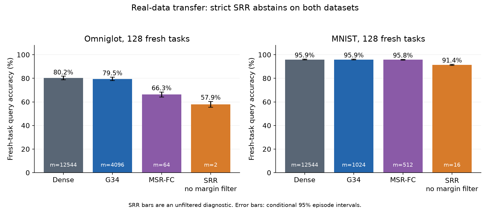
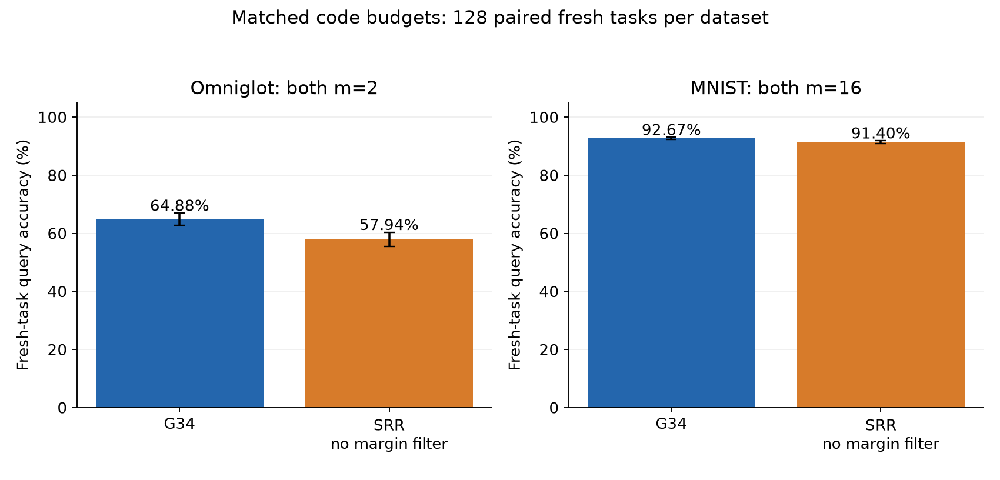
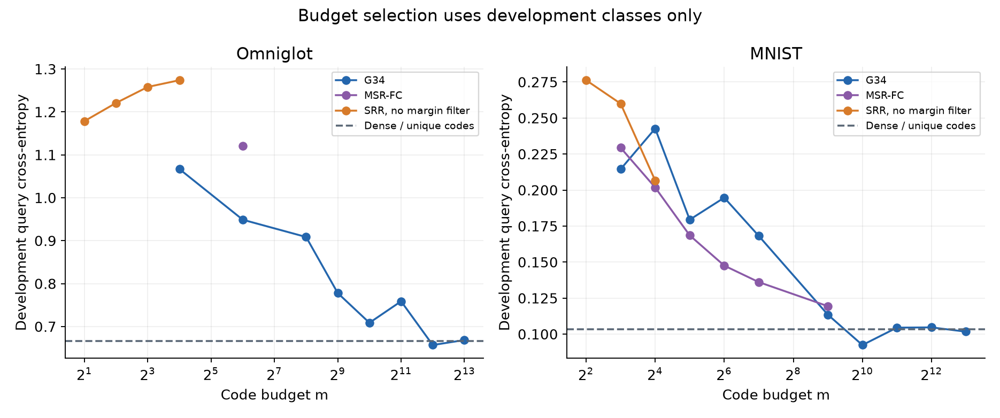
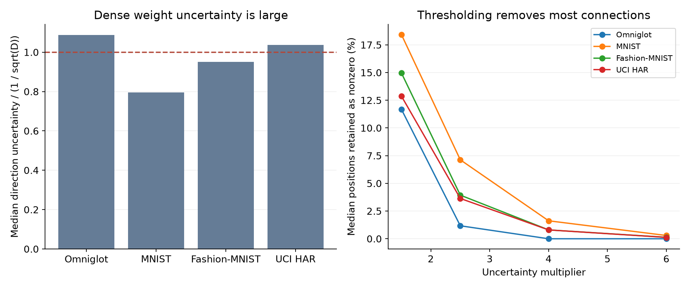

# SRR на реальных задачах: Omniglot и MNIST

15 ноября 2026. Синтетическая проверка завершена; здесь проверяется перенос локального SRR на обученные dense-веса. Основной бейзлайн — G34. Статья не изменялась.

**Итог:** текущий SRR пока не заменяет G34. На четырёх датасетах проверка устойчивости отвергает каждый выбранный индексатор. Если отключить этот фильтр, можно получить работающие малые модели, но сравнение с G34 нужно разделять по числу кодов. Ниже приведены свежие измерения, включая контроль одинаковой ёмкости.

## Свежие задачи

На каждом датасете 128 новых эпизодов. Основные числа кодов и варианты структур выбраны по development CE до генерации test-эпизодов. Дополнительный G34-контроль m2 выбран после генерации эпизодов, по прежнему development и до открытия test-ответов. Предсказания всех методов сохранены до открытия test-ответов. Интервалы отражают вариацию эпизодов при фиксированных данных и классах.

| Датасет | Метод | m | Accuracy, % (95% CI) | Query CE |
|---|---|---:|---:|---:|
| omniglot | Dense | 12544 | 80.25 ± 1.52 | 0.6683 |
| omniglot | G34 | 4096 | 79.53 ± 1.54 | 0.6709 |
| omniglot | SRR without margin filter | 2 | 57.94 ± 2.46 | 1.1756 |
| omniglot | MSR-FC, retained basis | 64 | 66.31 ± 2.09 | 1.0104 |
| omniglot | Unique codes (no sharing) | 12544 | 80.25 ± 1.52 | 0.6683 |
| omniglot | G34, same m as SRR | 2 | 64.88 ± 2.14 | 0.9816 |
| mnist | Dense | 12544 | 95.95 ± 0.32 | 0.1290 |
| mnist | G34 | 1024 | 95.95 ± 0.30 | 0.1295 |
| mnist | SRR without margin filter | 16 | 91.40 ± 0.51 | 0.2376 |
| mnist | MSR-FC, retained basis | 512 | 95.80 ± 0.33 | 0.1291 |
| mnist | Unique codes (no sharing) | 12544 | 95.95 ± 0.32 | 0.1290 |
| mnist | G34, same m as SRR | 16 | 92.67 ± 0.45 | 0.2045 |

**Строгий SRR:** отказ на обоих датасетах; accuracy для отсутствующего предсказания не определяется. Строки SRR выше — заранее обозначенная диагностическая абляция без фильтра расстояния до конкурирующих назначений.

| Парное сравнение | Omniglot, п.п. (95% CI) | MNIST, п.п. (95% CI) |
|---|---:|---:|
| G34 − Dense | -0.72 ± 1.12 | -0.00 ± 0.16 |
| G34 − MSR-FC, retained basis | +13.22 ± 1.89 | +0.15 ± 0.23 |
| SRR without margin filter − G34 | -21.59 ± 2.44 | -4.55 ± 0.39 |
| SRR without margin filter − G34, same m as SRR | -6.94 ± 2.61 | -1.27 ± 0.46 |

## Что проверялось

Omniglot: 784–16–5 ReLU, пять классов, по 10 обучающих, 5 примеров для численного выбора и 5 query-рисунков на класс. Source/development/test используют разные базовые символы. Источник — 128 сохранённых dense-моделей, обученных в прежней пятипримерной source-постановке; G34 использует прежние 16 H-отобранных источников. Одинаковое число source-моделей для этих двух восстановителей здесь не заявляется.

MNIST: 784–16–2 ReLU. Source — десять пар классов 0–4, по 8000 обучающих примеров на задачу; development — 24 эпизода классов 5–6; test — пары 7–9. На класс новой задачи: 100 train, 50 numerical validation, 100 query. Source-модели имеют среднюю точность на H около 99.7%; плохое извлечение структуры здесь нельзя объяснить только двадцатью примерами или высокой ошибкой классификации dense-сети.

Все численные параметры новых задач обучаются с нуля. Шесть стартов, Adam 200 шагов, LR .003/.01/.03; старт и checkpoint выбираются по numerical validation. Для Omniglot сохранён прежний численный solver, для MNIST использован прежний универсальный adapter с quantile .5. Все дискретные индексы задают веса как ±один код; G34 и SRR используют единичный масштаб базиса. MSR переносит сохранённый вещественный базис и получает свежие численные параметры.

G34: практические сохранённые банки и source-only деления групп для больших m. Omniglot включает 16/64/256/512/1024/2048/4096/8192; MNIST — 8/16/32/64/128/512/1024/2048/4096/8192. Большие бюджеты — расширение ёмкости банка, а не новый полный поиск G34 при каждом m. Конечная сетка не устанавливает глобальный оптимум. После выбора SRR m2 на Omniglot до открытия test-ответов дополнительно построены G34 full/pruned m2; маска выбрана только на прежних development-эпизодах. Этот отдельный контроль сохранён в matched_control_frozen.json.

MSR-FC: Omniglot — сохранённый m64; MNIST — development-выбор среди сохранённых m8/16/32/64/128/512. Полного нового source-подбора MSR и перезапуска CNN-экспериментов не было. Это полностью связные адаптации с переносом базиса; данные строки не являются опубликованными CNN-результатами MSR.

## Почему SRR не переносится автоматически

| Датасет | Source-задач | Разброс / типичный модуль координаты | Построены кандидаты при m | Прошли строгий фильтр |
|---|---:|---:|---|---:|
| omniglot | 128 | 1.09 | 2, 4, 8, 16 | 0 |
| mnist | 10 | 0.79 | 4, 8, 16 | 0 |
| fashion | 10 | 0.95 | 2, 4, 8, 16 | 0 |
| har | 4 | 1.04 | 2, 4, 8 | 0 |

Разброс измеряет различие четырёх независимо обученных, сопоставленных dense-моделей. Он включает неоднозначность представления и оптимизации; это эвристика неопределённости, а не доказанная ошибка оценки истинных весов. При исходных множителях 1.5/2.5/4/6 интервалы слишком широки, чтобы уверенно различать много близких кодов. Локальное порогование удаляет большинство связей из начального надёжного набора; остаются грубые кандидаты с малым m. Последующая проекция на восстановленные коды может заполнить поддержку: в выбранных SRR-кандидатах ненулевых 40.15% позиций на Omniglot и 81.30% на MNIST. При этих допусках само увеличение запрошенного m не добавляет различимых локальных классов.

Даже нулевое приближение даёт усечённую стандартизованную MSE от 0.79 до 1.44, существенно ниже порога 9. Поэтому одно прохождение проверки средней ошибки весов малоинформативно при таком разбросе. Фильтр расстояния до конкурирующих кодов выявляет эту неоднозначность. Его отказ не доказывает отсутствие полезного приближённого sharing.

Реализация строит полный кандидат отдельно из каждой source-задачи, затем проверяет его на других задачах. Она пока не объединяет частичные отношения разных задач в одну новую структуру. Поэтому наличие 128 источников само по себе не устраняет слабость каждого локального кандидата. Ограничение перебора пар в этом запуске не сработало: отказы здесь не объясняются лимитом вычислений.

Теорема восстановления остаётся условной: нужны точно оценённые и сопоставленные веса, разделённые отношения кодов и достаточное перекрытие. Высокая accuracy dense-сети этих условий не устанавливает. На реальных данных истинный индексатор неизвестен, поэтому exact recovery здесь не измеряется.

## Следующий шаг

Сохранять неоднозначные позиции как неизвестные, выводить только надёжные локальные ограничения и передавать их G34 для функционального выбора. Следует отдельно оценивать ошибку весов и неоднозначность представления, а для множества задач объединять частичные ограничения до построения полного индексатора. Текущий отказ от полной структуры обоснованнее принудительного слияния всех неопределённых весов.

Равенство числа кодов числу весов выполнено отдельным запуском уникального индексатора m12544. Это общий вариант без sharing. Результат контроля:

- omniglot: побитовое совпадение logits с Dense — True; максимальная разность 0.
- mnist: побитовое совпадение logits с Dense — True; максимальная разность 0.

Код: experiments/srr_real_v1. Компактные результаты, заморозки и графики: artifacts/srr_real_2026-11-15. Исходные индексы, новые панели и предсказания: artifacts/local/srr_real_2026-11-15. Запуски завершены; новые software-тесты не создавались и не запускались. Время параллельных запусков не используется для утверждений о скорости методов.
