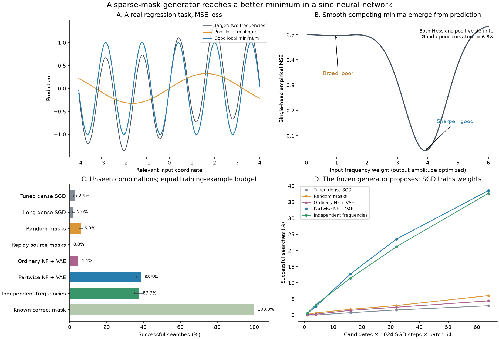

# Случайные маски и NF + VAE на настоящем обучении сети

Эксперимент проверяет, помогает ли генератор сочетать полезные части масок
и чаще находить хорошее решение, чем плотный SGD с рестартами. Обучается
маленькая синусоидальная нейросеть с обычной MSE на настоящих примерах.
Прогон завершён 21 октября 2026; исходный протокол и результаты сохранены.

На новых сочетаниях **NF + VAE с обучением по частям достиг хорошего
решения в 38,54% поисков**, настроенный плотный SGD — в 2,86%.
Простой контроль независимыми частотами частей получил 37,70%: этот опыт
показывает пользу композиционного prior, а не отдельное преимущество
сложности VAE.



## Постановка

Восемь независимых нормальных входов, два выхода. На каждый выход
приходится один sine-нейрон с обучаемой амплитудой: 18 параметров.
Цель содержит слабую низкую и сильную высокую частоты:

$$
f_j(x)=c_j\sin(w_j^T x),\qquad
y_j=\alpha_j\sin(\ell_j x_{r_j})+\sin(h_j x_{r_j}).
$$

Один нейрон выбирает, какую частоту воспроизвести. Так обычная ошибка
предсказания создаёт конкурирующие локальные минимумы. Для ожидаемой MSE
численно подтверждены плохой минимум **0,4993** и хороший **0,0488**;
оба гессиана положительны, средняя геометрическая кривизна хорошего выше
в **6,73 раза**. Это локальная резкость; вероятность достижения измеряется
отдельно. Часть неудач SGD связана с задержкой при слабом градиенте.

Маски оставляют ровно две из 16 входных связей. Выходные амплитуды всегда
обучаются. Из 262 144 случайных обучений по порогу измеренной MSE < 0,1
отобраны 279 элит. IMP не используется.

Восемь пар частей входят в source train, четыре в validation, четыре
в structural test. Все отдельные части известны, полные test-пары
не входят в обучающие цели. У каждого выхода своя известная роль.

NF означает Neural Functional layer. Он обрабатывает веса и градиенты
с отдельными параметрами для source-задач. VAE имеет латент размерности
16 и один общий decoder. При обучении по частям чужая половина кода
заменяется независимым нормальным шумом. При поиске замороженный decoder
за один проход выдаёт маску через глобальный top-2, а веса каждой
сети заново обучаются SGD. Encoder на новой задаче не используется.

## Результаты при равном онлайн-бюджете

На метод — 1536 поисков: четыре новые пары, две новые функции,
три seed/потока. Бюджет поиска — 65 536 обновлений отдельных сетей,
по 64 примера: обычно 64 кандидата × 1024 шага. Параметры плотного SGD
выбраны на validation. Успех — ожидаемая MSE < 0,1; кандидат выбирается
по измеренной MSE на свежих примерах.

| Метод | Успехи | Вероятность |
|---|---:|---:|
| Настроенный плотный SGD | 44/1536 | 2,86% |
| Длинный плотный SGD: 8 × 8192 шага | 31/1536 | 2,02% |
| Случайные маски | 92/1536 | 5,99% |
| Обычный NF + VAE | 67/1536 | 4,36% |
| **NF + VAE с обучением по частям** | **592/1536** | **38,54%** |
| Независимые частоты частей | 579/1536 | 37,70% |

Все 592 хороших решения NF/VAE сохранились после снятия маски
и дополнительных 1024 шагов плотного SGD.

Банк стоил 17,18 млрд обучающих примеров, или 4096 бюджетов одного
онлайн-поиска. Подготовка prior учитывается отдельно. Результат относится
к выбранной маленькой sine-сети с известными ролями частей; перенос
на ReLU, неизвестные модули и реальные данные ещё предстоит проверить.

[Полный отчёт](results/v1/REPORT.md) ·
[Метрики CSV](results/v1/metrics.csv) ·
[Агрегаты JSON](results/v1/summary.json) ·
[Кривые обучения](results/v1/training.png) ·
[Генерируемые сочетания](results/v1/combinations.png)

## Запуск

Из корня репозитория, Python 3.10+:

```bash
python3 -m pip install -r sine_mask_vae/requirements.txt
python3 -m sine_mask_vae status
```

`status` читает опубликованные агрегаты и работает без банков и весов.
Полный новый прогон:

```bash
python3 -m sine_mask_vae run \
  --run-dir sine_mask_vae/runs/reproduction \
  --device cuda:1
```

Обёртка `bash sine_mask_vae/run.sh` принимает те же аргументы. Можно указать другое
CUDA-устройство или `cpu`; воспроизводимость конкретных случайных чисел
и результатов между устройствами не гарантируется.

Фазы доступны отдельно: `pilot`, `geometry`, `population-geometry`, `bank`,
`train`, `validate`, `evaluate`, `curves`, `report`. Везде используются
одни и те же `--run-dir` и `--device`. Завершённые фазы пропускаются.
Изменение исходников после фиксации банка/validation требует новой
папки прогона. В новых обучениях сохраняются train/validation метрики;
исторически отсутствовавшие кривые v1 не достраиваются.

Сохранённый полный прогон v1 заморожен. Обычный `run` при его наличии
сообщает о завершении и ничего не переобучает. Для нового эксперимента
нужно явно выбрать новую папку.

## Артефакты и воспроизводимость

- `results/v1/` включена в Git: отчёт, три рисунка, JSON/CSV, геометрия,
  source-validation истории шести VAE, SHA checkpoint и исходный снимок.
- `runs/v1/` хранится локально и исключена из Git: все банки, шесть весов,
  216 результатов контекстов методов, сырые массивы и логи. Данные
  исходного прогона перенесены из `tmp` без переобучения.
- `models.py` содержит NF/VAE без зависимости от временного прототипа
  и других экспериментов. Формы и имена параметров совместимы
  с исходными checkpoint.
- [SOURCE.md](results/v1/SOURCE.md) и [manifest.json](results/v1/manifest.json)
  объясняют происхождение опубликованных результатов. Хеши validation
  относятся к историческому снимку `results/v1/source/`. Рабочий пакет
  после прогона получил новую организацию импортов и путей.

Экспорт завершённого нового прогона, без повторного обучения:

```bash
python3 -m sine_mask_vae export \
  --run-dir sine_mask_vae/runs/reproduction \
  --output sine_mask_vae/results/reproduction
```

Банки, веса, сырые массивы и логи в экспорт не включаются. Экспорт
отказывается перезаписывать каталог с другими результатами.
