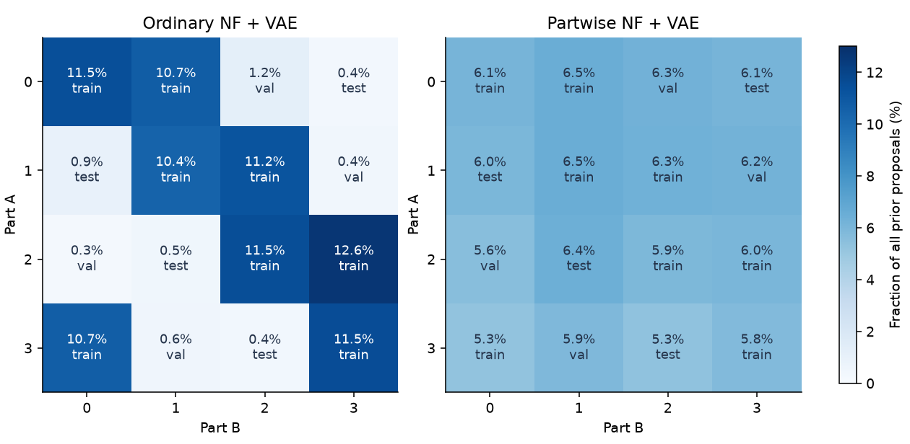
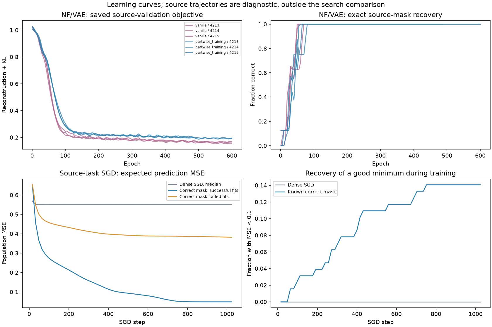

# Нейросеть с двумя конкурирующими частотами

## Постановка

Вход — восемь независимых нормальных признаков, выход — два числа.
Маленькая нейросеть имеет два синусоидальных нейрона и обучаемые выходные
амплитуды: всего 18 параметров. На каждый выход приходится один нейрон.

$$
f_j(x)=c_j\sin(w_j^T x), \qquad
y_j=\alpha_j\sin(\ell_j x_{r_j})+\sin(h_j x_{r_j}).
$$

Низкая частота лежит в диапазоне 0.65–0.75, высокая — 3.8–4.2,
слабая амплитуда — 0.35–0.45. Первый релевантный признак выбирается
из первых четырёх, второй — из последних четырёх. Один нейрон
не может точно воспроизвести обе частоты. Обучение слабой низкой
частоты даёт плохой минимум, сильной высокой — хороший. Это намеренно
маленькая сеть с ограниченной ёмкостью и синусоидальной активацией.

Обучение использует только обычную MSE предсказаний и настоящий autograd
SGD на свежих минибатчах из 64 примеров. Нет заданной функции качества
по расстоянию до параметров teacher, переключения между чашами,
добавленного шума к градиенту или IMP.

Маска оставляет ровно две из 16 входных связей. Оба выходных коэффициента
всегда обучаются. NF/VAE получает нормированные веса и градиенты
эмпирической MSE по активным связям; источник не содержит test-масок.

## Контроль до обучения генератора

В пилоте плотный SGD дал 0/8192 хороших сетей при четырёх масштабах
инициализации. Правильная маска при масштабе 2.0 дала 309/2048 успехов
после 2048 шагов; это диагностический oracle, не метод поиска.
Пилот использовал общий RNG для начальных весов и данных; основной
протокол разделяет эти потоки. Исходный пилот сохранён отдельно.

На обычной эмпирической MSE по 16 384 примерам два решения дополнительно
доведены до стационарных точек. Плохое: MSE 0.49504,
хорошее: 0.04862.
Градиенты меньше 5e-8; оба гессиана положительно определены.
Геометрическая средняя кривизна хорошего выше в
6.80 раза. Это локальная резкость
в данных координатах параметров; вероятность попадания измеряется
отдельно. Глобальная оптимальность хорошего решения не утверждается.

Поскольку основной SGD использует свежие примеры, отдельно проверена
и ожидаемая MSE: оба её минимума также имеют положительные гессианы,
градиенты меньше 8e-9, MSE соответственно
0.499315 и
0.048807.
Отношение средних геометрических кривизн —
6.73.

## Банк и замороженный NF + VAE

Восемь сочетаний входят в source train, четыре в validation, четыре
в новый структурный test; разбиение определено до обучения.
Все отдельные части встречаются в train. У каждого source-сочетания
две функции с разными частотами/амплитудами, всего 16 source-задач.

Равномерно выбираются маски из всех 120 вариантов двух связей.
Роли source train/validation присваиваются до обучения и отбора.
Каждая сеть обучается 1024 шагами SGD. Порог отбора — измеренная MSE
меньше 0.1 на 4096 новых примерах; поддержка teacher в отборе не используется.
Получено 262,144 обученных сетей, 279 элит,
8 разных масок. Сохранены и неудачные попытки.

Использована прежняя NF-архитектура, латентный код 16 и один общий
decoder 16→128→128→16. Вариант partwise_training сохранён:
при реконструкции каждой выходной колонки чужая половина латентного
кода заменяется независимым нормальным шумом. KL-вес 0.05,
тот же BCE + straight-through MSE масок. Обычный VAE отличается только
отсутствием этой замены. Обучающие цели — только настоящие source-маски.
Роли выходов здесь заданы самой двухвыходной задачей, поэтому цели
канонические у обоих вариантов. Новые полные пары в обучение не добавляются.
Все три seed сохранены, удачный seed не выбирался.

На новой задаче encoder и decoder заморожены. Сэмпл из стандартного
нормального prior, один проход decoder и глобальный top-2 дают маску.
Для каждого кандидата заново обучаются веса сети и выходные амплитуды.
Лучший кандидат выбирается по измеренной MSE на свежих примерах.

## Результат

Итог — четыре не встречавшиеся пары, две новые функции на пару,
три независимых потока запусков, по 64 поиска на контекст:
1536 поисков на метод. Успех означает population MSE ниже 0.1.
Для нормальных входов эта обычная MSE имеет точный интеграл; он
используется для диагностики, оценки validation и итогового измерения,
SGD оптимизирует ошибки настоящих примеров. Кандидат выбирается по
эмпирической ошибке, не по знанию правильных частот или маски.

| Метод | Успехи | Вероятность успеха | Средняя MSE выбранного |
|---|---:|---:|---:|
| Dense SGD | 2/1536 | 0.13% | 0.4986 |
| Tuned dense SGD | 44/1536 | 2.86% | 0.3083 |
| Long dense SGD | 31/1536 | 2.02% | 0.3886 |
| Random masks | 92/1536 | 5.99% | 0.2809 |
| Replay source masks | 0/1536 | 0.00% | 0.2982 |
| Ordinary NF + VAE | 67/1536 | 4.36% | 0.2844 |
| Partwise NF + VAE | 592/1536 | 38.54% | 0.1880 |
| Independent frequencies | 579/1536 | 37.70% | 0.1893 |
| Known correct mask | 1536/1536 | 100.00% | 0.0473 |

У всех методов бюджет обучения — 65 536 SGD-обновлений отдельных сетей,
или 4 194 304 примера на один поиск. Обычно это 64 старта по 1024 шага;
длинный SGD — восемь стартов по 8192 шага. Его настройки выбраны на
validation среди трёх learning rate и четырёх масштабов инициализации:
{'steps': 1024, 'lr': 0.2, 'scale': 1.25, 'batch': 64}. Моментум, Adam и все возможные способы
подбора начальных весов не проверялись. NF не гарантирует преимущество
над любым возможным градиентным алгоритмом.

После снятия маски и ещё 1024 шагов плотного SGD сохранились
592/592
хороших решений partwise NF/VAE. Значит, хорошая точка доступна
и плотной сети; разрежение помогает туда попасть.

training_metrics.json содержит train/validation Recall@2 масок на замороженных
лучших checkpoint. Сохранённая история VAE содержит validation loss,
KL и exact mask recovery; исторические train loss и Recall@2 по эпохам
не записывались. Они не восстанавливаются вымышленными кривыми.
Отдельные 128 source-траекторий SGD на политику служат иллюстрацией
обучения; известная маска в них — диагностический oracle. В основное
сравнение поисков эти дополнительные траектории не входят.

## Что показывает результат и его границы

Неудачные запуски SGD неоднородны. В исходном пилоте при масштабе
инициализации 2.0 у 97.9% плотных сетей обе выходные амплитуды стали
меньше 0.05 по модулю. При угасших амплитудах градиенты входных весов
слабы. Часть конечнобюджетных неудач связана с такой задержкой,
поэтому достижение широкого плохого минимума не приписывается каждому
неудачному запуску. Наличие двух строгих минимумов и частота достижения
хорошего решения проверены отдельно.

Это перенос способа сочетать части в настоящую оптимизацию предсказаний,
с гладкой стандартной loss и естественными для выбранной сети локальными
минимумами. Проверена синусоидальная сеть с двумя известными выходными
ролями и ограниченной ёмкостью. Перенос на ReLU/MLP, неизвестные модули
или произвольные реальные данные ещё не проверен. Геометрия исследована
на одной source-функции; вероятность успеха — на всех test-контекстах.

Независимые частоты частей — обязательный простой контроль:
они изучены из того же банка, с одинаковым весом source-задач,
а правило «одна связь на выход» выводится из элит. Этот контроль
отделяет пользу композиционного предположения от сложности VAE.
Replay исходных элит не создаёт test-пары.

Равенство бюджета относится к онлайн-обучению весов. Банк стоил
17,179,869,184 обучающих примеров
(60.7 с в векторизованном GPU-запуске),
шесть VAE — 59.7 с CPU.
Банк равен 4096 бюджетам одиночного онлайн-поиска. Это не сравнение
полной стоимости с нуля. Выбор масок и измерение качества учитываются
отдельно от числа обучающих примеров. Векторизованное время не равно
времени последовательного применения метода.

Интервалы Wilson в summary.json описывают условные повторы начальных
весов. Внутри контекста методы и старты разделяют поток минибатчей;
всего 24 контекста. Это не интервалы для популяции произвольных задач.

## Артефакты

Опубликованные материалы находятся в `sine_mask_vae/results/v1`. Полный прогон с банками и весами сохранён локально в `sine_mask_vae/runs/v1` и исключён из Git. [Запуск и структура пакета](../../README.md).

plan.json задаёт протокол, selection.json фиксирует validation,
bank/ хранит все попытки и элиты, models/ — все шесть checkpoint,
test/ — сырые результаты и маски, source/ — снимок реализации,
summary.json — агрегаты. Старый искусственный опыт не изменён.
