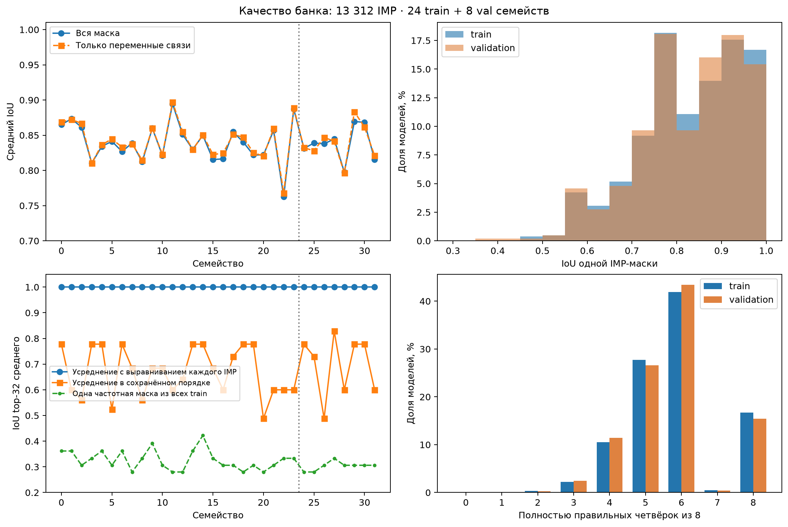
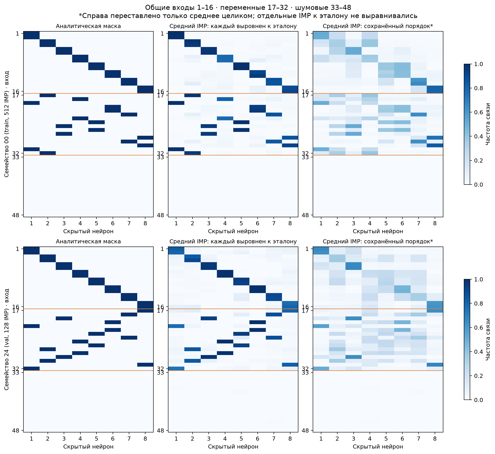
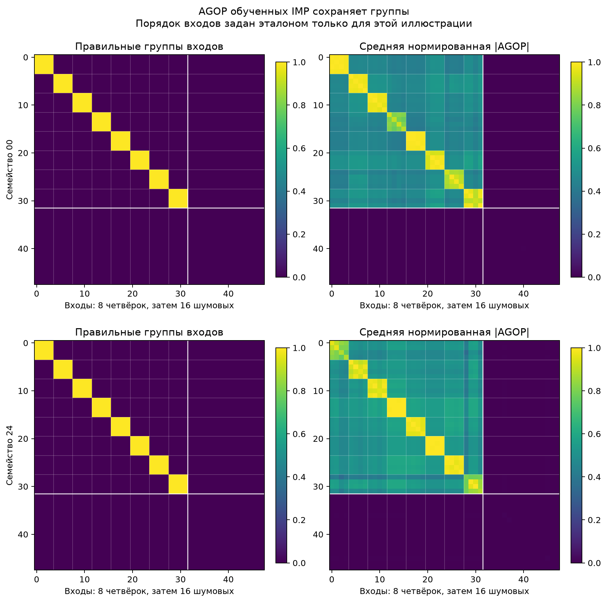

# Качество банка и восстановление структуры, 20 октября 2026

> Архив эксперимента 20 октября. Старые команды и формат W/G+AGOP описаны для истории; актуальный W/G-код и команды — в [overlapping_groups](../../overlapping_groups/README.md). Разовые скрипты удалены.

Банк завершён: 13 312 независимо инициализированных IMP-моделей для
128 функций из 32 семейств. Проверка подтверждает заданные общие и
переменные связи, восстановление групп входов и близкое качество на train
и валидационных семействах. Перед обучением VAE нужно учесть перестановки
скрытых нейронов: текущая канонизация смешивает колонки разных моделей.
Повторное обучение MLP для решения этого вопроса не требуется: исходные
параметры, маски и перестановки сохранены.

Пользователь самостоятельно завершил сбор на восьми V100. Последний
запуск занял 245,52 секунды, или 4 минуты 5,5 секунды. Это время продолжения
существующего банка: готовые задачи и доступные модели переиспользовались,
поэтому оно не является замером полного сбора с нуля. Проверка качества
выполнена без нового обучения. Общий пик видеопамяти этим анализом не измерялся.

## Состав и правильные маски

Определено 40 семейств: 24 train, 8 validation и 8 итоговых test.
В банке присутствуют первые 32; итоговые test-семейства не собирались.
Внутри каждого семейства четыре разные функции используют одну маску.
Для каждой train-функции сохранено 128 IMP, для validation-функции — 32.
Внутреннее разделение seed у train-функций даёт 9 216 train-карт,
1 536 validation-карт и 1 536 test-карт известных функций. Ещё 1 024 карты
принадлежат отдельным валидационным семействам.

Независимая проверка аналитических масок всех 40 семейств подтвердила
ровно 32 связи на маску, из которых 16 общие для всех. Попарное пересечение
равно 16–20 связям, среднее — 17,826. Все 320 четвёрок входов различны:
полная четвёрка скрытого нейрона не повторяется между семействами.
Из 48 независимых Gaussian-входов первые 16 образуют общие пары,
следующие 16 перераспределяются между нейронами, последние 16 — шумовые
и не входят ни в одну правильную маску. Таким образом, реализовано именно
частичное пересечение масок при разных группировках входов.

## Качество отдельных IMP

| Метрика | Train-семейства | Validation-семейства |
| --- | ---: | ---: |
| Число IMP | 12 288 | 1 024 |
| Средний IoU всей маски | 0,8395 | 0,8379 |
| Средний IoU переменной части | 0,8420 | 0,8388 |
| Доля восстановленных общих связей | 90,68% | 90,65% |
| Доля восстановленных переменных связей | 90,91% | 90,72% |
| Полностью правильных четвёрок из 8 | 5,77 | 5,73 |
| Полностью правильные маски | 16,67% | 15,43% |
| Средний test excess BCE | 0,001500 | 0,001515 |
| Правильных соседей входа в AGOP | 85,47% | 85,44% |

IoU считается после оптимального сопоставления восьми скрытых колонок.
При этом же сопоставлении отдельно оцениваются общие и переменные связи.
Excess BCE — превышение BCE над предсказанием аналитического учителя
на test-наблюдениях; цели являются мягкими вероятностями.

В среднем по банку сохраняется 90,68% общих и 90,90% переменных связей.
Близкие значения показывают, что IMP восстанавливает изменяющуюся часть
структуры, а не только общие связи. Полностью точны 2 207 масок из 13 312,
то есть 16,58%. Десятый процентиль IoU равен 0,6842 в обоих разделах.
Есть и слабые отдельные результаты: минимум 0,3913 на train и 0,3617
на validation; плохие IMP из банка не отфильтровывались.

Средний IoU по семействам составляет 0,7627–0,8946 на train
и 0,7976–0,8695 на validation. Самое трудное train-семейство — 22.
Из всех 425 984 сохранённых связей лишь 319 ведут к шумовым входам:
0,075% связей, или 0,024 шумовой связи на модель. Хотя бы одна шумовая
связь есть у 2,13% моделей.

Бейзлайн остаётся одной обычной MLP 48→8→1 без маски. В прежнем пилоте
его excess BCE был 0,002944, у IMP — 0,001658. Новый банк содержит IMP;
новое парное сравнение с dense на всех 128 функциях здесь не выполнялось.
Близость train и validation в таблице характеризует работу IMP
на разных семействах; обучение и перенос VAE ещё не проверялись.

## Сохраняются ли различия между семействами

Каждая из 13 312 IMP-масок после оптимального сопоставления колонок
имеет строго больший IoU со своей аналитической маской, чем с любой
из остальных 31 аналитических масок собранных семейств. Средний IoU
со своим семейством равен 0,8393, с ближайшим чужим — 0,4221.
Это диагностическое сравнение с известными эталонами, а не точность
обученного классификатора семейств.

Если каждую IMP-маску сначала сопоставить с правильной маской семейства,
затем усреднить все четыре функции и выбрать 32 самые частые связи,
правильная маска восстанавливается точно во всех 32 семействах.
Для train это 512 моделей на семейство, для validation — 128.
Такое выравнивание использует эталон и служит только диагностикой:
оно показывает, что структурный сигнал присутствует в банке.

Одна постоянная маска из 32 самых частых координат всех train-карт
даёт средний IoU 0,3263 на train и 0,3030 на validation, даже после
оптимального сопоставления с каждым эталоном. Этот конкретный простой
бейзлайн не заменяет различение семейств; оптимальная постоянная маска
специально не искалась.

## Ограничение канонизации колонок

В банк записаны колонки, отсортированные по функциональным центроидам
самой MLP на независимых входах. Такая сортировка не гарантирует один
порядок нейронов между разными IMP, в том числе внутри одной функции.
Признаки и targets при этом согласованы: речь о стабильности порядка
между моделями, а не об ошибке соответствия веса и маски внутри карты.

Если усреднять сохранённые targets внутри семейства и брать top-32,
IoU с правильной маской составляет в среднем 0,6693 на train
и 0,6975 на validation, диапазон по всем семействам — 0,4884–0,8286.
Даже это сравнение разрешает переставить итоговую среднюю маску целиком.
Следовательно, расхождение объясняется смешиванием колонок отдельных
IMP и не устраняется одной перестановкой среднего.

На рисунке показаны первые train- и validation-семейства, выбранные
заранее по номеру. Слева — эталон, в центре — среднее после индивидуального
диагностического выравнивания, справа — среднее сохранённых targets
с одной общей перестановкой для наглядности. Цвет означает частоту связи,
а не величину веса. Оранжевые линии отделяют общие, переменные и шумовые входы.

Перед обучением VAE нужно выбрать способ работы с перестановками:
например, loss с оптимальным сопоставлением колонок или более стабильную
канонизацию по информации самой модели. Использовать правильную маску
нового семейства для подготовки входов или targets переноса нельзя.
Текущий результат не доказывает, что VAE обязательно не справится,
но обнаруживает дополнительную вариативность, которую он должен учитывать.

## Структура в AGOP

Для каждого входа из первых 32 выбраны три других входа с максимальной
нормированной абсолютной AGOP среди всех 48 входов, без диагонали.
Нормировка делит модуль элемента на геометрическое среднее диагональных
элементов. При нулевой диагонали связь считается нулевой, а результат
для неиспользуемого информативного входа — ошибкой.

В среднем 85,47% выбранных соседей относятся к той же правильной
четвёрке; при случайном выборе из 47 других входов ожидалось бы 6,38%.
AGOP действительно содержит информацию о группировках. Это AGOP
обученной IMP-модели, поэтому результат характеризует сохранение её
структуры в признаках и не доказывает дополнительную пользу AGOP для VAE.

На рисунке входы переставлены по эталонным четвёркам исключительно
для визуализации. Справа усредняются уже нормированные |AGOP| отдельных
моделей. Светлые блоки соответствуют четвёркам, тёмная область внизу
и справа — шумовым входам. Фон между группами ожидаем: AGOP является
нецентрированным вторым моментом производных, поэтому независимость
входов не обязывает межгрупповые элементы быть нулевыми.

## Проверка сохранённых данных

У всех 128 задач сверены SHA-256 файлов карт и учителей, формы признаков,
конечность W/G/AGOP и масштабов, бюджет 32 связи, соответствие перестановок
колонок и сохранённых targets. Веса после применения маски точно совпадают
с каналом W; W и основной masked gradient равны нулю вне targets.
В каждой семье подтверждены четыре разные параметризации учителя
с одной маской. Все seeds моделей уникальны. Независимо пересчитанный IoU
совпадает с сохранённым для каждой карты.

Все AGOP симметричны. Проверка спектра одной AGOP на функцию,
128 матриц, дала минимум собственного значения −1,47e-6: малое
отклонение от положительной полуопределённости в вычислениях float32.
Это выборочная спектральная проверка, а не полный анализ спектров всех карт.
Для первых карт функций 00/0 и 24/0 градиент пересчитан с ошибкой
не больше 7e-10, AGOP — 5,5e-7, метки учителя — 1,2e-7.
Дополнительно пересчитана test BCE восьми моделей из функций 00/0, 22/0,
24/0 и 31/0: отличие от сохранённого значения не больше 1,2e-7.
Отклонение test-меток от предсказания сохранённого учителя — не больше 1,8e-7.

Для будущего эксперимента важно также, что фактическая IMP-маска почти
непосредственно читается из ненулевых весов входного канала W. Поэтому
точность реконструкции этих targets сама по себе не доказывает обучение
полезного пространства структур. Нужны отдельные проверки генерации,
поиска по z и переноса на новые семейства, с постоянной маской и случайным
z среди контролей. Итоговые восемь test-семейств для этих опытов сохранены.

Численные результаты: [сводка](bank_quality.json),
[по картам](bank_quality_cards.csv), [по семействам](bank_quality_families.csv),
[аналитическая структура](bank_structure.json),
[пересчёт предсказаний](bank_quality_prediction_checks.json).
Метод проверки находится в `audit_bank.py` (разовый аудит),
построение рисунков — в `plot_bank_quality.py` (разовый построитель).
