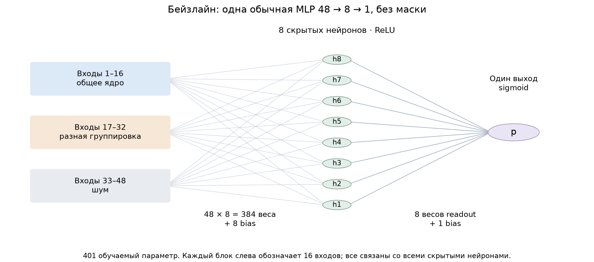
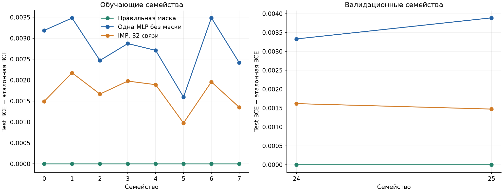
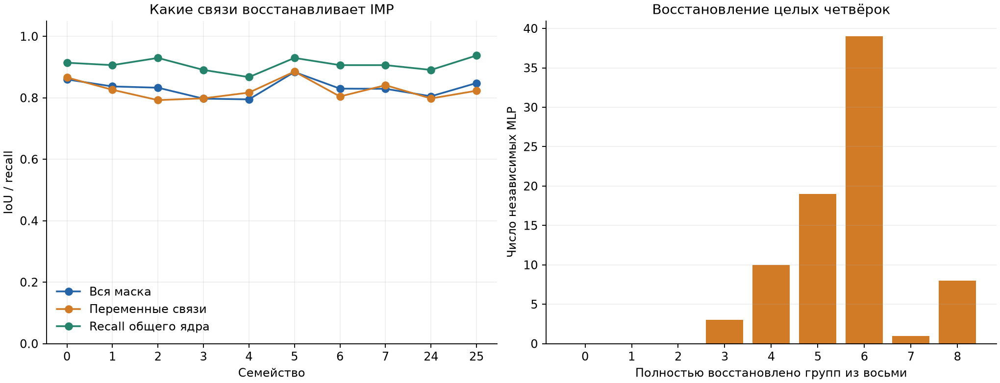
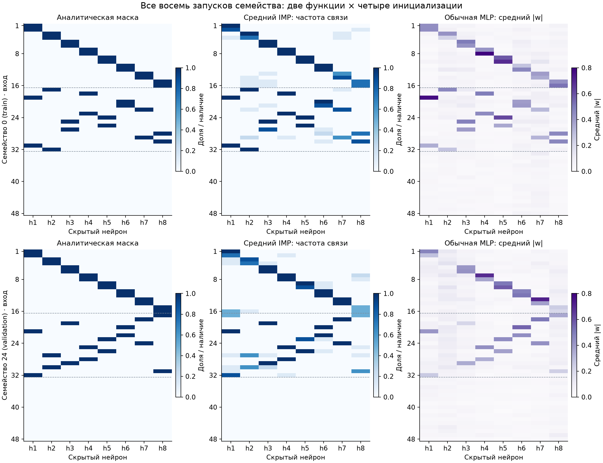
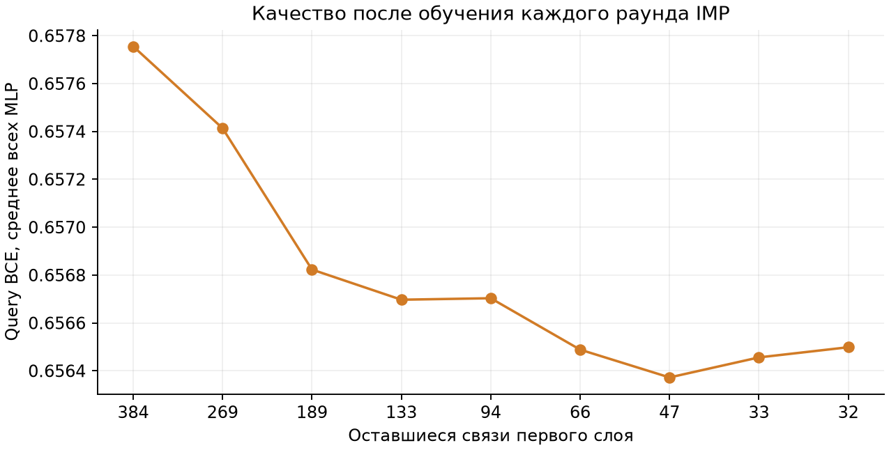

# Пилот MLP и IMP на частично пересекающихся масках 20 октября 2026

> Архив эксперимента 20 октября. Старые команды и формат W/G+AGOP описаны для истории; актуальный W/G-код и команды — в [overlapping_groups](../../overlapping_groups/README.md). Разовые скрипты удалены.

MLP с правильной маской достигла практически эталонного качества: средний
test excess BCE — 0,000000019.
Обычная MLP без маски получила 0,002944,
а IMP после сокращения до 32 связей — 0,001658.
Средний IoU IMP составил 0,8317,
для переменной части — 0,8251.
Полностью правильных масок: 8 из 80.
IMP улучшил test BCE относительно парной плотной MLP в 61
из 80 запусков. Правильная структура обучается до эталонного
качества, но обычный IMP восстанавливает её неполно.

## Постановка и объём пилота

Сгенерированы определения 40 семейств: 24 обучающих, восемь валидационных
и восемь для будущей итоговой оценки. Каждая правильная маска 48×8 содержит
32 связи, по четыре на скрытый нейрон. Восемь закреплённых пар входов дают
16 общих связей; остальные 16 входов распределяются по два на каждый нейрон
и задают специфику семейства. Попарное пересечение масок находится в пределах
16–20 связей,
среднее — 17,826 из 32.
Ни одна полная четвёрка входов между семействами не повторяется.
Входы независимы и имеют стандартное нормальное распределение; последние
16 признаков шумовые и не входят в правильные маски.

В пилоте обучены MLP для первых восьми обучающих и двух валидационных
семейств, по две функции и четыре инициализации: 20 функций и 80 независимых
MLP на каждый метод. Две функции одного семейства имеют общую маску,
но разные положительные входные веса, пороги и знаки выходных коэффициентов.
Определения остальных функций и семейств доступны в генераторе, их обучение
не запускалось. Итоговые test-семейства не использовались.

Бейзлайн — одна обычная MLP 48→8→1 со всеми 384 связями первого слоя,
401 параметр вместе с bias и readout. Четыре инициализации — статистические
повторы одиночной модели, их прогнозы не объединяются. Правильная маска
оставляет 49 эффективных параметров. Все методы получают одинаковые данные
и парные инициализации.

Каждый блок входов на схеме объединяет 16 независимых признаков.
Даже шумовые входы подключены ко всем скрытым нейронам плотной MLP;
их веса обучаются на общих основаниях. Разреженная маска изменяет только
связи первого слоя, сохраняя bias и выходной слой.

## Обучение на CUDA и калибровка

Все обучения выполнены в PyTorch 2.6.0+cu118 на четырёх
Tesla V100-PCIE-32GB, CUDA runtime 11.8.
Переход на CPU запрещён в коде. На CPU выполняются только подготовка
случайных определений и входов, сохранение результатов и структурные метрики.
Учителя вычисляют цели на CUDA.

На функцию используются 2048 support-, 2048 query- и 8192 test-наблюдения.
Цели — точные вероятности аналитического учителя, без сэмплирования бинарных
меток. BCE учителя с собственными вероятностями задаёт минимум для каждого
набора наблюдений. Query выбирает checkpoint; test не участвует в обучении
или выборе checkpoint. Все функции пилота имеют собственные независимые
обучающие наборы; это ещё не опыт переноса одной найденной маски на новые функции.

Первая калибровка с обычными знаковыми случайными весами, сохранённая
в `runs/pilot_v1`, не прошла критерий даже при правильной маске.
Скорости 0,01 и 0,03 давали сходный остаточный риск, поэтому IMP тогда
не запускался. В текущем запуске положительные случайные входные веса
и нулевой readout согласованы с общим prior генератора учителей.
Конкретные параметры учителя не используются в инициализации; далее веса
могут менять знак. Это правило одинаково для oracle, dense и IMP.

После изменения инициализации скорость обучения выбрана только по четырём
функциям обучающих семейств. Итоговые настройки: Adam, lr 0.03,
2000 полных градиентных шагов, L2 1e-05,
выбор checkpoint каждые 100 шагов.
Первые 200 шагов используют leaky ReLU со slope
0.1, затем обычный ReLU. Все оценки выполняются
с обычным ReLU. Средний source-query excess BCE правильной маски составил
0,000000002:
контроль прошёл заранее заданные пороги 0,001 для среднего и 0,005 для p95.

## Сравнение с одиночной MLP без маски

| Семейства | Метод | MLP | Test BCE | Test excess BCE |
| --- | --- | ---: | ---: | ---: |
| Обучающие | Правильная маска | 64 | 0,654563 | 0,000000 |
| Обучающие | Одна MLP без маски | 64 | 0,657341 | 0,002778 |
| Обучающие | IMP, 32 связи | 64 | 0,656249 | 0,001686 |
| Валидационные | Правильная маска | 16 | 0,655761 | 0,000000 |
| Валидационные | Одна MLP без маски | 16 | 0,659371 | 0,003610 |
| Валидационные | IMP, 32 связи | 16 | 0,657306 | 0,001545 |

Каждая точка — среднее двух функций и четырёх инициализаций одного семейства.
Валидационные семейства служат отдельной диагностикой; параметры MLP по ним
не подбирались. Поскольку размер данных и инициализации фиксированы, сравнение
описывает этот пилот, а не средний эффект на независимых наборах группировок.

## Качество IMP

IMP переиспользует готовую плотную MLP как первый раунд. После каждого
обрезания удаляет 30% оставшихся входных связей по абсолютному весу, не ниже
32, и возвращает все параметры к исходной инициализации; Adam также
создаётся заново. Каждый раунд получает тот же бюджет 2000 шагов
и собственный query-checkpoint. Ни эталонная маска, ни её IoU не участвуют
в pruning или выборе checkpoint. Bias и readout не обрезаются.
Это стандартное глобальное magnitude-pruning, без принудительного сохранения
общего ядра или четырёх связей на колонку. IMP использует несколько обучений,
поэтому сравнение с dense не уравнивает суммарное время или число шагов.

| Семейства | IoU всей маски | IoU переменных связей | Recall ядра | Точных групп | Шумовых связей |
| --- | ---: | ---: | ---: | ---: | ---: |
| Обучающие | 0,8330 | 0,8287 | 0,9062 | 5,64 / 8 | 0,02 |
| Валидационные | 0,8264 | 0,8104 | 0,9141 | 5,50 / 8 | 0,00 |

Для структурных метрик разрешена только перестановка скрытых колонок,
выбранная Hungarian matching по пересечению целых масок. Переменная часть
оценивается на входах 17–32; шумовые связи отдельно учитываются и ухудшают
общий IoU. Группа считается восстановленной только при точном совпадении
всех входов соответствующего нейрона с эталонной четвёркой.

Показаны первые обучающее и валидационное семейства, 0 и 24,
без отбора по качеству восстановления.
Слева — правильная бинарная маска. В центре — частота сохранения каждой
связи во всех восьми запусках семейства: двух функциях и четырёх инициализациях.
Это средняя карта, а не отдельная бинарная маска или лучший запуск.
Колонки каждого IMP предварительно выровнены к аналитической маске.
Сверху вниз расположены общие входы 1–16, переменные 17–32 и шумовые 33–48;
пунктир обозначает границы этих блоков.

Справа — средние абсолютные веса обычной MLP, с отдельной цветовой шкалой.
Для визуализации её колонки сопоставлены с эталонными группами по сумме
нормированных абсолютных весов на правильных связях. Это диагностическое
выравнивание не участвует в обучении. Плотная MLP не имеет бинарной маски:
даже очень малые веса сохраняются, а величины весов не равны вероятностям
восстановления связей. Исходные значения рисунка — [mask_examples.json](mask_examples.json).

На последнем графике показано query-качество выбранных checkpoint после
обучения каждого раунда. Query — часть процедуры выбора, поэтому этот график
описывает ход оптимизации; независимое качество приводится в test-таблице.

## Границы результата и продолжение

Пилот проверил достижимость аналитического качества с правильной структурой
и качество стандартного IMP при фиксированном бюджете 32 связи. Он не обучал
VAE, не сравнивал AGOP и не выполнял поиск z. Большой банк не собирался.
Для решения о его сборке нужны одновременно малый остаточный риск учителей
и восстановление переменных групп: одной высокой метрики общего ядра
недостаточно. Повторы инициализации не заменяют независимые наборы семейств.

Полные численные строки: [pilot_results.csv](pilot_results.csv).
Артефакты запуска: [manifest](runs/pilot_v2/manifest.json),
[определения семейств](runs/pilot_v2/families.json),
[контроли](runs/pilot_v2/controls.json), [IMP](runs/pilot_v2/imp.json).
Исходники, параметры и отдельные истории сохранены внутри запуска;
каталог `runs/` исключён из Git и требует отдельного переноса между машинами.
