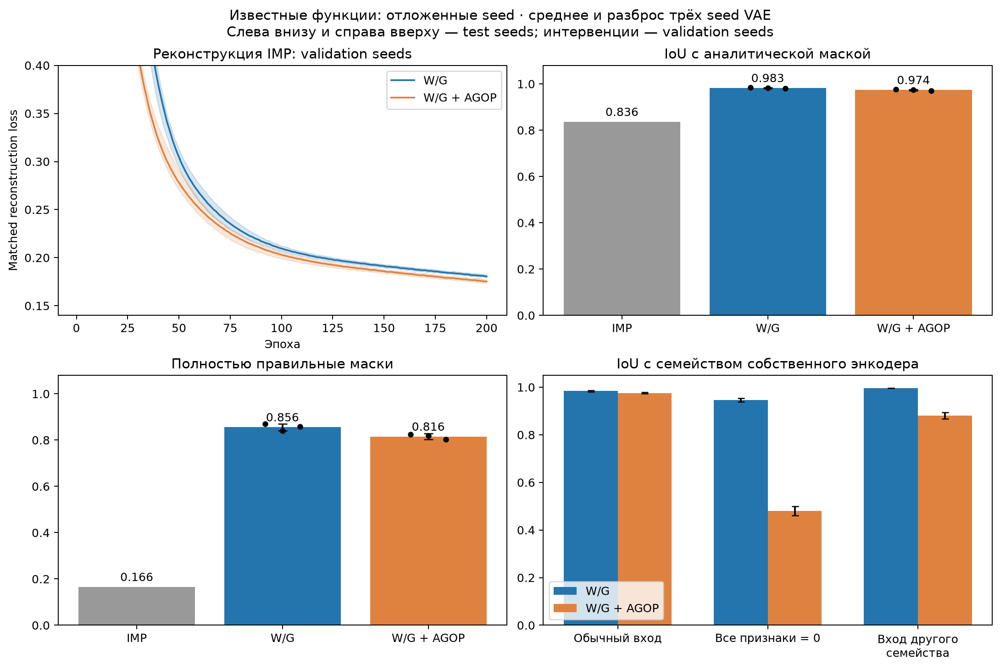
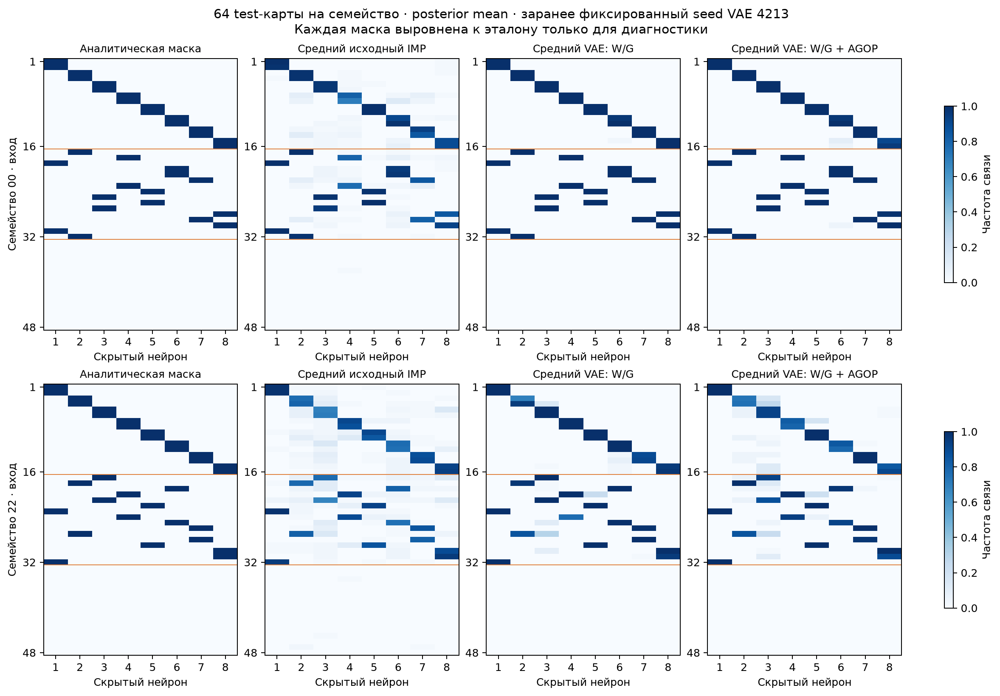
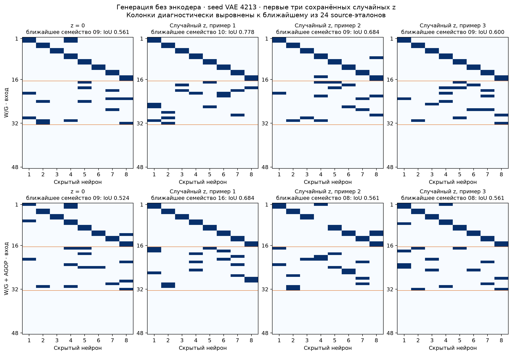

# Проверка NF/VAE, 20 октября 2026

> Архив эксперимента 20 октября. Старые команды и формат W/G+AGOP описаны для истории; актуальный W/G-код и команды — в [overlapping_groups](../../overlapping_groups/README.md). Разовые скрипты удалены.

Все шесть запусков завершены пользователем: W/G и W/G + AGOP с seed
4213, 4214 и 4215. На отложенных инициализациях известных функций
posterior-реконструкция значительно ближе к правильным маскам, чем исходные
IMP. Зависимость декодера от z присутствует. При этом отдельные энкодеры
запоминают свои функции, а большая часть случайных z выдаёт маски,
нарушающие ограничения группировки. Перенос и поиск по z ещё не выполнены.

AGOP улучшает восстановление фактического IMP-target, но ухудшает
восстановление аналитической структуры во всех трёх парных seed.
Поэтому считать его победителем по основной структурной метрике нельзя.

## Протокол и проверка результатов

Архитектура: 96 независимых NF-энкодеров обучающих функций, один общий
декодер, latent dimension 16. В обеих версиях 46 120 576 параметров;
контроль W/G использует такую же боковую ветку с нулевым входом.
Обучение — 9 216 карт, выбор checkpoint — 1 536 validation-карт
известных функций, итоговая оценка — 1 536 test-карт тех же функций.
Восемь новых валидационных и восемь итоговых test-семейств этой проверкой
не использовались.

Сверены банк и его SHA-256, порядок функций, сохранённая версия исходников,
номер выбранного checkpoint. Из выбранных checkpoint заново получены
posterior-реконструкции всех validation- и test-карт. IoU к IMP совпадает
с сохранённым с максимальным отклонением 5,96e-8.
Аналитические маски использовались только для последующей диагностики;
выбранные веса и номера эпох не менялись.

Все шесть моделей прошли 200 эпох, лучшие checkpoint выбраны на эпохах
197–200. Время обучения и заключительной оценки одного запуска —
138–145 секунд; инициализация и загрузка банка происходят до начала
этого таймера. Пик памяти PyTorch: allocated 1,035 ГиБ, reserved 1,223 ГиБ.
Это не суммарная видеопамять процесса с CUDA-контекстом.
Новое обучение или оптимизация z при проверке не запускались;
анализ выполнен как CPU inference сохранённых моделей.

## Восстановление правильной структуры

Ниже — 1 536 test-карт известных функций, среднее по трём seed VAE.
После знака ± указано стандартное отклонение между тремя seed,
а не доверительный интервал по независимым семействам.

| Метрика | Исходные IMP | W/G | W/G + AGOP |
| --- | ---: | ---: | ---: |
| IoU с аналитической маской | 0,8364 | 0,9828 ± 0,0019 | 0,9740 ± 0,0025 |
| IoU переменных связей | 0,8376 | 0,9867 ± 0,0016 | 0,9803 ± 0,0030 |
| Полностью точные маски | 16,60% | 85,59% ± 1,47 п.п. | 81,55% ± 1,21 п.п. |
| Полностью правильных четвёрок из 8 | 5,755 | 7,680 | 7,584 |
| Шумовых связей на маску | 0,0280 | 0 | 0 |
| IoU реконструкции с фактическим IMP-target | — | 0,8404 ± 0,0012 | 0,8449 ± 0,0011 |

Реконструкция здесь означает декодирование среднего posterior,
без случайной выборки z. IoU аналитического эталона считается после
оптимального сопоставления скрытых колонок. Восстанавливается как общая,
так и переменная часть маски. Если усреднить выровненные реконструкции
внутри каждого семейства и взять top-32, эталон восстанавливается точно
во всех 24 семействах при всех трёх seed у обоих методов: 72/72 на метод.
Это диагностическое усреднение с использованием эталона.

| Seed | IoU аналитический, W/G | IoU аналитический, AGOP | IoU к IMP, W/G | IoU к IMP, AGOP |
| --- | ---: | ---: | ---: | ---: |
| 4213 | 0,9850 | 0,9756 | 0,8395 | 0,8445 |
| 4214 | 0,9823 | 0,9752 | 0,8398 | 0,8441 |
| 4215 | 0,9813 | 0,9711 | 0,8418 | 0,8462 |

При AGOP IoU к IMP увеличивается примерно на 0,0045, а IoU к правильной
маске снижается на 0,0089. Наблюдение согласуется с более точным
воспроизведением отклонений отдельных IMP, но эта проверка сама по себе
не устанавливает причину различия. Три seed используют один фиксированный
набор семейств, поэтому это ещё не оценка устойчивости на разных банках.

На следующем рисунке показаны семейства 00 и 22, первое и самое трудное
в прежней проверке IMP. Seed VAE 4213 зафиксирован заранее. В каждом
среднем 64 test-карты: четыре функции по 16 инициализаций. Каждая маска
индивидуально выровнена к эталону только для визуализации.

## Использует ли энкодер входные признаки

У каждой функции собственный энкодер. Его параметры сами могут кодировать
семейство, даже если W/G не содержит полезного сигнала. Для проверки
выполнены фиксированные интервенции на validation-картах известных функций,
без обновления весов.

| Интервенция и метрика | W/G | W/G + AGOP |
| --- | ---: | ---: |
| Все входные признаки заменены нулями: IoU к своему семейству | 0,9454 | 0,4802 |
| Входы другого семейства при прежнем энкодере: IoU к семейству энкодера | 0,9961 | 0,8801 |
| Те же чужие входы: IoU к семейству входной карты | 0,3848 | 0,3795 |
| При чужих входах структура не изменилась, с точностью до колонок | 84,68% | 46,64% |

Чужие входы получены циклическим сдвигом всего набора на четыре функции;
каждая функция получила карты следующего семейства. В версии AGOP
вместе с W/G переставлялась соответствующая AGOP. При занулении только
AGOP и сохранении правильных W/G средний аналитический IoU падает
до 0,6997: эта ветка действительно влияет на предсказание.

У W/G присутствует сильная компонента запоминания структуры в параметрах
отдельного энкодера. Входы не полностью игнорируются: средняя дисперсия
posterior mean внутри функции на test-картах — 0,0498, между средними
разных функций — 0,7366. У AGOP соответственно 0,0740 и 0,7193.
Зануление и чужие входы выходят за распределение конкретного энкодера,
поэтому это диагностические интервенции, а не замена оценки переноса.

Такой механизм допустим в схеме с отдельными энкодерами и сам по себе
не означает ошибку NF или loss. Но высокая реконструкция известных
семейств не доказывает, что появился универсальный распознаватель
структуры по W/G. Основной проверкой общего декодера остаётся поиск
масок новых семейств по z.

## Декодер без энкодера

Проверены сохранённые 512 случайных z и z = 0 каждого запуска.
У W/G получено 499, 505 и 505 различных масок с точностью до перестановок
колонок; у AGOP — 505, 506 и 510. Все случайные маски отличаются от маски
при нулевом z. Значит, схлопывания генератора в одну постоянную маску нет.

Однако разнообразие не равнозначно корректности группировки.
Случайные маски сопоставлены только с 24 обучающими аналитическими
масками, без доступа к новым семействам.

| Метрика случайного z, среднее по seed | W/G | W/G + AGOP |
| --- | ---: | ---: |
| IoU к ближайшему source-семейству | 0,6859 | 0,6606 |
| IoU переменной части при том же сопоставлении | 0,5327 | 0,5229 |
| Точная маска одного из source-семейств | 4,43% | 3,52% |
| Выполнены все ограничения группировки | 4,43% | 3,52% |
| Число точно покрытых source-семейств из 24, диапазон seed | 11–17 | 10–16 |
| IoU маски при z = 0 к ближайшему source-семейству | 0,5486 | 0,4678 |

Полная корректность группировки означает: каждый информативный вход
использован один раз, шумовые не используются, у каждого нейрона
четыре связи, закреплённые пары общих входов сохранены и распределены
по восьми нейронам. Это отдельная проверка ограничений без требования
принадлежать одному из 24 source-семейств. В данной конечной выборке
все прошедшие её маски оказались точными source-масками; новых корректных
группировок среди этих случайных z не встретилось.

Большинство случайных z сохраняет общие связи и отбрасывает шум,
но нарушает переменную группировку. Нулевой z тоже не даёт оптимальной
маски. В отличие от прежнего простого Pattern, здесь есть содержательная
задача выбора z. Иллюстрации используют первые три сохранённых случайных
z при seed 4213, без отбора удачных примеров.

## Следующий эксперимент

Следующий шаг — заморозить эти декодеры и проверить поиск по z
на восьми валидационных семействах. Две функции семейства использовать
для адаптации, две другие — для оценки после фиксации маски.
Сохранить оба варианта входных признаков и три seed, сравнить
Gumbel/RelaxedTopK и evolution при сопоставимом бюджете fitness-оценок,
а также z = 0, случайный z, постоянную частотную маску, IMP и одну
обычную MLP без маски.

Главные результаты переноса — BCE обученной MLP с выбранной маской
и восстановление переменных групп нового семейства. Восемь итоговых
test-семейств оставить до фиксации настроек по validation. Увеличение
числа эпох пока не является необходимым следующим действием:
кривые ещё снижаются к 200-й эпохе, но текущие checkpoint уже позволяют
проверить основной вопрос переноса. Дополнительное обучение этой
проверкой не запускалось.

Данные: [полная диагностика](vae_quality.json),
[сводка по seed](vae_quality_summary.json),
[метрики отдельных карт](vae_quality_cards.csv),
[метрики семейств](vae_quality_families.csv).
Расчёт: `audit_vae.py` (разовый аудит), рисунки:
`plot_vae_quality.py` (разовый построитель).
